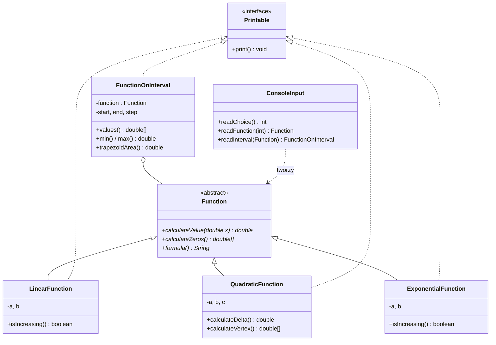

# AOiM Lab 1 — funkcje (klasa abstrakcyjna i interfejs)

> [!skrot] W 30 sekund
> - **Co to:** konsolowy kalkulator funkcji liniowej, kwadratowej i wykładniczej oraz ich przebiegu na przedziale (tabela, min, max, pole metodą trapezów). Piszesz w **Javie 11**.
> - **Klucz:** `interface Printable { void print(); }`, `abstract class Function` z `calculateValue(x)` i `calculateZeros()`, trzy klasy `extends Function implements Printable`, a `FunctionOnInterval` liczy wszystko **tylko przez `calculateValue()`, bez `instanceof`**.
> - **Oddajesz:** program na zajęciach (max 5 pkt, liczy się znajomość kodu i teorii z listy niżej), potem w ciągu 7 dni `LAB1_GRy_NAZWISKO_IMIĘ.zip` na UPeL.

> [!intuicja] Po ludzku
> `Function` to umowa: „każda funkcja umie policzyć wartość w punkcie i swoje miejsca zerowe”. `FunctionOnInterval` nie musi wiedzieć, czy dostała parabolę, czy wykładniczą. Pyta tylko o `calculateValue(x)` w kolejnych punktach. To jest cały sens abstrakcji (polimorfizmu): dopiszesz czwartą funkcję, a przebiegu na przedziale nie zmieniasz ani o linijkę.

## Architektura



Punkt 7 instrukcji („odgranicz interfejs użytkownika od logiki”) realizuje `ConsoleInput`: tylko ona czyta z klawiatury. Klasy funkcji i `FunctionOnInterval` nie znają `Scanner`a, więc tę samą logikę podepniesz w lab 3 pod okienko Swing/JavaFX.

## Matematyka, którą musisz mieć w kodzie
> [!wzor] Trzy funkcje
> | Klasa | Wzór | Wyjątek w konstruktorze | Miejsca zerowe |
> |---|---|---|---|
> | `LinearFunction` | $ax + b$ | $a = 0$ (funkcja stała) | $x_0 = -b/a$ |
> | `QuadraticFunction` | $ax^2 + bx + c$ | $a = 0$ (to nie kwadratowa) | $\Delta = b^2 - 4ac$; $\Delta<0$: brak, $\Delta=0$: $-\frac{b}{2a}$, $\Delta>0$: $\frac{-b \pm \sqrt\Delta}{2a}$ |
> | `ExponentialFunction` | $a^x + b$ | $a \le 0$ lub $a = 1$ | tylko gdy $b < 0$: $x_0 = \frac{\ln(-b)}{\ln a}$ |
>
> Wierzchołek paraboli: $p = -\frac{b}{2a}$, $q = -\frac{\Delta}{4a}$.

> [!wzor] Metoda trapezów (pole „ze znakiem”)
> $$P \approx \sum_{i=0}^{n-1} \frac{f(x_i) + f(x_{i+1})}{2}\,h, \qquad x_i = x_0 + i h$$
> To jest przybliżenie **całki oznaczonej**, więc części pod osią OX odejmują się. Dla $f(x) = 2x - 3$ na $[0, 3]$ wynik to $0$, chociaż „geometrycznie” pole wynosi $2{,}25$. Więcej: [[Całkowanie numeryczne i kwadratury Gaussa]].

## Jak to zrobić — krok po kroku
1. Projekt w IntelliJ (Java 11), pakiet np. `lab1`. **ALT+INSERT** generuje konstruktory, gettery i `toString`.
2. `Printable` i `abstract class Function` z metodami abstrakcyjnymi.
3. Trzy klasy funkcji: pola `private final`, konstruktor **waliduje i rzuca `IllegalArgumentException`**, `print()` wypisuje wzór, współczynniki i miejsca zerowe (kwadratowa także deltę i wierzchołek).
4. `FunctionOnInterval`: walidacja (`function != null`, `start < end`, `0 < step ≤ end − start`), tabela wartości, min, max, trapezy.
5. `ConsoleInput` + `Main`: pętla `while`, `switch` po wyborze, `try/catch` wokół tworzenia obiektów, żeby zły współczynnik nie zabijał programu.
6. Sprawdź na przykładzie z instrukcji (niżej) i na przypadkach brzegowych: $a = 0$, $\Delta < 0$, $b \ge 0$ w wykładniczej, krok większy niż przedział.

## Przykład
> [!przyklad] Sesja z instrukcji: $x^2 - 4x + 3$ na $[0, 4]$, krok 1
> ```text
> 1 – Liniowa  2 – Kwadratowa  3 – Wykładnicza  0 – Wyjście
> > 2
> a: 1   b: -4   c: 3
> Początek przedziału: 0   Koniec przedziału: 4   Krok: 1
> --- f(x) = 1.00x^2 - 4.00x + 3.00
> Delta: 4.00, wierzchołek: (2.00, -1.00)
> Miejsca zerowe: 1.00, 3.00
> --- Przebieg na [0.00, 4.00], krok 1.00
> x:      0.00   1.00   2.00   3.00   4.00
> f(x):   3.00   0.00  -1.00   0.00   3.00
> Min: -1.00, max: 3.00
> Pole (metoda trapezów): 2.00
> ```
> Trapezy ręcznie: $\frac{3+0}{2} + \frac{0-1}{2} + \frac{-1+0}{2} + \frac{0+3}{2} = 1{,}5 - 0{,}5 - 0{,}5 + 1{,}5 = 2$. Dokładnie $\int_0^4 (x^2 - 4x + 3)\,dx = \frac{4}{3} \approx 1{,}33$. Krok 1 jest gruby, stąd różnica.

> [!przyklad]- Więcej przypadków testowych (sprawdzone na rozwiązaniu wzorcowym)
> | wejście | wynik |
> |---|---|
> | wykładnicza $a=2$, $b=-8$, $[-1, 4]$, krok 1 | zero $x_0 = 3$; f: −7,5 −7 −6 −4 0 8; min −7,5, max 8; trapezy −16,75 |
> | liniowa $a=2$, $b=-3$, $[0, 3]$, krok 0,5 | zero 1,5; trapezy 0,00 (części się znoszą) |
> | kwadratowa $1, 2, 5$, $[-2, 2]$, krok 0,5 | $\Delta = -16$, wierzchołek $(-1, 4)$, brak zer; min 4, max 13; trapezy 25,50 (dokładnie 25,33) |
> | wykładnicza $a = 1$ | wyjątek „Podstawa a musi spełniać a > 0 i a ≠ 1” |
> | przedział $[3, 1]$ | wyjątek „Początek przedziału musi być mniejszy od końca” |

## Rozwiązanie wzorcowe
Pełny kod: `Kod/aoim/lab1/src/lab1/*.java` (8 plików, kompiluje się `javac --release 11`). **Najpierw napisz swoją wersję.** Na zajęciach prowadzący prosi o zmianę na żywo, a za niesamodzielną pracę daje 0 pkt.

> [!kod]- Najważniejsze fragmenty
> ```java
> public abstract class Function {
>     protected static final double EPS = 1e-9;
>     public abstract double calculateValue(double x);
>     public abstract double[] calculateZeros();   // pusta tablica, gdy brak
>     public abstract String formula();
> }
>
> public class QuadraticFunction extends Function implements Printable {
>     private final double a, b, c;
>     public QuadraticFunction(double a, double b, double c) {
>         if (Math.abs(a) < EPS)
>             throw new IllegalArgumentException("Współczynnik a nie może być równy 0");
>         this.a = a; this.b = b; this.c = c;
>     }
>     @Override public double calculateValue(double x) { return (a * x + b) * x + c; } // Horner
>     public double calculateDelta() { return b * b - 4 * a * c; }
>     @Override public double[] calculateZeros() {
>         double d = calculateDelta();
>         if (Math.abs(d) < EPS) return new double[] { -b / (2 * a) };
>         if (d < 0) return new double[0];
>         double s = Math.sqrt(d), x1 = (-b - s) / (2 * a), x2 = (-b + s) / (2 * a);
>         return x1 < x2 ? new double[] { x1, x2 } : new double[] { x2, x1 };
>     }
>     // formula(), calculateVertex(), print() — w pliku
> }
>
> // FunctionOnInterval: tylko calculateValue(), żadnego instanceof
> public double trapezoidArea() {
>     double[] xs = arguments(), ys = values();
>     double sum = 0;
>     for (int i = 0; i + 1 < xs.length; i++)
>         sum += (ys[i] + ys[i + 1]) / 2 * (xs[i + 1] - xs[i]);
>     return sum;
> }
> public double[] arguments() {
>     int n = (int) Math.floor((end - start) / step + 1e-9) + 1;  // tolerancja na zaokrąglenia
>     double[] xs = new double[n];
>     for (int i = 0; i < n; i++) xs[i] = start + i * step;       // mnożenie, nie x += step
>     return xs;
> }
> ```

## Typowe błędy
> [!blad] `Scanner` i przecinek dziesiętny
> Na polskim systemie `scanner.nextDouble()` czyta **`0,5`**, a `0.5` rzuca `InputMismatchException`. Złapałem to przy testach rozwiązania. Rozwiązanie: `new Scanner(System.in).useLocale(Locale.US)`. Przy wypisywaniu analogicznie: `String.format(Locale.US, "%.2f", x)`, inaczej dostaniesz `2,00`.

> [!blad] Inne pułapki
> - Porównanie `delta == 0` na `double`: używaj tolerancji, `Math.abs(delta) < 1e-9` (wskazówka z instrukcji). Dlaczego: [[Arytmetyka zmiennoprzecinkowa i błędy numeryczne]].
> - `x += step` w pętli kumuluje błąd i np. dla kroku 0,1 gubi ostatni punkt przedziału. Licz `x = start + i * step`.
> - `instanceof` w `FunctionOnInterval` łamie warunek zadania. Wszystko, czego potrzebujesz, daje `calculateValue()`.
> - `catch (Exception e)` bez komunikatu, albo wyjątek rzucony w `main` bez obsługi, kończy program przy pierwszym złym współczynniku.
> - Nazwy niezgodne z Google Java Style: klasy `UpperCamelCase`, metody i zmienne `lowerCamelCase`, stałe `UPPER_SNAKE_CASE`.
> - Zła nazwa archiwum albo spakowany katalog `out/` lub `.idea/`: zgodnie z zasadami tylko źródła.

## Na zajęcia i egzamin
> [!zajecia]
> - **Teoria do labu 1** (obowiązuje też na kolejnych): JDK/JRE/JVM, kompilacja do bajtkodu kontra do kodu maszynowego, pakiety, budowa klasy, konstruktor, dostępność składowych, `main`, przeciążanie metod, „domyślne argumenty” (w Javie ich nie ma), typy prymitywne i precyzja `double`, interfejs, klasa abstrakcyjna, konwencje nazewnicze. Odpowiedzi: [[Java dla programisty C++ (JDK, JRE, JVM, typy)]] i [[Klasa abstrakcyjna i interfejs (Java)]].
> - **Typowe prośby prowadzącego na żywo:** dodaj czwartą funkcję (np. `SineFunction`), zmień całkowanie na metodę prostokątów, policz wartość średnią na przedziale, dodaj opcję w menu, rzuć własny wyjątek.
> - Łączy się z: [[Całkowanie numeryczne i kwadratury Gaussa]] (trapezy), [[Diagram klas UML]].

## Zadania
> [!zadanie] Zadanie 1
> Dopisz `SineFunction` ($A\sin(\omega x)$). Co musisz zmienić w `FunctionOnInterval`?
> > [!odpowiedz]- Odpowiedź
> > Nic. Nowa klasa dziedziczy po `Function`, implementuje `Printable`, a `FunctionOnInterval` woła tylko `calculateValue()`. Zmienia się jedynie menu w `ConsoleInput`. Miejsc zerowych jest nieskończenie wiele, więc `calculateZeros()` może zwrócić zera z zadanego przedziału albo udokumentować ograniczenie.

> [!zadanie] Zadanie 2
> Dlaczego `Printable` jest interfejsem, a `Function` klasą abstrakcyjną, a nie odwrotnie?
> > [!odpowiedz]- Odpowiedź
> > `Printable` to zdolność, którą może mieć wiele niepowiązanych klas (funkcja, przebieg na przedziale, później np. raport), a klasa może implementować wiele interfejsów. `Function` to wspólny „rodzaj” obiektów, który może mieć wspólny kod i pola (stała `EPS`, metody pomocnicze do formatowania), a dziedziczyć można tylko po jednej klasie.

> [!zadanie] Zadanie 3
> Policz ręcznie trapezy dla $2^x - 8$ na $[-1, 4]$ z krokiem 1.
> > [!odpowiedz]- Odpowiedź
> > Wartości: $-7{,}5;\ -7;\ -6;\ -4;\ 0;\ 8$. Suma: $\frac{-14{,}5}{2} + \frac{-13}{2} + \frac{-10}{2} + \frac{-4}{2} + \frac{8}{2} = -7{,}25 - 6{,}5 - 5 - 2 + 4 = -16{,}75$.

## Fiszki #fiszki/aoim
Jakie metody abstrakcyjne ma `Function` w lab 1?::`double calculateValue(double x)` i `double[] calculateZeros()`
Czego nie wolno użyć w `FunctionOnInterval`?::`instanceof`; wszystko przez `calculateValue()`
Kiedy `ExponentialFunction` rzuca wyjątek?::Gdy $a \le 0$ lub $a = 1$
Miejsce zerowe $a^x + b$?::Tylko dla $b < 0$: $x = \ln(-b)/\ln a$
Jak nazwać archiwum z labem?::`LABx_GRy_NAZWISKO_IMIĘ.zip`, tylko źródła
Dlaczego `Scanner` nie czyta `0.5` na polskim Windowsie/Linuksie?::Domyślne locale oczekuje przecinka; `useLocale(Locale.US)`

## Moje notatki
> [!ja] Tu piszesz ty — Albert tej sekcji nie rusza.

## Źródła
- Instrukcja: [[Lab 1 — klasa abstrakcyjna i interfejs (funkcje).pdf]] (S. Gajoch, UPeL PAOiM-26).
- Zasady oceniania: [[Zajęcia organizacyjne — zasady (Gajoch).pdf]].
- [Google Java Style Guide](https://google.github.io/styleguide/javaguide.html).
- Rozwiązanie wzorcowe: `Kod/aoim/lab1/`.
