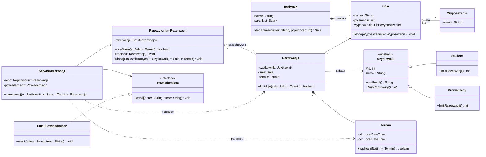

# Diagram klas UML

> [!skrot] W 30 sekund
> - **Co to:** statyczna struktura systemu — klasy, interfejsy, ich pola i metody oraz **związki** między nimi.
> - **Klucz:** romb pusty = agregacja, romb pełny = kompozycja (część żyje i umiera z całością), trójkąt + linia ciągła = dziedziczenie, trójkąt + przerywana = implementacja interfejsu, przerywana strzałka = zależność.
> - **Kiedy:** etap 2 projektu na labach i podstawa każdego następnego — każdy wzorzec GoF jest opisany właśnie diagramem klas.

> [!intuicja] Po ludzku
> To „plan budynku” programu: jakie są pomieszczenia (klasy), co w nich stoi (pola), co się w nich robi (metody) i które drzwi prowadzą dokąd (związki). Każdy element przekłada się prawie 1:1 na kod Javy — jeśli umiesz napisać klasę z polem `List<Sala>`, umiesz narysować asocjację z krotnością `*`.

## Definicja i wzory
> [!definicja] Klasa i interfejs
> Prostokąt z trzema przegródkami: **nazwa** | **atrybuty** `widoczność nazwa: Typ` | **operacje** `widoczność nazwa(param: Typ): Typ`.
> - Widoczność: `+` public, `-` private, `#` protected, `~` package.
> - **Statyczne** — podkreślone (Mermaid: `$` na końcu).
> - **Abstrakcyjne** — nazwa kursywą albo `{abstract}` (Mermaid: `<<abstract>>`, metoda abstrakcyjna: `*` na końcu).
> - **Interfejs** — stereotyp `«interface»` nad nazwą (albo „lizak”, kółko na kresce).

> [!wzor] Związki → kod Java
> | związek | rysunek | znaczenie | w Javie |
> |---|---|---|---|
> | asocjacja | linia ciągła (ze strzałką = skierowana) | obiekty „znają się” trwale | pole: `Sala sala;` lub `List<Rezerwacja> rezerwacje;` |
> | agregacja | linia + **pusty romb** przy całości | całość–część, część może istnieć sama / być współdzielona | lista przekazanych z zewnątrz obiektów: `dodaj(Wyposazenie w)` |
> | kompozycja | linia + **pełny romb** przy całości | część **nie istnieje bez całości**, cykl życia wspólny, część ma jednego właściciela | całość **tworzy** część w konstruktorze / metodzie, nie wypuszcza referencji |
> | dziedziczenie | linia ciągła + **pusty trójkąt** do rodzica | „jest rodzajem” | `class Student extends Uzytkownik` |
> | realizacja | linia **przerywana** + pusty trójkąt do interfejsu | implementuje kontrakt | `class EmailPowiadamiacz implements Powiadamiacz` |
> | zależność | **przerywana strzałka** | chwilowe użycie (parametr, zmienna lokalna, wywołanie statyczne) | `void zarezerwuj(Termin t)` — brak pola |
>
> **Krotności** na końcach asocjacji: `1`, `0..1`, `*` (= `0..*`), `1..*`, `2..4`. Czytasz: „jeden Użytkownik ma `0..*` Rezerwacji” — krotność stoi **przy klasie, której dotyczy liczba**.

> [!wazne] Mermaid — ściągawka składni (Obsidian renderuje `classDiagram`)
> `A <|-- B` dziedziczenie (B extends A) · `A *-- B` kompozycja (A całość) · `A o-- B` agregacja · `A --> B` asocjacja skierowana · `A -- B` asocjacja · `A ..> B` zależność · `B ..|> A` realizacja · krotności w cudzysłowach: `A "1" *-- "1..*" B : etykieta` · typy generyczne: `List~Sala~`.

## Jak to zrobić — krok po kroku
1. **Rzeczowniki ze scenariuszy** [[Diagram przypadków użycia UML|przypadków użycia]] → kandydaci na klasy (Sala, Rezerwacja, Użytkownik, Termin). Odrzuć te, które są tylko atrybutem (np. „numer sali”).
2. **Czasowniki** → kandydaci na operacje (zarezerwuj, anuluj, sprawdź dostępność). Przypisz je klasie, która ma potrzebne dane (zasada GRASP *Information Expert*).
3. Dodaj **atrybuty** z typami i widocznością (domyślnie `-`, dostęp przez metody).
4. **Związki:** kto trzyma kogo w polu → asocjacja; czy część żyje bez całości → agregacja vs kompozycja; „jest rodzajem” → dziedziczenie; wymienna implementacja → interfejs + realizacja.
5. **Krotności** na każdym końcu asocjacji.
6. Sprawdź z [[Diagram sekwencji UML|diagramem sekwencji]]: każdy komunikat na sekwencji musi być operacją klasy odbiorcy.

## Przykład
System rezerwacji sal z [[Diagram przypadków użycia UML]] — tylko klasy potrzebne do „Zarezerwuj salę”.



Jak czytać kluczowe decyzje:
- **Budynek ◆— Sala (kompozycja):** sala nie istnieje bez budynku; to `Budynek.dodajSale(...)` **tworzy** obiekt `Sala`. Usunięcie budynku = usunięcie sal.
- **Sala ◇— Wyposażenie (agregacja):** projektor można przenieść do innej sali, istnieje niezależnie; sala dostaje gotowy obiekt.
- **Uzytkownik `{abstract}`:** `limitRezerwacji()` jest abstrakcyjna — Student i Prowadzący mają inne limity (polimorfizm).
- **Powiadamiacz `«interface»`:** serwis zależy od abstrakcji, nie od e-maila — później łatwo wpiąć SMS (to już zapowiedź wzorców i zasady DIP z SOLID).
- **SerwisRezerwacji ..> Termin:** termin przychodzi jako parametr, serwis go nie przechowuje → zależność, nie asocjacja.

> [!kod] Ten sam fragment w Javie
> ```java
> abstract class Uzytkownik {
>     protected int id;
>     protected String email;
>     public String getEmail() { return email; }
>     public abstract int limitRezerwacji();
> }
> class Student extends Uzytkownik { public int limitRezerwacji() { return 2; } }
>
> class Budynek {                                   // kompozycja
>     private final List<Sala> sale = new ArrayList<>();
>     public Sala dodajSale(String numer, int pojemnosc) {
>         Sala s = new Sala(numer, pojemnosc);      // całość TWORZY część
>         sale.add(s);
>         return s;
>     }
> }
> class Sala {                                      // agregacja
>     private final List<Wyposazenie> wyposazenie = new ArrayList<>();
>     public void dodajWyposazenie(Wyposazenie w) { wyposazenie.add(w); } // część z zewnątrz
> }
>
> interface Powiadamiacz { void wyslij(String adres, String tresc); }
> class EmailPowiadamiacz implements Powiadamiacz { /* ... */ }
>
> class SerwisRezerwacji {
>     private final RepozytoriumRezerwacji repo;    // asocjacja skierowana
>     private final Powiadamiacz powiadamiacz;      // asocjacja do interfejsu
>     public Rezerwacja zarezerwuj(Uzytkownik u, Sala s, Termin t) { /* ... */ } // Termin = zależność
> }
> ```

> [!przyklad]- Przykład 2 — ten sam diagram w PlantUML
> ```plantuml
> @startuml
> abstract class Uzytkownik {
>   # id : int
>   # email : String
>   + getEmail() : String
>   + {abstract} limitRezerwacji() : int
> }
> interface Powiadamiacz {
>   + wyslij(adres : String, tresc : String) : void
> }
> class Budynek
> class Sala
> class Wyposazenie
> Uzytkownik <|-- Student
> Uzytkownik <|-- Prowadzacy
> Budynek "1" *-- "1..*" Sala
> Sala "0..1" o-- "*" Wyposazenie
> Powiadamiacz <|.. EmailPowiadamiacz
> SerwisRezerwacji --> Powiadamiacz
> SerwisRezerwacji ..> Termin
> @enduml
> ```
> W PlantUML statyczne oznaczasz `{static}`, abstrakcyjne `{abstract}`.

## Typowe błędy
> [!blad] Romb po złej stronie
> Romb (pusty lub pełny) zawsze stoi **przy całości**, nie przy części. W Mermaid `Budynek *-- Sala` — całość po lewej, przy symbolu `*`.

> [!blad] Kompozycja „bo tak ładniej”
> Kompozycja wymaga, by część miała **jednego właściciela** i ginęła z nim. Jeśli obiekt przychodzi z zewnątrz i jest współdzielony — to agregacja albo zwykła asocjacja. W razie wątpliwości: zwykła asocjacja (Fowler wprost radzi oszczędnie używać agregacji).

> [!blad] Pole i asocjacja naraz bez sensu / brak krotności
> Albo atrybut `-sala: Sala`, albo linia do `Sala` — na kolokwium rysuj linię z krotnościami (w Mermaid powyżej dla czytelności są oba, linia jest ważniejsza). Brak krotności na asocjacji = diagram niedokończony.

> [!blad] Mylenie realizacji z dziedziczeniem
> `implements` → linia **przerywana** z trójkątem; `extends` → **ciągła**. Interfejs dziedziczący z interfejsu (`extends`) to też generalizacja (ciągła).

## Na zajęcia i egzamin
> [!zajecia]
> - **Lab 1:** diagram klas dla tematu zespołu, spójny z przypadkami użycia (rzeczowniki → klasy) i z sekwencjami (komunikaty → operacje). Już teraz zostaw miejsce na interfejsy — na kolejnych labach wzorce dokłada się właśnie na diagramie klas (np. Strategy = interfejs + kilka realizacji, Factory Method = abstrakcyjna metoda tworząca).
> - **Kolokwium (prawdopodobnie):** rozpoznaj związek z rysunku i zapisz go w Javie/C++; agregacja vs kompozycja na przykładzie; narysuj diagram dla podanego kodu; znaczenie `+ - # ~`, krotności; co to klasa abstrakcyjna vs interfejs.
> - **Temat projektu:** wybierz taki, gdzie naturalnie są hierarchie (różne rodzaje użytkowników/produktów/rezerwacji) i wymienne zachowania (cenniki, powiadomienia) — inaczej później nie będzie gdzie wstawić wzorców.
> - Łączy się z: [[Diagram przypadków użycia UML]], [[Diagram sekwencji UML]].

## Zadania
> [!zadanie] Zadanie 1
> Zapisz w Mermaid: `Zamowienie` składa się z 1..* `PozycjaZamowienia`, które powstają razem z zamówieniem i giną z nim; `Klient` ma 0..* zamówień.
> > [!odpowiedz]- Odpowiedź
> > `Zamowienie "1" *-- "1..*" PozycjaZamowienia` oraz `Klient "1" --> "0..*" Zamowienie`. Kompozycja, bo pozycja nie istnieje bez zamówienia.

> [!zadanie] Zadanie 2
> Jaki związek opisuje kod: `class Raport { void drukuj(Drukarka d) { d.print(this); } }`?
> > [!odpowiedz]- Odpowiedź
> > Zależność `Raport ..> Drukarka` — Drukarka jest tylko parametrem metody, nie polem.

> [!zadanie] Zadanie 3
> `Samochod` ma 4 `Kolo`, które można przełożyć do innego auta, i jeden `Silnik` z numerem VIN tworzony w fabryce razem z autem. Jakie romby?
> > [!odpowiedz]- Odpowiedź
> > `Samochod "0..1" o-- "4" Kolo` (agregacja — koła istnieją niezależnie). `Samochod "1" *-- "1" Silnik` — kompozycja, jeśli w modelu silnik nie istnieje bez auta. To decyzja modelu; uzasadnij ją cyklem życia.

> [!zadanie] Zadanie 4
> Jak w UML i w Mermaid zaznaczyć metodę statyczną `+utworz(): Sala` i abstrakcyjną `+oblicz(): double`?
> > [!odpowiedz]- Odpowiedź
> > UML: statyczna podkreślona, abstrakcyjna kursywą lub `{abstract}`. Mermaid: `+utworz()$ Sala`, `+oblicz()* double`.

## Fiszki #fiszki/wzorce
Co znaczą symbole widoczności + - # ~ w UML?::+ public, - private, # protected, ~ package.
Jak oznaczyć element statyczny i abstrakcyjny na diagramie klas?::Statyczny podkreślony; abstrakcyjny kursywą lub {abstract}. W Mermaid: $ i * na końcu.
Agregacja — rysunek i znaczenie?::Pusty romb przy całości; część może istnieć bez całości i być współdzielona.
Kompozycja — rysunek i znaczenie?::Pełny romb przy całości; część ma jednego właściciela i wspólny z nim cykl życia.
Jak kompozycja wygląda w Javie?::Całość tworzy część (new w konstruktorze/metodzie) i trzyma ją w prywatnym polu, nie oddając na zewnątrz.
Dziedziczenie vs realizacja na diagramie klas?::Oba: pusty trójkąt do rodzica/interfejsu; dziedziczenie linia ciągła, realizacja przerywana.
Co oznacza zależność (przerywana strzałka)?::Chwilowe użycie: parametr, zmienna lokalna, wywołanie statyczne — brak pola.
Gdzie stawia się krotność asocjacji?::Przy klasie, której liczba dotyczy: Uzytkownik "1" --> "0..*" Rezerwacja = użytkownik ma 0..* rezerwacji.
Składnia relacji w Mermaid classDiagram?::<|-- dziedziczenie, *-- kompozycja, o-- agregacja, --> asocjacja, ..> zależność, ..|> realizacja.
Skąd brać klasy i operacje do diagramu klas?::Z rzeczowników (klasy) i czasowników (operacje) w scenariuszach przypadków użycia.

## Moje notatki
> [!ja] Tu piszesz ty — Albert tej sekcji nie rusza.

## Źródła
- Object Management Group, *Unified Modeling Language (UML) Specification, Version 2.5.1*, rozdz. 9 „Classification”, 11 „Structured Classifiers” — https://www.omg.org/spec/UML/2.5.1
- M. Fowler, *UML Distilled* (wyd. pol. „UML w kropelce”), rozdziały o diagramach klas.
- Dokumentacja Mermaid — Class diagrams: https://mermaid.js.org/syntax/classDiagram.html
- Dokumentacja PlantUML — Class Diagram: https://plantuml.com/class-diagram
- E. Gamma, R. Helm, R. Johnson, J. Vlissides, *Wzorce projektowe* (GoF) — notacja diagramów klas używana przy każdym wzorcu; E. Freeman, E. Robson, *Wzorce projektowe. Rusz głową!*; A. Shalloway, J. Trott, *Projektowanie zorientowane obiektowo. Wzorce projektowe*.
