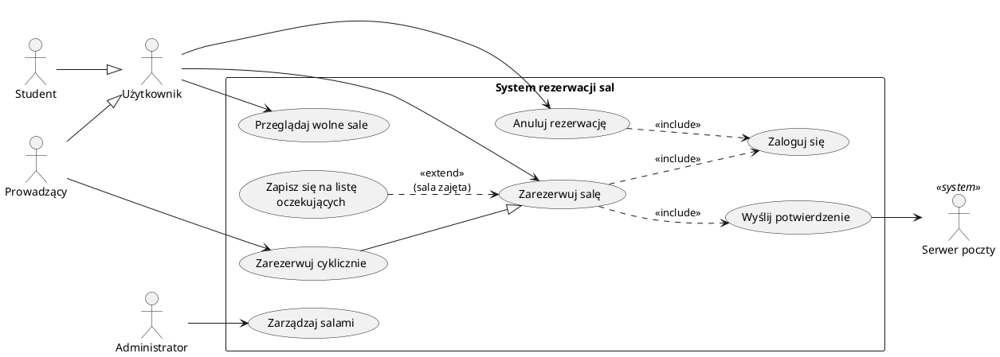

# Diagram przypadków użycia UML

> [!skrot] W 30 sekund
> - **Co to:** diagram, który pokazuje **kto** (aktorzy) **co** może zrobić z systemem (przypadki użycia) — bez słowa o tym, jak to działa w środku.
> - **Klucz:** aktor = rola spoza systemu; przypadek użycia = cel aktora, nazwany „czasownik + rzeczownik”; `«include»` = zawsze, `«extend»` = czasem.
> - **Kiedy:** pierwszy krok analizy — tu zaczyna się projekt na labach z Wzorców (etap 1: analiza funkcjonalna).

> [!intuicja] Po ludzku
> Menu restauracji: widzisz, co i kto może zamówić, ale nie kuchnię. Każda pozycja daje klientowi coś wartościowego — „zamów obiad” tak, „podgrzej patelnię” nie.

## Definicja i wzory
> [!definicja] Elementy (UML 2.5)
> - **Aktor** — rola pełniona wobec systemu przez **człowieka albo system zewnętrzny** (np. bramka płatności, serwer poczty). Ludzik z podpisem; system zewnętrzny bywa też prostokątem `«actor»`. Jedna osoba może grać kilka ról.
> - **Przypadek użycia (use case)** — elipsa; spójna funkcja dająca aktorowi **mierzalny rezultat**. Nazwa: **czasownik + rzeczownik** („Zarezerwuj salę”, „Anuluj rezerwację”).
> - **Granica systemu** — prostokąt z nazwą systemu; przypadki w środku, aktorzy na zewnątrz.
> - **Asocjacja** — zwykła linia aktor–przypadek: aktor uczestniczy w przypadku (inicjuje go albo jest w nim użyty).

> [!wzor] Związki między przypadkami i aktorami
> | związek | zapis | kiedy | kierunek strzałki |
> |---|---|---|---|
> | `«include»` | przerywana strzałka | włączany krok wykonuje się **zawsze** (wspólny fragment kilku przypadków) | **od bazowego do włączanego** |
> | `«extend»` | przerywana strzałka | rozszerzenie dzieje się **warunkowo**, w **punkcie rozszerzenia** (extension point) przypadku bazowego | **od rozszerzającego do bazowego** |
> | generalizacja przypadków | ciągła linia, pusty trójkąt | przypadek szczegółowy jest wariantem ogólnego | od szczegółowego do ogólnego |
> | generalizacja aktorów | ciągła linia, pusty trójkąt | aktor szczegółowy dziedziczy wszystkie przypadki ogólnego i ma swoje | od szczegółowego do ogólnego |
>
> Mnemotechnika: strzałka zawsze wskazuje tego, **kto o kim wie**. Bazowy „wie”, że włącza logowanie; rozszerzenie „wie”, do czego się dokleja — bazowy o nim nie wie.

> [!definicja] Scenariusz przypadku użycia
> Diagram to tylko spis; treść jest w **opisie tekstowym**: nazwa, aktor główny, warunki początkowe, **scenariusz główny** (ponumerowane kroki „aktor robi → system odpowiada”), **scenariusze alternatywne** (np. „3a. Sala zajęta → …”), warunki końcowe. To z kroków scenariusza powstaje potem [[Diagram sekwencji UML|diagram sekwencji]], a z rzeczowników — [[Diagram klas UML|diagram klas]].

## Jak to zrobić — krok po kroku
1. **Aktorzy:** role (nie osoby) i systemy zewnętrzne.
2. **Cele każdego aktora** → przypadki (czasownik + rzeczownik). Odsiej kroki udające cele („Kliknij przycisk”).
3. Wspólne fragmenty → `«include»`; warunkowe ścieżki → `«extend»` z punktem rozszerzenia.
4. Generalizacja tylko przy prawdziwym „jest rodzajem”.
5. Granica systemu + asocjacje aktorów.
6. Dla 2–3 kluczowych przypadków: **scenariusz główny i alternatywne** (przydadzą się na etapie sekwencji).

## Przykład
**System rezerwacji sal** (np. na wydziale). Ten sam system ciągnie się przez [[Diagram klas UML]] i [[Diagram sekwencji UML]].

- Aktorzy: **Użytkownik** (ogólny), **Student** i **Prowadzący** (specjalizacje), **Administrator**, **Serwer poczty** (system zewnętrzny).
- Przypadki: Przeglądaj wolne sale, Zarezerwuj salę, Anuluj rezerwację, Zaloguj się, Zapisz się na listę oczekujących, Zarezerwuj cyklicznie (tylko Prowadzący), Zarządzaj salami (Admin), Wyślij potwierdzenie.
- `Zarezerwuj salę` **«include»** `Zaloguj się` i `Wyślij potwierdzenie` (zawsze).
- `Zapisz się na listę oczekujących` **«extend»** `Zarezerwuj salę` w punkcie rozszerzenia „sala zajęta”.
- `Zarezerwuj cyklicznie` → generalizacja `Zarezerwuj salę` (wariant: co tydzień przez semestr).

Kod PlantUML (wklej na plantuml.com albo do IntelliJ z wtyczką PlantUML):

**Scenariusz „Zarezerwuj salę”** (aktor główny: Użytkownik; warunek początkowy: zalogowany):
1. Użytkownik wybiera salę i termin.
2. System sprawdza, czy sala jest wolna w tym terminie.
3. System tworzy rezerwację i zapisuje ją.
4. System wysyła potwierdzenie e-mailem (przez Serwer poczty).
5. System pokazuje komunikat o sukcesie.

Alternatywne: **2a.** Sala zajęta → system proponuje listę oczekujących (punkt rozszerzenia) → przy zgodzie zapisuje użytkownika; koniec. **3a.** Użytkownik przekroczył limit rezerwacji → komunikat o błędzie; koniec.

> [!przyklad]- Przykład 2 — wypożyczalnia rowerów miejskich (w skrócie)
> Aktorzy: Klient, Serwisant, Bramka płatności (zewn.). Wypożycz rower «include» Zweryfikuj płatność; Zgłoś usterkę «extend» Zwróć rower (punkt: „rower uszkodzony”); Napraw rower (Serwisant).

## Typowe błędy
> [!blad] Odwrócone strzałki include/extend
> `«include»`: od bazowego **do** włączanego. `«extend»`: od rozszerzenia **do** bazowego. Najczęstszy błąd na kolokwium.

> [!blad] Diagram jako schemat blokowy
> Przypadki połączone w kolejności „Zaloguj → Wybierz salę → Zapłać” to algorytm, nie use case. Kolejność kroków jest w scenariuszu albo na diagramie aktywności/sekwencji.

> [!blad] Za drobne przypadki i system jako aktor
> „Kliknij Zapisz” to nie cel. Sam system, który projektujesz, nie jest aktorem; baza danych **twojego** systemu też nie (jest w środku granicy).

## Na zajęcia i egzamin
> [!zajecia]
> - **Lab 1:** zespół wybiera temat i oddaje wstępny projekt — diagram przypadków użycia + opis scenariuszy, potem [[Diagram klas UML|klas]] i [[Diagram sekwencji UML|sekwencji]]. Miej gotowe 2–3 tematy i umiej je obronić.
> - **Kolokwium (prawdopodobnie):** różnica include/extend z kierunkiem strzałek; co może być aktorem; narysuj diagram dla krótkiego opisu słownego; popraw błędny diagram; czym jest punkt rozszerzenia i scenariusz alternatywny.
> - **Dobór tematu pod wzorce** — potrzebne: kilka rodzajów tworzonych obiektów (kreacyjne), systemy zewnętrzne / struktury drzewiaste (strukturalne), wymienne zachowania i zdarzenia (czynnościowe):
>   1. **Rezerwacja sal/biletów** — Factory Method, Builder rezerwacji cyklicznej; Adapter poczty/kalendarza, Decorator dodatków; Observer powiadomień, Strategy cennika, State rezerwacji.
>   2. **Sklep / restauracja z zamówieniami** — Abstract Factory; Composite zestawów, Facade płatności; Strategy rabatów, Command z cofaniem, State zamówienia.
>   3. **Gra turowa** — Prototype jednostek; Composite armii; Observer zdarzeń, Memento zapisu.
> - Unikaj czystego CRUD-a („lista kontaktów”) — nie będzie gdzie wpleść czynnościowych.
> - Łączy się z: [[Diagram klas UML]], [[Diagram sekwencji UML]], [[AGH Wzorce projektowe]].

## Zadania
> [!zadanie] Zadanie 1
> W systemie bankowości: „Wykonaj przelew” zawsze wymaga „Autoryzuj SMS-em”, a przy kwocie > 10 000 zł dodatkowo „Potwierdź telefonicznie”. Jakie związki i w którą stronę strzałki?
> > [!odpowiedz]- Odpowiedź
> > `Wykonaj przelew ..> Autoryzuj SMS-em : «include»` (od bazowego). `Potwierdź telefonicznie ..> Wykonaj przelew : «extend»` (od rozszerzenia), punkt rozszerzenia „kwota > 10 000 zł”.

> [!zadanie] Zadanie 2
> Czy „Baza danych MySQL” i „System płatności PayU” to aktorzy w systemie sklepu?
> > [!odpowiedz]- Odpowiedź
> > PayU — tak, to system zewnętrzny, z którym sklep się komunikuje. Własna baza danych — nie, to część implementacji wewnątrz granicy systemu.

> [!zadanie] Zadanie 3
> Prowadzący może wszystko co Student, plus rezerwować cyklicznie. Jak to narysować bez dublowania linii?
> > [!odpowiedz]- Odpowiedź
> > Generalizacja aktorów: Prowadzący → (pusty trójkąt) → Student albo obaj → wspólny Użytkownik. Prowadzący dziedziczy asocjacje i ma dodatkową z „Zarezerwuj cyklicznie”.

## Fiszki #fiszki/wzorce
Kto może być aktorem na diagramie przypadków użycia?::Rola człowieka albo system zewnętrzny wobec projektowanego systemu (np. bramka płatności). Nie sam system ani jego baza.
Jak nazywać przypadek użycia?::Czasownik + rzeczownik, cel aktora dający mu rezultat, np. „Zarezerwuj salę”.
Kiedy «include»?::Gdy fragment wykonuje się zawsze, często wspólny dla kilku przypadków (np. Zaloguj się).
Kierunek strzałki «include»?::Od przypadku bazowego do włączanego (bazowy wie, co włącza).
Kiedy «extend»?::Gdy zachowanie jest warunkowe/opcjonalne i dokleja się w punkcie rozszerzenia przypadku bazowego.
Kierunek strzałki «extend»?::Od przypadku rozszerzającego do bazowego (bazowy nie wie o rozszerzeniu).
Co to punkt rozszerzenia?::Nazwane miejsce w przypadku bazowym, w którym przy spełnionym warunku wchodzi przypadek «extend».
Co oznacza generalizacja aktorów?::Aktor szczegółowy dziedziczy wszystkie przypadki ogólnego i może mieć własne; pusty trójkąt do ogólnego.
Co zawiera scenariusz przypadku użycia?::Aktora, warunki początkowe, ponumerowany scenariusz główny, scenariusze alternatywne, warunki końcowe.
Co oznacza prostokąt na diagramie przypadków użycia?::Granicę systemu — przypadki w środku, aktorzy na zewnątrz.

## Moje notatki
> [!ja] Tu piszesz ty — Albert tej sekcji nie rusza.

## Źródła
- Object Management Group, *Unified Modeling Language (UML) Specification, Version 2.5.1*, rozdz. 18 „UseCases” — https://www.omg.org/spec/UML/2.5.1
- M. Fowler, *UML Distilled* (wyd. pol. „UML w kropelce”), rozdział o przypadkach użycia.
- Dokumentacja PlantUML — Use Case Diagram: https://plantuml.com/use-case-diagram
- Literatura przedmiotu (kontekst wzorców do tematu projektu): E. Gamma, R. Helm, R. Johnson, J. Vlissides, *Wzorce projektowe* (GoF); E. Freeman, E. Robson, *Wzorce projektowe. Rusz głową!*; A. Shalloway, J. Trott, *Projektowanie zorientowane obiektowo. Wzorce projektowe*.
