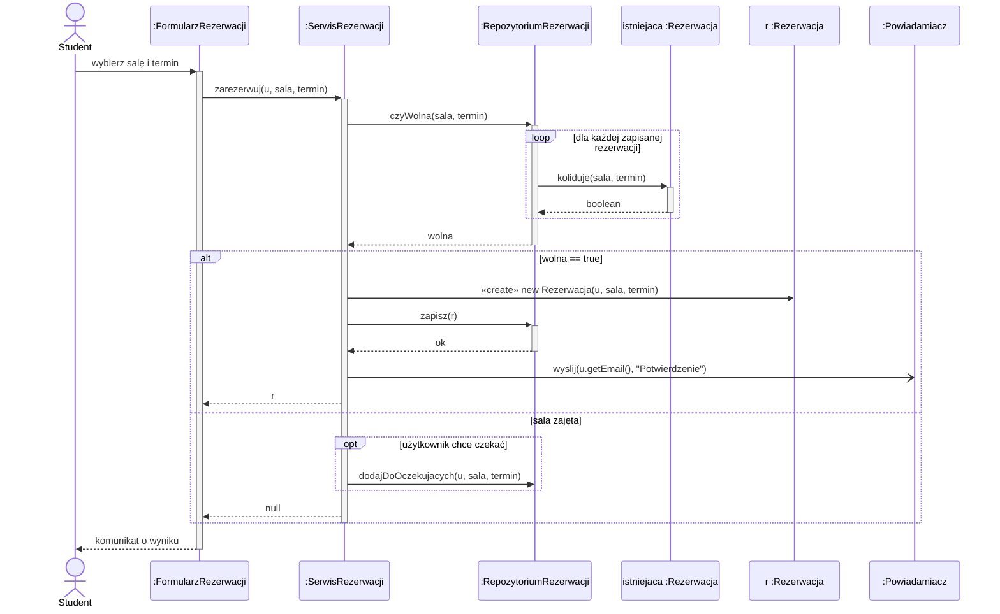

# Diagram sekwencji UML

> [!skrot] W 30 sekund
> - **Co to:** diagram interakcji — **kto do kogo i w jakiej kolejności** wysyła komunikaty, żeby zrealizować jeden scenariusz.
> - **Klucz:** czas płynie **w dół**; pełny grot = wywołanie synchroniczne, otwarty = asynchroniczne, przerywana = odpowiedź; ramki `alt` / `opt` / `loop` = if-else / if / pętla.
> - **Kiedy:** etap 3 projektu na labach — po jednym diagramie dla każdego ważnego [[Diagram przypadków użycia UML|przypadku użycia]].

> [!intuicja] Po ludzku
> To zapis wywołań metod jak w debuggerze z call stackiem, tylko narysowany. Każda pionowa linia to obiekt, każda pozioma strzałka to `obiekt.metoda(...)`. Jeśli umiesz przejść kod krokami w IntelliJ, umiesz czytać sekwencję — i odwrotnie, z sekwencji piszesz ciało metody.

## Definicja i wzory
> [!definicja] Elementy
> - **Linia życia (lifeline)** — prostokąt `nazwa : Klasa` (albo `:Klasa` dla anonimowego obiektu) i przerywana linia w dół. Aktor może mieć własną linię życia (ludzik).
> - **Aktywacja (specyfikacja wykonania)** — wąski prostokąt na linii życia: obiekt w tym czasie wykonuje metodę (jest na stosie wywołań).
> - **Komunikat** — strzałka między liniami życia, opisana `operacja(argumenty)`; musi odpowiadać **operacji klasy odbiorcy** z [[Diagram klas UML|diagramu klas]].
> - **Fragment kombinowany** — ramka z operatorem i warunkami (dozorami) w `[nawiasach]`.

> [!wzor] Rodzaje komunikatów i ramek
> | element | rysunek UML | Mermaid | w kodzie |
> |---|---|---|---|
> | synchroniczny | linia ciągła, **pełny** grot | `A->>B: m()` | zwykłe wywołanie, nadawca czeka |
> | asynchroniczny | linia ciągła, **otwarty** grot | `A-)B: m()` | wysłanie zdarzenia / wątek / kolejka, nadawca nie czeka |
> | odpowiedź | linia **przerywana**, otwarty grot | `B-->>A: wynik` | `return` |
> | tworzenie obiektu | przerywana strzałka `«create»` do **prostokąta** linii życia (linia zaczyna się niżej) | `A->>B: «create»` (patrz uwaga) | `new B(...)` |
> | zniszczenie | krzyżyk X na końcu linii | `destroy B` (nowy Mermaid) | koniec życia / `delete` w C++ |
> | `alt [w1] / [else]` | ramka z przegródkami | `alt ... else ... end` | `if / else` |
> | `opt [w]` | ramka | `opt ... end` | `if` bez else |
> | `loop [w]` | ramka | `loop ... end` | `for` / `while` |
> | `par` | ramka z przegródkami | `par ... and ... end` | równoległe wątki |
>
> Aktywację w Mermaid włączasz `+`/`-` przy strzałce (`A->>+B`, `B-->>-A`) albo `activate B` / `deactivate B`.

## Jak to zrobić — krok po kroku
1. Weź **jeden scenariusz** przypadku użycia (np. „Zarezerwuj salę”, scenariusz główny + najważniejsze alternatywne).
2. Ustaw linie życia od lewej: **aktor → obiekt interfejsu (formularz/kontroler) → serwis → repozytoria/encje → systemy zewnętrzne**.
3. Każdy krok scenariusza zamień na komunikat. Sprawdź, czy odbiorca ma tę operację na diagramie klas — jeśli nie, **dopisz ją tam** (diagramy muszą być spójne).
4. Dodaj odpowiedzi tam, gdzie zwracana wartość jest ważna (nie musisz przy każdym `void`).
5. Scenariusze alternatywne → `alt`/`opt`; przetwarzanie kolekcji → `loop`.
6. Zaznacz aktywacje — pokazują, kto czeka na kogo.

## Przykład
„Zarezerwuj salę” z systemu rezerwacji sal (spójny z [[Diagram przypadków użycia UML]] i [[Diagram klas UML]]). Główny scenariusz w `alt [sala wolna]`, alternatywa 2a (lista oczekujących, `«extend»`) w `else` + `opt`.



> [!wazne] O tworzeniu obiektu w Mermaid
> W poprawnym UML linia życia `r :Rezerwacja` zaczyna się **na wysokości** komunikatu `«create»`. Nowszy Mermaid ma do tego `create participant R as r :Rezerwacja` tuż przed komunikatem, ale wersja w Obsidianie bywa starsza, więc tu stoi zwykła deklaracja + etykieta `«create»`. Na kartce rysuj po UML-owemu.

**Ten diagram jako kod** — ciało `SerwisRezerwacji.zarezerwuj` czytasz z góry na dół, ramki to instrukcje sterujące:

```java
public Rezerwacja zarezerwuj(Uzytkownik u, Sala sala, Termin termin) {
    if (repo.czyWolna(sala, termin)) {                  // alt [wolna]
        Rezerwacja r = new Rezerwacja(u, sala, termin); // «create»
        repo.zapisz(r);
        powiadamiacz.wyslij(u.getEmail(), "Potwierdzenie"); // async: np. w osobnym wątku/kolejce
        return r;                                       // odpowiedź
    } else {                                            // [else]
        if (u.chceCzekac()) repo.dodajDoOczekujacych(u, sala, termin); // opt
        return null;
    }
}
// RepozytoriumRezerwacji.czyWolna:
//   for (Rezerwacja e : rezerwacje) if (e.koliduje(sala, termin)) return false;  // loop
//   return true;
```
(`u.chceCzekac()` w praktyce pochodzi z odpowiedzi użytkownika w formularzu — na diagramie to dozór `opt`.)

> [!przyklad]- Przykład 2 — ten sam szkielet w PlantUML
> ```plantuml
> @startuml
> actor Student as U
> participant ":SerwisRezerwacji" as S
> participant ":RepozytoriumRezerwacji" as Repo
> U -> S ++ : zarezerwuj(u, sala, termin)
> S -> Repo ++ : czyWolna(sala, termin)
> return wolna
> alt wolna
>   create "r :Rezerwacja" as R
>   S -> R : <<create>>
>   S ->> ":Powiadamiacz" : wyslij(...)
> else zajęta
>   S --> U : null
> end
> return r
> @enduml
> ```
> PlantUML: `->` synchroniczny, `->>` asynchroniczny (otwarty grot), `-->` odpowiedź, `++`/`return` aktywacja i powrót, `create` — linia życia od miejsca utworzenia.

## Typowe błędy
> [!blad] Komunikat, którego nie ma w klasie
> Strzałka `Repo->>E: koliduje(...)` wymaga operacji `koliduje` w klasie `Rezerwacja`. Niespójność sekwencja ↔ klasy to najczęstsza uwaga prowadzących.

> [!blad] Strzałka do klasy zamiast do obiektu
> Linie życia to **obiekty** (`:Sala`, `s1 :Sala`), nie klasy. Wyjątek: wywołanie statyczne.

> [!blad] Pomylone groty
> Odpowiedź jest **przerywana**; synchroniczny ma **pełny** grot. Odpowiedź rysowana ciągłą linią wygląda jak nowe wywołanie.

> [!blad] Diagram całego systemu naraz
> Jeden diagram = jeden scenariusz (ewentualnie z alternatywami w `alt`). Dziesięć ramek zagnieżdżonych — podziel albo użyj `ref` do osobnego diagramu.

## Na zajęcia i egzamin
> [!zajecia]
> - **Lab 1:** diagramy sekwencji dla kluczowych przypadków użycia projektu, spójne z diagramem klas. Wybierz scenariusze, które przechodzą przez kilka warstw (UI → serwis → repozytorium → system zewnętrzny) — tam potem naturalnie wejdą wzorce (Facade przed systemem zewnętrznym, Observer zamiast bezpośredniego `wyslij`, Factory zamiast `new`).
> - **Kolokwium (prawdopodobnie):** rozpoznaj rodzaje komunikatów i ramek; napisz kod na podstawie diagramu (albo diagram dla podanej metody z `if`/`for`); znaczenie aktywacji; różnica synchroniczny vs asynchroniczny.
> - **Temat projektu:** dobry, jeśli ma scenariusze z warunkami i pętlami oraz komunikację z systemem zewnętrznym — sekwencje są wtedy ciekawe, a wzorce czynnościowe (Observer, Command, State, Chain of Responsibility) mają gdzie się pokazać.
> - Łączy się z: [[Diagram przypadków użycia UML]], [[Diagram klas UML]].

## Zadania
> [!zadanie] Zadanie 1
> Narysuj (w Mermaid) sekwencję dla: `Koszyk.suma()` przechodzi po wszystkich `Pozycja` i woła `p.cena()`.
> > [!odpowiedz]- Odpowiedź
> > `K->>+K2: suma()` → `loop dla każdej pozycji` → `K2->>+P: cena()` / `P-->>-K2: double` → `end` → `K2-->>-K: suma`. Pętla = ramka `loop`, każde `cena()` to komunikat synchroniczny z odpowiedzią.

> [!zadanie] Zadanie 2
> Czym różni się `A->>B: m()` od `A-)B: m()` i jak to wygląda w kodzie?
> > [!odpowiedz]- Odpowiedź
> > Pierwsze — synchroniczne: A czeka na zakończenie `m()` (zwykłe wywołanie). Drugie — asynchroniczne: A wysyła i idzie dalej (np. `executor.submit(() -> b.m())`, wiadomość do kolejki, zdarzenie).

> [!zadanie] Zadanie 3
> Na diagramie jest ramka `opt [kwota > 1000]` z komunikatem `bank.autoryzuj()`, a za nią `alt [ok] ... [else] ...`. Zapisz szkielet kodu.
> > [!odpowiedz]- Odpowiedź
> > `if (kwota > 1000) bank.autoryzuj();` a potem `if (ok) { ... } else { ... }`. `opt` = if bez else, `alt` = if/else.

> [!zadanie] Zadanie 4
> Na sekwencji `S->>R: «create»` do `r :Rezerwacja`. Co musi być na diagramie klas?
> > [!odpowiedz]- Odpowiedź
> > Klasa `Rezerwacja` z konstruktorem o tych parametrach i związek między `SerwisRezerwacji` a `Rezerwacja` (co najmniej zależność `..>` — serwis tworzy rezerwacje). Na kolejnych labach to dobre miejsce na Factory.

## Fiszki #fiszki/wzorce
Co przedstawia diagram sekwencji?::Kolejność komunikatów (wywołań) między obiektami w jednym scenariuszu; czas płynie w dół.
Co to linia życia?::Obiekt uczestniczący w interakcji: prostokąt nazwa :Klasa + przerywana linia w dół.
Co oznacza prostokąt aktywacji?::Okres, w którym obiekt wykonuje operację (jest na stosie wywołań).
Komunikat synchroniczny — jak wygląda?::Linia ciągła z pełnym grotem; nadawca czeka na wynik. Mermaid: A->>B.
Komunikat asynchroniczny — jak wygląda?::Linia ciągła z otwartym grotem; nadawca nie czeka. Mermaid: A-)B.
Jak oznacza się odpowiedź (return)?::Linia przerywana z otwartym grotem do wywołującego. Mermaid: B-->>A.
Jak pokazać utworzenie obiektu?::Przerywana strzałka «create» do prostokąta nowej linii życia, która zaczyna się na tej wysokości (new w kodzie).
alt, opt, loop — odpowiedniki w kodzie?::alt = if/else (switch), opt = if bez else, loop = for/while.
Jaki warunek spójności łączy sekwencję z diagramem klas?::Każdy komunikat musi być operacją klasy obiektu-odbiorcy.
Ile scenariuszy na jeden diagram sekwencji?::Jeden scenariusz przypadku użycia (alternatywy w ramkach alt/opt), nie cały system.

## Moje notatki
> [!ja] Tu piszesz ty — Albert tej sekcji nie rusza.

## Źródła
- Object Management Group, *Unified Modeling Language (UML) Specification, Version 2.5.1*, rozdz. 17 „Interactions” — https://www.omg.org/spec/UML/2.5.1
- M. Fowler, *UML Distilled* (wyd. pol. „UML w kropelce”), rozdział o diagramach sekwencji.
- Dokumentacja Mermaid — Sequence diagrams: https://mermaid.js.org/syntax/sequenceDiagram.html
- Dokumentacja PlantUML — Sequence Diagram: https://plantuml.com/sequence-diagram
- E. Freeman, E. Robson, *Wzorce projektowe. Rusz głową!*; E. Gamma i in., *Wzorce projektowe* (GoF) — sekcje „Współdziałanie” wzorców ilustrowane diagramami interakcji; A. Shalloway, J. Trott, *Projektowanie zorientowane obiektowo. Wzorce projektowe*.
