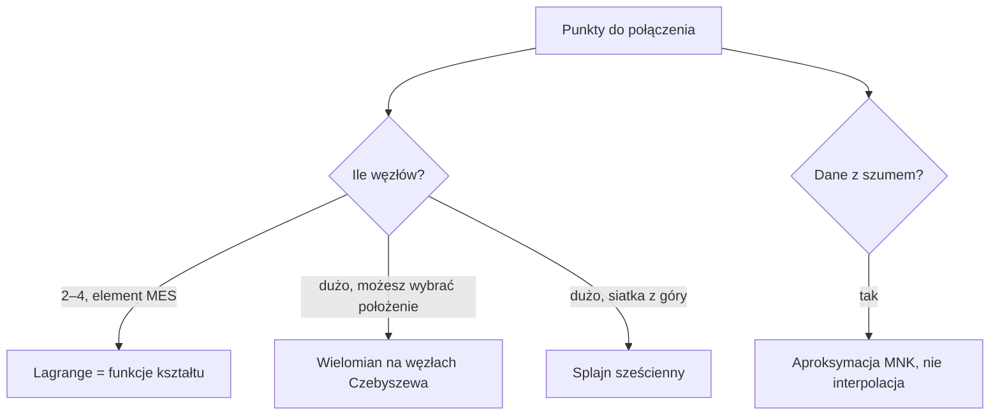

# Interpolacja

> [!skrot] W 30 sekund
> - **Co to:** budowanie funkcji, która przechodzi **dokładnie** przez zadane punkty $(x_i, y_i)$, żeby znać wartości pomiędzy nimi.
> - **Klucz:** $p(x) = \sum_i y_i\, l_i(x)$, gdzie bazy Lagrange'a spełniają $l_i(x_j) = \delta_{ij}$. W MES te same bazy nazywają się **funkcjami kształtu** $N_i$.
> - **Kiedy:** wartości wewnątrz elementu skończonego z wartości węzłowych, tablice pomiarowe, gładkie krzywe przez punkty (splajn).

> [!intuicja] Po ludzku
> Masz temperatury zmierzone w kilku punktach pręta i chcesz znać temperaturę między nimi. Każdy węzeł dostaje swoją „funkcję wpływu”: równą 1 w nim samym i 0 we wszystkich pozostałych węzłach. Wynik to suma wartości węzłowych ważonych tymi funkcjami. Dokładnie tak MES liczy pole temperatury w elemencie.

## Definicja i wzory
> [!definicja] Zadanie interpolacji
> Dane są węzły $x_0 < x_1 < \dots < x_n$ i wartości $y_i$. Szukamy wielomianu $p$ stopnia co najwyżej $n$, takiego że $p(x_i) = y_i$. Taki wielomian istnieje i jest **jedyny** — Vandermonde, Lagrange i Newton to trzy zapisy tego samego wielomianu.

> [!wzor] Vandermonde (jak nie robić dla dużego n)
> $$p(x) = a_0 + a_1 x + \dots + a_n x^n, \qquad V a = y, \quad V_{ik} = x_i^k$$
> Kolumny $x^k$ i $x^{k+1}$ są dla dużych $k$ prawie równoległe, więc $\mathrm{cond}(V)$ rośnie wykładniczo: dla 21 równoodległych węzłów na $[-1,1]$ wynosi ok. $8 \cdot 10^8$.

> [!wzor] Lagrange — funkcje kształtu
> $$l_i(x) = \prod_{j \ne i} \frac{x - x_j}{x_i - x_j}, \qquad l_i(x_j) = \delta_{ij}, \qquad \sum_i l_i(x) = 1$$
> Element 1D na $[-1,1]$, współrzędna lokalna $\xi$:
> $$\text{liniowy: } N_1 = \tfrac{1-\xi}{2},\ N_2 = \tfrac{1+\xi}{2}; \qquad \text{kwadratowy: } N_1 = \tfrac{\xi(\xi-1)}{2},\ N_2 = 1-\xi^2,\ N_3 = \tfrac{\xi(\xi+1)}{2}$$
> Element 4-węzłowy na $[-1,1]^2$ to iloczyn liniowych baz w $\xi$ i w $\eta$, węzły $(\xi_k, \eta_k) \in \{\pm1\}^2$:
> $$N_k(\xi,\eta) = \tfrac14 (1 + \xi\xi_k)(1 + \eta\eta_k)$$
> Element 9-węzłowy to iloczyn kwadratowych baz: $N_{ij}(\xi,\eta) = l_i(\xi)\, l_j(\eta)$.

> [!wzor] Newton — ilorazy różnicowe
> $$p(x) = f[x_0] + f[x_0,x_1](x-x_0) + \dots + f[x_0,\dots,x_n]\prod_{k<n}(x-x_k)$$
> $$f[x_i,\dots,x_{i+k}] = \frac{f[x_{i+1},\dots,x_{i+k}] - f[x_i,\dots,x_{i+k-1}]}{x_{i+k} - x_i}$$
> Dodanie węzła dokłada jeden wyraz — nic nie liczysz od nowa.

> [!wzor] Błąd interpolacji i węzły Czebyszewa
> $$f(x) - p(x) = \frac{f^{(n+1)}(\zeta)}{(n+1)!} \prod_{i=0}^{n} (x - x_i)$$
> Węzły Czebyszewa minimalizują $\max |\prod (x - x_i)|$:
> $$x_k = \tfrac{a+b}{2} + \tfrac{b-a}{2} \cos\frac{(2k+1)\pi}{2(n+1)}, \quad k = 0,\dots,n$$

> [!wzor] Splajn sześcienny naturalny
> Na każdym odcinku osobny wielomian 3. stopnia, ciągłe $S, S', S''$, na końcach $S'' = 0$. Momenty $M_i = S''(x_i)$ spełniają układ trójdiagonalny:
> $$h_{i-1} M_{i-1} + 2(h_{i-1}+h_i) M_i + h_i M_{i+1} = 6\left(\frac{y_{i+1}-y_i}{h_i} - \frac{y_i - y_{i-1}}{h_{i-1}}\right)$$



## Jak to zrobić — krok po kroku
1. Sprawdź, czy dane są dokładne. Pomiary z szumem → [[Aproksymacja średniokwadratowa]].
2. Mało węzłów (element skończony) → wypisz bazy Lagrange'a i sprawdź $N_i(x_j) = \delta_{ij}$ oraz $\sum N_i = 1$.
3. Wartość w punkcie: $u(\xi) = \sum_i N_i(\xi)\, u_i$.
4. Dużo węzłów równoodległych → **nie** wielomian jednego stopnia (efekt Rungego), tylko splajn (`scipy.interpolate.CubicSpline(x, y, bc_type="natural")`).
5. Możesz wybrać węzły → węzły Czebyszewa.

## Przykład
> [!przyklad] Wielomian przez $(0,1), (1,3), (2,2), (4,5)$, wartość w $x = 3$
> **Lagrange.** Bazy w $x = 3$:
> $$l_0(3) = \frac{(3-1)(3-2)(3-4)}{(0-1)(0-2)(0-4)} = \frac{-2}{-8} = 0{,}25, \quad l_1(3) = \frac{3 \cdot 1 \cdot (-1)}{1 \cdot (-1)(-3)} = -1$$
> $$l_2(3) = \frac{3 \cdot 2 \cdot (-1)}{2 \cdot 1 \cdot (-2)} = 1{,}5, \quad l_3(3) = \frac{3 \cdot 2 \cdot 1}{4 \cdot 3 \cdot 2} = 0{,}25$$
> Suma baz $0{,}25 - 1 + 1{,}5 + 0{,}25 = 1$ — zgadza się. Wartość: $p(3) = 1 \cdot 0{,}25 + 3 \cdot (-1) + 2 \cdot 1{,}5 + 5 \cdot 0{,}25 = 1{,}5$.
>
> **Newton.** Tablica ilorazów:
>
> | $x_i$ | $f[\cdot]$ | rząd 1 | rząd 2 | rząd 3 |
> |---|---|---|---|---|
> | 0 | 1 | 2 | −1,5 | 7/12 |
> | 1 | 3 | −1 | 5/6 | |
> | 2 | 2 | 1,5 | | |
> | 4 | 5 | | | |
>
> $p(x) = 1 + 2x - 1{,}5\,x(x-1) + \tfrac{7}{12} x(x-1)(x-2)$, więc $p(3) = 1 + 6 - 9 + 3{,}5 = 1{,}5$. Ten sam wynik, bo wielomian jest jeden.

```cpp
#include "m03.h"   // Kod/metody_numeryczne
Vec xs = {0, 1, 3}, ys = {0, 1, 9};                 // parabola x^2
double w1 = lagrange(xs, ys, 2.0);                  // 4
Vec b = ilorazy_roznicowe(xs, ys);                  // b = {0, 1, 1}: p(x) = 0 + 1(x-0) + 1(x-0)(x-1)
double w2 = newton_wartosc(xs, b, 2.0);             // 4
double T = interpolacja_1d(-5, 4, 20, 46, 1.55);    // 38.92 (lab 1 MES)
auto N = N4(0.5, -0.5);                             // 0.1875, 0.5625, 0.1875, 0.0625
```

> [!kod]- To samo w Pythonie (do szybkiego sprawdzenia)
> ```python
> import numpy as np
> from scipy.interpolate import KroghInterpolator
> x, y = [0, 1, 2, 4], [1, 3, 2, 5]
> print(KroghInterpolator(x, y)(3.0))    # 1.5
> ```

> [!przyklad]- Przykład 2: temperatura w elemencie 4-węzłowym
> Temperatury węzłowe $T = (100, 200, 300, 150)$ w węzłach $(-1,-1), (1,-1), (1,1), (-1,1)$. Punkt $(\xi, \eta) = (0{,}5;\ -0{,}5)$:
> $N = (0{,}1875;\ 0{,}5625;\ 0{,}1875;\ 0{,}0625)$, suma 1. Temperatura $T = 18{,}75 + 112{,}5 + 56{,}25 + 9{,}375 = 196{,}875$.

## Laby z interpolacji — co oddajesz i wyniki do sprawdzenia
Instrukcje: [[Lab — interpolacja Lagrange'a.pdf]] (10.03), [[Lab — interpolacja Newtona.pdf]] (17.03). W obu labach węzły, wartości i ich liczbę czytasz **z pliku tekstowego**, punkt podaje użytkownik z klawiatury, a `.cpp` (i przy Lagrange'u krótkie sprawozdanie ze zrzutami ekranu) wrzucasz na UPEL.

### Lagrange (6 + 4 pkt)
> [!przyklad] Przykład z instrukcji: $x = (-4, -3, 1, 2)$, $f = (5, 2, 5, 2)$
> $$L_3(x) = 5\frac{(x+3)(x-1)(x-2)}{(-1)(-5)(-6)} + 2\frac{(x+4)(x-1)(x-2)}{(1)(-4)(-5)} + 5\frac{(x+4)(x+3)(x-2)}{(5)(4)(-1)} + 2\frac{(x+4)(x+3)(x-1)}{(6)(5)(1)}$$
> $$L_3(x) = -\tfrac14x^3 - \tfrac34x^2 + x + 5$$
> **Zad. 1:** $L_3(-1) = \tfrac14 - \tfrac34 - 1 + 5 = \mathbf{3{,}5}$ (jak w instrukcji), $L_3(0{,}5) = -\tfrac{1}{32} - \tfrac{3}{16} + \tfrac12 + 5 = \tfrac{169}{32} = \mathbf{5{,}28125}$.
> Program wypisuje: liczbę węzłów, węzły i wartości, punkt, wartość wielomianu.

> [!przyklad] Zad. 2: $\sqrt[3]{50}$ z węzłów $27, 64, 125, 216$ (wartości $3, 4, 5, 6$)
> $$L_3(50) = 3\,l_0(50) + 4\,l_1(50) + 5\,l_2(50) + 6\,l_3(50) \approx \mathbf{3{,}66588}$$
> Dokładnie $\sqrt[3]{50} = 3{,}68403$, błąd ok. $0{,}018$ (0,5%). Do sprawozdania: procedura to wybór węzłów, w których znasz pierwiastek dokładnie (sześciany liczb całkowitych), zbudowanie wielomianu Lagrange'a dla $y = \sqrt[3]{x}$ i obliczenie w $x = 50$. Błąd wynika z tego, że $\sqrt[3]{x}$ nie jest wielomianem, a węzły są daleko od siebie (oszacowanie reszty wymaga $f^{(4)}$). Współczynniki Newtona dla kontroli: $b = (3;\ 0{,}027027;\ -1{,}0851\cdot10^{-4};\ 3{,}8598\cdot10^{-7})$.

### Newton (6 + 4 pkt)
> [!przyklad] Przykład z instrukcji: $f(1..5) = 1, 4, 9, 16, 25$
> Tablica ilorazów: rząd 1: $3, 5, 7, 9$; rząd 2: $1, 1, 1$; rząd 3 i 4: $0$. Przekątna: $b = (1, 3, 1, 0, 0)$, więc $W(x) = 1 + 3(x-1) + (x-1)(x-2)$, czyli $x^2$. $W(2{,}5) = 1 + 4{,}5 + 0{,}75 = 6{,}25$.
> **Zad. 1:** program ma wypisać też **współczynniki $b_k$**. Wartości dla $x = 5$ i $x = 10$ liczysz dla pliku `dane1.txt` od prowadzącego. Tego pliku nie było w materiałach na UPeL, więc wyników nie podaję. Sprawdź program na przykładzie z instrukcji i na przykładzie z wykładu niżej.

> [!przyklad] Zad. 2: efekt Rungego dla $f(x) = \frac{1}{1+25x^2}$ na $[-1, 1]$
> | węzłów równoodległych | max błąd | to samo na węzłach Czebyszewa |
> |---|---|---|
> | 5 | 0,438 | 0,402 |
> | 20 | **8,58** | 0,0376 |
>
> ![[Efekt Rungego — 5 i 20 węzłów.png]]
>
> **Wnioski:** przy 5 węzłach wielomian jest zbyt „sztywny” (błąd 0,44 w środku przedziałów). Przy 20 równoodległych węzłach w środku jest świetnie, ale **przy końcach przedziału pojawiają się oscylacje** o amplitudzie ok. 8, czyli więcej węzłów daje gorszy wynik. To efekt Rungego: czynnik $\prod(x - x_i)$ w reszcie jest ogromny przy brzegach dla węzłów równoodległych. Lekarstwo: węzły Czebyszewa (gęstsze przy brzegach) albo funkcje sklejane ([[Interpolacja Hermite'a i funkcje sklejane]]).

## Wykład dr Szeligi (W03) — co dochodzi
> [!definicja] Pojęcia
> **Interpolacja**: funkcja przechodzi przez punkty, szukamy wartości **między** węzłami. **Ekstrapolacja**: to samo, ale **poza** zakresem węzłów. **Aproksymacja**: funkcja (np. wielomian stopnia $< n$) dopasowana do punktów wg kryterium, nie musi przez nie przechodzić. Ogólnie: $f$ dana przez wartości funkcjonałów $F_j(f)$ (wartości, pochodne), szukamy $g$ z ustalonej klasy z $F_j(g) = F_j(f)$.

> [!wzor] Trzy postacie wielomianu i schematy obliczania
> - **Naturalna** $w(x) = \sum a_kx^k$ ($a_k = w^{(k)}(0)/k!$): **schemat Hornera** $w_n = a_n$, $w_i = w_{i+1}x + a_i$, $w(x) = w_0$. Horner jest **numerycznie poprawny** (wskaźnik kumulacji $\le 2n + 1$).
> - **Newtona** $w(x) = \sum b_kp_k(x)$, $p_k = (x-x_0)\cdots(x-x_{k-1})$: **uogólniony Horner** $w_n = b_n$, $w_i = w_{i+1}(x - x_i) + b_i$. Przejście do postaci naturalnej: $a_n^{(i)} = b_n$, $a_i^{(i)} = b_i - a_{i+1}^{(i+1)}x_i$, $a_k^{(i)} = a_k^{(i+1)} - a_{k+1}^{(i+1)}x_i$, koszt $\frac{n(n+1)}{2}$ mnożeń i odejmowań.
> - **Czebyszewa** $w(x) = \sum c_kT_k(x)$: algorytm Clenshawa $\tilde c_{n+2} = \tilde c_{n+1} = 0$, $\tilde c_k = 2x\tilde c_{k+1} + c_k - \tilde c_{k+2}$.
>
> Wyznaczanie współczynników naturalnych z układu Vandermonde'a kosztuje $n^3$ i jest **bardzo źle uwarunkowane** (szczególnie dla węzłów równoodległych). Lepiej: ilorazy różnicowe (postać Newtona) w $n^2$, potem ewentualnie przejście do naturalnej.

> [!wzor] Ilorazy różnicowe i różnice skończone
> $b_k = f[x_0, \dots, x_k] = \sum_{i=0}^k\frac{f(x_i)}{\prod_{j \ne i}(x_i - x_j)}$; tablica trójkątna kosztuje $\frac{n(n-1)}{2}$ dzieleń i 2× tyle odejmowań. Dla węzłów równoodległych $x_i = x_0 + ih$:
> $$\Delta^kf(x) = \Delta^{k-1}f(x+h) - \Delta^{k-1}f(x), \qquad f[x_0, \dots, x_k] = \frac{\Delta^kf(x_0)}{k!\,h^k}$$
> $$L_n(x_0 + th) = f(x_0) + \Delta f(x_0)\,t + \frac{\Delta^2f(x_0)}{2!}t(t-1) + \dots + \frac{\Delta^nf(x_0)}{n!}t(t-1)\cdots(t-n+1)$$
> (wzór Newtona „w przód”; różnica wsteczna $\nabla^kf(x) = \nabla^{k-1}f(x) - \nabla^{k-1}f(x-h)$.)

> [!wzor] Zbieżność przy $n \to \infty$
> - Runge: dla $f = \frac{1}{1+x^2}$ na równoodległych węzłach z $[-5, 5]$ ciąg $L_n$ jest zbieżny tylko dla $|x| < 3{,}63$, a rozbieżny dla pozostałych.
> - **Faber:** dla **dowolnego** układu węzłów istnieje funkcja ciągła, dla której ciąg wielomianów interpolacyjnych **nie** jest jednostajnie zbieżny.
> - Z drugiej strony dla każdej $f$ ciągłej **istnieje** ciąg węzłów, dla którego interpolacja jest jednostajnie zbieżna (twierdzenie niekonstruktywne).
> - Wysoki stopień: oscylacje na końcach i złe uwarunkowanie. Rozwiązania: interpolacja lokalna niskiego stopnia (splajny) albo węzły Czebyszewa.

> [!przyklad] Przykłady z wykładu
> - $\sqrt6$ z węzłów $(1, 1), (4, 2), (9, 3)$: $L_2(6) = 1\cdot\frac{(6-4)(6-9)}{(1-4)(1-9)} + 2\cdot\frac{(6-1)(6-9)}{(4-1)(4-9)} + 3\cdot\frac{(6-1)(6-4)}{(9-1)(9-4)} = -\frac14 + 2 + \frac34 = 2{,}5$ (dokładnie $2{,}4495$).
> - Ilorazy dla $(1, 1), (2, 5), (3, -6), (5, 2)$: rząd 1: $4, -11, 4$; rząd 2: $-7{,}5;\ 5$; rząd 3: $\frac{5 + 7{,}5}{4} = 3{,}125$. Postać Newtona: $1 + 4(x-1) - 7{,}5(x-1)(x-2) + 3{,}125(x-1)(x-2)(x-3)$.
> - $W(x) = 2x^2 - 4x + 3$ w postaci Newtona dla $x_0 = 1, x_1 = 2, x_2 = 3$: $W = 1 + 2(x-1) + 2(x-1)(x-2)$.
> - Błąd $\cos\frac{5\pi}{8}$ z 7 węzłów $0, \frac\pi6, \frac\pi4, \frac\pi3, \frac\pi2, \frac{2\pi}3, \pi$: $|r| \le \frac{1}{7!}\prod|x - x_i| \approx 3{,}7\cdot10^{-5}$ (bo $|\cos^{(7)}| \le 1$). Rzeczywisty błąd: $3{,}4\cdot10^{-5}$.
> - Interpolacja okręgu krzywą parametryczną $x(t) = \cos\frac{t\pi}{2}$, $y(t) = \sin\frac{t\pi}{2}$ dla $t = 0..4$ (układy $Ta = x$, $Tb = y$ z macierzą Vandermonde'a $T$). Dołożenie punktów $t = 0{,}5;\ 1{,}5;\ \dots$ poprawia kształt.
>
> Interpolacja Hermite'a, splajny, interpolacja trygonometryczna i FFT: [[Interpolacja Hermite'a i funkcje sklejane]].

## Typowe błędy
> [!blad] Wielomian wysokiego stopnia na równoodległych węzłach
> Dla $f(x) = 1/(1+25x^2)$ błąd maksymalny przy 21 węzłach wynosi ok. 60 (!), choć w węzłach jest zero. To efekt Rungego: oscylacje przy końcach przedziału. Na węzłach Czebyszewa ten sam stopień daje błąd ok. 0,015.

> [!blad] Odwrócona numeracja węzłów elementu
> Funkcja $N_k$ musi być równa 1 w węźle $k$ według **tej samej** numeracji, której używasz przy agregacji. Element 4-węzłowy numeruje się zwykle przeciwnie do ruchu wskazówek zegara, od lewego dolnego narożnika. Pomyłka daje „wykręcony” element i ujemny jakobian.

> [!blad] Interpolacja danych pomiarowych
> Wielomian przechodzący przez każdy zaszumiony punkt odwzorowuje szum. Wtedy właściwym narzędziem jest aproksymacja.

## Na zajęcia i egzamin
> [!zajecia]
> - **Laby MES (pierwszy etap projektu):** funkcje kształtu elementów 3-, 4- i 9-węzłowych oraz interpolacja wartości węzłowych do punktu wewnątrz elementu. Pochodne $\partial N/\partial \xi$ są potrzebne do jakobianu. **Ćwicz w C++:** `Kod/metody_numeryczne/zadania/m03.cpp` (Lagrange, ilorazy różnicowe Newtona, interpolacja 1D, funkcje kształtu N4 i ich pochodne), specyfikacja w `m03.h`, sprawdzasz `./sprawdz.sh 03`. Wzorzec: `rozwiazania/m03.cpp`, dopiero po własnej próbie.
> - **Egzamin MES:** „wyprowadź funkcje kształtu elementu kwadratowego 1D”, „jakie warunki spełniają funkcje kształtu” (delta Kroneckera, suma równa 1), „czym jest element Lagrange'a”.
> - **Trójkąt 3-węzłowy (simpleks):** $N = (L_1, L_2, L_3)$, $L_3 = 1 - L_1 - L_2$, gdzie $L_k = A_k / A$ (pole trójkąta z punktem zamiast wierzchołka $k$ przez pole całego). Ćwicz `ksztalt_t3` i `wspolrzedne_L` w `m03`.
> - Łączy się z: [[Całkowanie numeryczne i kwadratury Gaussa]] (całkujemy iloczyny funkcji kształtu), [[MES 1D — od różnic skończonych do macierzy sztywności]].

## Zadania
> [!zadanie] Zadanie 1
> Wypisz funkcje kształtu elementu 1D o węzłach $\xi = -1, 0, 1$ i policz je w $\xi = 0{,}5$.
> > [!odpowiedz]- Odpowiedź
> > $N_1 = \xi(\xi-1)/2 = -0{,}125$, $N_2 = 1-\xi^2 = 0{,}75$, $N_3 = \xi(\xi+1)/2 = 0{,}375$. Suma 1.

> [!zadanie] Zadanie 2
> Ile wynosi $N_3(\xi,\eta)$ elementu 4-węzłowego w środku elementu i w węźle 1?
> > [!odpowiedz]- Odpowiedź
> > $N_3 = \frac14(1+\xi)(1+\eta)$. W środku: $\frac14$ (każda z czterech funkcji). W węźle 1 $(-1,-1)$: 0.

> [!zadanie] Zadanie 3
> Dopisz węzeł $(3, 4)$ do przykładu. O ile wyrazów zmieni się postać Newtona?
> > [!odpowiedz]- Odpowiedź
> > O jeden: $+f[x_0,\dots,x_4]\,x(x-1)(x-2)(x-4)$. Iloraz rzędu 4 policzysz z nowej przekątnej tablicy. Pozostałe współczynniki zostają.

> [!zadanie] Zadanie 4
> Dlaczego splajn sześcienny na 21 równoodległych węzłach nie ma efektu Rungego?
> > [!odpowiedz]- Odpowiedź
> > Bo na każdym odcinku jest wielomian stopnia 3, a nie jeden wielomian stopnia 20. Błąd zależy od $h^4$ i $\max|f^{(4)}|$, nie od rosnącego iloczynu $\prod (x - x_i)$.

## Pytania testowe (egzamin UPeL)
> [!zadanie] 1. Które zdania o interpolacji Lagrange'a są prawdziwe?
> a) Dla $n + 1$ różnych węzłów istnieje dokładnie jeden wielomian stopnia $\le n$. b) $\sum_i l_i(x) = 1$ dla każdego $x$. c) Zwiększanie liczby równoodległych węzłów zawsze zmniejsza błąd. d) Postać Newtona pozwala dodać węzeł bez liczenia wszystkiego od nowa.
> > [!odpowiedz]- Odpowiedź
> > **a, b, d.** (c) fałsz: efekt Rungego.

> [!zadanie] 2. Koszt wyznaczenia współczynników postaci Newtona przez ilorazy różnicowe jest rzędu:
> a) $n$ b) $n^2$ c) $n^3$ d) $n\log n$
> > [!odpowiedz]- Odpowiedź
> > **b.** Rozwiązanie układu Vandermonde'a to $n^3$.

> [!zadanie] 3. Dla węzłów równoodległych $f[x_0, \dots, x_k]$ jest równe:
> a) $\Delta^kf(x_0)$ b) $\frac{\Delta^kf(x_0)}{k!h^k}$ c) $\frac{\Delta^kf(x_0)}{h^k}$ d) $k!\,\Delta^kf(x_0)$
> > [!odpowiedz]- Odpowiedź
> > **b.**

> [!zadanie] 4. Dla wielomianu stopnia 3 ilorazy różnicowe rzędu 4 są:
> a) równe współczynnikowi przy $x^3$ b) równe zeru c) zależne od węzłów d) nieokreślone
> > [!odpowiedz]- Odpowiedź
> > **b.** Iloraz rzędu $k$ to $f^{(k)}(\xi)/k!$, a 4. pochodna wielomianu 3. stopnia jest zerem.

> [!zadanie] 5. Schemat Hornera:
> a) liczy wartość wielomianu w $n$ mnożeniach i $n$ dodawaniach b) jest numerycznie poprawny c) wymaga postaci Newtona d) ma wskaźnik kumulacji co najwyżej $2n + 1$
> > [!odpowiedz]- Odpowiedź
> > **a, b, d.**

## Fiszki #fiszki/numeryczne
Interpolacja, ekstrapolacja, aproksymacja — różnica::Interpolacja: przez punkty, wartości między węzłami; ekstrapolacja: poza zakresem węzłów; aproksymacja: dopasowanie wg kryterium, niekoniecznie przez punkty
Uogólniony schemat Hornera (postać Newtona)::$w_n = b_n$, $w_i = w_{i+1}(x - x_i) + b_i$, $w(x) = w_0$
Związek ilorazu różnicowego z różnicą progresywną::$f[x_0..x_k] = \Delta^kf(x_0)/(k!\,h^k)$
Twierdzenie Fabera::Dla dowolnego układu węzłów istnieje funkcja ciągła, dla której interpolacja nie jest jednostajnie zbieżna
Lab: $\sqrt[3]{50}$ Lagrange'em z 27, 64, 125, 216::≈ 3,66588 (dokładnie 3,68403)
Runge, 20 węzłów równoodległych, $1/(1+25x^2)$: max błąd::ok. 8,6 (Czebyszew: 0,038)
Jaką własność mają bazy Lagrange'a w węzłach?::l_i(x_j) = δ_ij — jedynka w swoim węźle, zero w pozostałych
Ile wynosi suma wszystkich funkcji kształtu w dowolnym punkcie elementu?::1 (odtwarzają funkcję stałą)
Funkcje kształtu liniowego elementu 1D na [−1, 1]::N1 = (1 − ξ)/2, N2 = (1 + ξ)/2
Funkcje kształtu kwadratowego elementu 1D na węzłach −1, 0, 1::ξ(ξ − 1)/2, 1 − ξ², ξ(ξ + 1)/2
Funkcja kształtu elementu 4-węzłowego::N_k = ¼(1 + ξξ_k)(1 + ηη_k) — iloczyn liniowych baz Lagrange'a
Dlaczego nie liczy się interpolacji przez macierz Vandermonde'a dla wielu węzłów?::Jej uwarunkowanie rośnie wykładniczo z liczbą węzłów
Na czym polega efekt Rungego?::Wielomian wysokiego stopnia na równoodległych węzłach silnie oscyluje przy końcach przedziału
Jak uniknąć efektu Rungego?::Węzły Czebyszewa albo splajn (wielomiany niskiego stopnia na odcinkach)
Wzór na błąd interpolacji wielomianowej::f^(n+1)(ζ)/(n+1)! razy iloczyn (x − x_i) po wszystkich węzłach
Jaki układ rozwiązuje się dla naturalnego splajnu sześciennego?::Trójdiagonalny dla momentów M_i = S''(x_i), z M_0 = M_n = 0
Zaleta postaci Newtona nad Lagrange'em::Dodanie węzła dokłada jeden wyraz, poprzednie współczynniki zostają

Interpolacja 1D w elemencie z labu 1 MES: x₁ = −5 (20 °C), x₂ = 4 (46 °C), x = 1,55::T = 0,2722·20 + 0,7278·46 = 38,92 °C

## Moje notatki
> [!ja] Tu piszesz ty — Albert tej sekcji nie rusza.

## Źródła
- Z. Fortuna, B. Macukow, J. Wąsowski, *Metody numeryczne*, WNT — rozdział o interpolacji.
- D. Kincaid, W. Cheney, *Analiza numeryczna*, WNT — interpolacja wielomianowa, splajny.
- R. L. Burden, J. D. Faires, *Numerical Analysis*, Brooks/Cole — Lagrange, ilorazy różnicowe, splajny sześcienne.
- A. Milenin, *Podstawy metody elementów skończonych*, Wyd. AGH 2010 — funkcje kształtu elementów.
- Dokumentacja SciPy: `scipy.interpolate.CubicSpline`, `scipy.interpolate.KroghInterpolator`.
- Kurs MN w C++: Kod/metody_numeryczne (moduły, testy, rozwiązania wzorcowe)
- Notatka [[Funkcje kształtu]] (wersja MES tego tematu, kurs dr. Kustry)
