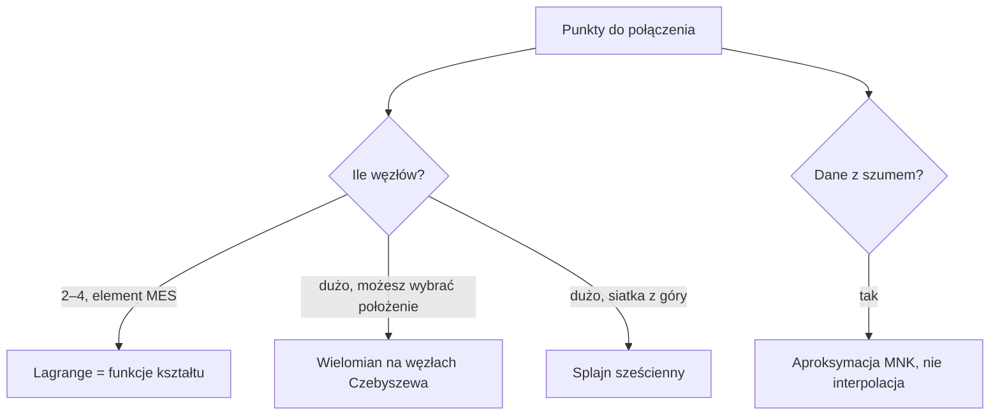

# Interpolacja

> [!skrot] W 30 sekund
> - **Co to:** budowanie funkcji, która przechodzi **dokładnie** przez zadane punkty $(x_i, y_i)$, żeby znać wartości pomiędzy nimi.
> - **Klucz:** $p(x) = \sum_i y_i\, l_i(x)$, gdzie bazy Lagrange'a spełniają $l_i(x_j) = \delta_{ij}$. W MES te same bazy nazywają się **funkcjami kształtu** $N_i$.
> - **Kiedy:** wartości wewnątrz elementu skończonego z wartości węzłowych, tablice pomiarowe, gładkie krzywe przez punkty (splajn).

> [!intuicja] Po ludzku
> Masz temperatury zmierzone w kilku punktach pręta i chcesz znać temperaturę między nimi. Każdy węzeł dostaje swoją „funkcję wpływu”: równą 1 w nim samym i 0 we wszystkich pozostałych węzłach. Wynik to suma wartości węzłowych ważonych tymi funkcjami. Dokładnie tak MES liczy pole temperatury w elemencie.

## Definicja i wzory
> [!definicja] Zadanie interpolacji
> Dane są węzły $x_0 < x_1 < \dots < x_n$ i wartości $y_i$. Szukamy wielomianu $p$ stopnia co najwyżej $n$, takiego że $p(x_i) = y_i$. Taki wielomian istnieje i jest **jedyny** — Vandermonde, Lagrange i Newton to trzy zapisy tego samego wielomianu.

> [!wzor] Vandermonde (jak nie robić dla dużego n)
> $$p(x) = a_0 + a_1 x + \dots + a_n x^n, \qquad V a = y, \quad V_{ik} = x_i^k$$
> Kolumny $x^k$ i $x^{k+1}$ są dla dużych $k$ prawie równoległe, więc $\mathrm{cond}(V)$ rośnie wykładniczo: dla 21 równoodległych węzłów na $[-1,1]$ wynosi ok. $8 \cdot 10^8$.

> [!wzor] Lagrange — funkcje kształtu
> $$l_i(x) = \prod_{j \ne i} \frac{x - x_j}{x_i - x_j}, \qquad l_i(x_j) = \delta_{ij}, \qquad \sum_i l_i(x) = 1$$
> Element 1D na $[-1,1]$, współrzędna lokalna $\xi$:
> $$\text{liniowy: } N_1 = \tfrac{1-\xi}{2},\ N_2 = \tfrac{1+\xi}{2}; \qquad \text{kwadratowy: } N_1 = \tfrac{\xi(\xi-1)}{2},\ N_2 = 1-\xi^2,\ N_3 = \tfrac{\xi(\xi+1)}{2}$$
> Element 4-węzłowy na $[-1,1]^2$ to iloczyn liniowych baz w $\xi$ i w $\eta$, węzły $(\xi_k, \eta_k) \in \{\pm1\}^2$:
> $$N_k(\xi,\eta) = \tfrac14 (1 + \xi\xi_k)(1 + \eta\eta_k)$$
> Element 9-węzłowy to iloczyn kwadratowych baz: $N_{ij}(\xi,\eta) = l_i(\xi)\, l_j(\eta)$.

> [!wzor] Newton — ilorazy różnicowe
> $$p(x) = f[x_0] + f[x_0,x_1](x-x_0) + \dots + f[x_0,\dots,x_n]\prod_{k<n}(x-x_k)$$
> $$f[x_i,\dots,x_{i+k}] = \frac{f[x_{i+1},\dots,x_{i+k}] - f[x_i,\dots,x_{i+k-1}]}{x_{i+k} - x_i}$$
> Dodanie węzła dokłada jeden wyraz — nic nie liczysz od nowa.

> [!wzor] Błąd interpolacji i węzły Czebyszewa
> $$f(x) - p(x) = \frac{f^{(n+1)}(\zeta)}{(n+1)!} \prod_{i=0}^{n} (x - x_i)$$
> Węzły Czebyszewa minimalizują $\max |\prod (x - x_i)|$:
> $$x_k = \tfrac{a+b}{2} + \tfrac{b-a}{2} \cos\frac{(2k+1)\pi}{2(n+1)}, \quad k = 0,\dots,n$$

> [!wzor] Splajn sześcienny naturalny
> Na każdym odcinku osobny wielomian 3. stopnia, ciągłe $S, S', S''$, na końcach $S'' = 0$. Momenty $M_i = S''(x_i)$ spełniają układ trójdiagonalny:
> $$h_{i-1} M_{i-1} + 2(h_{i-1}+h_i) M_i + h_i M_{i+1} = 6\left(\frac{y_{i+1}-y_i}{h_i} - \frac{y_i - y_{i-1}}{h_{i-1}}\right)$$



## Jak to zrobić — krok po kroku
1. Sprawdź, czy dane są dokładne. Pomiary z szumem → [[Aproksymacja średniokwadratowa]].
2. Mało węzłów (element skończony) → wypisz bazy Lagrange'a i sprawdź $N_i(x_j) = \delta_{ij}$ oraz $\sum N_i = 1$.
3. Wartość w punkcie: $u(\xi) = \sum_i N_i(\xi)\, u_i$.
4. Dużo węzłów równoodległych → **nie** wielomian jednego stopnia (efekt Rungego), tylko splajn (`scipy.interpolate.CubicSpline(x, y, bc_type="natural")`).
5. Możesz wybrać węzły → węzły Czebyszewa.

## Przykład
> [!przyklad] Wielomian przez $(0,1), (1,3), (2,2), (4,5)$, wartość w $x = 3$
> **Lagrange.** Bazy w $x = 3$:
> $$l_0(3) = \frac{(3-1)(3-2)(3-4)}{(0-1)(0-2)(0-4)} = \frac{-2}{-8} = 0{,}25, \quad l_1(3) = \frac{3 \cdot 1 \cdot (-1)}{1 \cdot (-1)(-3)} = -1$$
> $$l_2(3) = \frac{3 \cdot 2 \cdot (-1)}{2 \cdot 1 \cdot (-2)} = 1{,}5, \quad l_3(3) = \frac{3 \cdot 2 \cdot 1}{4 \cdot 3 \cdot 2} = 0{,}25$$
> Suma baz $0{,}25 - 1 + 1{,}5 + 0{,}25 = 1$ — zgadza się. Wartość: $p(3) = 1 \cdot 0{,}25 + 3 \cdot (-1) + 2 \cdot 1{,}5 + 5 \cdot 0{,}25 = 1{,}5$.
>
> **Newton.** Tablica ilorazów:
>
> | $x_i$ | $f[\cdot]$ | rząd 1 | rząd 2 | rząd 3 |
> |---|---|---|---|---|
> | 0 | 1 | 2 | −1,5 | 7/12 |
> | 1 | 3 | −1 | 5/6 | |
> | 2 | 2 | 1,5 | | |
> | 4 | 5 | | | |
>
> $p(x) = 1 + 2x - 1{,}5\,x(x-1) + \tfrac{7}{12} x(x-1)(x-2)$, więc $p(3) = 1 + 6 - 9 + 3{,}5 = 1{,}5$. Ten sam wynik, bo wielomian jest jeden.

```python
import numpy as np
from scipy.interpolate import KroghInterpolator
x, y = [0, 1, 2, 4], [1, 3, 2, 5]
print(KroghInterpolator(x, y)(3.0))    # 1.5
```

> [!przyklad]- Przykład 2: temperatura w elemencie 4-węzłowym
> Temperatury węzłowe $T = (100, 200, 300, 150)$ w węzłach $(-1,-1), (1,-1), (1,1), (-1,1)$. Punkt $(\xi, \eta) = (0{,}5;\ -0{,}5)$:
> $N = (0{,}1875;\ 0{,}5625;\ 0{,}1875;\ 0{,}0625)$, suma 1. Temperatura $T = 18{,}75 + 112{,}5 + 56{,}25 + 9{,}375 = 196{,}875$.

## Typowe błędy
> [!blad] Wielomian wysokiego stopnia na równoodległych węzłach
> Dla $f(x) = 1/(1+25x^2)$ błąd maksymalny przy 21 węzłach wynosi ok. 60 (!), choć w węzłach jest zero. To efekt Rungego: oscylacje przy końcach przedziału. Na węzłach Czebyszewa ten sam stopień daje błąd ok. 0,015.

> [!blad] Odwrócona numeracja węzłów elementu
> Funkcja $N_k$ musi być równa 1 w węźle $k$ według **tej samej** numeracji, której używasz przy agregacji. Element 4-węzłowy numeruje się zwykle przeciwnie do ruchu wskazówek zegara, od lewego dolnego narożnika. Pomyłka daje „wykręcony” element i ujemny jakobian.

> [!blad] Interpolacja danych pomiarowych
> Wielomian przechodzący przez każdy zaszumiony punkt odwzorowuje szum. Wtedy właściwym narzędziem jest aproksymacja.

## Na zajęcia i egzamin
> [!zajecia]
> - **Laby MES (pierwszy etap projektu):** funkcje kształtu elementów 3-, 4- i 9-węzłowych oraz interpolacja wartości węzłowych do punktu wewnątrz elementu. Pochodne $\partial N/\partial \xi$ są potrzebne do jakobianu. Ćwicz w `m03_interpolacja.py` (`ksztalt_1d`, `ksztalt_q4`, `ksztalt_lagrange_2d`).
> - **Egzamin MES:** „wyprowadź funkcje kształtu elementu kwadratowego 1D”, „jakie warunki spełniają funkcje kształtu” (delta Kroneckera, suma równa 1), „czym jest element Lagrange'a”.
> - **Trójkąt 3-węzłowy (simpleks):** $N = (L_1, L_2, L_3)$, $L_3 = 1 - L_1 - L_2$, gdzie $L_k = A_k / A$ (pole trójkąta z punktem zamiast wierzchołka $k$ przez pole całego). Ćwicz `ksztalt_t3` i `wspolrzedne_L` w `m03`.
> - Łączy się z: [[Całkowanie numeryczne i kwadratury Gaussa]] (całkujemy iloczyny funkcji kształtu), [[MES 1D — od różnic skończonych do macierzy sztywności]].

## Zadania
> [!zadanie] Zadanie 1
> Wypisz funkcje kształtu elementu 1D o węzłach $\xi = -1, 0, 1$ i policz je w $\xi = 0{,}5$.
> > [!odpowiedz]- Odpowiedź
> > $N_1 = \xi(\xi-1)/2 = -0{,}125$, $N_2 = 1-\xi^2 = 0{,}75$, $N_3 = \xi(\xi+1)/2 = 0{,}375$. Suma 1.

> [!zadanie] Zadanie 2
> Ile wynosi $N_3(\xi,\eta)$ elementu 4-węzłowego w środku elementu i w węźle 1?
> > [!odpowiedz]- Odpowiedź
> > $N_3 = \frac14(1+\xi)(1+\eta)$. W środku: $\frac14$ (każda z czterech funkcji). W węźle 1 $(-1,-1)$: 0.

> [!zadanie] Zadanie 3
> Dopisz węzeł $(3, 4)$ do przykładu. O ile wyrazów zmieni się postać Newtona?
> > [!odpowiedz]- Odpowiedź
> > O jeden: $+f[x_0,\dots,x_4]\,x(x-1)(x-2)(x-4)$. Iloraz rzędu 4 policzysz z nowej przekątnej tablicy. Pozostałe współczynniki zostają.

> [!zadanie] Zadanie 4
> Dlaczego splajn sześcienny na 21 równoodległych węzłach nie ma efektu Rungego?
> > [!odpowiedz]- Odpowiedź
> > Bo na każdym odcinku jest wielomian stopnia 3, a nie jeden wielomian stopnia 20. Błąd zależy od $h^4$ i $\max|f^{(4)}|$, nie od rosnącego iloczynu $\prod (x - x_i)$.

## Fiszki #fiszki/numeryczne
Jaką własność mają bazy Lagrange'a w węzłach?::l_i(x_j) = δ_ij — jedynka w swoim węźle, zero w pozostałych
Ile wynosi suma wszystkich funkcji kształtu w dowolnym punkcie elementu?::1 (odtwarzają funkcję stałą)
Funkcje kształtu liniowego elementu 1D na [−1, 1]::N1 = (1 − ξ)/2, N2 = (1 + ξ)/2
Funkcje kształtu kwadratowego elementu 1D na węzłach −1, 0, 1::ξ(ξ − 1)/2, 1 − ξ², ξ(ξ + 1)/2
Funkcja kształtu elementu 4-węzłowego::N_k = ¼(1 + ξξ_k)(1 + ηη_k) — iloczyn liniowych baz Lagrange'a
Dlaczego nie liczy się interpolacji przez macierz Vandermonde'a dla wielu węzłów?::Jej uwarunkowanie rośnie wykładniczo z liczbą węzłów
Na czym polega efekt Rungego?::Wielomian wysokiego stopnia na równoodległych węzłach silnie oscyluje przy końcach przedziału
Jak uniknąć efektu Rungego?::Węzły Czebyszewa albo splajn (wielomiany niskiego stopnia na odcinkach)
Wzór na błąd interpolacji wielomianowej::f^(n+1)(ζ)/(n+1)! razy iloczyn (x − x_i) po wszystkich węzłach
Jaki układ rozwiązuje się dla naturalnego splajnu sześciennego?::Trójdiagonalny dla momentów M_i = S''(x_i), z M_0 = M_n = 0
Zaleta postaci Newtona nad Lagrange'em::Dodanie węzła dokłada jeden wyraz, poprzednie współczynniki zostają

## Moje notatki
> [!ja] Tu piszesz ty — Albert tej sekcji nie rusza.

## Źródła
- Z. Fortuna, B. Macukow, J. Wąsowski, *Metody numeryczne*, WNT — rozdział o interpolacji.
- D. Kincaid, W. Cheney, *Analiza numeryczna*, WNT — interpolacja wielomianowa, splajny.
- R. L. Burden, J. D. Faires, *Numerical Analysis*, Brooks/Cole — Lagrange, ilorazy różnicowe, splajny sześcienne.
- A. Milenin, *Podstawy metody elementów skończonych*, Wyd. AGH 2010 — funkcje kształtu elementów.
- Dokumentacja SciPy: `scipy.interpolate.CubicSpline`, `scipy.interpolate.KroghInterpolator`.
