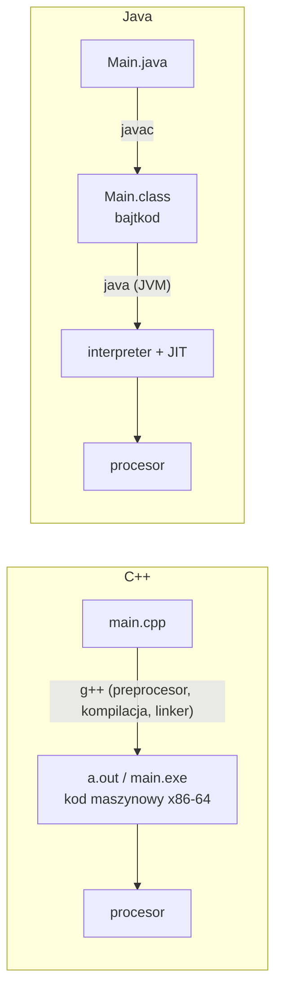

# Java dla programisty C++ (JDK, JRE, JVM, typy)

> [!skrot] W 30 sekund
> - **Co to:** odpowiedzi na punkty 1–4 i 7 z „Teorii” labu 1 AOiM. Ta teoria **obowiązuje na każdym kolejnym labie**.
> - **Klucz:** `javac` kompiluje `.java` do **bajtkodu** (`.class`), a **JVM** wykonuje bajtkod (interpreter + kompilator JIT). JDK = narzędzia + JRE, JRE = JVM + biblioteki standardowe.
> - **Kiedy:** pytanie na odbiorze labu („czym się różni kompilacja w C++ i w Javie?”, „co to JVM?”, „ile bitów ma `long`?”).

> [!intuicja] Po ludzku
> C++ tłumaczysz od razu na język konkretnego procesora i systemu, jak książkę przetłumaczoną na polski. Java tłumaczy na „esperanto” (bajtkod), a na każdym komputerze siedzi tłumacz symultaniczny (JVM), który czyta esperanto i w trakcie czytania przepisuje najczęściej używane fragmenty na język lokalny (JIT). Ten sam `.class` działa na Windowsie, Linuksie i Androidzie.

## Definicja i wzory
> [!definicja] JDK, JRE, JVM
> | Skrót | Rozwinięcie | Co zawiera | Kto potrzebuje |
> |---|---|---|---|
> | **JVM** | Java Virtual Machine | maszyna wirtualna: ładuje klasy, weryfikuje bajtkod, wykonuje go (interpreter + JIT), zarządza pamięcią (garbage collector) | każdy, kto uruchamia program |
> | **JRE** | Java Runtime Environment | JVM + biblioteki standardowe (`java.lang`, `java.util`, …) | użytkownik programu |
> | **JDK** | Java Development Kit | JRE + narzędzia: `javac` (kompilator), `java`, `jar`, `javadoc`, `jdb`, `jshell` | programista |
>
> Od Javy 11 Oracle nie dystrybuuje osobnego JRE, a JDK zawiera wszystko. Pytanie nadal pada, bo podział logiczny został.



> [!definicja] Kompilacja: C++ kontra Java
> | | C++ (kod maszynowy, AOT) | Java (bajtkod + JVM) |
> |---|---|---|
> | Przenośność | trzeba kompilować osobno na każdą platformę | „write once, run anywhere”: ten sam `.class` |
> | Start programu | natychmiast | wolniejszy (ładowanie JVM, rozgrzewanie JIT) |
> | Szybkość po rozgrzaniu | zwykle najszybciej | blisko C++ dzięki JIT, który optymalizuje „gorące” fragmenty na podstawie profilu działania |
> | Bezpieczeństwo | wskaźniki, brak sprawdzania granic tablic | weryfikacja bajtkodu, sprawdzanie granic (`ArrayIndexOutOfBoundsException`), brak arytmetyki wskaźników |
> | Pamięć | ręcznie (`new`/`delete`, RAII) | garbage collector, brak `delete` i destruktorów |
> | Wymagania | nic poza bibliotekami | zainstalowana JVM odpowiedniej wersji |

> [!definicja] Typy prymitywne (zawsze te same rozmiary, niezależnie od platformy)
> | typ | rozmiar | zakres / uwagi | domyślna wartość pola |
> |---|---|---|---|
> | `byte` | 8 bit | −128…127 | 0 |
> | `short` | 16 bit | −32 768…32 767 | 0 |
> | `int` | 32 bit | ok. ±2,1·10⁹ | 0 |
> | `long` | 64 bit | ok. ±9,2·10¹⁸, literał `10L` | 0L |
> | `float` | 32 bit | IEEE 754, ok. 7 cyfr znaczących, literał `1.5f` | 0.0f |
> | `double` | 64 bit | IEEE 754, **ok. 15–16 cyfr znaczących**, $\varepsilon \approx 2{,}2\cdot10^{-16}$ | 0.0 |
> | `char` | 16 bit | znak UTF-16, bez znaku 0…65 535 | `'\u0000'` |
> | `boolean` | (JVM) | `true`/`false`, **nie** konwertuje się z/do `int` | false |
>
> W przeciwieństwie do C++ nie ma typów `unsigned` (poza `char`). Każdy prymityw ma klasę opakowującą (`Integer`, `Double`, …) potrzebną w kolekcjach (lab 2).

> [!wzor] Porównywanie liczb zmiennoprzecinkowych
> `0.1 + 0.2 == 0.3` daje **false**, bo $0{,}1$ nie ma dokładnej reprezentacji binarnej. Porównuj z tolerancją:
> $$|a - b| < \varepsilon \quad\text{(bezwzględna, np. } 10^{-9}) \qquad\text{lub}\qquad |a - b| < \varepsilon \cdot \max(|a|, |b|) \quad\text{(względna)}$$
> W Javie: `Math.abs(a - b) < 1e-9`. Do pieniędzy: `BigDecimal`. Szczegóły: [[Arytmetyka zmiennoprzecinkowa i błędy numeryczne]].

## Obiektowość w Javie — co powiedzieć na odbiorze
> [!definicja] Budowa klasy i pakiety
> ```java
> package lab1;                         // pakiet = katalog lab1/; pełna nazwa klasy: lab1.Point
>
> import java.util.Locale;              // import innych klas
>
> public class Point {                  // 1 publiczna klasa na plik, nazwa pliku = Point.java
>     private final double x, y;        // pola (enkapsulacja: private + metody dostępu)
>     private static int created = 0;   // pole statyczne: jedno na klasę
>
>     public Point(double x, double y) { this.x = x; this.y = y; created++; }  // konstruktor
>     public Point() { this(0, 0); }    // przeciążony konstruktor woła inny przez this(...)
>
>     public double distance(Point p) { return Math.hypot(x - p.x, y - p.y); }      // metoda
>     public double distance() { return distance(new Point()); }                    // przeciążenie
>
>     @Override public String toString() { return String.format(Locale.US, "(%.2f, %.2f)", x, y); }
>
>     public static void main(String[] args) {     // punkt wejścia programu
>         System.out.println(new Point(3, 4).distance());   // 5.0
>     }
> }
> ```
> - **Konstruktor:** ta sama nazwa co klasa, brak typu zwracanego. Jeśli nie napiszesz żadnego, kompilator dodaje bezparametrowy. Brak destruktorów (GC).
> - **Modyfikatory dostępu:** `public` (wszyscy), `protected` (pakiet + podklasy), **brak modyfikatora = package-private** (tylko ten sam pakiet), `private` (tylko ta klasa). W C++ domyślny dostęp w `class` to `private`, w Javie pakietowy.
> - **`main`:** `public static void main(String[] args)`. `static`, bo JVM woła ją bez tworzenia obiektu.
> - **Przeciążanie (overloading):** te same nazwy, różne listy parametrów, wybór w czasie kompilacji. **Nadpisywanie (overriding):** ta sama sygnatura w podklasie, wybór w czasie działania (`@Override`).
> - **Domyślne argumenty metod: w Javie NIE ma** (`void f(int x = 5)` się nie skompiluje). Zastępuje się je przeciążeniem (jak `distance()` wyżej) albo wzorcem Builder.
> - Wszystkie metody niestatyczne są domyślnie **wirtualne** (w C++ trzeba pisać `virtual`). `final` blokuje nadpisanie.
> - Obiekty zawsze przez referencję (`new`), prymitywy przez wartość. Parametry przekazywane są **przez wartość**, ale wartością dla obiektu jest referencja.

> [!definicja] Konwencja nazewnicza (Google Java Style)
> | element | styl | przykład |
> |---|---|---|
> | klasa, interfejs | `UpperCamelCase` | `QuadraticFunction`, `Printable` |
> | metoda, zmienna, parametr | `lowerCamelCase` | `calculateZeros`, `startValue` |
> | stała (`static final`) | `UPPER_SNAKE_CASE` | `MAX_ITERATIONS` |
> | pakiet | małe litery, bez podkreśleń | `pl.agh.lab1` |
>
> Do tego: wcięcie 2 spacje (w IntelliJ można ustawić styl Google), klamra otwierająca w tej samej linii, jedna klasa najwyższego poziomu na plik.

## Jak to zrobić — krok po kroku (pierwszy program bez IDE)
1. `javac -version` sprawdza JDK (na zajęciach Java 11; nowszy JDK + `--release 11` też działa).
2. Plik `src/lab1/Main.java` z `package lab1;`.
3. `javac --release 11 -encoding UTF-8 -d out src/lab1/*.java`.
4. `java -cp out lab1.Main`.
5. W IntelliJ to samo robi przycisk Run, a `out/` to katalog, którego **nie** wysyłasz na UPeL.

## Typowe błędy
> [!blad] Pułapki programisty C++
> - `==` na obiektach (np. `String`) porównuje **referencje**. Treść porównujesz `a.equals(b)`.
> - `int / int` to dzielenie całkowite jak w C++: `1 / 2 == 0`. Pisz `1.0 / 2`.
> - `char` ma 16 bitów, a `boolean` nie jest liczbą (`if (1)` się nie skompiluje).
> - Brak `unsigned`, brak przeciążania operatorów, brak wielodziedziczenia klas (są interfejsy).
> - `Scanner.nextDouble()` zależy od locale: na polskim systemie czyta `0,5`. Ustaw `useLocale(Locale.US)`.
> - Nazwa pliku inna niż nazwa publicznej klasy = błąd kompilacji.

## Na zajęcia i egzamin
> [!zajecia]
> - **Pytania z listy labu 1:** JDK/JRE/JVM; bajtkod a kod maszynowy (zalety i wady); pakiety; budowa klasy; konstruktor; dostępność składowych; `main`; przeciążanie; domyślne argumenty; typy prymitywne, precyzja `double`, porównywanie; interfejs; klasa abstrakcyjna; konwencje nazw.
> - Łączy się z: [[Klasa abstrakcyjna i interfejs (Java)]], [[AOiM Lab 1 — funkcje (klasa abstrakcyjna i interfejs)]].

## Zadania
> [!zadanie] Zadanie 1
> Co wypisze `System.out.println(0.1 + 0.2 == 0.3);` i jak to poprawić?
> > [!odpowiedz]- Odpowiedź
> > `false`, bo w double $0{,}1 + 0{,}2 = 0{,}30000000000000004$. Poprawnie: `Math.abs(0.1 + 0.2 - 0.3) < 1e-9`.

> [!zadanie] Zadanie 2
> Chcesz metodę `print(int precision = 2)`. Jak to zrobić w Javie?
> > [!odpowiedz]- Odpowiedź
> > Dwie przeciążone metody: `print(int precision) { … }` oraz `print() { print(2); }`.

> [!zadanie] Zadanie 3
> Dlaczego program w Javie startuje wolniej niż ten sam w C++, ale po minucie pracy może działać porównywalnie szybko?
> > [!odpowiedz]- Odpowiedź
> > Na starcie JVM musi się załadować, a kod jest najpierw interpretowany. Kompilator JIT obserwuje, które metody są często wywoływane, i kompiluje je do kodu maszynowego z optymalizacjami dobranymi do rzeczywistego profilu działania (np. inlining metod wirtualnych).

## Fiszki #fiszki/aoim
JVM::Maszyna wirtualna wykonująca bajtkod (interpreter + JIT + garbage collector)
JRE::JVM + biblioteki standardowe, do uruchamiania programów
JDK::JRE + narzędzia programisty (`javac`, `jar`, `javadoc`, `jshell`)
Czym jest plik `.class`?::Bajtkod klasy, niezależny od procesora i systemu
Ile bitów ma `int`, `long`, `char` w Javie?::32, 64, 16 (zawsze, na każdej platformie)
Ile cyfr znaczących ma `double`?::Ok. 15–16 (IEEE 754, 64 bity)
Czy Java ma domyślne argumenty metod?::Nie; zastępuje się je przeciążaniem
Domyślny dostęp (bez modyfikatora) w Javie?::Pakietowy (package-private)
Overloading a overriding?::Przeciążanie: inne parametry, wybór przy kompilacji; nadpisywanie: ta sama sygnatura w podklasie, wybór w czasie działania
Jak porównać dwa `String`?::`a.equals(b)`, nie `==`

## Moje notatki
> [!ja] Tu piszesz ty — Albert tej sekcji nie rusza.

## Źródła
- Instrukcja LAB 1, sekcja „Teoria”: [[Lab 1 — klasa abstrakcyjna i interfejs (funkcje).pdf]].
- [dev.java/learn](https://dev.java/learn/): oficjalny kurs Oracle (rozdziały „Getting Started”, „Classes and Objects”, „Primitive Types”).
- *The Java Language Specification*, Java SE 11, rozdz. 4 (typy) i 8 (klasy).
- [Google Java Style Guide](https://google.github.io/styleguide/javaguide.html).
