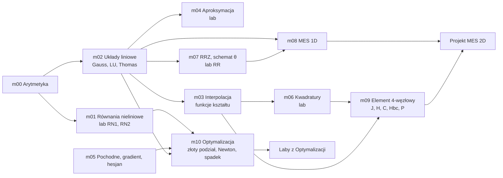

# Kurs — Metody numeryczne

> [!skrot] W 30 sekund
> - **Co to:** 11 modułów, w każdym notatka + **zadania w C++ z testami** + rozwiązanie wzorcowe. Kod jest w repo: `Kod/metody_numeryczne/`.
> - **Cel:** napisać samemu każdy klocek, z którego składa się program MES (Gauss, funkcje kształtu, kwadratury, jakobian, schemat w czasie) i metody optymalizacji (pochodne, Newton, złoty podział). Wszystko w C++, bo w C++ są laby MES, Optymalizacji i instrukcje z metod numerycznych.
> - **Jak:** `./sprawdz.sh 01` pokazuje, które testy przechodzą. Najpierw piszesz sam, do rozwiązania zaglądasz po 20 minutach utknięcia.

## Mapa: co z czego wynika



## Moduły

| Moduł | Notatka | Lab z instrukcją | Co piszesz w C++ | Czas | Przyda się do |
|---|---|---|---|---|---|
| m00 | [[Arytmetyka zmiennoprzecinkowa i błędy numeryczne]] | — | eps maszynowy, suma Kahana, stabilne pierwiastki, Horner | 40 min | kryteria stopu wszędzie |
| m01 | [[Rozwiązywanie równań nieliniowych]] | [[Lab RN1 — metoda stycznych i siecznych.pdf\|RN1]], [[Lab RN2 — bisekcja i regula falsi.pdf\|RN2]] | bisekcja, falsi, styczne, sieczne, Newton 2×2, rząd zbieżności | 90 min | Optymalizacja (Newton), MES nieliniowy |
| m02 | [[Układy równań liniowych]] | (Gauss w aproksymacji) | Gauss z wyborem, LU, Thomas, Gauss–Seidel | 90 min | **MES (układ H t = P)**, aproksymacja, Newton |
| m03 | [[Interpolacja]], [[Funkcje kształtu]] | — | Lagrange, Newton, interpolacja 1D, $N_4$, $\partial N/\partial\xi$ | 60 min | **MES lab 1 i 3** |
| m04 | [[Aproksymacja średniokwadratowa]] | [[Lab — aproksymacja średniokwadratowa.pdf\|aproksymacja]] | układ normalny, wielomian dowolnego stopnia, błąd $E$ | 60 min | Optymalizacja (metamodel) |
| m05 | [[Różniczkowanie numeryczne]] | — | różnice skończone, gradient, hesjan | 50 min | **Optymalizacja (metody gradientowe)** |
| m06 | [[Całkowanie numeryczne i kwadratury Gaussa]] | [[Lab — kwadratury Gaussa-Legendre'a.pdf\|kwadratury]] | prostokąty, trapezy, Simpson, Gauss 1–4, Gauss 2D, całka po czworokącie | 75 min | **MES lab 2–3** |
| m07 | [[Numeryczne rozwiązywanie RRZ]] | [[Lab RR — Euler i Runge-Kutta.pdf\|RR]] | Euler, RK2, RK4, schemat θ dla układu | 75 min | **MES nieustalony** |
| m08 | [[MES 1D — od różnic skończonych do macierzy sztywności]], [[Metoda Galerkina]] | — | pręt: $H$, $P$, $C$, agregacja, stan ustalony i nieustalony | 90 min | **MES** („Wstęp” Kustry) |
| m09 | [[Jakobian]], [[Macierz sztywności]], [[Nieustalony przepływ ciepła]] | MES laby 3–9 | jakobian, $H$, $C$, $H_{bc}$, $P$ elementu 4-węzłowego | 2 h | **projekt MES** |
| m10 | [[Metoda złotego podziału]], [[Funkcja celu i warunki optymalności]] | — | złoty podział z licznikiem, Newton dla minimum, najszybszy spadek | 75 min | **Optymalizacja** |

Testy sprawdzają też przykłady z instrukcji: kroki stycznych 4,459 → 3,672 → 3,416 (RN1), kroki bisekcji 1 → 1,5 → 1,75 (RN2), prosta $a_0 = 0{,}107$, $a_1 = 1{,}392$ (aproksymacja), $y(0{,}3) = 0{,}1382$ (RR), $\int_{0{,}5}^{2{,}5}\sin x \approx 1{,}67163$ (kwadratury) i liczby z plików Kustry (det J, $H$, $C$, $H_{bc}$, $P$).

## Ścieżki: od czego zacząć
> [!wazne] Pod najbliższe zajęcia
> - **MES, lab 2 (całkowanie Gaussa):** m03 → **m06** → m02. Praca domowa z labu 2 to dokładnie testy z m06 ($\int 5x^2 + 3x + 6 = 15{,}333$, $\iint 5x^2y^2 + 3xy + 6 = 26{,}222$). Potem m09 krok po kroku razem z labami 3–9.
> - **Optymalizacja (projekt):** m01 (styczne = Newton) → m05 (gradient, hesjan) → **m10** → [[Trening — Optymalizacja w kodzie]] i [[Framework optymalizacji (matrix, solution) w C++]].
> - **Laby z metod numerycznych z instrukcji:** m01 (RN1, RN2), m04 (aproksymacja), m06 (kwadratury), m07 (RR). W każdej notatce jest sekcja „Lab” z wymaganiami, wynikami do porównania i szkieletem programu.
>
> **Minimum, jeśli masz tylko jeden wieczór:** m02 `gauss`, m03 `N4`/`dN4`, m06 `gauss_wezly` i `gauss_legendre`, m07 `schemat_theta`. To jest kręgosłup programu MES.

## Jak pracować z kodem
```bash
cd ~/obsidian-vault/Kod/metody_numeryczne      # ścieżka do twojego vaulta w WSL
./sprawdz.sh 01                  # testy twojej wersji: [ OK ], [BŁĄD], [TODO]
./sprawdz.sh 04 --zaleznosci-wzor  # twoja aproksymacja, ale gauss() z rozwiązań (gdy m02 jeszcze nie gotowy)
./sprawdz.sh 06 --wzor           # testy rozwiązań wzorcowych (czy środowisko działa)
./sprawdz.sh wszystko            # cały kurs
```
- `mNN.h` — **specyfikacja**: co funkcja ma robić, wzór, kryterium stopu. Tego pliku nie zmieniasz.
- `zadania/mNN.cpp` — tu piszesz. Każda funkcja ma `TODO;`, który rzuca wyjątek „brak implementacji”.
- `testy/test_mNN.cpp` — testy. Komunikat `[BŁĄD]` mówi, w której linii, co wyszło i co powinno.
- `rozwiazania/mNN.cpp` — wzorzec. Po własnej wersji porównaj i zapisz różnice w „Moje notatki” danej notatki.
- Wymagany kompilator: g++ z C++17 (masz 13.3 w WSL). Testy nie potrzebują żadnych bibliotek.

## Jak się uczyć, żeby to zostało w głowie
1. **Notatka, 10 min:** „W 30 sekund”, wzory i jeden przykład policzony na kartce. Wyprowadzeń nie czytasz od deski do deski.
2. **Kod, test po teście:** otwierasz `mNN.h`, piszesz jedną funkcję i odpalasz `./sprawdz.sh NN`. Dopiero zielony test oznacza, że rozumiesz.
3. **Reguła 20 minut:** utknąłeś na 20 min, to zajrzyj do rozwiązania, zamknij je i napisz funkcję jeszcze raz sam.
4. **Pisanie z pamięci (najważniejsze):** następnego dnia skasuj swoją funkcję (albo otwórz pusty plik) i napisz ją jeszcze raz bez patrzenia. Na kolokwium ustnym z MES i na labach tak właśnie będziesz pisać.
5. **Ręcznie jak na egzaminie:** zadania z notatki bez komputera.
6. **Fiszki codziennie 10 min:** `#fiszki/numeryczne` i `#fiszki/mes` (Obsidian, Ctrl+P → Spaced Repetition).
7. **Przeplatanie:** nie rób trzech modułów jednego dnia. Lepiej jeden nowy moduł + 15 min powtórki z pamięci starego.
8. Albert: *„przepytaj mnie z kwadratur Gaussa”*, *„daj podpowiedź do m09, funkcja brzeg”*, *„sprawdź mój m06”*.

## Ściąga C++ do numeryki
> [!kod] Konstrukcje, których używasz w każdym module
> ```cpp
> #include <cmath>        // std::sqrt, std::exp, std::fabs, std::pow, M_PI
> #include <functional>   // std::function
> #include <vector>
> using Vec = std::vector<double>;
> using Mat = std::vector<Vec>;                       // A[i][j]
> using F1  = std::function<double(double)>;          // funkcja jako argument
>
> Mat A(n, Vec(n, 0.0));                              // macierz n×n zer
> double calka(F1 f, double a, double b);             // przyjmuje funkcję, lambdę, wskaźnik
> calka([](double x) { return x * x; }, 0, 1);        // lambda bez przechwytywania
> double k = 2;
> calka([k](double x) { return k * x; }, 0, 1);       // lambda z przechwyceniem k
> void zmien(Vec& v);                                 // & = bez kopii, można zmieniać
> double suma(const Vec& v);                          // const & = bez kopii, tylko odczyt
> throw std::invalid_argument("brak zmiany znaku");   // błąd z opisem; łapiesz try/catch
> std::printf("%2d  %.8f  %.3e\n", k, x, fx);         // tabela iteracji
> ```
> Pułapki: `1/3` to 0 (dzielenie całkowite), pisz `1.0/3`. `pow(x, 2)` jest wolniejsze od `x * x`. Indeksy w `vector` od 0, a w plikach siatki MES od 1.

## Na zajęcia i egzamin
> [!zajecia]
> - **MES, egzamin (60% oceny):** funkcje kształtu, kwadratury Gaussa, jakobian, macierz sztywności i wektor obciążeń, schematy w czasie. To są m03, m06, m07, m08 i m09.
> - **MES, laby:** program piszesz sam i bronisz go ustnie. Moduły m02, m03, m06, m07 i m09 to dokładnie jego części, a testy m09 używają liczb z plików prowadzącego.
> - **Optymalizacja:** m01 (Newton), m04 (metamodel), m05 (gradient i hesjan), m10 (złoty podział, Newton, najszybszy spadek), a do tego [[Trening — Optymalizacja w kodzie]].
> - **Laby z instrukcji (metody numeryczne):** wyniki do porównania i odpowiedzi na pytania są w sekcjach „Lab” notatek m01, m04, m06 i m07.

## Moje notatki
> [!ja] Tu piszesz ty — Albert tej sekcji nie rusza.

## Źródła
- Instrukcje do laboratorium (RN1, RN2, aproksymacja, RR, kwadratury): `Załączniki/MN/Instrukcje/`.
- Z. Fortuna, B. Macukow, J. Wąsowski, *Metody numeryczne*, WNT — podstawowy polski podręcznik.
- D. Kincaid, W. Cheney, *Analiza numeryczna*, WNT.
- R.L. Burden, J.D. Faires, *Numerical Analysis*, Brooks/Cole.
- A. Milenin, *Podstawy metody elementów skończonych*, Wyd. AGH 2010.
- **Darmowe, w repo:** H.P. Langtangen, S. Linge, *Finite Difference Computing with PDEs* (CC BY; rozdz. 3 o dyfuzji i reguła θ, dodatek B o błędzie obcięcia) oraz H.P. Langtangen, K.-A. Mardal, *Introduction to Numerical Methods for Variational Problems* (CC BY; całkowanie, MES) — oba w `Załączniki/MES/Podręczniki/`.
- **Darmowe, online:** S. Linge, H.P. Langtangen, *Programming for Computations — Python*, 2nd ed., Springer 2020, open access ([link.springer.com/book/10.1007/978-3-030-16877-3](https://link.springer.com/book/10.1007/978-3-030-16877-3)) — całkowanie, równania nieliniowe i ODE od strony kodu, krótko i z przykładami.
- **Darmowe, online:** A. Kaw, *Holistic Numerical Methods* (University of South Florida), [mathforcollege.com/nm](https://mathforcollege.com/nm/) — każda metoda z kursu jako krótki PDF, wideo i quiz.
- **Darmowe, online:** MIT OpenCourseWare 18.330 *Introduction to Numerical Analysis* ([ocw.mit.edu](https://ocw.mit.edu/courses/18-330-introduction-to-numerical-analysis-spring-2012/)).
- Linków online nie dało się sprawdzić z miejsca, w którym robiłem notatki (sieć przepuszczała tylko GitHub). Jeśli któryś nie działa, szukaj po tytule.
