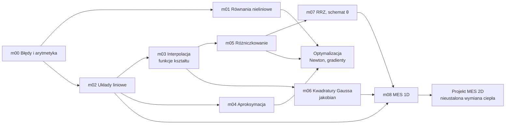

# Kurs — Metody numeryczne

> [!skrot] W 30 sekund
> - **Co to:** 9 modułów powtórki metod numerycznych. Każdy to notatka i plik Pythona z zadaniami, testami i rozwiązaniami.
> - **Klucz:** MES na egzaminie i w projekcie to w praktyce m02, m03, m06, m07 i m08 złożone razem.
> - **Gdzie:** `~/studia/sem5/metody_numeryczne/kurs`, opis w `README.md`. Testy: `~/venvs/opt/bin/pytest -q tests/test_mNN.py`.

## Mapa: co z czego wynika

## Kolejność i czas

| Moduł | Notatka | Czas | Najbardziej dla |
|---|---|---|---|
| m00 | [[Arytmetyka zmiennoprzecinkowa i błędy numeryczne]] | 45 min | wszystko (kryteria stopu, rząd zbieżności) |
| m01 | [[Rozwiązywanie równań nieliniowych]] | 70 min | Optymalizacja |
| m02 | [[Układy równań liniowych]] | 90 min | MES (K·T = F) |
| m03 | [[Interpolacja]] | 75 min | MES: funkcje kształtu |
| m04 | [[Aproksymacja średniokwadratowa]] | 70 min | Optymalizacja: metamodel |
| m05 | [[Różniczkowanie numeryczne]] | 70 min | Optymalizacja: gradient i hesjan |
| m06 | [[Całkowanie numeryczne i kwadratury Gaussa]] | 75 min | MES: całkowanie, jakobian |
| m07 | [[Numeryczne rozwiązywanie RRZ]] | 75 min | MES: krok czasowy; PK: równania różniczkowe |
| m08 | [[MES 1D — od różnic skończonych do macierzy sztywności]] | 2 h | MES: lab z prętem i szkielet projektu |

> [!wazne] Ścieżka ekspresowa pod MES (ok. 6 h)
> m02 → m03 → m06 → m07 → m08. Na pierwszych labach MES są funkcje kształtu i interpolacja (m03), potem pręt 1D (m08), a dalej 2D nieustalone (m06 + m07). Pierwszy lab MES jest w poniedziałek 5.10, więc m03 warto zrobić w weekend.

## Jak się uczyć, żeby było szybko i dokładnie
1. Z notatki najpierw „W 30 sekund” i przykład (10 min). Wyprowadzeń nie czytasz od deski do deski.
2. Piszesz moduł sam, test po teście (`-x`).
3. Po zielonych testach: zadania z notatki bez komputera, czyli tak, jak na egzaminie.
4. Fiszki `#fiszki/numeryczne` codziennie po 10 min (Obsidian → Ctrl+P → Spaced Repetition).
5. Albert: *„przepytaj mnie z kwadratur Gaussa”*, *„daj podpowiedź do m06, funkcja jakobian”*.

## Na zajęcia i egzamin
> [!zajecia]
> - **MES, egzamin (60% oceny):** macierz sztywności i wektor obciążeń, funkcje kształtu, jakobian, całkowanie Gaussa, schematy w czasie. Wszystko to jest w m03, m06, m07 i m08.
> - **MES, projekt (40%):** kod z m08 jest napisany jak szkielet projektu (węzły, elementy, agregacja), więc rozbudujesz go do 2D.
> - **Optymalizacja:** m01 (Newton), m04 (metamodel), m05 (gradient numeryczny), a do tego [[Trening — Optymalizacja w kodzie]].

## Moje notatki
> [!ja] Tu piszesz ty — Albert tej sekcji nie rusza.

## Źródła
- Z. Fortuna, B. Macukow, J. Wąsowski, *Metody numeryczne*, WNT.
- R. L. Burden, J. D. Faires, *Numerical Analysis*.
- A. Milenin, *Podstawy metody elementów skończonych*, Wyd. AGH 2010.
