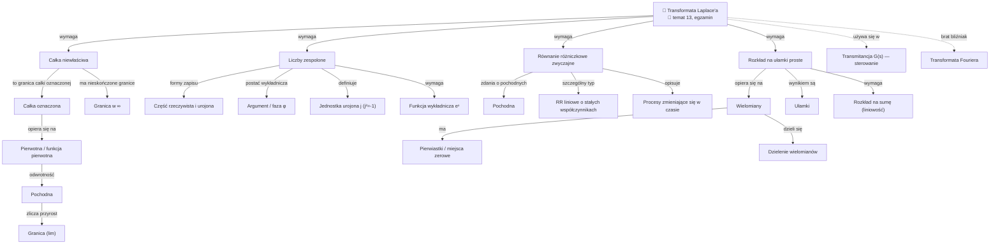

# 🌳 Drzewo nauki — Transformata Laplace'a

> [!intuicja] Jak czytać to drzewo
> Zaczynasz OD DOŁU (najprostsze idee, "jak dla idioty") i wspinasz się w górę, aż dotrzesz do [[Transformata Laplace'a|Laplace'a]]. Każdy węzeł to notatka-pojęcie ze statusem: 🟠 nowe → 🟡 uczę się → ✅ umiem. Kliknij link, żeby otworzyć daną gałąź.

> [!wazne] Zasada "jak dla idioty"
> Nie przechodzisz wyżej, dopóki nie rozumiesz węzła poniżej. Każda notatka kończy się Fiszkami (Ctrl+P → Spaced Repetition) — powtarzaj je, zanim wskoczysz o poziom wyżej.

## 📐 Mapa zależności (od najprostszej idei do Laplace'a)

## 🪜 Ścieżka nauki krok po kroku (od zera do Laplace'a)

### Poziom 0 — podstawa "jak dla idioty" (powtórka z AGH, ~20 min)
- [[Granica (lim)]] — "do czego się zbliża"
- [[Pochodna]] — "tempo zmiany"
- [[Funkcja wykładnicza]] — "eksplozja / gasnięcie"

### Poziom 1 — rachunek całkowy (~25 min)
- [[Całka oznaczona]] — "pole pod krzywą"
- [[Całka niewłaściwa]] — całka oznaczona z granicą w ∞ / przy nieograniczonej funkcji **(filar)**

### Poziom 2 — liczby zespolone (~20 min)
- [[Liczby zespolone]] — "liczby 2D" **(filar)**
- [[Argument i faza (φ)]] — "kąt"

### Poziom 3 — równania różniczkowe (~25 min)
- [[Równanie różniczkowe zwyczajne]] — "równania o pochodnych" **(filar)**
- liniowe o stałych współczynnikach — "te najprostsze, szkolne"

### Poziom 4 — algebra na drodze powrotnej (~20 min)
- [[Wielomiany]] i pierwiastki
- [[Rozkład na ułamki proste]] — "rozbijanie ilorazu na sumę" **(filar)**

### Poziom 5 — gotowy Laplace (~45 min)
- [[Transformata Laplace'a]] — "tłumacz różniczek na algebrę"
- [[Transmitancja]] — dlaczego to ważne w automatyce (Sterowanie procesami ciągłymi, Elektrotechnika, Mechanika)

## ✅ Jak oznaczać postęp
Status w nagłówku notatki: 🟠 `nowe` → rozumiesz treść po przećwiczeniu, zmień na 🟡 `uczę się` przy powtórce, potem na ✅ `umiem`. Postęp drzewa sam liczy się w [[Start]] przez dataview — widzisz go w tabelach przedmiotów.

## 🔗 Gałęzie użycia (dokąd Laplace prowadzi cię w dalszych semestrach)
- [[PK Elektrotechnika i miernictwo]] — [[Stany nieustalone w obwodach]] (RC/RL)
- [[PK Mechanika ogólna]] — [[Drgania mechaniczne]] (mẍ + cẋ + kx = F(t))
- **Sterowanie procesami ciągłymi** (PK sem. 4–5, egzamin)
- **Teoria sygnałów** (FFT, [[Transformata Fouriera|Fourier]])

## Moje notatki
> [!ja] Tu piszesz ty — Albert tej sekcji nie rusza.
