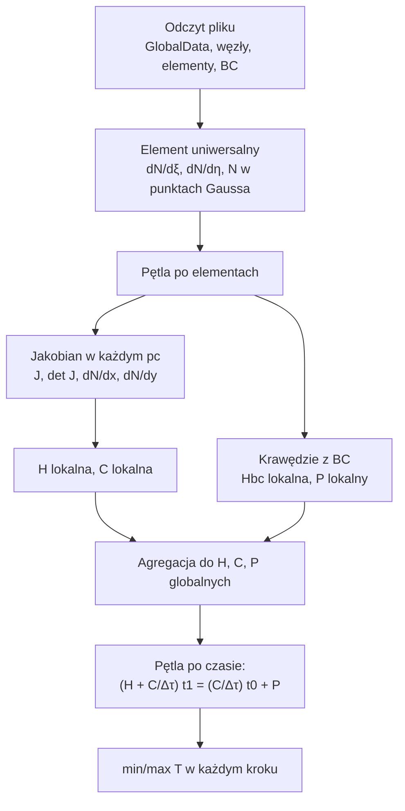

# MES — kurs dr. Kustry (mapa labów)

> [!skrot] W 30 sekund
> - **Co to:** przez 14 labów piszesz **własny program MES 2D**, który liczy nieustalony przepływ ciepła z konwekcją na brzegu. Każdy lab dokłada jeden klocek.
> - **Klucz:** $\left([H] + \frac{[C]}{\Delta\tau}\right)\{t_1\} = \frac{[C]}{\Delta\tau}\{t_0\} + \{P\}$, gdzie $[H]$ zawiera już $[H_{bc}]$. Cały kurs to policzenie tych trzech obiektów i rozwiązanie układu w pętli po czasie.
> - **Kiedy:** każdy lab. Pod koniec kursu jest kolokwium ustne z twojego kodu i sprawozdanie.

> [!intuicja] Po ludzku
> Płytka stali o temperaturze 100 °C trafia do pieca o temperaturze 1200 °C. Pytanie: jak szybko się nagrzewa i gdzie jest najgorętsza? Program dzieli płytkę na kwadraty (elementy). W każdym liczy, jak łatwo ciepło przez niego płynie ($H$), ile ciepła mieści ($C$) i ile wpada z pieca przez brzeg ($H_{bc}$, $P$). Potem skleja to w jeden duży układ równań i rozwiązuje go krok po kroku w czasie.

## Zasady zaliczenia (2025/26, od prowadzącego)
> [!definicja] Jak się zalicza część laboratoryjną
> - Piszesz **samodzielnie** oprogramowanie MES do nieustalonego transportu ciepła z konwekcją. Na **3 ostatnich zajęciach** jest **kolokwium ustne**: rozmowa z prowadzącym o twoim kodzie i teorii.
> - Na **UPEL** wrzucasz **sprawozdanie i kod**. Samo potwierdzenie, że program działa (siatki testowe) daje **3.0**. **Problem rzeczywisty** ustalony z prowadzącym (np. ściana wielowarstwowa, hartowanie) podnosi ocenę do **3.5–5.0**.
> - W trakcie kursu mogą być **kolokwia na UPEL albo niezapowiedziane kartkówki**. Ich średnia musi wynosić **co najmniej 50%**.
> - **Ocena z labów = średnia z: kolokwiów, sprawozdania, odpowiedzi ustnej.** Są dwa terminy poprawkowe.
> - Przedmiot: 0,4·zaliczenie + 0,6·egzamin (z sylabusa, patrz [[AGH Metoda elementów skończonych]]).
>
> Oryginał: ![[00 Zasady zaliczenia 2025-26.pdf]]

## Plan labów: co, z czego i jak sprawdzić
Kolejność jest zgodna z numeracją materiałów prowadzącego. Daty mogą się przesunąć, bo tempo ustala prowadzący.

| # | Temat | Materiał prowadzącego | Notatka | Efekt w kodzie | Sprawdzasz na |
|---|---|---|---|---|---|
| 1 | Wstęp: analiza problemu, funkcje kształtu, interpolacja, funkcjonał | [[01 MES zajęcia 1 — funkcje kształtu, interpolacja, siatka.pdf\|Zajęcia 1]], [[01 Wstęp — ustalony przepływ ciepła (do druku).pdf\|Wstęp (do druku!)]] | [[Funkcje kształtu]], [[Metoda Galerkina]], [[Siatka MES i wczytywanie danych]] | `GlobalData`, `node`, `element`, `grid` + odczyt pliku | wypisane węzły i ID elementów jak w pliku wyników |
| 2 | Całkowanie numeryczne (prostokąty, Gauss 1D/2D) | [[04 Całkowanie Gaussa — materiały do zajęć.pdf\|Gauss]], [[02 Tablica kwadratur Gaussa.png\|tablica]] | [[Całkowanie numeryczne i kwadratury Gaussa]] | funkcja całkująca 2- i 3-punktowo w 1D i 2D | $\int_{-1}^1 5x^2+3x+6 = 15{,}333$, $\iint 5x^2y^2+3xy+6 = 26{,}222$ |
| 3 | Jakobian przekształcenia, całkowanie na $[a,b]$ | [[03 Jakobian.pdf\|Jakobian]], [[03.1 Całkowanie z jakobianem przekształcenia 1D-2D.pdf\|całkowanie z jakobianem]] | [[Jakobian]] | element uniwersalny ($dN/d\xi$, $dN/d\eta$ w pc), $J$, $\det J$, $dN/dx$, $dN/dy$ | $\det J = 0{,}000277778$ dla Test1 |
| 4–5 | Macierz $[H]$ elementu | [[05 Całkowanie macierzy H.pdf\|Macierz H]] | [[Macierz sztywności]] | $[H]$ lokalna, 2/3/4 punkty | $H_{11} = 16{,}6667$ dla Test1 |
| 6 | Agregacja | [[06 Agregacja H.pdf\|Agregacja]] | [[Macierz sztywności]] | $[H]$ globalna | plik HG bez BC |
| 7 | Warunek brzegowy: $[H_{bc}]$ | [[07 Macierz Hbc.pdf\|Hbc]] | [[Macierz sztywności]] | $[H_{bc}]$ z krawędzi z flagą BC | $H+H_{bc}$: $23{,}333$; $-2{,}5$ |
| 8 | Wektor $\{P\}$ i układ ustalony | [[08 Wektor P.pdf\|Wektor P]] | [[Macierz sztywności]] | $\{P\}$, rozwiązanie $[H]\{t\} = \{P\}$ | $P = 12000$ w węzłach brzegowych |
| 9 | Macierz $[C]$, rozwiązanie nieustalone | [[09 Rozwiązanie niestacjonarne.pdf\|Niestacjonarne]], [[09.1 Całkowanie macierzy C.pdf\|Macierz C]] | [[Nieustalony przepływ ciepła]], [[Schematy całkowania w czasie]] | $[C]$, pętla po czasie, min/max $T$ | tabela niżej |
| 10–11 | Testy na 3 siatkach, problem rzeczywisty, siatki w ABAQUS | [[11 Tworzenie siatek w ABAQUS.pdf\|ABAQUS]] | [[Nieustalony przepływ ciepła]] | własna siatka, wnioski | sprawozdanie |
| 12–14 | **Kolokwium ustne** z kodu i teorii | — | wszystkie powyżej | — | — |

Ściąga z wzorami od prowadzącego: ![[10 Wzory (ściąga).pdf]]

## Dane testowe i wyniki do porównania
- Siatki: [[Test1_4_4.txt]] (kwadrat 4×4 węzły), [[Test2_4_4_MixGrid.txt]] (ten sam kwadrat, ale elementy są nieprostokątne), [[Test3_31_31_kwadrat.txt]] (31×31 węzłów).
- Wyniki pośrednie od prowadzącego są w folderze `Załączniki/MES/Kustra — wyniki testowe/`: jakobian, $dN/dx$, $H$ lokalne, $H_{bc}$, $P$, $H$ globalna i $C$.

> [!wzor] Min i max temperatura w czasie (schemat niejawny, 2 punkty Gaussa)
> Test1 zgadza się z plikiem *TestCase* prowadzącego co do 3 miejsc po przecinku. Pozostałe dwie kolumny policzył referencyjny solver w `Załączniki/MES/kod/mes2d.py`, sprawdzony na Test1 i na macierzach $H+H_{bc}$ i $P$ dla MixGrid.
>
> | $\tau$ [s] | Test1 min | Test1 max | MixGrid min | MixGrid max |
> |---|---|---|---|---|
> | 50 | 110,038 | 365,815 | 95,152 | 374,686 |
> | 100 | 168,837 | 502,592 | 147,644 | 505,968 |
> | 150 | 242,801 | 587,373 | 220,164 | 586,998 |
> | 200 | 318,615 | 649,387 | 296,736 | 647,286 |
> | 250 | 391,256 | 700,068 | 370,968 | 697,334 |
> | 300 | 459,037 | 744,063 | 440,560 | 741,219 |
> | 350 | 521,586 | 783,383 | 504,891 | 781,210 |
> | 400 | 579,034 | 818,992 | 564,002 | 817,392 |
> | 450 | 631,689 | 851,431 | 618,174 | 850,237 |
> | 500 | 679,908 | 881,058 | 667,766 | 880,168 |
>
> Test3 (31×31, $\Delta\tau = 1$ s): po 1 s max 149,557; po 5 s 226,683; po 10 s 276,701; po 20 s min 100,064 i max 341,085. Pełne tabele są w `Załączniki/MES/kod/wyniki referencyjne.txt`.

> [!wazne] Jak korzystać z solvera referencyjnego
> `mes2d.py` służy **tylko do sprawdzania liczb**. Na kolokwium ustnym tłumaczysz *swój* kod, więc najpierw piszesz sam, a dopiero potem porównujesz. Uruchomienie: `python3 mes2d.py "../Kustra — siatki testowe/Test2_4_4_MixGrid.txt" 2`. Ostatni argument to liczba punktów Gaussa (2, 3 albo 4).

## Algorytm całego programu

## Typowe błędy (z wyników testów)
> [!blad] Numeracja od 1 w pliku, od 0 w kodzie
> Plik ma węzły `1..nN`, a tablice w C++ i Pythonie liczą od 0. Odejmij 1 przy wczytywaniu i trzymaj się tego w całym programie. Objaw: elementy wskazują na sąsiedni węzeł albo wychodzisz poza tablicę.

> [!blad] Węzły w Test1 idą od prawej do lewej
> W Test1 węzeł 1 ma $x = 0{,}1$, a węzeł 4 ma $x = 0$. Dlatego jakobian ma na przekątnej $-0{,}0167$, a nie $+0{,}0167$. To nie jest błąd: $\det J$ i tak wychodzi dodatni, bo odwrócone są oba kierunki.

> [!blad] Hbc na krawędzi, która ma tylko jeden węzeł z BC
> Warunek brzegowy liczysz tylko na krawędzi, której **oba** węzły mają flagę BC. Węzeł narożny ma flagę, ale jego krawędź wewnętrzna już nie.

## Na zajęcia i egzamin
> [!zajecia]
> - **Każdy lab:** przychodzisz z działającym krokiem z poprzedniego labu (praca domowa) i porównujesz wyniki z plikami prowadzącego.
> - **Kolokwium ustne:** „pokaż, gdzie w kodzie liczysz jakobian”, „dlaczego $H_{bc}$ liczysz po krawędzi, a $H$ po objętości”, „co się zmieni przy 3 punktach całkowania”, „skąd się bierze $C/\Delta\tau$”.
> - **Egzamin:** wyprowadzenie $[H]\{t\} + \{P\} = 0$ z funkcjonału, funkcje kształtu, jakobian, schematy w czasie.

## Zadania
> [!zadanie] Zadanie 1
> Ile niewiadomych ma układ równań dla siatki Test3_31_31 i ile elementów ma ta siatka?
> > [!odpowiedz]- Odpowiedź
> > $31 \cdot 31 = 961$ węzłów, czyli 961 niewiadomych temperatur. Elementów jest $30 \cdot 30 = 900$.

> [!zadanie] Zadanie 2
> Dlaczego w Test1 temperatura minimalna rośnie od razu, a w Test3 przez pierwsze ~5 s zostaje równa 100 °C?
> > [!odpowiedz]- Odpowiedź
> > W Test1 są tylko 4 węzły wewnętrzne, a każdy z nich leży jeden element od brzegu (3,3 cm), więc ciepło dociera tam od razu. W Test3 węzeł centralny leży 15 elementów od brzegu, a krok czasowy wynosi 1 s. Ciepło potrzebuje czasu, żeby przewędrować przez materiał.

## Fiszki #fiszki/mes
Równanie MES dla nieustalonego przepływu ciepła w kursie Kustry::([H] + [C]/Δτ)·{t1} = ([C]/Δτ)·{t0} + {P}
Co daje samo potwierdzenie działania programu w sprawozdaniu MES?::Ocenę 3.0. Problem rzeczywisty podnosi ją do 3.5–5.0
Z czego składa się ocena z labów MES?::Średnia z kolokwiów (min. 50%), sprawozdania i odpowiedzi ustnej
Kiedy jest kolokwium ustne z MES?::Na trzech ostatnich zajęciach
Test1_4_4 po 500 s: min i max temperatura::679,91 °C i 881,06 °C
Dane fizyczne siatek testowych Kustry::k = 25, α = 300, t_ot = 1200, t0 = 100, ρ = 7800, c = 700

## Moje notatki
> [!ja] Tu piszesz ty — Albert tej sekcji nie rusza.

## Źródła
- P. Kustra, materiały do laboratorium MES, AGH WIMiIP, 2025/26: [home.agh.edu.pl/~pkustra/MES.html](https://home.agh.edu.pl/~pkustra/MES.html). Kopie w `Załączniki/MES/Kustra — instrukcje/` pochodzą z publicznego repozytorium studenta (AndrzejJanaszek/fem-lab-agh, styczeń 2026), bo strona AGH nie była dostępna z miejsca, w którym je pobierałem.
- A. Milenin, *Podstawy metody elementów skończonych*, Wydawnictwa AGH, Kraków 2010 (rozdziały 5 i 6 = „Wstęp” i „Rozwiązanie niestacjonarne”).
- Więcej: [[MES — źródła i podręczniki]].
