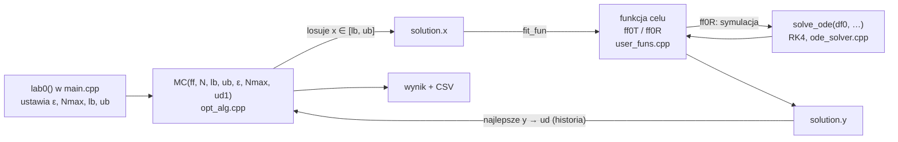

# Optymalizacja Lab 0 — Monte Carlo i wahadło

> [!skrot] W 30 sekund
> - **Co to:** ćwiczenie wprowadzające do projektu C++ dr. Sztangreta. Uruchamiasz gotową metodę **Monte Carlo** (`MC` w `opt_alg.cpp`) na funkcji testowej `ff0T` i na problemie rzeczywistym `ff0R`.
> - **Problem rzeczywisty:** jaki moment siły $M \in [0, 5]$ N·m, działający przez 0,5 s, rozbuja wahadło do maksymalnego wychylenia **dokładnie 1 rad**? Odpowiedź: $M^* \approx 3{,}509$ N·m.
> - **Oddajesz:** wynik dla funkcji testowej, wykres funkcji celu w kolejnych iteracjach, symulację dla znalezionego $M$ w `.xlsx` i wykresy $\theta(t)$ oraz $\dot\theta(t)$.

> [!intuicja] Po ludzku
> Nie wiesz, jak mocno pchnąć huśtawkę, żeby wychyliła się dokładnie do zadanego kąta. Pchasz losowo z różną siłą, za każdym razem mierzysz, o ile chybiłeś, i zapamiętujesz najlepszą próbę. To jest Monte Carlo. Nie wymaga wzoru ani pochodnych, tylko umiejętności policzenia „o ile chybiłem”. Tutaj policzenie tego wymaga **symulacji** całego ruchu wahadła, więc jedno wywołanie funkcji celu kosztuje 100 kroków RK4.

## Struktura projektu (z notatki grupy IO)

- `matrix`: wektory, macierze, liczby. **Nie modyfikujesz.**
- `solution`: `x` (zmienne), `y` = $f(x)$, `g`, `H`, `flag`, statyczne liczniki `f_calls`, `g_calls`, `H_calls`. `fit_fun()` liczy `y` i zwiększa `f_calls`.
- `user_funs.cpp`: `ff0T` (test ze znanym minimum), `ff0R` (wahadło) i `df0` (model RR).
- `opt_alg.cpp`: gotowe `MC`, puste szkielety kolejnych metod (`expansion`, `fib`, `lag`, `HJ`, `Rosen`, `pen`, `sym_NM`, `SD`, `CG`, `Newton`, `golden`, `Powell`, `EA`).
- Szczegóły klas i pułapki: [[Framework optymalizacji (matrix, solution) w C++]].

## Definicja i wzory
> [!wzor] Funkcja testowa `ff0T`
> $$f(x_1, x_2) = (x_1 - a_1)^2 + (x_2 - a_2)^2, \qquad X = [-5, 5]^2, \qquad a = (-1, 2)$$
> Minimum $f = 0$ w $x = a$. W kodzie $a$ przychodzi przez `ud1`.

> [!wzor] Problem rzeczywisty: wahadło matematyczne
> $$I\ddot\theta + b\dot\theta + mgl\sin\theta = M(t), \qquad I = ml^2$$
> $m = 1$ kg, $l = 0{,}5$ m, $b = 0{,}5$ N·m·s, $g = 9{,}81$ m/s², $\theta(0) = \dot\theta(0) = 0$. Moment działa tylko na początku: $M(t) = M$ dla $t \le 0{,}5$ s, potem 0.
>
> Układ pierwszego rzędu dla RK4 (`df0`): $Y = (\theta, \dot\theta)$,
> $$\dot Y_0 = Y_1, \qquad \dot Y_1 = \frac{[t \le 0{,}5]\,M - mgl\sin Y_0 - bY_1}{I}$$
> **Funkcja celu:** $f(M) = |\theta_{max}(M) - \theta_{opt}|$, gdzie $\theta_{opt} = 1$ rad, a $\theta_{max}$ to największe $\theta$ z symulacji.

> [!wzor] Monte Carlo z kodu (`MC`)
> 1. Losuj $x \sim U[lb, ub]$ (`rand_mat` + skalowanie $x_i = (ub_i - lb_i)\,r_i + lb_i$), policz $f$.
> 2. Jeśli $f(x) < f(x_{opt})$, to $x_{opt} \leftarrow x$.
> 3. Stop 1: $f(x_{opt}) < \varepsilon$ → `flag = 1`. Stop 2: `f_calls > Nmax` → `flag = 0`.
> 4. Po każdym losowaniu najlepsza wartość jest dopisywana wierszem do `Xopt.ud`. To jest **historia do wykresu** „funkcja celu w kolejnych iteracjach”.
>
> Uwaga: kryterium $f < \varepsilon$ ma sens tylko dlatego, że **znamy** minimum ($f^* = 0$). W prawdziwym problemie bez znanego minimum MC zatrzymuje się dopiero na `Nmax`.

## Jak to zrobić — krok po kroku
1. Pobierz `Pliki źródłowe` z UPeL (kopia w vaulcie: `Załączniki/Optymalizacja/Kod lab (Sztangret)/`, przekonwertowana na UTF-8), utwórz projekt w Visual Studio albo zbuduj: `g++ -std=c++17 -O2 *.cpp -o lab0`.
2. **Funkcja testowa:** w `lab0()` zmień `if (0)` przy „Funkcja testowa” na `if (1)`. Ustawienia: $\varepsilon = 10^{-2}$, `Nmax = 10000`, $lb = (-5,-5)$, $ub = (5, 5)$, $a = (-1, 2)$. Wypisz `opt`.
3. **Wahadło:** blok „Wahadło” (domyślnie włączony): $\varepsilon = 10^{-2}$, `Nmax = 1000`, $lb = 0$, $ub = 5$, `ud1 = teta_opt = 1`.
4. `optymalicja_lab0.csv` (literówka w oryginale): historia najlepszego $f$, czyli wykres zbieżności. `symulacja_lab0.csv`: kolumny $t$, $\theta$, $\dot\theta$ dla znalezionego $M$. Separator `;`, przecinek dziesiętny (`SEP_SYMBOL`), więc polski Excel czyta bez konwersji. Zapisz jako `.xlsx` (wymóg instrukcji).
5. Wykresy: $f$ w funkcji iteracji, $\theta(t)$, $\dot\theta(t)$.
6. Sprawozdanie: cel, sformułowanie obu zadań, parametry metody, wyniki (tabela kilku uruchomień, bo MC jest losowe), wykresy, wnioski.

## Przykład
> [!przyklad] Moje uruchomienia oryginalnego kodu (g++ 15, Linux)
> **Wahadło** (8 uruchomień, `flag = 1` w każdym):
>
> | $M$ [N·m] | $f(M)$ | `f_calls` |
> |---|---|---|
> | 3,5403 | 0,00959 | 32 |
> | 3,5029 | 0,00201 | 75 |
> | 3,5260 | 0,00516 | 137 |
> | 3,5156 | 0,00192 | 56 |
> | 3,5111 | 0,00054 | 110 |
> | 3,4921 | 0,00535 | 10 |
> | 3,5052 | 0,00128 | 700 |
> | 3,5171 | 0,00241 | 21 |
>
> Dokładnie (bisekcja na tej samej symulacji): $M^* = 3{,}5094$ N·m. Warunek $f < 0{,}01$ spełnia przedział $M \in [3{,}477;\ 3{,}542]$, czyli 1,3% zakresu $[0, 5]$. Średnio wystarcza ok. **77 losowań**, ale rozrzut jest duży (od 10 do 700).
>
> **Funkcja testowa** (8 uruchomień): $x$ od $(-1{,}08;\ 2{,}02)$ do $(-0{,}92;\ 1{,}99)$, `f_calls` od **351 do 9498**. Teoria: trafienie w koło o promieniu $\sqrt{0{,}01} = 0{,}1$ wokół $a$ ma prawdopodobieństwo $p = \frac{\pi \cdot 0{,}01}{100} \approx 3{,}14\cdot10^{-4}$, więc średnio $1/p \approx 3183$ wywołań. W ok. 4,6% uruchomień MC **nie zmieści się w `Nmax = 10000`** i skończy z `flag = 0`.

![[Lab 0 — wahadło (theta_max, funkcja celu, symulacja).png]]

![[Lab 0 — zbieżność Monte Carlo.png]]

Z wykresów: $\theta_{max}(M)$ rośnie prawie liniowo, więc funkcja celu $|\theta_{max} - 1|$ ma kształt litery V z jednym minimum (jest unimodalna). Dlatego w kolejnych labach ten sam problem rozwiążą o wiele taniej metody jednowymiarowe (ekspansja + Fibonacci/złoty podział). Maksymalne wychylenie pojawia się już w pierwszym wahnięciu (ok. 0,7 s), więc symulacja do 10 s czy do 20 s daje ten sam $\theta_{max}$.

## Typowe błędy
> [!blad] Na co uważać
> - **Instrukcja mówi „symulacja od 0 do 20 s”, a kod liczy do 10 s** (`solve_ode(df0, 0, 0.1, 10, …)`). Dla wyniku to bez znaczenia (maksimum jest w pierwszej sekundzie), ale w sprawozdaniu podaj, czego użyłeś, albo zmień na 20.
> - Brak `solution::clear_calls()` między uruchomieniami: liczniki są **statyczne**, więc drugie uruchomienie startuje z `f_calls` pierwszego i szybciej trafia w `Nmax`.
> - Wykres „funkcja celu w iteracjach” rób z historii **najlepszego** $f$ (to zapisuje `ud`), a nie z losowych prób. Ta krzywa jest schodkowa i nierosnąca.
> - Jedno uruchomienie MC to nie wynik. Metoda jest losowa, więc podaj kilka przebiegów albo średnią i rozrzut.
> - `MT = matrix(2, new double[2]{…})` w `ff0R` przy każdym wywołaniu alokuje pamięć bez `delete`. To drobny wyciek w kodzie prowadzącego: nie poprawiaj go na siłę, ale nie kopiuj tego wzorca do własnych funkcji.
> - Pliki źródłowe z UPeL są w kodowaniu Windows-1250 (polskie komentarze). Na Linuksie/VS Code ustaw kodowanie albo przekonwertuj `iconv -f cp1250 -t utf-8`.

## Na zajęcia i egzamin
> [!zajecia]
> - **Ćwiczenia:** umieć powiedzieć, co robi każdy plik projektu, jak przekazywać dane do funkcji celu przez `ud1`/`ud2`, co oznacza `flag`, dlaczego trzeba zerować liczniki.
> - **Egzamin:** idea Monte Carlo, jego zalety (prostota, brak pochodnych, globalne przeszukiwanie) i wady (koszt rośnie wykładniczo z wymiarem i dokładnością, wynik losowy).
> - Łączy się z: [[Numeryczne rozwiązywanie RRZ]] (RK4 w `solve_ode`), [[Metoda złotego podziału]] (ten sam problem w lab 1), [[Trening — Optymalizacja w kodzie]].

## Zadania
> [!zadanie] Zadanie 1
> Ile średnio losowań potrzebuje MC dla `ff0T` przy $\varepsilon = 10^{-4}$ zamiast $10^{-2}$?
> > [!odpowiedz]- Odpowiedź
> > Promień koła $\sqrt{10^{-4}} = 0{,}01$, $p = \frac{\pi \cdot 10^{-4}}{100} \approx 3{,}1\cdot10^{-6}$, czyli średnio ok. **318 000** wywołań. 100× większa dokładność w $f$ oznacza 100× więcej losowań (w 2D). Z `Nmax = 10000` prawie zawsze skończy się `flag = 0`.

> [!zadanie] Zadanie 2
> Dlaczego dla wahadła MC kończy się po kilkudziesięciu wywołaniach, a dla funkcji testowej po tysiącach?
> > [!odpowiedz]- Odpowiedź
> > Wahadło to zadanie **jednowymiarowe**, w którym „dobry” przedział zajmuje 1,3% zakresu ($p \approx 0{,}013$, średnio ok. 77 losowań). Funkcja testowa jest **dwuwymiarowa** i dobre koło zajmuje 0,03% kwadratu. Z każdym wymiarem udział dobrego obszaru maleje wykładniczo (przekleństwo wymiarowości).

> [!zadanie] Zadanie 3
> Jak policzyć $M^*$ dokładnie, bez losowania?
> > [!odpowiedz]- Odpowiedź
> > $\theta_{max}(M)$ jest rosnąca, więc wystarczy **bisekcja** równania $\theta_{max}(M) - 1 = 0$ na $[0, 5]$ ([[Rozwiązywanie równań nieliniowych]]) albo minimalizacja $|\theta_{max} - 1|$ złotym podziałem. Wychodzi $M^* = 3{,}5094$ N·m.

## Fiszki #fiszki/optymalizacja
Co jest zmienną decyzyjną w lab 0 (wahadło)?::Moment siły $M \in [0, 5]$ N·m, działający przez 0,5 s
Funkcja celu `ff0R`?::$|\theta_{max}(M) - 1|$, gdzie $\theta_{max}$ z symulacji RK4
Ile wynosi $M^*$ w lab 0?::Ok. 3,509 N·m
Kiedy `MC` ustawia `flag = 1`, a kiedy 0?::1: $f < \varepsilon$; 0: przekroczone `Nmax` wywołań
Co przechowuje `Xopt.ud` po `MC`?::Historię najlepszej wartości funkcji celu (do wykresu zbieżności)
Średnia liczba losowań MC dla `ff0T`, $\varepsilon = 0{,}01$, $X = [-5,5]^2$?::Ok. 3183 ($1/p$, $p = \pi\cdot0{,}01/100$)

## Moje notatki
> [!ja] Tu piszesz ty — Albert tej sekcji nie rusza.

## Źródła
- Instrukcja: [[Lab 0 — Monte Carlo i wahadło (instrukcja).pdf]] (Ł. Sztangret, KISiM AGH).
- Dokumentacja: [[Dokumentacja klas matrix i solution.pdf]].
- Kod: `Załączniki/Optymalizacja/Kod lab (Sztangret)/` (CC BY-SA 3.0, wersja z 15.09.2026, przekonwertowana do UTF-8).
- Notatka z lab 0 grupy IO (UPeL, sekcja „Notatka z lab0 grupy IO”).
