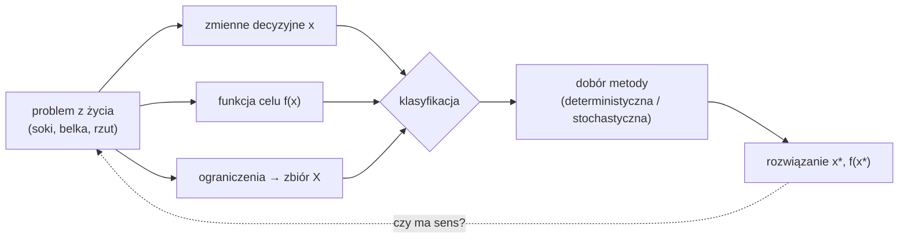

# Optymalizacja W01 — wprowadzenie i klasyfikacja problemów

> [!skrot] W 30 sekund
> - **Co to:** pierwszy wykład prof. Kusiaka (1.10.2026). Pokazuje, **jak zamienić problem z życia na zadanie matematyczne**: zmienne decyzyjne, funkcja celu, ograniczenia. Potem dzieli problemy i metody na klasy.
> - **Klucz:** zadanie optymalizacji to $\min_{x \in X} f(x)$ (albo max). Etapy: zdefiniuj $f$, wyznacz zbiór/przedział poszukiwań $X$, znajdź $x^*$ i $f(x^*)$.
> - **Kiedy:** każde zadanie projektowe zaczynasz od tego sformułowania. Na egzaminie typowe pytanie: „sformułuj zadanie” albo „sklasyfikuj problem”.

> [!intuicja] Po ludzku
> Optymalizacja to „najlepiej, jak się da, przy tym, co wolno”. Pszczoły od milionów lat budują sześciokątne plastry, bo przy danej ilości wosku dają największą pojemność. Matematycznie udowodnił to dopiero Thomas Hales w 1999 r. (*Honeycomb Conjecture*). Wniosek z wykładu: **obserwacja natury często podpowiada rozwiązanie optymalne**, a teoria optymalizacji daje narzędzia, żeby takie rozwiązanie znaleźć celowo.

## Definicja i wzory
> [!definicja] Sformułowanie zadania optymalizacji
> 1. **Zmienne decyzyjne** $x = (x_1, \dots, x_n)$: to, na co masz wpływ.
> 2. **Funkcja celu** $f(x)$: miara jakości, którą minimalizujesz (koszt, masa, błąd) albo maksymalizujesz (zysk, zasięg). $\max f = -\min(-f)$.
> 3. **Ograniczenia** wyznaczające **zbiór rozwiązań dopuszczalnych** $X$: równości $h(x) = 0$, nierówności $g(x) \le 0$, zakresy $x_i \in [l_i, u_i]$.
> $$x^* = \arg\min_{x \in X} f(x)$$

> [!definicja] Klasyfikacja problemów (slajd „Klasyfikacja problemów optymalizacji”)
> | kryterium | klasy |
> |---|---|
> | rodzaj zadania | **liniowe** (liniowa funkcja celu i ograniczenia) / **nieliniowe** |
> | ograniczenia | **bez ograniczeń** / **z ograniczeniami** |
> | wymiar | **jednowymiarowe** (1 zmienna) / **wielowymiarowe** |
> | liczba kryteriów | **jednokryterialne** / **wielokryterialne** |
>
> **Klasyfikacja metod:** **deterministyczne (klasyczne)**, czyli ten sam start daje ten sam wynik (złoty podział, Newton, gradienty), oraz **niedeterministyczne (stochastyczne)** z losowością (Monte Carlo, genetyczne, rój cząstek, wyżarzanie).

## Przykłady z wykładu
> [!przyklad] 1. Problem logistyczny: soki firmy Frutel (programowanie liniowe)
> Zysk: malinowy 2 zł/l, porzeczkowy 2,5 zł/l. W godzinę najwyżej 30 l obu soków razem. Porzeczkowego nie więcej niż 3× malinowego (malinowy daje składnik potrzebny do porzeczkowego).
> $$\max\ f(x_1, x_2) = 2x_1 + 2{,}5x_2 \quad\text{p.o.}\quad x_1 + x_2 \le 30,\quad x_2 \le 3x_1,\quad x_1, x_2 \ge 0$$
> Slajd „Problem” w tabelce zapisuje drugie ograniczenie jako $p_1 \le 3p_2$, ale tekst zadania i slajd ze sformułowaniem matematycznym mówią $x_2 \le 3x_1$. Liczę wg tej drugiej wersji.
>
> **Rozwiązanie** (wykład zostawił „Jak to rozwiązać?”): obszar dopuszczalny to trójkąt o wierzchołkach $(0,0)$, $(30, 0)$ i przecięcie $x_2 = 3x_1$ z $x_1 + x_2 = 30$, czyli $(7{,}5;\ 22{,}5)$. Funkcja liniowa osiąga max w wierzchołku: $f = 0$, $60$, $15 + 56{,}25 = \mathbf{71{,}25}$. **Optimum: 7,5 l malinowego i 22,5 l porzeczkowego na godzinę, zysk 71,25 zł/h.**
>
> ![[W01 — problem soków (programowanie liniowe).png]]

> [!przyklad] 2. Problem inżynierski: belka (dwa kryteria)
> Stalowa belka o przekroju kołowym (długość $l$, średnica $d$), obciążona siłą $P$ na końcu. Chcemy **jednocześnie** minimalnej masy $f_1$ i minimalnego ugięcia $f_2$. Te kryteria są sprzeczne: grubsza belka mniej się ugina, ale więcej waży. Rozwiązania niezdominowane tworzą **front Pareto** (tabela z wykładu, $l = 200$ dla A–D):
>
> | rozw. | $d$ | $l$ | masa | ugięcie |
> |---|---|---|---|---|
> | A | 18,94 | 200 | 0,44 | 2,04 |
> | B | 21,24 | 200 | 0,58 | 1,18 |
> | C | 34,19 | 200 | 1,43 | 0,19 |
> | D | 50,00 | 200 | 3,06 | 0,04 |
> | E | 33,02 | 362,5 | 2,42 | 1,31 |
>
> A–D leżą na froncie Pareto: żadne nie jest lepsze od innego w obu kryteriach naraz. **E jest zdominowane**, np. przez C: C ma mniejszą masę (1,43 < 2,42) i mniejsze ugięcie (0,19 < 1,31). Wybór między A–D to decyzja projektanta, nie matematyki. Więcej: [[Optymalność Pareto]].

> [!przyklad] 3. „Dylemat kupca” i problem konstrukcyjny
> - Samochody A1–A5: cena od 30 tys. do 150 tys., komfort od 30% do 90%. Każdy jest lepszy w jednym kryterium i gorszy w drugim, więc znowu zadanie wielokryterialne („Który samochód kupić?”).
> - Most: zaprojektować konstrukcję między podporami. Rozwiązaniem jest kratownica, czyli **optymalizacja topologii** (gdzie ma być materiał, a gdzie nie).

> [!przyklad] 4. Problem szkolny: rzut oszczepem (optymalizacja jednowymiarowa)
> Zasięg rzutu z prędkością $v_0$ pod kątem $\alpha$ (bez oporu powietrza):
> $$z(\alpha) = \frac{v_0^2 \sin 2\alpha}{g}, \qquad \alpha \in [0^\circ, 90^\circ]$$
> - **Szkolnie (analitycznie):** $z'(\alpha) = \frac{2v_0^2 \cos 2\alpha}{g} = 0 \Rightarrow \alpha^* = 45^\circ$. Optymalny kąt **nie zależy od $v_0$** (to odpowiedź na pytanie z Menti).
> - **Technikami optymalizacji:** funkcja celu $z(\alpha)$, przedział $[0, 90]$, maksimum szukane **metodą złotego podziału** z $\varepsilon = 0{,}01$. Na wykładzie po 19 iteracjach przedział to $[44{,}9982;\ 45{,}0078]$. Pierwsze kroki: $[0, 90] \to [34{,}38;\ 90] \to [34{,}38;\ 68{,}75] \to [34{,}38;\ 55{,}62] \to \dots$ Każdy krok zostawia 61,8% przedziału. Szczegóły: [[Metoda złotego podziału]].

> [!przyklad] 5. Problemy trudne: komiwojażer (NP-trudny)
> Odwiedzić $n$ miast najkrótszą trasą. Liczba tras rośnie jak silnia. Z wykładu (czas pełnego przeglądu w jednostkach): 10 miast ok. $2\cdot10^5$, 20 miast ok. $6\cdot10^{16}$, 100 miast ok. $5\cdot10^{155}$. Dodanie jednego miasta przy 100 miastach zwiększa czas ok. 100-krotnie. **Dlaczego problemy są trudne:** złożoność modelu, ogromna przestrzeń rozwiązań, trudna ocena jakości rozwiązania, ograniczenia utrudniające nawet sformułowanie zadania.
>
> Co wtedy robić: **metoda prób i błędów**, **Monte Carlo** albo **metody optymalizacji** (heurystyki, metaheurystyki).

> [!przyklad] 6. Dygresja: liczba π metodą Monte Carlo (S. Ulam)
> Koło o promieniu $0{,}5$ wpisane w kwadrat o boku 1: $\frac{S_{koła}}{S_{kw}} = \frac{\pi}{4}$. Losujesz $N_{all}$ punktów w kwadracie, liczysz $N_{in}$ w kole:
> $$\pi \approx 4\,\frac{N_{in}}{N_{all}}$$
> Błąd maleje jak $1/\sqrt{N}$. Więcej: [[Metoda Monte Carlo]].

## Jak to zrobić — krok po kroku (sformułowanie zadania na egzaminie)
1. Wypisz, **o czym decydujesz**: to są zmienne $x_i$ z jednostkami.
2. Napisz **funkcję celu** jako wzór od $x$. Zaznacz min czy max.
3. Wypisz **ograniczenia**, także te „oczywiste” (nieujemność, zakresy).
4. **Sklasyfikuj:** liniowe/nieliniowe, z ograniczeniami/bez, wymiar, liczba kryteriów.
5. Dobierz metodę: liniowe → sympleks; 1D unimodalne → złoty podział/Fibonacci; gładkie wielowymiarowe → gradientowe/Newton; nieróżniczkowalne → bezgradientowe (Hooke–Jeeves, Nelder–Mead); wiele minimów lokalnych/kombinatoryczne → stochastyczne.

## Typowe błędy
> [!blad] Pułapki
> - Mylenie **zmiennych decyzyjnych** z **parametrami** (w belce $P$ jest dane, a $d$, $l$ są zmiennymi).
> - Zapomniane ograniczenia nieujemności: bez $x_i \ge 0$ zadanie o sokach jest nieograniczone.
> - Sumowanie dwóch sprzecznych kryteriów z przypadkowymi wagami bez komentarza: to też metoda (skalaryzacja), ale wynik zależy od wag.
> - „Optymalny kąt zależy od prędkości”: nie, bez oporu powietrza zawsze 45°.

## Na zajęcia i egzamin
> [!zajecia]
> - **Egzamin:** sformułuj zadanie (zmienne, $f$, ograniczenia), sklasyfikuj problem i metodę, wyjaśnij front Pareto i zdominowanie, dlaczego komiwojażer jest trudny, jak działa Monte Carlo.
> - **Ćwiczenia:** sformułowanie z punktu 1–3 to pierwszy rozdział każdego sprawozdania.
> - Łączy się z: [[Funkcja celu i warunki optymalności]], [[Programowanie liniowe i metoda sympleks]], [[Metoda złotego podziału]], [[Optymalność Pareto]], [[Metoda Monte Carlo]].

## Zadania
> [!zadanie] Zadanie 1
> Zmień zadanie o sokach: zysk z porzeczkowego spada do 1,5 zł/l. Jakie jest nowe optimum?
> > [!odpowiedz]- Odpowiedź
> > Wierzchołki: $(0,0) \to 0$, $(30, 0) \to 60$, $(7{,}5;\ 22{,}5) \to 15 + 33{,}75 = 48{,}75$. Optimum: **tylko malinowy, 30 l/h, 60 zł/h**.

> [!zadanie] Zadanie 2
> Sklasyfikuj problem belki z wykładu.
> > [!odpowiedz]- Odpowiedź
> > Nieliniowy (masa $\sim d^2 l$, ugięcie $\sim l^3/d^4$), z ograniczeniami (zakresy $d$, $l$), dwuwymiarowy, **dwukryterialny**.

> [!zadanie] Zadanie 3
> Ile iteracji złotego podziału trzeba dla $[0, 90]$ i $\varepsilon = 0{,}01$?
> > [!odpowiedz]- Odpowiedź
> > $90 \cdot 0{,}618^n < 0{,}01 \Rightarrow n > \frac{\ln(0{,}01/90)}{\ln 0{,}618} \approx 18{,}9$, czyli **19 iteracji**, tyle co w tabeli z wykładu.

## Fiszki #fiszki/optymalizacja
Trzy elementy sformułowania zadania optymalizacji?::Zmienne decyzyjne, funkcja celu, ograniczenia (zbiór dopuszczalny)
Optimum zadania o sokach Frutel?::$x_1 = 7{,}5$, $x_2 = 22{,}5$ l/h, zysk 71,25 zł/h
Optymalny kąt rzutu bez oporu powietrza?::45°, niezależnie od $v_0$
Cztery kryteria klasyfikacji problemów (Kusiak)?::Liniowe/nieliniowe, z/bez ograniczeń, 1D/wielowymiarowe, jedno-/wielokryterialne
Dwie klasy metod optymalizacji?::Deterministyczne (klasyczne) i niedeterministyczne (stochastyczne)
Kiedy rozwiązanie jest zdominowane?::Gdy inne jest nie gorsze we wszystkich kryteriach i lepsze w co najmniej jednym
$\pi$ metodą Monte Carlo?::$\pi \approx 4 N_{in}/N_{all}$ (koło wpisane w kwadrat)

## Moje notatki
> [!ja] Tu piszesz ty — Albert tej sekcji nie rusza.

## Źródła
- Slajdy: [[W01 Wprowadzenie (Kusiak 2026-27).pdf]].
- Literatura z wykładu: notatki z wykładów; Findeisen, Szymanowski, Wierzbicki, *Teoria i metody obliczeniowe optymalizacji* (PWN 1980); Kowalik, Osborne, *Methods for Unconstrained Optimization Problems* (Elsevier 1968); **Kusiak, Danielewska-Tułecka, Oprocha, *Optymalizacja. Wybrane metody z przykładami zastosowań* (PWN 2009)**; Michalewicz, Fogel, *Jak to rozwiązać, czyli nowoczesna heurystyka* (WNT 2006); Schwefel, *Numerical Optimization of Computer Models* (Wiley 1981); Stadnicki, *Teoria i praktyka rozwiązywania zadań optymalizacji* (WNT 2006).
- T.C. Hales, *The Honeycomb Conjecture*, [arXiv:math/9906042](https://arxiv.org/abs/math/9906042).
