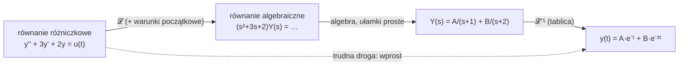

# Transformata Laplace'a

> [!skrot] W 30 sekund
> - **Co to:** zamiana funkcji czasu $f(t)$ na funkcję $F(s)$ — $\mathcal{L}\{f\}=\int_0^\infty f(t)e^{-st}dt$.
> - **Klucz:** $\mathcal{L}\{f'\} = sF(s) - f(0)$ — pochodna staje się mnożeniem przez $s$, równanie różniczkowe staje się algebrą.
> - **Kiedy:** równania różniczkowe z warunkami początkowymi, obwody RC/RLC, transmitancja w automatyce.

> [!intuicja] Po ludzku
> Laplace to **tłumacz**. Bierze funkcję czasu $f(t)$ i przekłada ją na funkcję $F(s)$ zmiennej zespolonej $s$. Po co? Bo w tym „języku” **różniczkowanie staje się mnożeniem przez $s$**, a równanie różniczkowe zamienia się w zwykłe równanie algebraiczne. Rozwiązujesz je algebrą z liceum, a na koniec tłumaczysz wynik z powrotem na czas (tablica transformat).
>
> To ten sam trik co logarytmy: zamiast mnożyć, logarytmujesz i dodajesz. Tu zamiast rozwiązywać RR, transformujesz i dzielisz.

## Definicja
> [!definicja] Transformata Laplace'a (jednostronna)
> $$\mathcal{L}\{f(t)\} = F(s) = \int_{0}^{\infty} f(t)\, e^{-st}\, dt, \qquad s = \sigma + j\omega \in \mathbb{C}$$
> - Zakładamy $f(t) = 0$ dla $t < 0$ (sygnał „włącza się” w chwili 0).
> - Całka to [[Całka niewłaściwa]]. Istnieje, gdy $f$ rośnie nie szybciej niż wykładniczo ($|f(t)| \le Me^{\sigma_0 t}$), i tylko dla $\operatorname{Re} s > \sigma_0$ (obszar zbieżności).
> - Transformata odwrotna $\mathcal{L}^{-1}$ w praktyce inżynierskiej = **tablica + [[Rozkład na ułamki proste]]**, nie całka.

## Jak to działa
**Liczymy z definicji dwie najważniejsze transformaty** — reszta tablicy powstaje z nich i z własności.

$$\mathcal{L}\{1\} = \int_0^\infty e^{-st}dt = \left[-\tfrac{1}{s}e^{-st}\right]_0^\infty = \frac{1}{s} \quad (\operatorname{Re}s>0)$$

$$\mathcal{L}\{e^{at}\} = \int_0^\infty e^{-(s-a)t}dt = \frac{1}{s-a} \quad (\operatorname{Re}s>a)$$

A skąd „pochodna → mnożenie przez $s$”? Całkowanie przez części:
$$\mathcal{L}\{f'\} = \int_0^\infty f'(t)e^{-st}dt = \big[f(t)e^{-st}\big]_0^\infty + s\!\int_0^\infty f(t)e^{-st}dt = sF(s) - f(0).$$
**Warunek początkowy $f(0)$ wchodzi sam** — dlatego Laplace jest idealny do zagadnień Cauchy'ego.

> [!wzor]- Tablica transformat (rozwiń)
> | $f(t)$, $t \ge 0$ | $F(s)$ |
> |---|---|
> | $\delta(t)$ (impuls Diraca) | $1$ |
> | $1(t)$ (skok jednostkowy) | $\dfrac{1}{s}$ |
> | $t$ | $\dfrac{1}{s^2}$ |
> | $t^n$ | $\dfrac{n!}{s^{n+1}}$ |
> | $e^{at}$ | $\dfrac{1}{s-a}$ |
> | $t\,e^{at}$ | $\dfrac{1}{(s-a)^2}$ |
> | $\sin \omega t$ | $\dfrac{\omega}{s^2+\omega^2}$ |
> | $\cos \omega t$ | $\dfrac{s}{s^2+\omega^2}$ |
> | $e^{at}\sin \omega t$ | $\dfrac{\omega}{(s-a)^2+\omega^2}$ |
> | $e^{at}\cos \omega t$ | $\dfrac{s-a}{(s-a)^2+\omega^2}$ |

> [!wzor]- Własności (rozwiń)
> | własność | wzór |
> |---|---|
> | liniowość | $\mathcal{L}\{af + bg\} = aF + bG$ |
> | pochodna | $\mathcal{L}\{f'\} = sF(s) - f(0)$ |
> | druga pochodna | $\mathcal{L}\{f''\} = s^2F(s) - sf(0) - f'(0)$ |
> | całka | $\mathcal{L}\left\{\int_0^t f(\tau)d\tau\right\} = \dfrac{F(s)}{s}$ |
> | przesunięcie w $s$ (tłumienie) | $\mathcal{L}\{e^{at}f(t)\} = F(s-a)$ |
> | opóźnienie w czasie o $\tau$ | $\mathcal{L}\{f(t-\tau)\,1(t-\tau)\} = e^{-s\tau}F(s)$ |
> | splot | $\mathcal{L}\{f * g\} = F(s)\,G(s)$ |
> | wartość początkowa | $f(0^+) = \lim_{s\to\infty} sF(s)$ |
> | wartość końcowa | $\lim_{t\to\infty} f(t) = \lim_{s\to 0} sF(s)$ — **tylko gdy bieguny $sF(s)$ leżą w lewej półpłaszczyźnie** |

## Jak liczyć — krok po kroku (równanie różniczkowe)
1. **Transformuj obie strony** równania, od razu wstawiając warunki początkowe ($y(0)$, $y'(0)$).
2. **Wyznacz $Y(s)$** — to już tylko algebra.
3. **Rozłóż $Y(s)$ na [[Rozkład na ułamki proste|ułamki proste]]** (pierwiastki mianownika = *bieguny*).
4. **Odczytaj $y(t)$ z tablicy** — każdy ułamek to jedna pozycja tablicy.
5. **Sprawdź**: $y(0)$ i $y'(0)$ z wyniku muszą zgadzać się z warunkami początkowymi.

## Przykłady
> [!przyklad]- Przykład 1 — równanie jednorodne II rzędu
> $y'' + 3y' + 2y = 0$, $\;y(0) = 1$, $\;y'(0) = 0$
>
> **1.** $\big(s^2Y - s\cdot 1 - 0\big) + 3\big(sY - 1\big) + 2Y = 0$
> **2.** $Y(s^2 + 3s + 2) = s + 3 \;\Rightarrow\; Y = \dfrac{s+3}{(s+1)(s+2)}$
> **3.** $\dfrac{s+3}{(s+1)(s+2)} = \dfrac{A}{s+1} + \dfrac{B}{s+2}$ — metoda „zakrywania”: $A = \dfrac{-1+3}{-1+2} = 2$, $\;B = \dfrac{-2+3}{-2+1} = -1$
> **4.** $y(t) = 2e^{-t} - e^{-2t}$
> **5.** $y(0) = 2 - 1 = 1$ ✓, $\;y'(0) = -2 + 2 = 0$ ✓

> [!przyklad]- Przykład 2 — skok na wejściu (automatyka!)
> $y' + 2y = 1(t)$, $\;y(0) = 0$ — tak opisuje się np. nagrzewanie się obiektu po włączeniu grzałki.
>
> $sY + 2Y = \dfrac{1}{s} \;\Rightarrow\; Y = \dfrac{1}{s(s+2)} = \dfrac{1}{2}\left(\dfrac{1}{s} - \dfrac{1}{s+2}\right) \;\Rightarrow\; y(t) = \tfrac12\left(1 - e^{-2t}\right)$
>
> Kontrola z twierdzenia o wartości końcowej: $\lim_{s\to0} sY(s) = \lim_{s\to 0}\dfrac{1}{s+2} = \tfrac12$ ✓
> To jest **odpowiedź skokowa członu inercyjnego** o [[Transmitancja|transmitancji]] $G(s) = \dfrac{1}{s+2}$ — dokładnie to będziesz rysować w *Sterowaniu procesami ciągłymi*.

> [!przyklad]- Przykład 3 — bieguny zespolone (drgania)
> $y'' + 2y' + 5y = 0$, $\;y(0) = 1$, $\;y'(0) = -1$
>
> $s^2Y - s + 1 + 2(sY - 1) + 5Y = 0 \;\Rightarrow\; Y = \dfrac{s+1}{s^2+2s+5} = \dfrac{s+1}{(s+1)^2 + 2^2}$
> Z tablicy ($a = -1$, $\omega = 2$): $\;y(t) = e^{-t}\cos 2t$ — **drganie gasnące**. Bieguny $s = -1 \pm 2j$: część rzeczywista = tłumienie, urojona = częstość.

## Typowe błędy
> [!blad] Zapominasz o warunkach początkowych
> $\mathcal{L}\{y'\}$ to $sY - y(0)$, a nie $sY$. Bez $y(0)$ dostajesz rozwiązanie innego zadania.

> [!blad] Twierdzenie o wartości końcowej dla niestabilnego układu
> Dla $F(s) = \dfrac{1}{s-1}$ wzór daje $\lim_{s\to0} sF(s) = 0$, a naprawdę $f(t) = e^t \to \infty$. Najpierw sprawdź bieguny $sF(s)$.

> [!blad] Mylisz sin i cos w tablicy
> $\sin$ ma $\omega$ w liczniku, $\cos$ ma $s$. Szybki test: $\cos 0 = 1$, więc $\lim_{s\to\infty} sF(s)$ musi dać 1 — daje go tylko $\dfrac{s}{s^2+\omega^2}$.

> [!blad] Opóźnienie bez skoku jednostkowego
> $e^{-s\tau}F(s)$ to $f(t-\tau)\cdot 1(t-\tau)$, a nie samo $f(t-\tau)$.

## Laplace a Fourier
[[Transformata Fouriera]] to „Laplace na osi urojonej”: $s = j\omega$, czyli $\sigma = 0$. Fourier mówi, **z jakich częstotliwości składa się sygnał**. Laplace dodatkowo ogarnia sygnały rosnące ($e^{t}$), stany nieustalone i warunki początkowe — dlatego w automatyce króluje Laplace, a w analizie sygnałów (FFT na Fizyce i Teorii sygnałów) Fourier.

## Gdzie ci się przyda
> [!przyda]
> - [[PK Matematyka 2]] — temat nr 13 z sylabusa, **egzamin w sesji letniej**.
> - **Sterowanie procesami ciągłymi** (PK, sem. 4–5, egzamin) — sylabus wymienia Laplace'a i twierdzenie o wartości granicznej *wprost w wymaganiach wstępnych*. Cały przedmiot to [[Transmitancja|transmitancje]], bieguny, odpowiedzi skokowe i regulatory PID w dziedzinie $s$.
> - [[PK Elektrotechnika i miernictwo]] — [[Stany nieustalone w obwodach]] RC/RL (patrz zadanie 6).
> - [[PK Mechanika ogólna]] — [[Drgania mechaniczne]]: $m\ddot x + c\dot x + kx = F(t)$ to przykład 3 w przebraniu.
> - Elementy i układy sterowania robotów, Symulacja układów sterowania — MATLAB/Simulink myśli w $s$.
> - Z AGH: *Metody numeryczne* i *MES* (nieustalony przepływ ciepła) rozwiązują te same równania **numerycznie** (Euler, schematy w czasie). Laplace daje wynik **analityczny** — świetny do sprawdzenia, czy twój program liczy dobrze.

## Zadania
> [!zadanie] Zadanie 1 — z tablicy
> Oblicz $\mathcal{L}\{3 - 2t + e^{4t}\}$.
> > [!odpowiedz]- Odpowiedź
> > Liniowość: $\dfrac{3}{s} - \dfrac{2}{s^2} + \dfrac{1}{s-4}$

> [!zadanie] Zadanie 2 — przesunięcie w $s$
> Oblicz $\mathcal{L}\{e^{-t}\cos 2t\}$.
> > [!odpowiedz]- Odpowiedź
> > $\dfrac{s+1}{(s+1)^2 + 4}$

> [!zadanie] Zadanie 3 — transformata odwrotna
> Znajdź $\mathcal{L}^{-1}\left\{\dfrac{5}{s^2+25}\right\}$.
> > [!odpowiedz]- Odpowiedź
> > $\omega = 5$, licznik $= \omega$ → $\sin 5t$

> [!zadanie] Zadanie 4 — ułamki proste
> Znajdź $\mathcal{L}^{-1}\left\{\dfrac{2s+3}{s^2+3s+2}\right\}$.
> > [!odpowiedz]- Odpowiedź
> > $(s+1)(s+2)$ w mianowniku; $A = \dfrac{-2+3}{1} = 1$, $B = \dfrac{-4+3}{-1} = 1$ → $e^{-t} + e^{-2t}$

> [!zadanie] Zadanie 5 — RR bez tłumienia
> $y'' + 4y = 0$, $y(0) = 0$, $y'(0) = 2$.
> > [!odpowiedz]- Odpowiedź
> > $s^2Y - 2 + 4Y = 0 \Rightarrow Y = \dfrac{2}{s^2+4} \Rightarrow y = \sin 2t$ (drganie nietłumione — bieguny $\pm 2j$ na osi urojonej)

> [!zadanie] Zadanie 6 — obwód RC (Elektrotechnika)
> Kondensator ładowany ze źródła $E$ przez opór $R$: $RC\,u' + u = E$, $u(0) = 0$. Znajdź $u(t)$.
> > [!odpowiedz]- Odpowiedź
> > $RCsU + U = \dfrac{E}{s} \Rightarrow U = \dfrac{E}{s(RCs+1)} = E\left(\dfrac1s - \dfrac{1}{s + 1/RC}\right) \Rightarrow u(t) = E\left(1 - e^{-t/RC}\right)$. Stała czasowa $\tau = RC$.

> [!zadanie] Zadanie 7 — wartość ustalona (Sterowanie)
> Obiekt $G(s) = \dfrac{4}{s^2+3s+2}$ dostaje na wejście skok jednostkowy. Do jakiej wartości dojdzie wyjście?
> > [!odpowiedz]- Odpowiedź
> > $Y = \dfrac{1}{s}G(s)$; bieguny $-1, -2$ (stabilny), więc wolno: $y(\infty) = \lim_{s\to0} s\cdot\dfrac1s G(s) = G(0) = 2$.

## Fiszki #fiszki/matematyka
Definicja transformaty Laplace'a::$F(s)=\int_0^\infty f(t)e^{-st}\,dt$
$\mathcal{L}\{1\}$::$\dfrac{1}{s}$
$\mathcal{L}\{t^n\}$::$\dfrac{n!}{s^{n+1}}$
$\mathcal{L}\{e^{at}\}$::$\dfrac{1}{s-a}$
$\mathcal{L}\{\sin\omega t\}$::$\dfrac{\omega}{s^2+\omega^2}$
$\mathcal{L}\{\cos\omega t\}$::$\dfrac{s}{s^2+\omega^2}$
$\mathcal{L}\{f'(t)\}$::$sF(s)-f(0)$
$\mathcal{L}\{f''(t)\}$::$s^2F(s)-sf(0)-f'(0)$
$\mathcal{L}\{e^{at}f(t)\}$ (przesunięcie w $s$)::$F(s-a)$
Transformata sygnału opóźnionego o $\tau$::$e^{-s\tau}F(s)$
Twierdzenie o wartości końcowej (i kiedy wolno)::$\lim_{t\to\infty}f(t)=\lim_{s\to0}sF(s)$, tylko gdy bieguny $sF(s)$ są w lewej półpłaszczyźnie
Po co Laplace przy równaniach różniczkowych?::Zamienia różniczkowanie na mnożenie przez $s$ — równanie różniczkowe staje się algebraicznym, a warunki początkowe wchodzą same
Co mówią bieguny $s=-1\pm2j$ o rozwiązaniu?::Drganie gasnące $e^{-t}(\ldots\cos 2t\ldots)$: część rzeczywista = tłumienie, urojona = częstość
Związek Laplace–Fourier::Fourier to Laplace dla $s=j\omega$

## Moje notatki
> [!ja] Tu piszesz ty — Albert tej sekcji nie rusza.

## Źródła
- A. Milian, *Zbiór zadań z matematyki z rozwiązaniami* cz. 2 (Wyd. PK) — literatura obowiązkowa PK Matematyka.
- W. Krysicki, L. Włodarski, *Analiza matematyczna w zadaniach* cz. II (PWN) — rozdział o przekształceniu Laplace'a.
- K. Ogata, *Modern Control Engineering*, Pearson — Laplace i transmitancja w automatyce (rozdz. o modelowaniu układów).
- W twoich materiałach (`materialy`) nie ma jeszcze nic o Laplasie — po pierwszych wykładach z Matematyki 2 wrzuć PDF-y do `~/studia/pk/`, Albert dopisze odnośniki.
