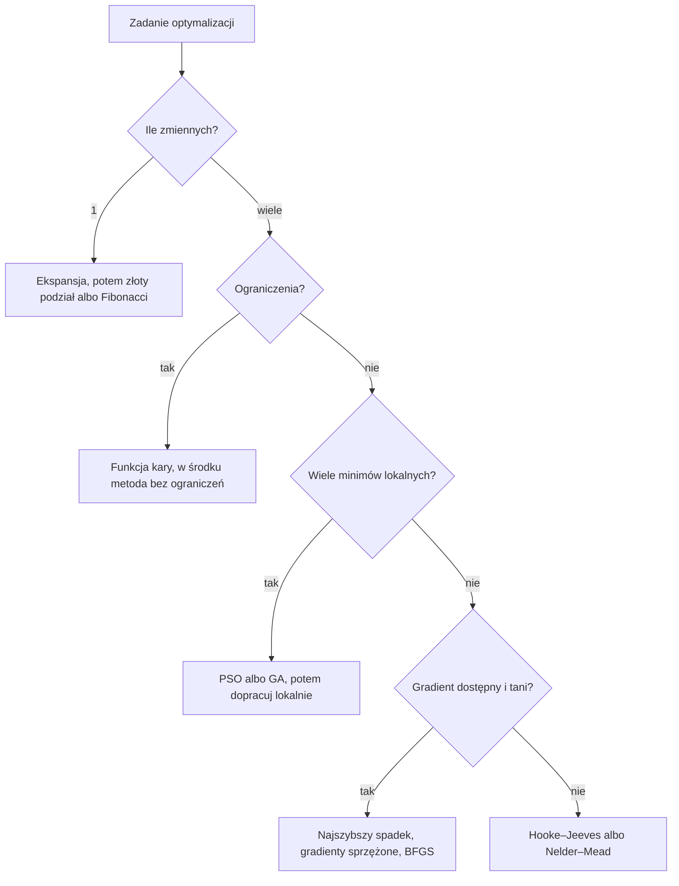

# Trening — Optymalizacja w kodzie

> [!skrot] W 30 sekund
> - **Co to:** zestaw 8 zadań z testami, w których sam piszesz metody optymalizacji: od złotego podziału po PSO, plus wzór tabeli i wykresu do sprawozdania.
> - **Klucz:** każda metoda to pętla „punkt → nowy punkt, jeśli $f$ spadło”. Koszt mierzysz **liczbą wywołań $f$**, jakość błędem $\lVert x - x^* \rVert$.
> - **Kiedy:** przed pierwszymi ćwiczeniami projektowymi i jako baza kodu do projektu. Zadania leżą w `~/studia/sem5/optymalizacja/trening`.

> [!wazne] Laby są w C++, nie w Pythonie
> Na laboratoriach piszesz metody w **C++ we frameworku dr. Sztangreta** (`matrix`, `solution`, `opt_alg.h`). Trening do labów: **`~/studia/sem5/optymalizacja/trening_cpp`** (`make test`, szkielet z pseudokodem, `rozwiazania/`). API i pułapki są w [[Framework optymalizacji (matrix, solution) w C++]].
> Python (`trening/`) zostaje do **zrozumienia algorytmu** i **szybkiej weryfikacji**: `scipy.optimize` przy tym samym starcie powinno dać to samo $x^*$ co twój C++.

| Lab | Metody (`opt_alg.h`) | Test w C++ | Odpowiednik w Pythonie |
|---|---|---|---|
| 0 | `MC` (gotowe) | `./testy MC` | — |
| 1 | `expansion`, `fib`, `lag` (+ `golden`) | `./testy expansion fib lag golden` | z01, z02 |
| 2 | `HJ_trial`, `HJ`, `Rosen` | `./testy HJ Rosen` | z03 |
| 3 | `sym_NM`, `pen` | `./testy sym_NM pen` | z05, z06 |
| 4 | `SD`, `CG`, `Newton`, `golden` | `./testy SD CG Newton` | z04 |
| 5 | `Powell` | `./testy Powell` | — |
| 6 | `EA` | `./testy EA` | z07 (inna metoda: PSO/GA) |

Kod piszesz w `trening_cpp/opt_alg.cpp`, funkcje testowe są w `user_funs_test.cpp`.

> [!intuicja] Po ludzku
> Na projekcie nikt nie zapyta, czy umiesz wyrecytować algorytm. Zapyta, czy twój program znajduje minimum, ile go to kosztuje i dlaczego jedna metoda jest lepsza od drugiej na danej funkcji. Trening ćwiczy dokładnie to: piszesz metodę, test mówi „działa / nie działa”, a z08 składa wyniki w tabelę i wykres, które wklejasz do sprawozdania.

## Definicja i wzory
> [!definicja] Wspólny „kontrakt” wszystkich metod w treningu
> - Wejście: funkcja `f(x)` (liczba albo wektor `np.ndarray`), punkt startowy albo przedział, tolerancja `eps`, limit iteracji `nmax`.
> - Wyjście: przybliżenie minimum $x^*$.
> - Koszt: liczba wywołań $f$ (klasa `Licznik` z z01). To uczciwa miara niezależna od komputera.
> - Funkcje testowe w `funkcje.py`: $x^4 - 3x^3 + 2$ (min. $2{,}25$), kwadratowa, $x^2 + 10y^2$, Rosenbrock (min. $(1,1)$), Rastrigin (min. $(0,0)$).

> [!wzor] Funkcje testowe, które trzeba znać
> $$f_R(x,y) = (1-x)^2 + 100\,(y - x^2)^2, \qquad x^* = (1,1),\; f^* = 0$$
> $$f_{Ras}(x) = 10n + \sum_{i=1}^{n}\left(x_i^2 - 10\cos(2\pi x_i)\right), \qquad x^* = 0$$
> Rosenbrock ma wąską, zakrzywioną dolinę (test metod lokalnych). Rastrigin ma dziesiątki minimów lokalnych (test metod globalnych).

> [!wzor] Gradient numeryczny (różnice centralne)
> $$\frac{\partial f}{\partial x_j} \approx \frac{f(x + h e_j) - f(x - h e_j)}{2h}, \qquad h \approx 10^{-6}$$
> Koszt: $2n$ wywołań $f$. Błąd rzędu $h^2$, więc dokładniejszy od różnicy w przód.

> [!wzor] Zewnętrzna funkcja kary
> $$F(x, c) = f(x) + c \sum_i \max\left(0,\, g_i(x)\right)^2, \qquad g_i(x) \le 0$$
> Minimalizujesz $F$ bez ograniczeń dla rosnących $c_k = 10^k c_0$. Punkty $x(c)$ podchodzą do zbioru dopuszczalnego **od zewnątrz**.

## Ściąga algorytmów (pseudokod)

```text
HOOKE–JEEVES (x0, s, alfa<1, eps)
  xB = x0
  dopóki s >= eps:
    x = PRÓBNY(xB, s)          # po każdej osi: +s, jak nie pomaga to -s
    jeśli f(x) < f(xB):        # ROBOCZY: idź dalej tym samym wektorem
      powtarzaj: xB_stary, xB = xB, x;  x = PRÓBNY(2*xB - xB_stary, s)
      dopóki f(x) < f(xB)
    inaczej: s = alfa * s
  zwróć xB

NAJSZYBSZY SPADEK (x0, eps)
  powtarzaj:
    g = grad f(x);  jeśli ||g|| < eps: stop
    d = -g / ||g||
    t = argmin_t f(x + t d)    # ekspansja + złoty podział
    x = x + t d

NELDER–MEAD (x0, krok)         # alfa=1, gamma=2, beta=0.5, delta=0.5
  simpleks: x0, x0 + krok*e_i;  powtarzaj:
    sortuj (najlepszy ... najgorszy xh);  c = środek bez xh
    xr = c + alfa(c - xh)                     ODBICIE
    f(xr) < najlepszy  -> xe = c + gamma(xr - c), weź lepszy z xe, xr
    f(xr) < drugi najgorszy -> weź xr
    inaczej xk = c + beta(xh - c)             KONTRAKCJA
      jeśli f(xk) < f(xh): weź xk;  inaczej REDUKCJA do najlepszego
  stop: rozrzut f w wierzchołkach < eps

KARA ZEWNĘTRZNA (x0, c0, mnożnik=10)
  powtarzaj: x_nowy = argmin F(x, c) startując z x   # dowolna metoda bez ograniczeń
    jeśli ||x_nowy - x|| < eps: stop
    x = x_nowy;  c = mnożnik * c

PSO (n cząstek)
  v = w v + c1 r1 (p_osobiste - x) + c2 r2 (g_rój - x);  x = clip(x + v)
  aktualizuj p_osobiste i g_rój

GA (kodowanie rzeczywiste)
  elita -> turniej -> krzyżowanie arytmetyczne a*p1 + (1-a)*p2
  -> mutacja gaussowska -> przycięcie do granic -> nowe pokolenie
```

```text
── metody frameworka C++, których nie ma w treningu Pythona ──

LAGRANGE / interpolacja kwadratowa (a, b, eps, gamma)    lag
  c = (a+b)/2;  powtarzaj:
    l = f(a)(b²-c²) + f(b)(c²-a²) + f(c)(a²-b²)
    m = f(a)(b-c)   + f(b)(c-a)   + f(c)(a-b);   m <= 0 -> porażka (flag -1)
    d = l / (2m)                                 # wierzchołek paraboli
    a<d<c: f(d)<f(c) ? (b=c, c=d) : a=d
    c<d<b: f(d)<f(c) ? (a=c, c=d) : b=d;   inaczej porażka
  dopóki b-a >= eps i |d - d_poprz| >= gamma

ROSENBROCK (x0, s0, alfa>1, beta<1, eps)                 Rosen
  kierunki D = I;  dla każdego j: krok s_j wzdłuż d_j
    sukces: x += s_j d_j, lambda_j += s_j, s_j *= alfa
    porażka: s_j *= -beta, p_j++
  gdy każdy kierunek miał sukces i porażkę -> OBRÓT BAZY:
    Q = D * L (L dolnotrójkątna z lambda), Gram–Schmidt -> nowe D; reset lambda, p, s
  stop: max |s_j| < eps

GRADIENT SPRZĘŻONY (Fletcher–Reeves)                      CG
  d = -g0;  x = x + h d;  beta = ||g_nowy||² / ||g_stary||²;  d = -g_nowy + beta d

NEWTON                                                    Newton
  d = -H(x)^-1 g(x);  x = x + h d          # h = 1: kwadratowa w 1 kroku
  (w SD/CG/Newton: h0 > 0 krok stały, h0 <= 0 h = argmin f(x + h d) złotym podziałem)

POWELL (bez gradientu)                                    Powell
  D = I;  powtarzaj:  p0 = x
    dla j: p = p + h_j d_j,  h_j = argmin f(p + h d_j)
    stop gdy ||p - x|| < eps
    wyrzuć d_1, przesuń resztę, d_n = p - p0;  x = p + h d_n (h = argmin)

STRATEGIA EWOLUCYJNA (mi + lambda), samoadaptacja sigma   EA
  mi osobników U(lb, ub), sigma = sigma0
  selekcja ruletką (waga 1/f) -> lambda potomków
  mutacja: sigma *= exp(b N + a N_wsp), x += sigma N;  krzyżowanie uśredniające
  nowa populacja: mi najlepszych z rodziców + potomków;  stop f < eps albo Nmax
```



## Jak to zrobić — krok po kroku
1. `cd ~/studia/sem5/optymalizacja/trening`, przeczytaj `README.md`.
2. Otwórz `z01_ekspansja_zloty.py`. W docstringu jest treść, pseudokod i wskazówki. Funkcje mają `raise NotImplementedError` do zastąpienia.
3. Pisz **sam**. Odpalaj test jednego zadania: `~/venvs/opt/bin/pytest -q tests/test_z01.py`.
4. Gdy wszystko zielone (albo po 20 minutach utknięcia) porównaj z `rozwiazania/z01_ekspansja_zloty.py`. Różnice zapisz w „Moje notatki”.
5. Kolejność: 01 → 03 → 05 (minimum na pierwsze zajęcia), potem 04, 02, 06, 07, 08.
6. Po z08 odpal `~/venvs/opt/bin/python z08_porownanie.py`: dostajesz tabelę Markdown i `wyniki/zbieznosc_rosenbrock.png`.
7. Weryfikacja: `scipy_porownanie.py` liczy to samo w `scipy.optimize`. Jeśli twój wynik odbiega od scipy przy tym samym starcie, szukaj błędu u siebie.

## Przykład
> [!przyklad] Wyniki na Rosenbrocku, start $(-1{,}2;\ 1)$ (rozwiązania z treningu)
> | Metoda | $x^*$ | błąd | wywołania $f$ |
> |---|---|---|---|
> | Hooke–Jeeves | $(1{,}000001;\ 1{,}000002)$ | $2 \cdot 10^{-6}$ | 379 |
> | Najszybszy spadek (3000 it.) | $(0{,}986;\ 0{,}973)$ | $3 \cdot 10^{-2}$ | ok. 100 tys. |
> | Nelder–Mead | $(1{,}000000;\ 1{,}000001)$ | $1 \cdot 10^{-6}$ | 205 |
>
> **Wniosek do sprawozdania:** najszybszy spadek w wąskiej dolinie robi zygzak, bo kolejne kierunki przy optymalnym kroku są prostopadłe. Metody bezgradientowe dopasowują się do kształtu doliny i są tu o dwa rzędy tańsze. Tak wygląda porządny wniosek: liczba + przyczyna.

> [!przyklad]- Kara zewnętrzna krok po kroku
> $\min (x-3)^2 + (y-2)^2$ przy $x + y \le 4$. Z symetrii $x(c) = (3 - t,\ 2 - t)$, a z warunku $\nabla F = 0$ wychodzi $t = \frac{c}{1 + 2c}$.
> - $c = 1$: $t = 0{,}333$, $x = (2{,}667;\ 1{,}667)$, $x + y = 4{,}33$ (niedopuszczalny).
> - $c = 100$: $t = 0{,}4975$, $x = (2{,}502;\ 1{,}502)$.
> - $c \to \infty$: $t \to 0{,}5$, $x \to (2{,}5;\ 1{,}5)$, $f = 0{,}5$.
>
> Numerycznie dla $c \ge 10^4$ wynik przestaje się poprawiać (błąd ok. $10^{-4}$), bo $F$ ma bardzo wąską dolinę wzdłuż prostej $x + y = 4$. To typowa wada metody kary i dobry punkt do wniosków.

## Typowe błędy
> [!blad] Dwa nowe wywołania $f$ na iterację w złotym podziale
> Test z01 sprawdza, że dla $\varepsilon = 10^{-5}$ na $[0,4]$ wystarczy co najwyżej 30 wywołań. Liczenie obu punktów od nowa podwaja koszt.

> [!blad] Lista zamiast `np.ndarray`
> `[0, 0] + e` to w Pythonie sklejenie list, nie dodawanie wektorów. Zawsze zaczynaj od `x = np.array(x0, dtype=float)`.

> [!blad] Mutowanie punktu „w miejscu”
> `x[j] += s`, a potem `x[j] -= s` przy odrzuceniu ruchu łatwo zostawia punkt przesunięty. Pracuj na kopiach (`x + e`).

> [!blad] Porównywanie metod po liczbie iteracji
> Iteracja Hooke'a–Jeevesa, Neldera–Meada i najszybszego spadku kosztuje różnie (NM 1–2 wywołania, gradient $2n$ plus kilkadziesiąt na szukanie kroku). Porównuj **wywołania $f$**.

> [!blad] Jedno uruchomienie metody losowej
> PSO i GA podajesz jako średnią i odchylenie z kilku uruchomień z różnymi ziarnami, a ziarno zapisujesz w sprawozdaniu.

## Szablon projektu i sprawozdania
> [!wazne] Struktura (ta sama dla prezentacji)
> 1. **Sformułowanie zadania:** zmienne decyzyjne z jednostkami, funkcja celu, ograniczenia, skąd pochodzi zadanie (np. z metalurgii). Wykres $f$ albo warstwic, jeśli 1–2 zmienne.
> 2. **Metody:** po akapicie na metodę (idea, parametry: krok startowy, $\varepsilon$, współczynniki), kryterium stopu. Pseudokod jak w ściądze wyżej.
> 3. **Wyniki:** tabela (metoda, $x^*$, $f(x^*)$, błąd, wywołania $f$) i wykres zbieżności „najlepsze dotąd $f$” vs liczba wywołań, oś Y logarytmiczna. Do tego weryfikacja scipy lub MATLAB. Wzór: z08.
> 4. **Wnioski:** która metoda wygrała i **dlaczego** (kształt funkcji, uwarunkowanie, minima lokalne), wpływ parametrów, ograniczenia metod.
>
> Kod w repo, w sprawozdaniu tylko fragmenty kluczowe. Każdą liczbę w tabeli musi dać się odtworzyć jednym poleceniem.

## Na zajęcia i egzamin
> [!zajecia]
> - **Laby (pt 8:00):** w C++ na frameworku Sztangreta. Na każdy lab przychodzisz z metodami z tabeli u góry, zielonymi w `trening_cpp` (`make test`), i ze szkieletem `labN()` zapisującym CSV.
> - **Przed lab 1 (pt 9.10):** `expansion`, `fib`, `lag`, `golden` w C++. W Pythonie z01 i z02 tylko po to, żeby zrozumieć metodę.
> - **Projekt (dr Byrska-Wójcik):** „własne programy albo Matlab”. Zapytaj, czy indywidualnie czy w zespole, jakie są terminy sprawozdania i prezentacji oraz warunki zaliczenia.
> - **Egzamin:** opisz i porównaj metody (bezgradientowe vs gradientowe), uzasadnij kryterium stopu, wyjaśnij karę zewnętrzną i wewnętrzną, kiedy metoda niedeterministyczna.
> - Łączy się z: [[Funkcja celu i warunki optymalności]], [[Metoda złotego podziału]], [[Metoda Hooke'a-Jeevesa]], [[Metoda simpleksu Neldera-Meada]].

## Zadania
> [!zadanie] Zadanie 1
> Dlaczego w z08 oś X wykresu to liczba wywołań $f$, a nie numer iteracji?
> > [!odpowiedz]- Odpowiedź
> > Bo koszt iteracji jest różny w różnych metodach. Wywołanie $f$ to w praktyce najdroższa operacja (np. symulacja procesu), więc to wspólna i uczciwa miara.

> [!zadanie] Zadanie 2
> Hooke–Jeeves startuje z $s = 0{,}5$, $\alpha = 0{,}5$, $\varepsilon = 10^{-6}$. Ile razy co najwyżej zmniejszy krok?
> > [!odpowiedz]- Odpowiedź
> > $0{,}5 \cdot 0{,}5^k < 10^{-6}$, czyli $k > \log_2(5 \cdot 10^5) \approx 18{,}9$, więc 19 zmniejszeń.

> [!zadanie] Zadanie 3
> Nelder–Mead na Rastriginie ze startu $(3{,}1;\ -2{,}2)$ kończy w $(2{,}985;\ -1{,}990)$ z $f \approx 12{,}9$. Czy metoda jest zepsuta?
> > [!odpowiedz]- Odpowiedź
> > Nie. Znalazła minimum **lokalne** najbliżej startu. Rastrigin wymaga metody globalnej (PSO, GA, ewolucja różnicowa) albo wielu startów.

> [!kod]- Rozwiązanie: Hooke–Jeeves (pełne w `rozwiazania/z03_hooke_jeeves.py`)
> ```python
> def krok_probny(f, x, fx, s):
>     x = np.array(x, dtype=float)
>     for j in range(x.size):
>         e = np.zeros_like(x); e[j] = s
>         if (fp := f(x + e)) < fx:   x, fx = x + e, fp
>         elif (fm := f(x - e)) < fx: x, fx = x - e, fm
>     return x, fx
>
> def hooke_jeeves(f, x0, s=0.5, alfa=0.5, eps=1e-6, nmax=20000):
>     xB = np.array(x0, dtype=float); fB = f(xB); licz = 0
>     while s >= eps and licz <= nmax:
>         x, fx = krok_probny(f, xB, fB, s)
>         if fx < fB:
>             while True:
>                 xB_stary, xB, fB = xB, x, fx
>                 xr = 2 * xB - xB_stary
>                 x, fx = krok_probny(f, xr, f(xr), s); licz += 1
>                 if fx >= fB or licz > nmax: break
>         else:
>             s *= alfa
>         licz += 1
>     return xB
> ```

> [!kod]- Rozwiązanie: kara zewnętrzna (pełne w `rozwiazania/z06_kara.py`)
> ```python
> def funkcja_kary(f, ograniczenia, c):
>     return lambda x: f(x) + c * sum(max(0.0, g(x)) ** 2 for g in ograniczenia)
>
> def kara_zewnetrzna(f, ograniczenia, x0, c0=1.0, mnoznik=10.0, eps=1e-6, nmax=20,
>                     metoda=nelder_mead):
>     x, c = np.array(x0, dtype=float), c0
>     for _ in range(nmax):
>         x_nowy = np.asarray(metoda(funkcja_kary(f, ograniczenia, c), x), dtype=float)
>         if np.linalg.norm(x_nowy - x) < eps:
>             return x_nowy
>         x, c = x_nowy, c * mnoznik
>     return x
> ```

> [!kod]- MATLAB — odpowiedniki (nietestowane, brak MATLAB-a na komputerze)
> ```matlab
> f  = @(x) (1 - x(1))^2 + 100*(x(2) - x(1)^2)^2;          % Rosenbrock
> opt = optimset('TolX', 1e-8, 'TolFun', 1e-10, 'Display', 'off');
> [x, fval, ~, out] = fminsearch(f, [-1.2 1], opt);         % Nelder-Mead
> fprintf('x = (%.6f, %.6f), wywołań f: %d\n', x, out.funcCount);
> xb = fminbnd(@(x) x.^4 - 3*x.^3 + 2, 0, 4);               % 1D na przedziale
> % z ograniczeniem x + y <= 4 (Optimization Toolbox):
> xc = fmincon(@(p) (p(1)-3)^2 + (p(2)-2)^2, [0 0], [1 1], 4);
> ```

## Fiszki #fiszki/optymalizacja
Jaką miarą kosztu porównujesz metody optymalizacji w projekcie?::Liczbą wywołań funkcji celu f, nie liczbą iteracji
Ile wywołań f kosztuje gradient z różnic centralnych w n wymiarach?::2n
Z czego składa się iteracja Hooke'a–Jeevesa?::Z kroku próbnego wzdłuż osi i, przy sukcesie, kroków roboczych x = 2xB − xB_stary
Kiedy Hooke–Jeeves zmniejsza krok?::Gdy krok próbny wokół bazy nie poprawia f, wtedy s = alfa · s
Cztery operacje simpleksu Neldera–Meada::Odbicie, ekspansja, kontrakcja, redukcja
Dlaczego najszybszy spadek zygzakuje w wąskiej dolinie?::Przy optymalnym kroku kolejne kierunki są prostopadłe
Jak wygląda zewnętrzna funkcja kary dla g(x) ≤ 0?::F = f + c · suma max(0, g)², c rośnie w kolejnych krokach
Skąd podchodzą punkty w metodzie kary zewnętrznej, a skąd w wewnętrznej?::Zewnętrzna od strony niedopuszczalnej, wewnętrzna (bariera) od środka zbioru dopuszczalnego
Wada kary zewnętrznej przy dużym c?::Złe uwarunkowanie, wąska dolina, metoda wewnętrzna przestaje poprawiać wynik
Wzór na prędkość cząstki w PSO::v = w·v + c1·r1·(p_osobiste − x) + c2·r2·(g_roju − x)
Trzy operatory algorytmu genetycznego::Selekcja (np. turniejowa), krzyżowanie, mutacja, plus elitaryzm
Jak raportować wynik metody losowej?::Średnia i odchylenie z kilku uruchomień, z zapisanym ziarnem
Minimum funkcji Rosenbrocka::(1, 1), f = 0, klasyczny start (−1,2; 1)
Odpowiednik fminsearch w scipy::minimize(f, x0, method='Nelder-Mead')
Cztery części sprawozdania z projektu::Sformułowanie zadania, metody, wyniki (tabela i wykres zbieżności), wnioski
W jakim języku i frameworku robisz laby z optymalizacji?::C++ we frameworku Sztangreta (matrix, solution, opt_alg.h); Python tylko do zrozumienia i weryfikacji
Skąd metoda Lagrange'a (lag) bierze nowy punkt?::Z wierzchołka paraboli przez trzy punkty a < c < b; gdy m <= 0, parabola nie ma minimum i metoda zawodzi
Kiedy metoda Rosenbrocka obraca bazę kierunków?::Gdy w każdym kierunku był co najmniej jeden sukces i jedna porażka; nowe kierunki z Grama–Schmidta
Ile kroków potrzebuje metoda Newtona z h = 1 na funkcji kwadratowej?::Jeden, bo model kwadratowy jest wtedy dokładny

## Moje notatki
> [!ja] Tu piszesz ty — Albert tej sekcji nie rusza.

## Źródła
- J. Kusiak, A. Danielewska-Tułecka, P. Oprocha, *Optymalizacja. Wybrane metody z przykładami zastosowań*, PWN 2009.
- J. Stadnicki, *Teoria i praktyka rozwiązywania zadań optymalizacji z przykładami zastosowań technicznych*, WNT 2006.
- J. Arabas, *Wykłady z algorytmów ewolucyjnych*, WNT 2001.
- Dokumentacja SciPy, moduł `scipy.optimize` (`minimize`, `minimize_scalar`, `differential_evolution`): https://docs.scipy.org/doc/scipy/reference/optimize.html
- Kod treningowy: `~/studia/sem5/optymalizacja/trening` (README, zadania, testy, rozwiązania).
- Ł. Sztangret, kod źródłowy do ćwiczeń z metod optymalizacji, CC BY-SA 3.0 (`~/github/optimalization_labs/od_prof/`); trening C++: `~/studia/sem5/optymalizacja/trening_cpp`.
