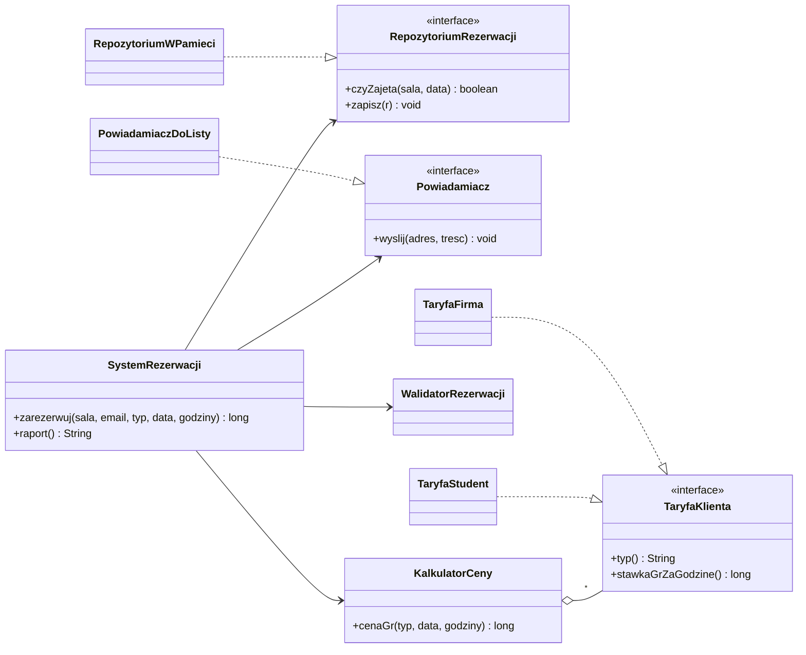

# Trening — Wzorce projektowe w kodzie

> [!skrot] W 30 sekund
> - **Co to:** 8 zadań w Javie z testami JUnit: diagram klas → kod, sekwencja → kod, kod → PlantUML, potem Singleton, fabryki, Budowniczy, Strategia + Obserwator i refaktoryzacja „God class” do SOLID.
> - **Klucz:** `cd ~/studia/sem5/wzorce_projektowe/trening && ./sprawdz.sh 01` — testy jednego zadania; `./sprawdz.sh rozw` — rozwiązania wzorcowe (wszystko zielone).
> - **Kiedy:** wieczór przed labem 1 zadania 01–03 (UML), przed kolejnymi labami 04–08.

> [!intuicja] Po ludzku
> Teoria siedzi w [[Diagram klas UML]] i [[Diagram sekwencji UML]]. Tu ćwiczysz **tłumaczenie w obie strony**: romb na diagramie musi stać się konkretną decyzją w kodzie (kto robi `new`, czy lista jest tylko do odczytu), a strzałka na sekwencji — konkretną linijką w metodzie. Testy pilnują, żeby to nie były tylko ładne obrazki.

## Definicja i wzory

> [!wzor] UML → Java (każda relacja ma swój ślad w kodzie)
> | UML | Mermaid | w Javie |
> |---|---|---|
> | asocjacja, krotność 1 | `A "*" --> "1" B` | pole `private final B b` + `Objects.requireNonNull` |
> | krotność `0..1` | `"0..1"` | pole może być null, getter zwraca `Optional<B>` |
> | krotność `*` | `"*"` | `List<B>`, getter zwraca `Collections.unmodifiableList` |
> | agregacja ◇ | `A o-- B` | `dodaj(B b)` — część z zewnątrz, przeżywa całość |
> | kompozycja ◆ | `A *-- B` | całość robi `new B(...)`, konstruktor `B` pakietowy |
> | dziedziczenie | `A <\|-- B` | `class B extends A` |
> | realizacja | `B ..\|> A` | `class B implements A` |
> | zależność | `A ..> B` | `B` tylko jako parametr / zmienna lokalna |
> | `alt` / `opt` / `loop` | ramki | `if-else` / `if` / `for` |
> | `«create»` | `S->>R: «create»` | `new R(...)` w ciele metody |

> [!definicja] Singleton (kreacyjny)
> **Problem:** dokładnie jedna instancja z globalnym dostępem (konfiguracja, generator numerów). **Rozwiązanie:** prywatny konstruktor + statyczny dostęp; bezpiecznie wątkowo przez idiom *holder* albo `enum` (Bloch).
> ```java
> public final class Konfiguracja {
>     private Konfiguracja() { }
>     private static class Holder { static final Konfiguracja I = new Konfiguracja(); }
>     public static Konfiguracja getInstance() { return Holder.I; }
> }
> public enum Generator { INSTANCJA; private final AtomicLong n = new AtomicLong();
>     public long nastepny() { return n.incrementAndGet(); } }
> ```

> [!definicja] Metoda wytwórcza (kreacyjny)
> **Problem:** wspólny algorytm, ale *który* obiekt powstaje, zależy od wariantu. **Rozwiązanie:** twórca ma abstrakcyjną metodę tworzącą, podklasy ją nadpisują.
> ```java
> abstract class ProcesRezerwacji {
>     public final Rezerwacja zarezerwuj(String sala, LocalDate d) {
>         Rezerwacja r = utworzRezerwacje(sala, d);   // metoda wytwórcza
>         zapisz(r); return r;
>     }
>     protected abstract Rezerwacja utworzRezerwacje(String sala, LocalDate d);
> }
> class ProcesCykliczny extends ProcesRezerwacji { /* return new RezerwacjaCykliczna(...) */ }
> ```

> [!definicja] Fabryka abstrakcyjna (kreacyjny)
> **Problem:** trzeba tworzyć **rodziny** pasujących obiektów i nie mieszać ich. **Rozwiązanie:** interfejs z metodą na każdy produkt, jedna fabryka konkretna na rodzinę; klient zna tylko interfejsy.
> ```java
> interface FabrykaWyposazenia { Projektor utworzProjektor(); Naglosnienie utworzNaglosnienie(); }
> class FabrykaPremium implements FabrykaWyposazenia { /* laser 6000 lm + bezprzewodowe */ }
> class KonfiguratorSali {
>     KonfiguratorSali(FabrykaWyposazenia f) { this.f = f; }   // zero new konkretnych produktów
> }
> ```

> [!definicja] Budowniczy (kreacyjny)
> **Problem:** wiele parametrów opcjonalnych, konstruktor teleskopowy nieczytelny, obiekt ma być niezmienny. **Rozwiązanie:** statyczna klasa `Builder` z płynnym interfejsem i walidacją całości w `build()`.
> ```java
> Rezerwacja r = Rezerwacja.builder("Aula A0", "p@agh.edu.pl")   // wymagane
>         .termin(d, od, doG).uczestnicy(120).catering()          // opcjonalne
>         .build();                                               // walidacja całości
> // w środku: private Rezerwacja(Builder b) { this.sala = b.sala; ... } — pola final
> ```

> [!definicja] Strategia (czynnościowy)
> **Problem:** wymienny algorytm (cennik, rabat) bez łańcucha `if`. **Rozwiązanie:** interfejs algorytmu + kontekst, który go trzyma i deleguje; podmiana w locie.
> ```java
> interface Cennik { long cenaGr(LocalDate d, int godziny); }
> class KalkulatorOplat {
>     private Cennik c;
>     void setCennik(Cennik c) { this.c = c; }
>     long oplataGr(LocalDate d, int h) { return c.cenaGr(d, h); }
> }
> new KalkulatorOplat((d, h) -> 0);   // strategia jako lambda
> ```

> [!definicja] Obserwator (czynnościowy)
> **Problem:** wiele obiektów ma reagować na zmianę stanu innego, bez sztywnych zależności. **Rozwiązanie:** podmiot trzyma listę obserwatorów (interfejs) i powiadamia ich przy zmianie.
> ```java
> interface ObserwatorSali { void salaZwolniona(String numer); }
> class Sala {
>     private final List<ObserwatorSali> obs = new ArrayList<>();
>     void zwolnij() { if (wolna) return; wolna = true;
>         for (ObserwatorSali o : List.copyOf(obs)) o.salaZwolniona(numer); }  // kopia!
> }
> ```

Docelowa struktura zadania 08 (po refaktoryzacji) — to samo rysujesz na ostatnim labie jako „diagram po”:



## Jak to zrobić — krok po kroku
1. `cd ~/studia/sem5/wzorce_projektowe/trening`, przeczytaj `README.md` (tam diagramy do zadań 01–02 i lista kontrolna do 03).
2. Otwórz szkielet w `src/main/java/pl/agh/wzorce/zadNN` — Javadoc mówi, co zrobić; wszystkie miejsca do uzupełnienia rzucają `UnsupportedOperationException("TODO zadNN")`.
3. Pisz **sam**, z tą ściągą i notatkami o UML. Testów w `src/test/java` nie ruszaj.
4. `./sprawdz.sh NN` po każdym kawałku. Czerwony test podaje w komunikacie, czego brakuje (np. „Sala nie może mieć publicznego konstruktora”).
5. Zielone → porównaj z `rozwiazania/src/main/java/...`. Zablokowany ponad 30 min → zajrzyj, zamknij, napisz od nowa.
6. Zadanie 03: narysuj `zadanie03/diagram.puml`, odhacz listę kontrolną z README, dopiero potem `rozwiazania/zadanie03/diagram.puml`.
7. Zadanie 08: przed każdym krokiem refaktoryzacji i po nim `./sprawdz.sh 08` — testy charakteryzujące muszą zostać zielone cały czas.

> [!wazne] Kolejność i co na który lab
> **Lab 1 (UML):** 01 → 02 → 03. **Kreacyjne:** 04, 05, 06. **Czynnościowe:** 07. **Antywzorce / SOLID / GRASP:** 08. Wzorców strukturalnych jeszcze nie ma — dojdą przed tamtym labem.

## Przykład
Zadanie 01, fragment „Budynek ◆— Sala, Sala ◇— Wyposażenie”, krok po kroku:
1. **Pełny romb przy Budynku** → sala ma jednego właściciela i nie istnieje bez niego. W kodzie: tylko `Budynek` robi `new Sala(...)` (konstruktor `Sala` pakietowy), `dodajSale(numer, pojemnosc)` zwraca nową salę.
2. **Krotność `1..*`** → pierwszą salę tworzy już konstruktor `Budynek(nazwa, numer, pojemnosc)`.
3. **`*` = lista**, ale całość pilnuje części → `getSale()` zwraca widok tylko do odczytu.
4. **Pusty romb przy Sali** → wyposażenie przychodzi z zewnątrz. Krotność `0..1` → `Wyposazenie.getSala()` zwraca `Optional<Sala>`; przeniesienie najpierw zabiera je ze starej sali.
5. **Koniec życia całości** → `zburz()` czyści sale, odpina wyposażenie i je zwraca: sale znikają, projektor przeżywa. To sprawdza test `zburzenieBudynku`.

> [!kod]- Rozwiązanie — rdzeń zadania 01 (kompozycja i agregacja)
> ```java
> public class Budynek {
>     private final List<Sala> sale = new ArrayList<>();
>     public Budynek(String nazwa, String numer, int pojemnosc) { this.nazwa = nazwa; dodajSale(numer, pojemnosc); }
>     public Sala dodajSale(String numer, int pojemnosc) {
>         if (zburzony) throw new IllegalStateException();
>         if (znajdzSale(numer).isPresent()) throw new IllegalArgumentException();
>         Sala s = new Sala(numer, pojemnosc);      // całość TWORZY część
>         sale.add(s); return s;
>     }
>     public List<Sala> getSale() { return Collections.unmodifiableList(sale); }
>     public List<Wyposazenie> zburz() {
>         List<Wyposazenie> wolne = new ArrayList<>();
>         for (Sala s : sale) wolne.addAll(s.oproznij());
>         sale.clear(); zburzony = true; return wolne;
>     }
> }
> public class Sala {
>     Sala(String numer, int pojemnosc) { ... }     // pakietowy — kompozycja
>     public void dodajWyposazenie(Wyposazenie w) {  // agregacja, 0..1
>         if (w.getSala().orElse(null) == this) return;
>         w.getSala().ifPresent(stara -> stara.usunWyposazenie(w));
>         wyposazenie.add(w); w.ustawSale(this);
>     }
> }
> ```

> [!kod]- Rozwiązanie — zadanie 02 (sekwencja „Zarezerwuj salę”)
> ```java
> public Optional<Rezerwacja> zarezerwuj(Uzytkownik u, Sala sala, Termin termin) {
>     if (repo.czyWolna(sala, termin)) {                     // alt [wolna]
>         Rezerwacja r = new Rezerwacja(u, sala, termin);    // «create»
>         repo.zapisz(r);
>         powiadamiacz.wyslij(u.email(), POTWIERDZENIE);
>         return Optional.of(r);
>     }
>     if (u.chceCzekac()) repo.dodajDoOczekujacych(u, sala, termin);  // [else] + opt
>     return Optional.empty();
> }
> ```

## Typowe błędy
> [!blad] Kompozycja z setterem
> `dodajSale(Sala s)` z gotową salą to agregacja. Przy pełnym rombie część tworzy całość.

> [!blad] Getter oddający wewnętrzną listę
> `return sale;` pozwala zrobić `getSale().clear()` — relacja z diagramu przestaje obowiązywać. Zwracaj widok tylko do odczytu.

> [!blad] Leniwy Singleton bez synchronizacji
> `if (instancja == null) instancja = new X();` przy wielu wątkach tworzy kilka obiektów. Holder albo `enum`.

> [!blad] Budowniczy, a produkt ma settery
> Sens wzorca to niezmienny obiekt i walidacja całości w `build()`, niezależna od kolejności wywołań.

> [!blad] Obserwator iterujący po oryginalnej liście
> Wypisanie się w trakcie powiadamiania → `ConcurrentModificationException`. Iteruj po kopii.

> [!blad] Refaktoryzacja bez siatki
> Najpierw testy charakteryzujące, potem małe kroki, po każdym zielono.

## Na zajęcia i egzamin
> [!zajecia]
> - **Lab 1:** umieć bez podpowiedzi zamienić diagram klas na szkielet klas (relacje, krotności, widoczność) i odwrotnie, a diagram sekwencji na ciało metody. Diagramy projektu zespołu muszą być spójne: każdy komunikat z sekwencji to operacja klasy odbiorcy.
> - **Kolokwium — typowe pytania:** agregacja a kompozycja na przykładzie i w kodzie; narysuj diagram klas dla podanego kodu (jak zadanie 03); napisz kod z diagramu sekwencji z `alt`/`loop`; różnica klasa abstrakcyjna a interfejs; po co Singleton i jak zrobić go bezpiecznie wątkowo; Metoda wytwórcza a Fabryka abstrakcyjna; kiedy Budowniczy zamiast konstruktora; narysuj strukturę Strategii / Obserwatora (uczestnicy z GoF); które zasady SOLID łamie dany kod i jak to poprawić.
> - **Projekt:** przy każdym wzorcu diagram klas z rolami GoF na klasach (np. «ConcreteStrategy») i zdanie „jaki problem rozwiązuje u nas”.
> - Łączy się z: [[Diagram przypadków użycia UML]], [[Diagram klas UML]], [[Diagram sekwencji UML]], [[SOLID]].

## Zadania
> [!zadanie] Zadanie 1
> Na diagramie `Zamowienie "1" *-- "1..*" Pozycja`. Wypisz trzy decyzje w kodzie, które z tego wynikają.
> > [!odpowiedz]- Odpowiedź
> > (1) `Pozycja` tworzona przez `Zamowienie` (np. `dodajPozycje(produkt, ilosc)`), konstruktor `Pozycja` niepubliczny; (2) pierwsza pozycja już w konstruktorze zamówienia (1..*); (3) lista pozycji oddawana tylko do odczytu.

> [!zadanie] Zadanie 2
> Czym różni się Metoda wytwórcza od Fabryki abstrakcyjnej?
> > [!odpowiedz]- Odpowiedź
> > Metoda wytwórcza to jedna metoda nadpisywana w podklasach twórcy (dziedziczenie), tworzy jeden produkt w ramach szerszego algorytmu. Fabryka abstrakcyjna to osobny obiekt z kilkoma metodami tworzącymi całą rodzinę produktów, przekazywany klientowi (kompozycja).

> [!zadanie] Zadanie 3
> Metoda `cena()` ma `if (typ == STUDENT) ... else if (typ == FIRMA) ...`. Którą zasadę SOLID łamie i jakim wzorcem to naprawić?
> > [!odpowiedz]- Odpowiedź
> > OCP — nowy typ wymaga edycji metody. Strategia (interfejs `Cennik`/`TaryfaKlienta`, jedna klasa na typ) wstrzykiwana do kontekstu; nowy typ = nowa klasa.

> [!zadanie] Zadanie 4
> Dlaczego `enum` z jedną stałą to dobry Singleton, ale licznik w nim i tak trzeba zabezpieczyć?
> > [!odpowiedz]- Odpowiedź
> > JVM gwarantuje jedną instancję stałej enuma (też przy serializacji i refleksji). To jednak nie czyni bezpiecznymi operacji na jej stanie: `licznik++` to odczyt-modyfikacja-zapis, więc potrzebny `AtomicLong` albo `synchronized`.

## Fiszki #fiszki/wzorce
Jak w kodzie odróżnić kompozycję od agregacji?::Kompozycja — całość sama tworzy część (new w środku, konstruktor części niepubliczny); agregacja — część przychodzi z zewnątrz i może żyć dalej.
Jak zapisać krotność 0..1 w Javie?::Pole może być null, getter zwraca Optional.
Dlaczego getter listy części zwraca widok tylko do odczytu?::Żeby nikt z zewnątrz nie dopisał ani nie usunął części z pominięciem całości — inaczej relacja z diagramu nie obowiązuje.
Na co przekładają się ramki alt, opt i loop?::alt na if-else, opt na if bez else, loop na for/while.
Idiom holder w Singletonie — dlaczego bezpieczny wątkowo?::JVM inicjalizuje statyczną klasę zagnieżdżoną dokładnie raz, przy pierwszym odwołaniu, więc nie trzeba synchronized.
Metoda wytwórcza w jednym zdaniu?::Abstrakcyjna metoda tworząca w klasie twórcy, nadpisywana w podklasach, które decydują o konkretnym produkcie.
Fabryka abstrakcyjna w jednym zdaniu?::Interfejs tworzący rodzinę pasujących produktów; jedna fabryka konkretna na rodzinę, klient zna tylko interfejsy.
Kiedy Budowniczy zamiast konstruktora?::Gdy jest wiele parametrów opcjonalnych, obiekt ma być niezmienny, a walidacja dotyczy całości.
Strategia — uczestnicy?::Interfejs strategii, strategie konkretne i kontekst, który trzyma strategię i deleguje do niej.
Obserwator — uczestnicy?::Podmiot z listą obserwatorów i metodami zapisz/wypisz/powiadom oraz interfejs obserwatora z metodą aktualizacji.
Po co testy charakteryzujące przed refaktoryzacją?::Zamrażają obecne zachowanie, więc po każdym kroku widać, czy zmiana struktury nie zmieniła działania.
Jakie zasady SOLID łamie God class?::SRP (wiele odpowiedzialności), zwykle OCP (if po typach) i DIP (zależność od konkretów zamiast abstrakcji).

## Moje notatki
> [!ja] Tu piszesz ty — Albert tej sekcji nie rusza.

## Źródła
- E. Gamma, R. Helm, R. Johnson, J. Vlissides, *Wzorce projektowe. Elementy oprogramowania obiektowego wielokrotnego użytku* (GoF) — rozdz. 3 (wzorce konstrukcyjne: Singleton, Factory Method, Abstract Factory, Builder) i 5 (operacyjne: Strategy, Observer); struktura i uczestnicy.
- E. Freeman, E. Robson, *Wzorce projektowe. Rusz głową!* — rozdziały o Strategii, Obserwatorze, fabrykach i Singletonie.
- A. Shalloway, J. R. Trott, *Projektowanie zorientowane obiektowo. Wzorce projektowe* — myślenie o wzorcach i zasada „programuj do interfejsu”.
- J. Bloch, *Effective Java*, wyd. 3 — item 2 (Builder przy wielu parametrach konstruktora), item 3 (Singleton przez prywatny konstruktor lub enum).
- Repozytorium ćwiczeń: `~/studia/sem5/wzorce_projektowe/trening` (`README.md`).
