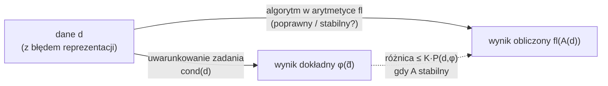

# Uwarunkowanie zadania i stabilność algorytmów

> [!skrot] W 30 sekund
> - **Uwarunkowanie** to cecha **zadania**: jak bardzo mała względna zmiana danych zmienia wynik. Nie zależy od metody.
> - **Poprawność numeryczna** (*backward stability*): wynik algorytmu to dokładne rozwiązanie zadania o **lekko zaburzonych danych**. **Stabilność numeryczna**: błąd wyniku jest tego samego rzędu co **optymalny poziom błędu** dla tego zadania.
> - **Klucz:** dla algorytmu stabilnego $\dfrac{\|\varphi(d) - fl(A(d))\|}{\|\varphi(d)\|} \le K\,(\operatorname{cond}(d)\,\rho_d + \rho_w)$. Błąd ≈ uwarunkowanie × błąd reprezentacji.

> [!intuicja] Po ludzku
> Uwarunkowanie to „jak chwiejny jest stół”, a stabilność to „jak drżą ci ręce”. Na chwiejnym stole (źle uwarunkowane zadanie) nawet chirurg nie postawi wieży z kart. Na stabilnym stole drżące ręce (niestabilny algorytm) i tak wszystko przewrócą. Algorytm numerycznie poprawny to taki, który robi tyle szkody, co lekkie szturchnięcie stołu, i ani trochę więcej.

## Definicja i wzory
> [!definicja] Reprezentacja liczb (wykład 1)
> - Całkowite: $l = s\sum_{i=0}^n e_i 2^i$, słowo $d+1$ bitów, zakres $[-2^d + 1,\ 2^d - 1]$.
> - Rzeczywiste: $x = s\cdot 2^c\cdot m$, $s = \pm1$, **cecha** $c$ (całkowita, na $d - t$ bitach), **mantysa** $m \in [\tfrac12, 1)$ zaokrąglona do $t$ bitów: $|m - m_t| \le \tfrac12 2^{-t}$.
> - Błąd reprezentacji: $rd(x) = x(1 + \varepsilon)$, $|\varepsilon| \le 2^{-t}$. Standard IEEE 754: liczby 32-bitowe (single) i 64-bitowe (double), pola: znak, cecha (wykładnik), mantysa. Szczegóły: [[Arytmetyka zmiennoprzecinkowa i błędy numeryczne]].

> [!definicja] Uwarunkowanie zadania
> Zadanie $w = \varphi(d)$, dane reprezentowane jako $rd(d_i) = d_i(1 + \varepsilon_i)$, $|\varepsilon_i| \le 2^{-t}$. Pytanie: czy mała **względna** zmiana danych daje dużą **względną** zmianę wyniku? Jeśli tak, zadanie jest **źle uwarunkowane**.
> - To cecha **samego zadania**, niezwiązana z metodą rozwiązania.
> - Lekarstwo: przekształcić zadanie w **matematycznie równoważne, dobrze uwarunkowane** (np. inna baza wielomianów, inna postać układu).

> [!wzor] Przykład 2 z wykładu: iloczyn skalarny
> $S = \sum a_i b_i$, zaburzenia $a_i(1+\alpha_i)$, $b_i(1+\beta_i)$:
> $$\frac{|\Delta S|}{|S|} \lesssim \max_i|\alpha_i + \beta_i|\cdot\operatorname{cond}(a,b), \qquad \operatorname{cond}(a, b) = \frac{\sum|a_i b_i|}{\left|\sum a_i b_i\right|}$$
> Gdy wszystkie $a_ib_i$ mają ten sam znak, $\operatorname{cond} = 1$ (świetnie uwarunkowane). Gdy się znoszą (suma bliska 0), $\operatorname{cond}$ jest ogromny.

> [!wzor] Przykład 1 z wykładu: wielomian Wilkinsona
> $w(x) = \prod_{k=1}^{20}(x - k)$ ma pierwiastki $1, 2, \dots, 20$. Zmiana **jednego** współczynnika $a_{19} = -210$ o $2^{-23}$ (względnie mniej niż $2^{-30} \approx 10^{-9}$) daje pierwiastki **zespolone**: najbliżej pierwiastka 15 leży teraz para $13{,}992358 \pm 2{,}51883\,i$. Szukanie pierwiastków z postaci naturalnej wielomianu wysokiego stopnia jest skrajnie źle uwarunkowane.

> [!definicja] Algorytm numerycznie poprawny
> $A$ jest numerycznie poprawny w klasie zadań $\{\varphi; D\}$, jeśli istnieją stałe $K_d, K_w$ (**wskaźniki kumulacji**), że dla każdego $d$ (dla dostatecznie silnej arytmetyki) istnieje $\tilde d$:
> $$\|d - \tilde d\| \le \rho_d K_d\|d\|, \qquad \|\varphi(\tilde d) - fl(A(d))\| \le \rho_w K_w\|\varphi(\tilde d)\|$$
> Słownie: wynik obliczony to **lekko zaburzone dokładne rozwiązanie zadania o lekko zaburzonych danych**. $\rho_d$, $\rho_w$ to niewielkie krotności $2^{-t}$. Przykład: **schemat Hornera** jest numerycznie poprawny (wskaźnik kumulacji co najwyżej $2n+1$).

> [!definicja] Algorytm numerycznie stabilny
> Optymalny poziom błędu rozwiązania w arytmetyce $fl$:
> $$P(d, \varphi) = \rho_w\|w\| + \max_{\|d - \hat d\| \le \rho_d\|d\|}\|\varphi(d) - \varphi(\hat d)\|$$
> $A$ jest **stabilny**, gdy $\|\varphi(d) - fl(A(d))\| \le K\cdot P(d, \varphi)$ dla pewnego niezbyt dużego $K$ (**wskaźnik stabilności**, im mniejszy, tym lepszy). Stąd oszacowanie błędu względnego:
> $$\frac{\|\varphi(d) - fl(A(d))\|}{\|\varphi(d)\|} \le K\,(\operatorname{cond}(d)\,\rho_d + \rho_w)$$
> **Każdy algorytm numerycznie poprawny jest stabilny** (odwrotnie nie zawsze).

## Jak to zrobić — krok po kroku (diagnoza złego wyniku)
1. Policz albo oszacuj $\operatorname{cond}$ zadania (dla układów $\operatorname{cond}(A) = \|A\|\|A^{-1}\|$).
2. Jeśli $\operatorname{cond}\cdot 2^{-t}$ jest duże, winne jest **zadanie**: przeformułuj je (inna baza, skalowanie, ortogonalizacja) albo zwiększ precyzję.
3. Jeśli $\operatorname{cond}$ jest małe, a wynik zły, winny jest **algorytm**: zamień na stabilny (wybór elementu głównego, Horner, wzory bez odejmowania bliskich liczb).

## Przykład
> [!przyklad] Ostatni slajd wykładu: $Ax = b$ przez $A^{-1}b$
> Wzór $x = A^{-1}b$ jest matematycznie poprawny, ale **jako algorytm numeryczny jest zły**: jawne odwracanie macierzy kosztuje więcej działań i wprowadza większe błędy niż eliminacja Gaussa z wyborem elementu albo LU. Przy zaburzeniu samej prawej strony $b$ błąd względny $x$ jest ograniczony przez $\operatorname{cond}(A)\cdot\frac{\|\Delta b\|}{\|b\|}$, czyli tu decyduje uwarunkowanie macierzy. Stąd w praktyce **nigdy nie licz $A^{-1}$**, żeby rozwiązać układ.

> [!przyklad]- Iloczyn skalarny: liczby
> $a = (1, 1)$, $b = (1, -0{,}999)$: $S = 0{,}001$, $\sum|a_ib_i| = 1{,}999$, więc $\operatorname{cond} \approx 2000$. Zaburzenie danych o $10^{-16}$ może dać błąd względny wyniku $2\cdot10^{-13}$. Dla $b = (1, 0{,}999)$: $\operatorname{cond} = 1$.

## Typowe błędy
> [!blad] Pomyłki pojęciowe (częste w testach)
> - „Algorytm źle uwarunkowany”: uwarunkowanie dotyczy **zadania**, nie algorytmu.
> - „Algorytm stabilny daje dokładny wynik dla źle uwarunkowanego zadania”: nie, daje błąd rzędu $\operatorname{cond}\cdot 2^{-t}$, czyli tyle, ile się da.
> - „Poprawność numeryczna = poprawność matematyczna”: nie. $A^{-1}b$ jest matematycznie poprawne, a numerycznie złe.
> - Na slajdzie o przestrzeniach unormowanych (wykłady 4 i 5) nierówność trójkąta jest zapisana jako $\|f+g\| \ge \|f\| + \|g\|$. To **literówka**: poprawnie $\|f+g\| \le \|f\| + \|g\|$. W teście wybieraj wersję z $\le$.

## Na zajęcia i egzamin
> [!zajecia]
> - **Egzamin (test):** definicje uwarunkowania, poprawności i stabilności; co jest cechą zadania, a co algorytmu; wielomian Wilkinsona jako przykład złego uwarunkowania; iloczyn skalarny ($\operatorname{cond} = 1$ przy jednakowych znakach); Horner jest numerycznie poprawny.
> - **Laby:** przykładowe układy do pivotingu (cond do $10^{20}$) i zadanie ze skalowaniem w LU pokazują to w praktyce: [[Układy równań liniowych]].
> - Łączy się z: [[Arytmetyka zmiennoprzecinkowa i błędy numeryczne]], [[Interpolacja]] (macierz Vandermonde'a), [[Aproksymacja średniokwadratowa]] (macierz Hilberta).

## Pytania testowe (egzamin UPeL)
> [!zadanie] 1. Które zdania są prawdziwe? (może być kilka)
> a) Uwarunkowanie zależy od wybranej metody rozwiązania. b) Uwarunkowanie jest cechą zadania. c) Każdy algorytm numerycznie poprawny jest numerycznie stabilny. d) Algorytm stabilny zawsze daje błąd rzędu $2^{-t}$.
> > [!odpowiedz]- Odpowiedź
> > **b, c.** (a) fałsz, (d) fałsz, bo błąd jest rzędu $\operatorname{cond}\cdot2^{-t}$.

> [!zadanie] 2. Wskaźnik uwarunkowania iloczynu skalarnego dla $a = (2, 3)$, $b = (4, 5)$ wynosi:
> a) 0 b) 1 c) 23 d) zależy od algorytmu
> > [!odpowiedz]- Odpowiedź
> > **b.** Wszystkie iloczyny dodatnie, $\sum|a_ib_i| = |\sum a_ib_i| = 23$, więc $\operatorname{cond} = 1$.

> [!zadanie] 3. Algorytm numerycznie poprawny to taki, że:
> a) daje wynik dokładny w arytmetyce zmiennoprzecinkowej b) wynik jest lekko zaburzonym dokładnym rozwiązaniem zadania o lekko zaburzonych danych c) jego wskaźniki kumulacji $K_d$, $K_w$ istnieją i są stałymi d) nie wymaga dzielenia
> > [!odpowiedz]- Odpowiedź
> > **b, c.**

> [!zadanie] 4. Co pokazuje przykład wielomianu Wilkinsona?
> > [!odpowiedz]- Odpowiedź
> > Że zadanie wyznaczania pierwiastków wielomianu z jego współczynników bywa **skrajnie źle uwarunkowane**: zmiana jednego współczynnika rzędu $10^{-9}$ (względnie) daje pierwiastki zespolone (najbliżej 15 jest para $13{,}99 \pm 2{,}52i$).

## Fiszki #fiszki/numeryczne
Uwarunkowanie zadania::Wrażliwość wyniku na małe względne zmiany danych; cecha zadania, nie algorytmu
Algorytm numerycznie poprawny::Wynik = lekko zaburzone dokładne rozwiązanie zadania o lekko zaburzonych danych (wskaźniki kumulacji $K_d$, $K_w$)
Algorytm numerycznie stabilny::Błąd wyniku tego samego rzędu co optymalny poziom błędu $P(d,\varphi)$, z niewielkim $K$
Oszacowanie błędu algorytmu stabilnego::$\le K(\operatorname{cond}(d)\rho_d + \rho_w)$
cond iloczynu skalarnego::$\sum|a_ib_i| / |\sum a_ib_i|$; równe 1, gdy składniki mają ten sam znak
Czy Horner jest numerycznie poprawny?::Tak, wskaźnik kumulacji ≤ 2n+1
Błąd reprezentacji liczby w arytmetyce z t-bitową mantysą::$rd(x) = x(1+\varepsilon)$, $|\varepsilon| \le 2^{-t}$

## Moje notatki
> [!ja] Tu piszesz ty — Albert tej sekcji nie rusza.

## Źródła
- [[W01 Wstęp — reprezentacja liczb, uwarunkowanie, stabilność.pdf]] (D. Szeliga, slajdy 5–24).
- A. Kiełbasiński, H. Schwetlick, *Numeryczna algebra liniowa*, WNT (definicje poprawności i stabilności w tej postaci).
- J.H. Wilkinson, *Rounding Errors in Algebraic Processes*, 1963 (wielomian Wilkinsona).
