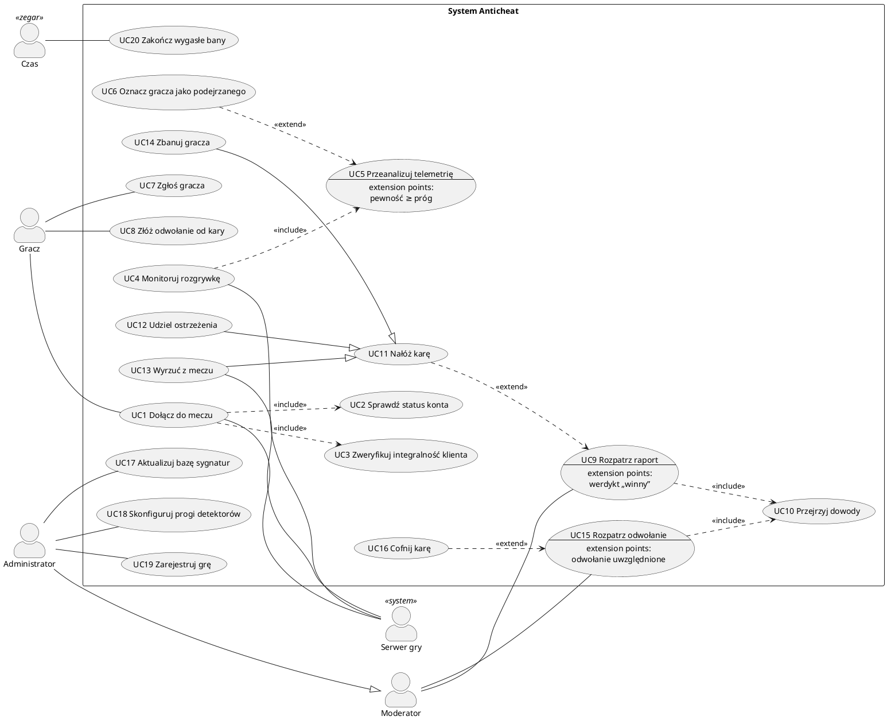
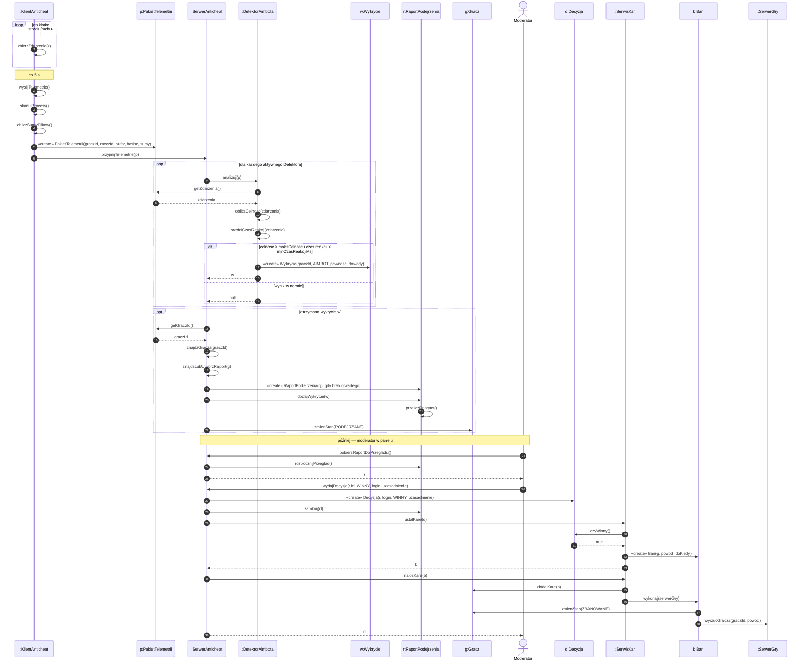

# WP — Anticheat w grach

> [!skrot] W 30 sekund
> - **Co to:** semestralny projekt zespołowy z [[AGH Wzorce projektowe]] (dr inż. Gabriel Rojek, lab pt 11:30, B5 s. 402): system anticheat obsługujący wiele gier. W kliencie gry działa **moduł anticheat**, który zbiera telemetrię (strzały, ruch, widoczność celu), skrót listy procesów i DLL oraz sumy kontrolne plików. Wysyła ją do **serwera anticheat**, a tam **detektory** szukają oszustw: sygnatur zakazanych programów, naruszeń integralności plików i pamięci oraz anomalii statystycznych (aimbot: nienaturalna celność i czas reakcji; speedhack: prędkość ponad fizykę gry; wallhack: celowanie w niewidocznych przeciwników).
> - **Dalej:** wykrycia i **zgłoszenia graczy** trafiają do **raportu podejrzenia**, który ocenia **moderator**. Możliwe kary to ostrzeżenie, wyrzucenie z meczu (kick), ban czasowy albo stały; ukarany może złożyć **odwołanie**. **Administrator** aktualizuje bazę sygnatur, ustawia progi detektorów i rejestruje nowe gry (silniki Unity, Unreal, własne). Kary egzekwuje **serwer gry**.
> - **Skala:** 25 klas i 6 wyliczeń, 20 przypadków użycia, 5 diagramów sekwencji. Klas jest celowo dużo, bo prowadzący mówi: im więcej klas, tym łatwiej o wzorce.
> - **Najbliżej:** pt 9.10 (zaj. 2) diagram przypadków użycia; pt 30.10 (zaj. 5) **ocena wstępnego projektu, 10 pkt**, bez wzorców.

Teoria: [[Diagram przypadków użycia UML]] · [[Diagram klas UML]] · [[Diagram sekwencji UML]] · ćwiczenia: [[Trening — Wzorce projektowe w kodzie]]. Pełne zasady przedmiotu: `~/studia/sem5/wzorce_projektowe/materialy/przebieg-i-ocenianie.md`.

## Wymagania

> [!definicja] Funkcjonalne
> 1. Moduł klienta zbiera zdarzenia z gry i co kilka sekund wysyła pakiet telemetrii (zdarzenia, skróty procesów i DLL, sumy kontrolne plików).
> 2. Przy dołączaniu do meczu system sprawdza status konta (ban?) i integralność klienta.
> 3. Serwer analizuje telemetrię pięcioma detektorami: aimbot, speedhack, wallhack, sygnatury, integralność.
> 4. Wykrycie powyżej progu pewności oznacza gracza jako podejrzanego i dopisuje dowód do jego raportu.
> 5. Gracz może zgłosić innego gracza z meczu (kategoria, opis); zgłoszenie trafia do tego samego raportu.
> 6. Moderator przegląda raporty według priorytetu, wydaje decyzję z uzasadnieniem i nakłada karę: ostrzeżenie, kick, ban czasowy lub stały.
> 7. Ukarany gracz może raz złożyć odwołanie; inny moderator je rozpatruje i może cofnąć karę.
> 8. Administrator zarządza bazą sygnatur, progami detektorów i listą zintegrowanych gier.
> 9. Bany czasowe wygasają automatycznie.

> [!definicja] Niefunkcjonalne
> - **Wydajność:** moduł klienta zabiera mniej niż 2% klatek na sekundę; telemetria to najwyżej ok. 20 kB/s na gracza; analiza pakietu trwa poniżej 1 s.
> - **Sprawiedliwość:** ban daje tylko człowiek (moderator). Automat może co najwyżej wyrzucić z meczu, i to tylko przy trafieniu sygnatury znanego cheata.
> - **Audytowalność:** każda kara ma decyzję, uzasadnienie, dowody i autora; nic nie jest kasowane, cofnięcie to osobny wpis.
> - **Bezpieczeństwo:** pakiety są podpisane, a klient nie decyduje o niczym sam, tylko raportuje.
> - **Prywatność (RODO):** z procesów zbieramy wyłącznie skróty, nie ich zawartość; dane telemetrii mają ograniczony czas przechowywania.
> - **Rozszerzalność:** nowa gra, nowy silnik albo nowy detektor nie wymagają przepisywania rdzenia, bo to są przyszłe miejsca na wzorce.
> - **Aktualność:** nowe sygnatury działają bez aktualizacji klienta gry.

## Aktorzy i przypadki użycia

> [!definicja] Aktorzy
> - **Gracz:** dołącza do meczu, zgłasza innych, składa odwołania. Moduł anticheat w jego kliencie jest **częścią systemu**, a nie aktorem.
> - **Moderator:** rozpatruje raporty i odwołania, nakłada i cofa kary.
> - **Administrator:** generalizacja, czyli „Administrator jest Moderatorem”, ma więc wszystkie przypadki moderatora oraz konfigurację systemu.
> - **Serwer gry** «system»: zewnętrzny system studia gier. Prosi o dopuszczenie gracza, inicjuje monitorowanie meczu i wykonuje kick.
> - **Czas** «zegar»: aktor inicjujący przypadek okresowy, czyli wygaszanie banów.

| # | Przypadek użycia | Aktor główny | Krótki opis |
|---|---|---|---|
| UC1 | Dołącz do meczu | Gracz (+ Serwer gry) | Serwer gry pyta, czy gracz może wejść; system sprawdza konto i klienta |
| UC2 | Sprawdź status konta | — («include») | Czy gracz nie ma aktywnego bana |
| UC3 | Zweryfikuj integralność klienta | — («include») | Sumy plików gry i skan procesów pod kątem sygnatur |
| UC4 | Monitoruj rozgrywkę | Serwer gry | Przez cały mecz przyjmuje kolejne pakiety telemetrii |
| UC5 | Przeanalizuj telemetrię | — («include») | Każdy aktywny detektor ocenia pakiet; punkt rozszerzenia: *pewność ≥ próg* |
| UC6 | Oznacz gracza jako podejrzanego | — («extend» UC5) | Tworzy lub uzupełnia raport podejrzenia, a konto dostaje stan „podejrzane” |
| UC7 | Zgłoś gracza | Gracz | Zgłoszenie z meczu (kategoria, opis) dopisane do raportu zgłoszonego |
| UC8 | Złóż odwołanie od kary | Gracz | Jedno odwołanie na karę, z uzasadnieniem |
| UC9 | Rozpatrz raport | Moderator | Pobiera raport o najwyższym priorytecie i wydaje werdykt; punkt rozszerzenia: *werdykt „winny”* |
| UC10 | Przejrzyj dowody | — («include») | Wykrycia, zgłoszenia, historia kar gracza |
| UC11 | Nałóż karę | — («extend» UC9) | Wybór i egzekucja kary; przypadek ogólny (abstrakcyjny) |
| UC12 | Udziel ostrzeżenia | (generalizacja UC11) | Komunikat do gracza, wpis w historii |
| UC13 | Wyrzuć z meczu | (generalizacja UC11) + Serwer gry | Kick z bieżącego meczu |
| UC14 | Zbanuj gracza | (generalizacja UC11) | Ban czasowy lub stały, kick, konto „zbanowane” |
| UC15 | Rozpatrz odwołanie | Moderator | Inny moderator niż autor decyzji; punkt rozszerzenia: *odwołanie uwzględnione* |
| UC16 | Cofnij karę | — («extend» UC15) | Kara oznaczona jako cofnięta, konto wraca do stanu „czyste” |
| UC17 | Aktualizuj bazę sygnatur | Administrator | Dodanie i usunięcie sygnatury, nowa wersja bazy |
| UC18 | Skonfiguruj progi detektorów | Administrator | Włączenie lub wyłączenie detektora, próg pewności |
| UC19 | Zarejestruj grę | Administrator | Nowa gra lub serwer: silnik, wersja klienta, oczekiwane sumy plików |
| UC20 | Zakończ wygasłe bany | Czas | Okresowo zdejmuje bany, którym minął termin |

> [!wazne] Kierunki strzałek (prowadzący oceni „poprawność syntaktyczną i semantyczną”)
> - **«include»: od bazowego do włączanego** (UC1 → UC2, UC1 → UC3, UC4 → UC5, UC9 → UC10, UC15 → UC10). Bazowy *zawsze* wykonuje włączany i bez niego nie jest kompletny, więc to bazowy „wie” o włączanym. UC10 jest wspólny dla raportów i odwołań, i właśnie po to istnieje «include».
> - **«extend»: od rozszerzającego do bazowego** (UC6 → UC5, UC11 → UC9, UC16 → UC15). Rozszerzenie dzieje się *warunkowo*, w nazwanym **punkcie rozszerzenia** bazowego. Bazowy jest kompletny bez niego (werdykt „niewinny” też kończy UC9) i nie wie o rozszerzeniu.
> - **Generalizacja przypadków: od szczegółowego do ogólnego** (UC12, UC13, UC14 → UC11), linia ciągła z pustym trójkątem. Ostrzeżenie, kick i ban to warianty „Nałóż karę”.
> - **Generalizacja aktorów:** Administrator → Moderator, bo administrator dziedziczy wszystkie przypadki moderatora.
> - Aktor–przypadek to **zwykła linia bez grotu**. Nie rysujemy strzałek „przepływu danych”: to nie jest diagram przepływu.

> [!blad] Pułapki w tym temacie
> - „Wyślij telemetrię” albo „Zapisz do bazy” jako przypadek użycia to błąd: to kroki wewnętrzne bez wartości dla aktora. Telemetria siedzi w UC4/UC5.
> - Moduł anticheat w kliencie **nie jest aktorem**, bo leży wewnątrz granicy systemu. Serwer gry jest aktorem, bo to cudzy system.
> - «include» nie służy do dzielenia na podprogramy. Używamy go tylko dla fragmentu wspólnego (UC10) albo wyraźnie wydzielonego kroku (UC2, UC3, UC5).

### Scenariusze najważniejszych przypadków

> [!przyklad] UC4–UC6: wykrycie oszustwa w trakcie meczu
> **Aktor główny:** Serwer gry. **Warunek początkowy:** gracz dopuszczony do meczu (UC1).
> 1. Moduł klienta zbiera zdarzenia (strzał, ruch, widoczność celu) do bufora.
> 2. Co 5 s moduł skanuje procesy, liczy sumy plików i wysyła pakiet telemetrii.
> 3. System przekazuje pakiet każdemu aktywnemu detektorowi (UC5).
> 4. Detektor aimbota liczy celność i średni czas reakcji. Celność 97% przy reakcji 40 ms przekracza próg, więc powstaje wykrycie AIMBOT z pewnością 0,93.
> 5. System znajduje otwarty raport gracza albo go tworzy, dopisuje wykrycie i przelicza priorytet (UC6).
> 6. Konto gracza przechodzi w stan „podejrzane”, a mecz trwa dalej.
>
> **Alternatywne:**
> - **4a.** Żaden detektor nie przekroczył progu, więc pakiet zostaje odrzucony i nie ma raportu.
> - **4b.** Detektor sygnatur znalazł skrót znanego cheata (pewność 1,0). System od razu wyrzuca gracza z meczu (UC13, przez Serwer gry), ale **nie banuje**, tylko tworzy raport z najwyższym priorytetem.
> - **2a.** Pakiet nie dotarł przez 30 s albo ma zły podpis. Serwer gry wyrzuca gracza z komunikatem „utracono połączenie z anticheatem”, co jest wpisem w raporcie, ale nie karą.
>
> **Warunek końcowy:** wykrycie zapisane w raporcie, raport w kolejce moderatorów.

> [!przyklad] UC7 + UC9 + UC14: zgłoszenie gracza, rozpatrzenie raportu i ban
> **Aktorzy:** Gracz (zgłaszający), Moderator.
> 1. Gracz po meczu wybiera przeciwnika, kategorię „wallhack” i dopisuje opis (UC7).
> 2. System sprawdza, czy obaj byli w tym meczu, i dopisuje zgłoszenie do raportu zgłoszonego (tworzy raport, jeśli go nie było).
> 3. Moderator pobiera raport o najwyższym priorytecie (UC9) i system oznacza go jako „w przeglądzie”.
> 4. Moderator przegląda dowody, czyli wykrycia, zgłoszenia i historię kar (UC10).
> 5. Moderator wydaje werdykt „winny” z uzasadnieniem. Spełniony jest punkt rozszerzenia, więc zaczyna się UC11.
> 6. System proponuje karę według historii (pierwsze przewinienie to ban 14 dni); moderator ją zatwierdza (UC14).
> 7. System zapisuje karę, zmienia stan konta na „zbanowane”, a Serwer gry wyrzuca gracza, jeśli ten akurat gra. Raport zostaje zamknięty.
>
> **Alternatywne:**
> - **2a.** Zgłoszony nie był w meczu albo zgłaszający wysłał więcej niż 10 zgłoszeń w ciągu godziny. Zgłoszenie jest odrzucone z komunikatem.
> - **5a.** Werdykt „niewinny” albo „brak dowodów”. Raport zostaje zamknięty bez kary, a konto wraca do stanu „czyste”.
> - **6a.** Recydywa (wcześniejszy ban), więc system proponuje ban stały. Moderator może zmienić proponowaną karę na łagodniejszą.

> [!przyklad] UC8 + UC15 + UC16: odwołanie od bana
> **Aktorzy:** Gracz (ukarany), Moderator (inny niż autor decyzji).
> 1. Gracz wybiera aktywną karę i składa odwołanie z uzasadnieniem (UC8).
> 2. System sprawdza, że to pierwsze odwołanie od tej kary, i ustawia stan konta „w odwołaniu” (ban dalej obowiązuje).
> 3. Moderator pobiera odwołanie i przegląda dowody (UC15 → UC10).
> 4. Moderator uwzględnia odwołanie, więc zaczyna się UC16: system oznacza karę jako cofniętą, stan konta wraca do „czyste” i gracz dostaje powiadomienie.
>
> **Alternatywne:**
> - **2a.** Odwołanie już było albo kara wygasła, więc system odmawia.
> - **3a.** Moderator jest autorem pierwotnej decyzji, więc system nie da mu rozpatrzyć odwołania.
> - **4a.** Odwołanie odrzucone. Kara trwa, a stan wraca do „zbanowane”.

### Diagram przypadków użycia (PlantUML)

Do podglądu (plantuml.com/plantuml albo wtyczka) i jako wzorzec do odrysowania w Visual Paradigm. Składnię sprawdziłem w PlantUML 1.2025.4.

> [!zadanie] Jak to narysować w Visual Paradigm CE (krok po kroku)
> 1. **Project → New**, nazwa „Anticheat”. Potem **Diagram → New → Use Case Diagram**, nazwa „Przypadki użycia”.
> 2. **Granica systemu:** z palety wybierz **System** i narysuj duży prostokąt podpisany „System Anticheat”. Przypadki użycia wrzucaj *do środka*, wtedy VP sam przypisze je do systemu.
> 3. **Aktorzy:** narzędzie **Actor** i pięć ludzików *poza* prostokątem. Dla „Serwer gry” i „Czas”: prawy przycisk → **Stereotypes → Edit Stereotypes…** → dodaj «system» albo «zegar».
> 4. **Przypadki użycia:** narzędzie **Use Case**, 20 elips. Nazwy w trybie rozkazującym, jak w tabeli.
> 5. **Punkty rozszerzenia:** prawy przycisk na UC5, UC9 i UC15 → **Add → Extension Point** i wpisz nazwę (np. „werdykt winny”). Elipsa dostanie przegródkę „extension points”.
> 6. **Asocjacje:** narzędzie **Association** od aktora do elipsy. Zwykła linia: jeśli VP doda grot (navigable), wyłącz go we właściwościach końca (**Navigable: Unspecified**).
> 7. **«include»:** narzędzie **Include**, ciągnięte *od bazowego do włączanego* (np. z UC1 do UC2).
> 8. **«extend»:** narzędzie **Extend**, ciągnięte *od rozszerzającego do bazowego* (z UC11 do UC9). VP zapyta o punkt rozszerzenia: wybierz ten z kroku 5. Warunek wpisz w **Open Specification → Condition**.
> 9. **Generalizacje:** narzędzie **Generalization** od szczegółowego do ogólnego (UC12, UC13, UC14 → UC11; Administrator → Moderator). UC11 oznacz jako abstrakcyjny w **Open Specification → Abstract**, wtedy nazwa będzie kursywą.
> 10. Szybciej idzie przez **Resource Catalog**: najedź na element, przeciągnij ikonkę z jego prawego górnego rogu i wybierz typ relacji.
> 11. **Scenariusze:** prawy przycisk na elipsie → **Open Use Case Details… → Flow of Events**. Wklej kroki ze scenariuszy powyżej (główny i alternatywne).
> 12. Na koniec **Diagram → Layout** albo ręczne wyrównanie, a potem **Project → Export → Active Diagram as Image (PNG)** do oddania. Projekt `.vpp` trzymajcie na wspólnym dysku lub w repozytorium.

## Diagram klas — szkic wstępny (bez wzorców)

Wersja na zaj. 3 (pt 16.10). 25 klas + 6 wyliczeń, styl jak w [[Diagram klas UML]]. Składnię sprawdziłem parserem Mermaid 12. Gettery i settery pomijam, chyba że występują na diagramie sekwencji.

```mermaid
classDiagram
    direction TB
    class Gracz {
        -id: String
        -nick: String
        -stanKonta: StanKonta
        -kary: List~Kara~
        +zmienStan(nowy: StanKonta) void
        +czyMozeGrac() boolean
        +dodajKare(k: Kara) void
        +aktywneKary(teraz: LocalDateTime) List~Kara~
    }
    class SerwerGry {
        -id: String
        -nazwaGry: String
        -silnik: TypSilnika
        -mecze: List~Mecz~
        +dopuscGracza(g: Gracz) boolean
        +rozpocznijMecz(gracze: List~Gracz~) Mecz
        +znajdzMecz(meczId: String) Mecz
        +wyslijKomunikat(graczId: String, tresc: String) void
        +wyrzucGracza(graczId: String, powod: String) void
    }
    class Mecz {
        -id: String
        -start: LocalDateTime
        -uczestnicy: List~Gracz~
        +dodajUczestnika(g: Gracz) void
        +czyUczestnik(graczId: String) boolean
        +zakoncz() void
    }
    class KlientAnticheat {
        -graczId: String
        -meczId: String
        -wersjaModulu: String
        -bufor: List~ZdarzenieGry~
        +zbierzZdarzenie(z: ZdarzenieGry) void
        +skanujProcesy() List~String~
        +obliczSumyPlikow() List~String~
        +wyslijTelemetrie() void
    }
    class PakietTelemetrii {
        -graczId: String
        -meczId: String
        -czas: LocalDateTime
        -zdarzenia: List~ZdarzenieGry~
        -hasheProcesow: List~String~
        -sumyPlikow: List~String~
        +getGraczId() String
        +getZdarzenia() List~ZdarzenieGry~
        +getHasheProcesow() List~String~
        +getSumyPlikow() List~String~
    }
    class ZdarzenieGry {
        -typ: String
        -czasMs: long
        -pozycja: double[]
        -predkosc: double
        -trafienie: boolean
        -czasReakcjiMs: long
        -celWidoczny: boolean
    }
    class SerwerAnticheat {
        -gra: String
        -silnik: TypSilnika
        -detektory: List~Detektor~
        -baza: BazaSygnatur
        -raporty: List~RaportPodejrzenia~
        -odwolania: List~Odwolanie~
        -serwisKar: SerwisKar
        -gracze: List~Gracz~
        -serwerGry: SerwerGry
        +zweryfikujKlienta(p: PakietTelemetrii) boolean
        +przyjmijTelemetrie(p: PakietTelemetrii) void
        +przyjmijZgloszenie(z: ZgloszenieGracza) void
        +pobierzRaportDoPrzegladu() RaportPodejrzenia
        +wydajDecyzje(raportId: String, w: Werdykt, moderator: String, uzasadnienie: String) Decyzja
        +zlozOdwolanie(graczId: String, karaId: String, tresc: String) Odwolanie
        +rozpatrzOdwolanie(odwolanieId: String, uwzglednij: boolean, moderator: String) void
        -skonfigurujDetektory() void
        -znajdzGracza(id: String) Gracz
        -znajdzLubUtworzRaport(g: Gracz) RaportPodejrzenia
    }
    class Detektor {
        <<abstract>>
        #nazwa: String
        #progPewnosci: double
        #aktywny: boolean
        +analizuj(p: PakietTelemetrii)* Wykrycie
        +ustawProg(prog: double) void
    }
    class DetektorAimbota {
        -maksCelnosc: double
        -minCzasReakcjiMs: long
        +analizuj(p: PakietTelemetrii) Wykrycie
        -obliczCelnosc(z: List~ZdarzenieGry~) double
        -sredniCzasReakcji(z: List~ZdarzenieGry~) double
    }
    class DetektorSpeedhacka {
        -maksPredkosc: double
        +analizuj(p: PakietTelemetrii) Wykrycie
    }
    class DetektorWallhacka {
        -maksOdsetekNiewidocznych: double
        +analizuj(p: PakietTelemetrii) Wykrycie
    }
    class DetektorSygnatur {
        -baza: BazaSygnatur
        +analizuj(p: PakietTelemetrii) Wykrycie
    }
    class DetektorIntegralnosci {
        -oczekiwaneSumy: List~String~
        +analizuj(p: PakietTelemetrii) Wykrycie
    }
    class Wykrycie {
        -graczId: String
        -typ: TypOszustwa
        -pewnosc: double
        -dowody: String
        -czas: LocalDateTime
        +getPewnosc() double
        +opis() String
    }
    class Sygnatura {
        -id: String
        -hash: String
        -nazwaProgramu: String
        -typ: TypOszustwa
        -wersja: int
    }
    class BazaSygnatur {
        -wersja: int
        -sygnatury: List~Sygnatura~
        +znajdz(hash: String) Sygnatura
        +dodaj(s: Sygnatura) void
        +usun(id: String) void
        +getWersja() int
    }
    class RaportPodejrzenia {
        -id: String
        -gracz: Gracz
        -wykrycia: List~Wykrycie~
        -zgloszenia: List~ZgloszenieGracza~
        -status: StatusRaportu
        -priorytet: int
        +dodajWykrycie(w: Wykrycie) void
        +dodajZgloszenie(z: ZgloszenieGracza) void
        +przeliczPriorytet() void
        +rozpocznijPrzeglad() void
        +zamknij(d: Decyzja) void
    }
    class ZgloszenieGracza {
        -id: String
        -zglaszajacy: Gracz
        -zgloszony: Gracz
        -meczId: String
        -kategoria: TypOszustwa
        -opis: String
        -czas: LocalDateTime
    }
    class Decyzja {
        -raport: RaportPodejrzenia
        -moderator: String
        -werdykt: Werdykt
        -uzasadnienie: String
        -czas: LocalDateTime
        +czyWinny() boolean
    }
    class Kara {
        <<abstract>>
        #id: String
        #gracz: Gracz
        #powod: String
        #od: LocalDateTime
        #cofnieta: boolean
        +wykonaj(s: SerwerGry)* void
        +czyAktywna(teraz: LocalDateTime)* boolean
        +cofnij() void
    }
    class Ostrzezenie {
        +wykonaj(s: SerwerGry) void
        +czyAktywna(teraz: LocalDateTime) boolean
    }
    class Wyrzucenie {
        -meczId: String
        +wykonaj(s: SerwerGry) void
        +czyAktywna(teraz: LocalDateTime) boolean
    }
    class Ban {
        -doKiedy: LocalDateTime
        +czyStaly() boolean
        +wykonaj(s: SerwerGry) void
        +czyAktywna(teraz: LocalDateTime) boolean
    }
    class Odwolanie {
        -id: String
        -kara: Kara
        -tresc: String
        -zlozono: LocalDateTime
        -status: StatusOdwolania
        +rozpatrz(uwzglednij: boolean, moderator: String) void
    }
    class SerwisKar {
        -serwerGry: SerwerGry
        +ustalKare(d: Decyzja) Kara
        +nalozKare(k: Kara) void
        +cofnijKare(k: Kara) void
    }
    class StanKonta {
        <<enumeration>>
        CZYSTE
        PODEJRZANE
        ZBANOWANE
        W_ODWOLANIU
    }
    class TypOszustwa {
        <<enumeration>>
        AIMBOT
        SPEEDHACK
        WALLHACK
        ZAKAZANY_PROGRAM
        MODYFIKACJA_PLIKOW
    }
    class Werdykt {
        <<enumeration>>
        WINNY
        NIEWINNY
        BRAK_DOWODOW
    }
    class StatusRaportu {
        <<enumeration>>
        OTWARTY
        W_PRZEGLADZIE
        ZAMKNIETY
    }
    class StatusOdwolania {
        <<enumeration>>
        ZLOZONE
        UWZGLEDNIONE
        ODRZUCONE
    }
    class TypSilnika {
        <<enumeration>>
        UNITY
        UNREAL
        WLASNY
    }

    Detektor <|-- DetektorAimbota
    Detektor <|-- DetektorSpeedhacka
    Detektor <|-- DetektorWallhacka
    Detektor <|-- DetektorSygnatur
    Detektor <|-- DetektorIntegralnosci
    Kara <|-- Ostrzezenie
    Kara <|-- Wyrzucenie
    Kara <|-- Ban

    SerwerGry "1" *-- "*" Mecz : prowadzi
    Mecz "*" o-- "2..*" Gracz : uczestnicy
    KlientAnticheat "*" --> "1" SerwerAnticheat : wysyła do
    KlientAnticheat ..> PakietTelemetrii : «create»
    PakietTelemetrii "1" *-- "*" ZdarzenieGry : zdarzenia
    SerwerAnticheat "1" *-- "1..*" Detektor : detektory
    SerwerAnticheat "1" o-- "1" BazaSygnatur : baza
    DetektorSygnatur "*" --> "1" BazaSygnatur : sprawdza w
    BazaSygnatur "1" *-- "*" Sygnatura : sygnatury
    Detektor ..> PakietTelemetrii : analizuje
    Detektor ..> Wykrycie : «create»
    SerwerAnticheat "1" *-- "*" RaportPodejrzenia : raporty
    SerwerAnticheat "1" --> "1" SerwisKar : serwisKar
    SerwerAnticheat "1" *-- "*" Odwolanie : odwolania
    RaportPodejrzenia "1" *-- "*" Wykrycie : wykrycia
    RaportPodejrzenia "1" o-- "*" ZgloszenieGracza : zgloszenia
    RaportPodejrzenia "*" --> "1" Gracz : dotyczy
    ZgloszenieGracza "*" --> "1" Gracz : zglaszajacy
    ZgloszenieGracza "*" --> "1" Gracz : zgloszony
    Decyzja "0..1" --> "1" RaportPodejrzenia : rozstrzyga
    SerwisKar ..> Decyzja : czyta
    SerwisKar ..> Kara : «create»
    SerwisKar ..> Gracz : dodajKare
    SerwerAnticheat "1" --> "*" Gracz : gracze
    SerwerAnticheat "*" --> "1" SerwerGry : chroni
    SerwisKar "*" --> "1" SerwerGry : egzekwuje na
    Gracz "1" -- "*" Kara : kary
    Kara ..> SerwerGry : wykonaj
    Odwolanie "0..1" --> "1" Kara : dotyczy
```

> [!wazne] Co dopowiedzieć prowadzącemu (decyzje projektowe)
> - **Kompozycja a agregacja:** wykrycia żyją tylko w raporcie (◆), a zgłoszenia mają własne życie, bo da się je odrzucić bez raportu (◇). Gracz istnieje niezależnie od meczu (◇). Mecz nie przetrwa serwera gry (◆). Detektory tworzy i posiada serwer anticheat (◆). Bazę sygnatur współdzieli z detektorem sygnatur (◇ + asocjacja).
> - **Dziedziczenie, a nie wzorzec:** `Detektor` i `Kara` to zwykły polimorfizm (metody abstrakcyjne `analizuj`, `wykonaj`, `czyAktywna`). Na tym etapie świadomie nie ma jeszcze fabryk, strategii ani stanów.
> - **Gdzie widać „przed” dla przyszłych wzorców** (zostawione celowo proste):
>   - `SerwerAnticheat.skonfigurujDetektory()` tworzy detektory przez `new` i `switch (silnik)`, co później zastąpi fabryka.
>   - `SerwisKar.ustalKare()` to łańcuch `if`-ów, a konstruktory kar mają długie listy parametrów: miejsce na budowniczego.
>   - `Gracz.zmienStan()` używa wyliczenia `StanKonta` i `switch` w `czyMozeGrac()`: miejsce na wzorzec Stan.
>   - `SerwerAnticheat` sam woła każdy detektor i sam zmienia stan gracza: miejsce na Obserwatora, a w studium SOLID także na SRP.
> - **Moderator i administrator nie są klasami**, tylko aktorami. W danych zostaje po nich login (`Decyzja.moderator`). Jeśli prowadzący zażąda klasy, dodajcie `Moderator` z `rozpatrz()` i podklasę `Administrator`.
> - **Ban czasowy a stały:** jedna klasa `Ban`; `doKiedy == null` oznacza ban stały (`czyStaly()`). Klasa `BanStaly` byłaby podklasą bez nowego zachowania.
> - **Klient a serwer:** `KlientAnticheat` niczego nie rozstrzyga, tylko zbiera i wysyła. Wszystkie decyzje zapadają po stronie serwera (wymaganie bezpieczeństwa).
> - Typy dat to `LocalDateTime`, a kolekcje to `List~T~`, czyli `List<T>` w Javie.

## Diagramy sekwencji

> [!zadanie] Kandydaci (na zaj. 4 rysujecie **wszystkie**, bo zaj. 5 wymaga „wszystkich interakcji”)
> 1. **SD1 Wykrycie aimbota → raport → decyzja → ban** (UC4, UC5, UC6, UC9, UC14): poniżej w całości.
> 2. **SD2 Dołączenie do meczu** (UC1–UC3): pierwszy pakiet z `KlientAnticheat.wyslijTelemetrie()` (ze `skanujProcesy()` i `obliczSumyPlikow()`) → `SerwerAnticheat.zweryfikujKlienta(p)` → `znajdzGracza(id)` → `Gracz.czyMozeGrac()` → `DetektorSygnatur.analizuj(p)` (→ `BazaSygnatur.znajdz(hash)`) i `DetektorIntegralnosci.analizuj(p)` → `alt` dopuszczony: `SerwerGry.dopuscGracza(g)` / odrzucony: `SerwerGry.wyslijKomunikat(...)`.
> 3. **SD3 Zgłoszenie gracza** (UC7): `SerwerAnticheat.przyjmijZgloszenie(z)` → `SerwerGry.znajdzMecz(meczId)` → `Mecz.czyUczestnik(id)` ×2 → `znajdzGracza(id)` → `znajdzLubUtworzRaport(g)` → `RaportPodejrzenia.dodajZgloszenie(z)` → `przeliczPriorytet()`.
> 4. **SD4 Odwołanie i cofnięcie bana** (UC8, UC15, UC16): `zlozOdwolanie(...)` → «create» `Odwolanie` → `Gracz.zmienStan(W_ODWOLANIU)`; potem `rozpatrzOdwolanie(id, true, login)` → `Odwolanie.rozpatrz(true, login)`, a potem serwer woła `SerwisKar.cofnijKare(k)` → `Kara.cofnij()` → `Gracz.zmienStan(CZYSTE)`.
> 5. **SD5 Aktualizacja sygnatur i progów** (UC17, UC18): `BazaSygnatur.dodaj(s)` / `usun(id)` → nowa wersja; `Detektor.ustawProg(prog)`.

SD1 używa wyłącznie klas i metod z diagramu klas, a to jest kryterium oceny na zaj. 5: zbieżność z diagramem klas.

> [!blad] Na co uważać przy sekwencjach
> - Każda strzałka `obiekt->>obiekt2: metoda()` musi istnieć jako **publiczna metoda klasy odbiorcy** (albo prywatna przy wywołaniu na sobie). Dodajecie metodę na sekwencji, więc dopisujecie ją też na diagramie klas.
> - Moderator to aktor (ludzik), a nie obiekt klasy, i wchodzi przez metody `SerwerAnticheat`, który pełni rolę kontrolera.
> - `«create»` rysujcie w VP narzędziem **Create Message**: obiekt pojawia się na wysokości komunikatu.

## Plan wzorców na cały semestr

Na każdym etapie wdrażacie **dwa** wzorce i dla każdego piszecie studium z 4 części: **motywacja → fragment PRZED → struktura PO → współdziałanie (sekwencja)**. Teoria w [[Trening — Wzorce projektowe w kodzie]]. Gwiazdka ★ oznacza rekomendację, czyli łatwe studium z wyraźnym „przed” w obecnym projekcie.

> [!przyda] Kreacyjne (zaj. 6–7: 6.11 i 13.11)
> - ★ **[[Fabryka abstrakcyjna]] / [[Metoda wytwórcza]]: detektory dla silnika.** *Przed:* `skonfigurujDetektory()` ze `switch (silnik)` i `new DetektorIntegralnosci(sumyUnity)`. *Po:* `FabrykaDetektorow` z podklasami `FabrykaUnity`, `FabrykaUnreal`, które tworzą rodzinę: detektor integralności z sumami danego silnika i detektor speedhacka z fizyką danego silnika. Nowy silnik to nowa fabryka, bez zmian w serwerze (OCP).
> - ★ **[[Budowniczy]]: kara albo raport.** *Przed:* `new Ban(gracz, powod, od, doKiedy, dowody, decyzja, gry…)`, czyli długi konstruktor, a do tego `if`-y w `ustalKare()`. *Po:* `BudowniczyKary.dlaGracza(g).zPowodu(…).na(14, DNI).zDowodami(…).zbuduj()`, ewentualnie z kierownikiem `KatalogKar` („pierwsze przewinienie”, „recydywa”).
> - **[[Prototyp]]: sygnatury.** Nowa wersja sygnatury to klon starej ze zmienionym skrótem (`Sygnatura.clone()`); dobre jako zapasowy wzorzec.
> - **[[Singleton]]: konfiguracja progów.** Łatwy, ale **ostrzeżenie**: to ukryty stan globalny, utrudnia testy (progi z jednego testu przeciekają do drugiego) i bywa podawany jako antywzorzec. Jeśli go bierzecie, w motywacji napiszcie o tym wprost, a na studium SOLID pokażcie zastąpienie wstrzykiwaniem zależności. Bezpieczniej wybrać dwa poprzednie.

> [!przyda] Strukturalne (zaj. 8–9: 20.11 i 27.11)
> - ★ **[[Adapter]]: silniki gier.** *Przed:* `SerwerGry` i `KlientAnticheat` zakładają jeden format zdarzeń. *Po:* interfejs `ZrodloTelemetrii` i adaptery `AdapterUnity`, `AdapterUnreal`, które tłumaczą zdarzenia SDK silnika na `ZdarzenieGry`. Bardzo naturalne, bo każdy silnik ma inne API.
> - ★ **[[Dekorator]]: detektory.** `DetektorZLogowaniem`, `DetektorZProgiem` i `DetektorZPomiaremCzasu` owijają dowolny `Detektor` i dokładają zachowanie bez nowych podklas na każdą kombinację. Ładnie się rysuje, bo `Detektor` już jest abstrakcyjny.
> - **[[Fasada]]: API anticheatu dla twórców gier.** `AnticheatAPI` z trzema metodami (`dopusc`, `raportuj`, `zglos`) zasłania serwer, detektory i serwis kar. Najprostsze studium, wzorzec zapasowy.
> - **[[Pełnomocnik]]: zdalna baza sygnatur.** `PelnomocnikBazySygnatur` z pamięcią podręczną i leniwym pobieraniem nowej wersji.
> - **[[Kompozyt]]: reguły detekcji.** `RegulaZlozona` („celność > 90% I reakcja < 80 ms”) i reguły proste mają wspólny interfejs `Regula`.

> [!przyda] Czynnościowe (zaj. 10–11: 4.12 i 11.12)
> - ★ **[[Stan]]: konto gracza** (czyste / podejrzane / zbanowane / w odwołaniu). *Przed:* `enum StanKonta` i `switch` w `czyMozeGrac()`, `zmienStan()`, `zlozOdwolanie()`. *Po:* klasy `StanCzyste`, `StanPodejrzane`, `StanZbanowane`, `StanWOdwolaniu`, w których przejścia są w stanach (np. odwołanie da się złożyć tylko ze stanu „zbanowane”). Diagram stanów pomaga w motywacji.
> - ★ **[[Obserwator]]: zdarzenia telemetrii i wykryć.** *Przed:* `SerwerAnticheat` sam woła raport, gracza i serwer gry. *Po:* `SerwerAnticheat` publikuje `Wykrycie`, a subskrybenci (`KolejkaRaportow`, `SerwerGry` przy kicku, `Statystyki`, `Powiadomienia`) reagują niezależnie.
> - **[[Polecenie]]: akcje moderatora z cofaniem.** `NalozBan`, `Ostrzez`, `Wyrzuc` z `wykonaj()` i `cofnij()`, a historia poleceń daje audyt. Odwołanie to po prostu `cofnij()`. Mocny zapasowy, dobrze pasuje do UC16.
> - **[[Strategia]]: algorytmy detekcji.** Uwaga: `Detektor` już jest polimorficzny, więc prowadzący może uznać, że „to już było”. Sens ma tylko jako wymienny algorytm *wewnątrz* detektora aimbota (np. `StrategiaProgowa` albo `StrategiaZScore`).
> - **[[Łańcuch zobowiązań]]: weryfikacja zgłoszenia.** Filtr spamu → czy był w meczu → duplikat → wyliczenie priorytetu → kolejka; każdy krok może przerwać łańcuch.

> [!przyda] Studium pięciu punktów (zaj. 12–13: 18.12 i 8.01)
> Wybierzcie punkty, które da się pokazać jako „przed/po” na **waszym** diagramie:
> 1. ★ **SRP ([[SOLID]]):** `SerwerAnticheat` przyjmuje telemetrię, zgłoszenia, decyzje i odwołania. Rozbicie na `PrzyjmowanieTelemetrii`, `ObslugaRaportow` i `ObslugaOdwolan`.
> 2. ★ **OCP:** dodanie nowego detektora albo nowej kary bez modyfikacji `SerwerAnticheat` i `SerwisKar`; tu przydaje się efekt fabryki i budowniczego.
> 3. ★ **DIP:** `SerwisKar` zależy od konkretnego `SerwerGry`. Wprowadzamy interfejs `EgzekutorKar` i wstrzykiwanie zależności, co przy okazji usuwa Singletona, jeśli był.
> 4. ★ **Information Expert ([[GRASP]]):** priorytet liczy `RaportPodejrzenia`, bo ma wykrycia i zgłoszenia, a aktywność kary sprawdza `Kara`. Przed zmianą robił to serwer.
> 5. ★ **Creator (GRASP):** `Wykrycie` tworzy detektor, bo ma dane, a `Decyzja` powstaje u tego, kto ją zapisuje. Zapasowe: **Controller** (`SerwerAnticheat` jako kontroler przypadków użycia), **Low Coupling** i **[[Antywzorce projektowe|antywzorzec]] God Object**, czyli stan „przed” w punkcie 1.

## Harmonogram

Lab: **piątek 11:30–13:00, B5 s. 402** (sprawdzone w `plan przedmiot wzorce`). Przerwa świąteczna: 25.12 i 1.01 to piątki wolne.

| Zaj. | Data | Temat | Co oddać / przygotować | Pkt |
|---|---|---|---|---|
| 1 | pt 2.10 | Organizacja, VP CE, zespoły, temat | Temat: anticheat (zrobione) | — |
| 2 | pt 9.10 | Diagram przypadków użycia | Diagram PU w VP + scenariusze UC4–6, UC7/9/14, UC8/15/16 | — |
| 3 | pt 16.10 | Diagram klas | 25 klas z atrybutami, metodami i relacjami | — |
| 4 | pt 23.10 | Diagramy sekwencji | SD1–SD5 zbieżne z diagramem klas | — |
| 5 | pt 30.10 | **Ocena wstępnego projektu** | PU + klasy + wszystkie sekwencje, bez wzorców | **10** |
| 6 | pt 6.11 | **Kartkówka: kreacyjne**; wdrożenie 2 kreacyjnych | Nauka: Fabryka, Metoda wytwórcza, Budowniczy, Prototyp, Singleton | **10** |
| 7 | pt 13.11 | **Ocena studium kreacyjnych** | 2 studia × 4 części | **10** |
| 8 | pt 20.11 | **Kartkówka: strukturalne**; wdrożenie 2 strukturalnych | Nauka: Adapter, Dekorator, Fasada, Pełnomocnik, Kompozyt, Most | **10** |
| 9 | pt 27.11 | **Ocena studium strukturalnych** | 2 studia × 4 części | **10** |
| 10 | pt 4.12 | **Kartkówka: czynnościowe**; wdrożenie 2 czynnościowych | Nauka: Stan, Obserwator, Polecenie, Strategia, Łańcuch, Metoda szablonowa, Iterator | **10** |
| 11 | pt 11.12 | **Ocena studium czynnościowych** | 2 studia × 4 części | **10** |
| 12 | pt 18.12 | **Kartkówka: SOLID i GRASP** | Nauka: SOLID, GRASP (9 zasad), antywzorce | **10** |
| 13 | pt 8.01 | **Ocena studium pięciu punktów** | 5 studiów przed/po (3 tygodnie przerwy na pracę) | **10** |
| 14 | pt 15.01 | Uzupełnienia, oceny | Zaległe kartkówki (z nieobecności) | — |

> [!wazne] Zasady, które bolą
> **90 pkt, zaliczenie od 45.** Kartkówek i zadań **nie da się poprawić**. Spóźnienie z oddaniem kosztuje **−2 pkt za każdy tydzień**. Obecność jest obowiązkowa; kartkówkę z nieobecności pisze się na zaj. 14. Kartkówki są indywidualne, studia wspólne.

## Podział pracy (propozycja)

| Etap | Patryk | Oliwier | Razem |
|---|---|---|---|
| PU (zaj. 2) | UC1–UC6, UC17–UC20 + scenariusz wykrycia | UC7–UC16 + scenariusze zgłoszenia i odwołania | Jeden plik `.vpp`, przegląd kierunków strzałek |
| Klasy (zaj. 3) | Telemetria i detekcja: Klient, Pakiet, Zdarzenie, Detektory, Sygnatury, SerwerGry, Mecz | Moderacja: Raport, Zgłoszenie, Decyzja, Kary, Odwołanie, SerwisKar, Gracz | `SerwerAnticheat` i relacje między częściami |
| Sekwencje (zaj. 4) | SD1 (pierwsza połowa), SD2, SD5 | SD1 (druga połowa), SD3, SD4 | Kontrola zgodności metod z diagramem klas |
| Kreacyjne | Fabryka detektorów | Budowniczy kary | Wzajemna korekta studiów |
| Strukturalne | Adapter silników | Dekorator detektorów | — |
| Czynnościowe | Obserwator telemetrii | Stan konta gracza | — |
| SOLID/GRASP | SRP, OCP, DIP | Information Expert, Creator | — |

Podział idzie wzdłuż granicy **detekcja / moderacja**, więc każdy rozwija „swoją” część w kolejnych wzorcach. Jedna osoba (Patryk) odpowiada za spójność pliku VP: kto ostatni edytuje, ten eksportuje PNG.

## Moje notatki
> [!ja] Tu piszesz ty — Albert tej sekcji nie rusza.
