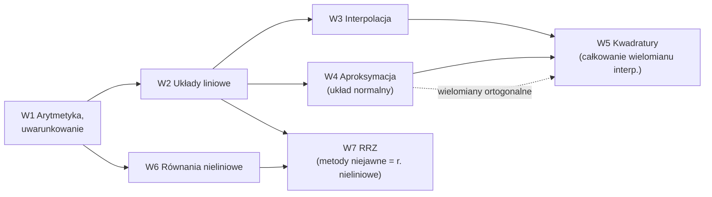

# AGH Metody numeryczne

> [!definicja] Zaliczenie
> **Wykład 28 h + laboratorium 28 h.** Wykład: dr Danuta Szeliga (WIMiIP). Rok 2025/26, semestr letni: egzamin w czerwcu 2026, laby „lato 26” (dlatego sem. 4; notatka MES podaje sem. 3 za sylabusem, sprawdź w `~/studia/sylabus`).
> **Egzamin:** test na UPeL w laboratorium komputerowym, **pytania wielokrotnego wyboru z jedną lub więcej poprawnymi odpowiedziami**, wyświetlane po kolei, **bez możliwości powrotu** do poprzednich. Wolno mieć kartkę i długopis, telefon i smartwatch schowane (inaczej 2,0). Podejść może każdy, ale ocena trafia do USOS dopiero po zaliczeniu labów. Grupy egzaminacyjne 1–6 (bez przypisania nie wejdziesz).
> Terminy 2025/26: I — 29 czerwca (11:30/12:30/13:30, s. 410 i 701 B5), II — 6 lipca 11:30 (s. 410 B5), III — 3 września 10:30 (s. 101 B4).
> **Laboratorium (lato 26):** 12 instrukcji, każda z programem w C++ (i czasem krótkim sprawozdaniem) na UPeL. **Max 10 pkt za zajęcia**: sama implementacja metody daje najwyżej 6 pkt, reszta za zadania problemowe. Oddajesz na tych samych zajęciach; tydzień spóźnienia −3 pkt, dwa tygodnie −5 pkt, dłużej najwyżej 1 pkt (przy usprawiedliwionej nieobecności opóźnienie liczy się od drugich zajęć po powrocie). **Warunki zaliczenia: 50% punktów, 50% frekwencji i każde zadanie oddane na co najmniej 1 pkt.** Frekwencja: 2 nieusprawiedliwione nieobecności wolno, każde kolejne 2 obniżają ocenę o 0,5, ponad 7 = jak nieuczęszczanie (zaliczenie tylko za zgodą dziekana).

> [!wazne] Jak uczyć się pod ten egzamin
> Test wielokrotnego wyboru bez powrotu sprawdza **definicje, twierdzenia i własności metod** (rzędy zbieżności, warunki zbieżności, dokładność kwadratur, co jest jawne/niejawne), a nie długie rachunki. W każdej notatce jest sekcja **„Pytania testowe”** z odpowiedziami do rozwiązywania na sucho. Kod i laby masz w [[Kurs — Metody numeryczne]].

## Wykłady (dr Szeliga) — co gdzie jest
| # | Wykład | Notatki | PDF |
|---|---|---|---|
| 1 | Wstęp: reprezentacja liczb, IEEE 754, uwarunkowanie, poprawność i stabilność algorytmów | [[Arytmetyka zmiennoprzecinkowa i błędy numeryczne]], [[Uwarunkowanie zadania i stabilność algorytmów]] | [[W01 Wstęp — reprezentacja liczb, uwarunkowanie, stabilność.pdf]] |
| 2 | Układy równań liniowych: Gauss, Gauss–Crout, LU (Doolittle, Crout), macierze rzadkie, Jacobi, Gauss–Seidel, SOR, Richardson, metody projekcji | [[Układy równań liniowych]], [[Metody iteracyjne rozwiązywania układów liniowych]] | [[W02 Układy równań liniowych.pdf]] |
| 3 | Interpolacja: postacie wielomianu, Lagrange, ilorazy różnicowe, Newton, Hermite, Runge, trygonometryczna i FFT, funkcje sklejane | [[Interpolacja]], [[Interpolacja Hermite'a i funkcje sklejane]] | [[W03 Interpolacja.pdf]] |
| 4 | Aproksymacja: przestrzenie unormowane i unitarne, Gram–Schmidt, wielomiany ortogonalne, średniokwadratowa, jednostajna, Padé | [[Aproksymacja średniokwadratowa]], [[Wielomiany ortogonalne]], [[Aproksymacja jednostajna i Padégo]] | [[W04 Aproksymacja.pdf]] |
| 5 | Kwadratury: rząd kwadratury, zbieżność, interpolacyjne, Newton–Cotes, Gauss, Monte Carlo | [[Całkowanie numeryczne i kwadratury Gaussa]], [[Metoda Monte Carlo]] | [[W05 Kwadratury.pdf]] |
| 6 | Równania nieliniowe: punkt stały, Newton, sieczne, regula falsi, Pegaz, Illinois, wielomiany, układy | [[Rozwiązywanie równań nieliniowych]] | [[W06 Równania nieliniowe.pdf]] |
| 7 | Równania różniczkowe zwyczajne: Cauchy, Euler, jednokrokowe, rząd, RK, jawne/niejawne, sztywność, układy | [[Numeryczne rozwiązywanie RRZ]] | [[W07 Równania różniczkowe zwyczajne.pdf]] |



## Laboratorium (lato 2026)
| Data | Temat | Instrukcja | Notatka (sekcja „Lab”) |
|---|---|---|---|
| 3.03 | Sprawy organizacyjne | — | — |
| 10.03 | Interpolacja Lagrange'a | [[Lab — interpolacja Lagrange'a.pdf]] | [[Interpolacja]] |
| 17.03 | Interpolacja Newtona | [[Lab — interpolacja Newtona.pdf]] | [[Interpolacja]] |
| 24.03 | Eliminacja Gaussa | [[Lab — eliminacja Gaussa.pdf]] | [[Układy równań liniowych]] |
| 31.03 | Pivoting | [[Lab — Gauss z wyborem elementu (pivoting, Crout).pdf]], [[Lab — przykładowe układy do pivotingu i LU.pdf]] | [[Układy równań liniowych]] |
| 14.04 | LU Doolittle'a | [[Lab — LU Doolittle'a i skalowanie.pdf]] | [[Układy równań liniowych]] |
| 21.04 | Metoda Jacobiego | [[Lab — metoda Jacobiego.pdf]] | [[Układy równań liniowych]] |
| 28.04 | Całkowanie: prostokąty, trapezy, parabole | [[Lab — całkowanie metodami prostokątów, trapezów i parabol.pdf]] | [[Całkowanie numeryczne i kwadratury Gaussa]] |
| 5.05 | Kwadratury Gaussa | [[Lab — kwadratury Gaussa-Legendre'a.pdf]] | [[Całkowanie numeryczne i kwadratury Gaussa]] |
| 12.05 | Równania różniczkowe (Euler, RK) | [[Lab RR — Euler i Runge-Kutta.pdf]] | [[Numeryczne rozwiązywanie RRZ]] |
| 19.05 | Aproksymacja średniokwadratowa | [[Lab — aproksymacja średniokwadratowa.pdf]] | [[Aproksymacja średniokwadratowa]] |
| 26.05 | Równania nieliniowe: sieczne, styczne | [[Lab RN1 — metoda stycznych i siecznych.pdf]] | [[Rozwiązywanie równań nieliniowych]] |
| 2.06 | Równania nieliniowe: bisekcja, regula falsi | [[Lab RN2 — bisekcja i regula falsi.pdf]] | [[Rozwiązywanie równań nieliniowych]] |

## Tematy
- [[Kurs — Metody numeryczne]] (mapa z kodem C++ i testami)
- [[Arytmetyka zmiennoprzecinkowa i błędy numeryczne]]
- [[Uwarunkowanie zadania i stabilność algorytmów]]
- [[Układy równań liniowych]]
- [[Metody iteracyjne rozwiązywania układów liniowych]]
- [[Interpolacja]]
- [[Interpolacja Hermite'a i funkcje sklejane]]
- [[Aproksymacja średniokwadratowa]]
- [[Wielomiany ortogonalne]]
- [[Aproksymacja jednostajna i Padégo]]
- [[Całkowanie numeryczne i kwadratury Gaussa]]
- [[Metoda Monte Carlo]]
- [[Rozwiązywanie równań nieliniowych]]
- [[Numeryczne rozwiązywanie RRZ]]
- [[Różniczkowanie numeryczne]]

## Postęp
```dataviewjs
const me = dv.current();
const topics = [...new Set((me.file.outlinks ?? []).map(l => l.path))].filter(p => !p.endsWith(".pdf"));
const rows = topics.map(p => { const n = dv.page(p);
  return [n ? n.file.link : dv.fileLink(p.replace(/\.md$/, "")), n?.status ?? "brak notatki"]; });
const icon = {"umiem": "✅", "uczę się": "🟡", "nowe": "🟠", "brak notatki": "⬜"};
const c = s => rows.filter(r => r[1] === s).length;
const done = c("umiem"), all = rows.length || 1;
dv.paragraph(`**Postęp:** ${"▰".repeat(Math.round(10*done/all))}${"▱".repeat(10-Math.round(10*done/all))} ${done}/${rows.length} · ✅ ${done} · 🟡 ${c("uczę się")} · 🟠 ${c("nowe")} · ⬜ ${c("brak notatki")}`);
dv.table(["Pojęcie", "Status"], rows.map(r => [r[0], `${icon[r[1]] ?? ""} ${r[1]}`]));
```
