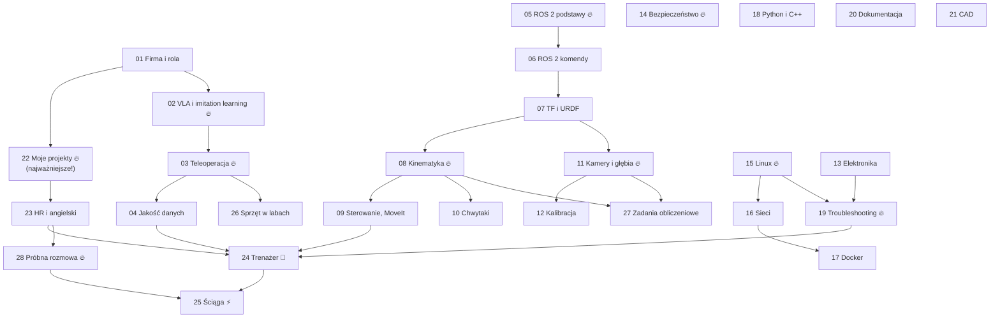

# 🤖 Rozmowa: Grid Dynamics — Robotics Engineer Intern (Kraków)

> [!skrot] W 30 sekund
> - **Cel:** zdać rozmowę na staż w labie robotyki: teleoperacja i zbieranie danych do **VLA**, utrzymanie ramion, chwytaków i kamer, Linux, ROS 2, sieci.
> - **Co mówił Szymon:** *ROS, VLA, ogólne koncepty z robotyki* i **„nauczcie się ładnie mówić o tym, co robiliście na uczelni — to jest bardzo ważne”**.
> - **Jak tu się uczyć:** czytasz notatkę → **zakrywasz i opowiadasz na głos** → pytania z notatki → fiszki → [[24 Trenażer — symulacja rozmowy|trenażer]]. Codziennie fiszki do zera.
> - **Dzień rozmowy:** tylko [[25 Ściąga — 30 minut przed rozmową]].

## Mapa nauki (kolejność ma znaczenie)


🔥 = najwyższy priorytet (prawie pewne pytania). Plan na tablicy: [[Plan nauki — Kanban]].

## Wszystkie notatki
| # | Blok | Notatki |
|---|---|---|
| 🧭 | **Rola** | [[01 Firma, rola i dzień pracy]] |
| 🧠 | **Robot learning i dane** | [[02 Robot learning — imitation learning i VLA]] · [[03 Teleoperacja i zbieranie datasetów]] · [[04 Jakość danych, organizacja i upload]] |
| 🐢 | **ROS 2** | [[05 ROS 2 — podstawy]] · [[06 ROS 2 — komendy, launch, bagi i debugowanie]] · [[07 TF2, URDF i układy współrzędnych]] |
| 🦾 | **Manipulatory** | [[08 Manipulatory — kinematyka]] · [[09 Sterowanie ramieniem, ros2_control i MoveIt]] · [[10 Chwytaki i czujniki siły]] |
| 📷 | **Wizja** | [[11 Kamery i sensory głębi]] · [[12 Kalibracja kamer i hand-eye]] |
| 🔧 | **Sprzęt i BHP** | [[13 Elektronika, okablowanie i drobne naprawy]] · [[14 Bezpieczeństwo pracy z robotami]] · [[21 CAD i mocowania (druk 3D)]] |
| 🐧 | **Linux, sieci, Docker, kod** | [[15 Linux i wiersz poleceń]] · [[16 Sieci — IP, podsieci, łączenie urządzeń]] · [[17 Docker dla robotyki]] · [[18 Python i C++ — minimum na rozmowę]] |
| 🩺 | **Praca w labie** | [[19 Troubleshooting — jak diagnozować]] · [[20 Dokumentacja, inwentaryzacja i log konserwacji]] |
| 🗣️ | **Ty i rozmowa** | [[22 Moje projekty — jak o nich opowiadać]] · [[23 Pytania HR, behawioralne i po angielsku]] |
| 🧰 | **Sprzęt i liczenie** | [[26 Sprzęt w labach robot learning]] · [[27 Zadania obliczeniowe — liczenie na głos]] |
| 🎯 | **Trening** | [[28 Próbna rozmowa — scenariusz i dopytki]] · [[24 Trenażer — symulacja rozmowy]] · [[25 Ściąga — 30 minut przed rozmową]] · [[Plan nauki — Kanban]] |

## Postęp
```dataviewjs
const ps = dv.pages('"Rozmowa GD"').where(p => p.typ === "pojęcie").sort(p => p.file.name);
const icon = { "umiem": "🟢", "uczę się": "🟡", "nowe": "🟠" };
const n = ps.length, done = ps.where(p => p.status === "umiem").length, mid = ps.where(p => p.status === "uczę się").length;
const bar = k => "▰".repeat(Math.round(20 * k / n)) + "▱".repeat(20 - Math.round(20 * k / n));
dv.paragraph(`**${bar(done)}  ${done}/${n} umiem** · 🟡 ${mid} uczę się · 🟠 ${n - done - mid} nowe`);
dv.table(["", "Notatka", "Status", "Ostatnio ruszana"],
  ps.map(p => [icon[p.status] ?? "⬜", p.file.link, p.status, dateformat(p.file.mtime)]));
function dateformat(d) { return d ? d.toFormat("dd.MM HH:mm") : ""; }
```
Status zmieniasz w nagłówku notatki (`status: nowe` → `uczę się` → `umiem`) albo mówiąc Albertowi *„umiem już kinematykę”*.

## Metoda nauki — dlaczego tak (i jak najszybciej)
> [!intuicja] Nauka, która działa (potwierdzona badaniami)
> 1. **Aktywne przypominanie (active recall)** — po przeczytaniu sekcji **zamknij ją i powiedz z pamięci**. To 2–3× skuteczniejsze niż ponowne czytanie. Dlatego każda notatka ma **pytania z zakrytą odpowiedzią**.
> 2. **Powtórki rozłożone w czasie (spaced repetition)** — fiszki wracają tuż przed zapomnieniem. `Ctrl+Shift+R` → talia `rozmowa-gd`. Codziennie do zera.
> 3. **Technika Feynmana** — wytłumacz temat „jak dla 10-latka” na głos. Gdzie się zacinasz — tam nie rozumiesz. Sekcje *„Po ludzku”* to wzór.
> 4. **Mów na głos i po angielsku** — rozmowa to mówienie, nie czytanie. Nagraj się telefonem i odsłuchaj raz.
> 5. **Przeplatanie (interleaving)** — trenażer losuje pytania z różnych tematów: tak jak na rozmowie.
> 6. **Pomodoro 25/5** (`Ctrl+Alt+P`) — 4 bloki, potem dłuższa przerwa. Sen po nauce utrwala pamięć — nie zarywaj nocy przed rozmową.

### Jedna notatka = jeden cykl (~25 min)
1. **„W 30 sekund”** + **„Po ludzku”** + diagram (3 min).
2. Reszta notatki — **czytaj aktywnie**: przy każdej tabeli zadaj sobie pytanie „po co to?” (12 min).
3. **Zamknij i opowiedz** temat na głos w 2 minuty, najlepiej po angielsku (3 min).
4. **Pytania rekrutacyjne** z notatki — najpierw odpowiedz na głos, potem rozwiń (5 min).
5. Status → `uczę się`. Fiszki dojdą do codziennej powtórki same.

## Plan, jeśli masz ~5 dni (dopasuj do daty rozmowy)
| Dzień | Rano (2 pomodoro) | Popołudnie (3 pomodoro) | Wieczór (1 pomodoro) |
|---|---|---|---|
| **1** | 01 Rola · 22 Projekty (napisz swoje STAR!) | 02 VLA · 03 Teleop · 04 Dane | pitch na głos ×3 + fiszki |
| **2** | 05 ROS 2 · 06 Komendy | 07 TF/URDF · 08 Kinematyka | trenażer: ROS + VLA |
| **3** | 15 Linux · 16 Sieci | 11 Kamery · 12 Kalibracja · 19 Troubleshooting | trenażer: wszystko ×10 |
| **4** | 09 Sterowanie · 10 Chwytaki · 14 BHP | 13 Elektronika · 17 Docker · 18 Python/C++ | symulacja z Albertem (EN) |
| **5** | 20 Dokumentacja · 21 CAD · 23 HR | **mała praktyka** (niżej) | trenażer ×15 + ściąga, wcześnie spać |

**Jeśli masz tylko 1–2 dni:** 22 → 01 → 02 → 03 → 05 → 15 → 19 → 08 → 11 → 14 → 23 → trenażer → ściąga. Reszta: tylko sekcje „W 30 sekund” i fiszki.

## Mała praktyka, która robi ogromną różnicę (jeśli masz 2–3 h)
- [ ] Odpal **MoveIt z udawanym UR5e** (Docker z ROS 2 Humble, `sudo apt install ros-humble-ur`):
  ```bash
  ros2 launch ur_robot_driver ur_control.launch.py ur_type:=ur5e robot_ip:=192.168.56.101 use_mock_hardware:=true launch_rviz:=false
  # (starsze wydania drivera: use_fake_hardware:=true)
  ros2 launch ur_moveit_config ur_moveit.launch.py ur_type:=ur5e launch_rviz:=true
  ```
  W RViz przeciągnij kulkę przy chwytaku → **Plan & Execute**. Potem `ros2 control list_controllers`, `ros2 topic echo /joint_states --once`. Teraz możesz powiedzieć *„I played with MoveIt and a simulated UR5e”*.
- [ ] Przejrzyj **LeRobot** (README, przykład datasetu na Hugging Face, wizualizacja epizodu) → *„I looked at how LeRobot stores datasets: parquet + mp4”*.
- [ ] Na swoim laptopie: `ros2 bag record` z dowolnego topicu, `ros2 bag info`, `lsusb -t` z kamerą internetową, `v4l2-ctl --list-devices`.
- [ ] Wpisz do [[22 Moje projekty — jak o nich opowiadać]] jedną **prawdziwą** historię naprawy sprzętu.

## Moje notatki
> [!ja] Tu piszesz ty — Albert tej sekcji nie rusza.
