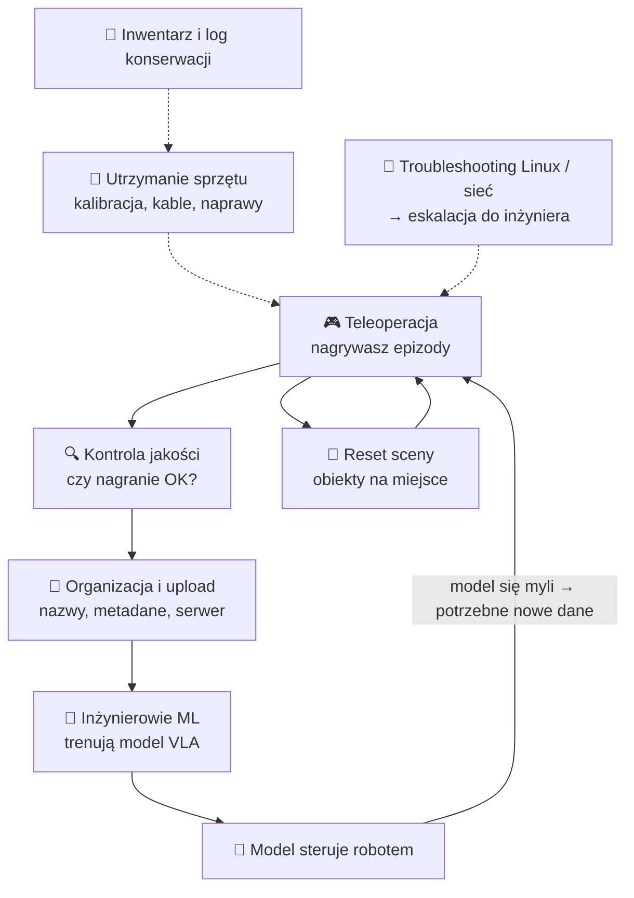

# 01 Firma, rola i dzień pracy

> [!skrot] W 30 sekund
> - **Stanowisko:** Robotics Engineer Intern, laboratorium w Krakowie, 6 miesięcy, 6 h dziennie, na miejscu.
> - **Sedno pracy:** sterujesz robotem ręcznie (**teleoperacja**), żeby nagrać **dane z demonstracji**. Na tych danych firma trenuje modele, które potem same sterują robotem (**VLA**, imitation learning). Do tego utrzymujesz sprzęt: ramiona, chwytaki, kamery, kable, Linux.
> - **Czego chcą od ciebie na rozmowie:** że jesteś **dokładny i niezawodny**, rozumiesz po co są te dane, ogarniasz Linuksa, podstawy ROS 2, sieci i kamer, i umiesz ładnie opowiedzieć o swoich projektach.

> [!intuicja] Po ludzku
> Wyobraź sobie, że uczysz kogoś gotować przez pokazywanie. Nagrywasz 500 razy, jak kroisz cebulę, a „uczeń” (sieć neuronowa) patrzy na nagrania i uczy się robić to sam. **Ty jesteś kucharzem, który pokazuje, i jednocześnie dbasz, żeby noże były ostre, kamera nagrywała, a nagrania były porządnie podpisane.** Jak nagranie jest krzywe, nieostre albo źle podpisane, uczeń nauczy się bzdur. Dlatego w ogłoszeniu tyle razy jest „procedury”, „quality checks” i „accurate notes”.

## Kim jest Grid Dynamics
- Amerykańska firma usługowa IT (NASDAQ: **GDYN**), założona w **2006**, centrala w **Dolinie Krzemowej** (San Ramon, Kalifornia), biura w obu Amerykach, Europie i Indiach. W Polsce m.in. Kraków, Wrocław, Gdańsk.
- Robi dla dużych firm (enterprise): **AI, dane i analityka, chmura i DevOps, modernizacja aplikacji, e-commerce / customer experience**. W ogłoszeniu chwalą się „8 latami doświadczenia w enterprise AI”.
- Robotyka i „physical AI” to dla nich **nowy kierunek**: modele AI, które działają w świecie fizycznym (ramiona robotów). Żeby takie modele trenować, potrzeba **ogromnej ilości dobrych danych z demonstracji** — i to robi to laboratorium.

> [!wazne] Co powiedzieć, gdy zapytają „Co wiesz o firmie / dlaczego my?”
> „Grid Dynamics to firma technologiczna z Doliny Krzemowej, mocna w AI, danych i chmurze, notowana na NASDAQ. Interesuje mnie to, że rozwijacie robotykę opartą o uczenie maszynowe — zbieranie danych z teleoperacji pod modele typu VLA. To dokładnie styk tego, co lubię: sprzęt, ROS i AI. Chcę się nauczyć, jak wygląda profesjonalny pipeline danych dla robot learningu.”
>
> **EN:** *"Grid Dynamics is a Silicon Valley engineering company strong in AI, data and cloud. What attracts me is that you're building a robotics lab for physical AI — collecting teleoperation data for robot learning models like VLAs. That's exactly where hardware, ROS and machine learning meet, and that's what I want to work on."*

## Obowiązki z ogłoszenia — przetłumaczone na ludzki

| Z ogłoszenia (EN) | Co to znaczy w praktyce | Notatka |
|---|---|---|
| Operate robots in teleoperation sessions to collect manipulation datasets | Sterujesz ramieniem (np. ramieniem „leader”, VR, gamepadem/SpaceMouse) i nagrywasz epizody zadań typu „podnieś kubek i włóż do pudełka” | [[03 Teleoperacja i zbieranie datasetów]] |
| Set up and reset scenes | Po każdym epizodzie odkładasz przedmioty, często **losowo zmieniając** ich pozycję (różnorodność danych!) | [[03 Teleoperacja i zbieranie datasetów]] |
| Basic quality checks, organize and upload | Sprawdzasz: czy wszystkie kamery nagrały, czy nie ma zgubionych klatek, czy epizod jest oznaczony sukces/porażka, wrzucasz na serwer wg standardu nazewnictwa | [[04 Jakość danych, organizacja i upload]] |
| Maintain manipulators, grippers, cameras, sensors | Sprawdzanie, kalibracja, kable, drobne naprawy (wymiana palców chwytaka, dokręcenie mocowania kamery) | [[13 Elektronika, okablowanie i drobne naprawy]], [[12 Kalibracja kamer i hand-eye]] |
| Troubleshoot hardware, connection, Linux; escalate | Kamera nie wykryta, robot nie pinguje, topic nie publikuje — sprawdzasz po kolei, a jak nie wiesz, **zgłaszasz z opisem** | [[19 Troubleshooting — jak diagnozować]] |
| Integrate new tools and scene components | Nowy chwytak, nowe mocowanie kamery, nowy obiekt na scenie — montaż + konfiguracja | [[21 CAD i mocowania (druk 3D)]] |
| Inventory and maintenance log | Arkusz: co mamy, gdzie leży, numer seryjny, kiedy kalibrowane, co się zepsuło | [[20 Dokumentacja, inwentaryzacja i log konserwacji]] |

## Wymagania — jak się do nich odnosisz

| Wymaganie | Twój dowód (powiedz to!) |
|---|---|
| Student robotyki / informatyki | AGH (informatyka, sem. 5) + Politechnika Krakowska (Automatyka i Robotyka, rok 1) |
| Praktyczne zainteresowanie sprzętem (koła, zawody) | **AGH Solar Boat** — autonomiczna łódź na ROS 2 (zawody Njord 2026), lidar, kamera ZED, CAN, Jetson; **SNN_Agent** — Arduino + Raspberry Pi 5 + mikrofon + płytki neuronów |
| Linux, CLI | Codzienna praca na Linuksie (Fedora), Jetson, Raspberry Pi, Docker z ROS 2 |
| Python / C++ | Python (pipeline SNN, FastAPI, testy), C++ (węzły ROS 2, SLAM, regulator) |
| Dokładność, procedury, notatki | Prowadzisz rozbudowaną bazę wiedzy o projektach (ta baza w Obsidianie!) — **to świetny argument** |
| Plus: ROS/ROS 2 | ROS 2 Humble w Solar Boat: topiki, TF, launch, rosbagi |
| Plus: sieci | SSH na Jetsona/RPi, IP, modem 5G, DDS i domeny ROS |
| Plus: kamery, głębia, CV | ZED (stereo), fuzja kamera–lidar, YOLO |
| Plus: CAD | (uzupełnij, jeśli masz cokolwiek: Fusion 360, FreeCAD, SolidWorks, rysunek techniczny na PK) |
| Plus: Docker | Środowisko `ros2-humble-gpu` w Dockerze |

> [!wazne] Najważniejsze cechy, które oceniają
> 1. **Rzetelność** — „robię zgodnie z procedurą, a jak coś odbiega, zapisuję i zgłaszam”.
> 2. **Bezpieczeństwo** — przy robotach zawsze wiesz, gdzie jest e-stop.
> 3. **Samodzielność w diagnozie + wiedza, kiedy eskalować.**
> 4. **Rozumienie celu** — wiesz, że jakość danych = jakość modelu.
> 5. **Komunikacja** — po angielsku też (firma międzynarodowa).

## Jak może wyglądać rekrutacja
1. **Rozmowa wstępna / HR** (często po angielsku, 20–30 min): o tobie, motywacja, dostępność (6 h dziennie na miejscu w Krakowie! — przygotuj się, jak to pogodzisz z dwiema uczelniami).
2. **Rozmowa techniczna** (30–60 min): ROS 2, Linux, sieci, robotyka (kinematyka, kamery), VLA/imitation learning, scenariusze troubleshootingu, twoje projekty.
3. Czasem małe zadanie: komenda Linux, prosty skrypt w Pythonie, „co zrobisz, gdy…”.

> [!blad] Pułapka: dostępność
> Ogłoszenie mówi „regular schedule on-site, 6 h/day”. Studiujesz na **dwóch** uczelniach. Przygotuj **konkretną** odpowiedź: w jakie dni i godziny możesz być w labie (np. „pon–pt od 8 do 14 / wybrane dni pełne”) — przejrzyj plan zajęć **przed** rozmową.

## Pytania rekrutacyjne
> [!zadanie] Co wiesz o naszej firmie?
> > [!odpowiedz]- Odpowiedź
> > Grid Dynamics, NASDAQ: GDYN, od 2006, centrala w Dolinie Krzemowej, usługi inżynierskie dla enterprise: AI, dane, chmura, DevOps, e-commerce. Rozwijacie laboratorium robotyki w Krakowie, które zbiera dane z teleoperacji do trenowania modeli robot learning (np. VLA).

> [!zadanie] Jak rozumiesz tę rolę? Co będziesz robić?
> > [!odpowiedz]- Odpowiedź
> > Głównie zbieranie wysokiej jakości danych z demonstracji przez teleoperację, reset scen, kontrola jakości i upload danych zgodnie ze standardem; do tego utrzymanie sprzętu (ramiona, chwytaki, kamery), kalibracje, proste naprawy, troubleshooting Linux/sieci i eskalacja, prowadzenie inwentarza i logu. Rozumiem, że dane trafiają do treningu modeli, więc ich jakość i spójność jest kluczowa.

> [!zadanie] Ta praca bywa powtarzalna (setki epizodów tego samego zadania). Jak do tego podchodzisz?
> > [!odpowiedz]- Odpowiedź
> > Rozumiem, po co to jest — model uczy się z różnorodności i spójności demonstracji, więc każdy epizod musi być porządny. Trzymam się procedury, robię krótkie przerwy, żeby nie spadała jakość, i notuję anomalie. Przy okazji szukam usprawnień, np. skrypt do automatycznego QC, i zgłaszam je zespołowi.

> [!zadanie] Dlaczego chcesz pracować przy robotyce, a nie np. jako programista webowy?
> > [!odpowiedz]- Odpowiedź
> > Lubię, kiedy kod rusza coś w świecie fizycznym. W Solar Boat widziałem, jak ROS 2, sensory i sterowanie składają się w działającą łódź. Physical AI to obecnie najciekawszy kierunek — chcę zobaczyć od środka, jak powstają dane i modele dla robotów.

## Fiszki #fiszki/rozmowa-gd/firma
Grid Dynamics — giełda i ticker?::NASDAQ: GDYN.
Grid Dynamics — rok założenia i centrala?::2006, Dolina Krzemowa (San Ramon, Kalifornia).
Główne obszary Grid Dynamics?::AI, dane i analityka, chmura i DevOps, modernizacja aplikacji, customer experience / e-commerce.
Jaki jest główny produkt pracy stażysty w labie?::Wysokiej jakości dane z teleoperacji (epizody manipulacji) do trenowania modeli robot learning / VLA.
Wymiar i długość stażu?::6 miesięcy, 6 godzin dziennie, na miejscu w laboratorium w Krakowie.
Co to jest physical AI?::Modele AI, które działają w świecie fizycznym — sterują robotami na podstawie obrazu, czujników i poleceń.

## Moje notatki
> [!ja] Tu piszesz ty — Albert tej sekcji nie rusza.
