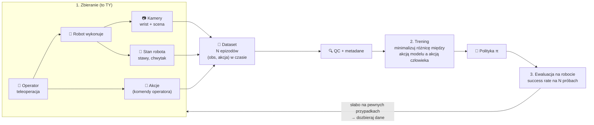
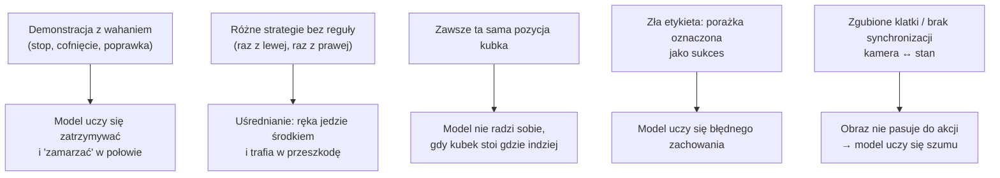
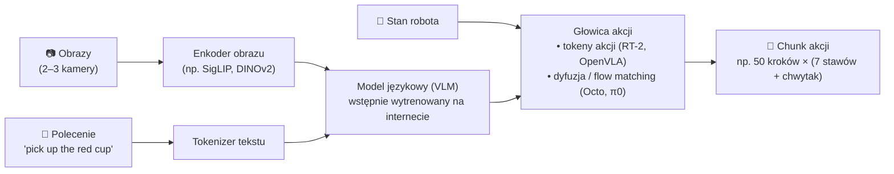

# 02 Robot learning — imitation learning i VLA

> [!skrot] W 30 sekund
> - **Imitation learning (uczenie przez naśladowanie):** robot uczy się z **demonstracji człowieka**. Dane = pary *(co robot widzi, co człowiek wtedy zrobił)*. Najprostsza wersja to **behavior cloning (BC)** — zwykłe uczenie nadzorowane.
> - **Polityka (policy) $\pi$:** funkcja „obserwacja → akcja”. To jest ten wytrenowany model.
> - **VLA = Vision-Language-Action:** duży model, który **widzi** (obraz z kamer), **czyta polecenie** („put the cup in the box”) i **zwraca akcje** robota. Budowany na bazie modelu wizja-język (VLM), dotrenowany na danych robotów. Przykłady: **RT-2, OpenVLA, Octo, π0 / π0.5, GR00T N1, SmolVLA**.
> - **Dlaczego to ważne dla ciebie:** twoje nagrania z teleoperacji **są** danymi treningowymi. Model kopiuje twoje ruchy — także błędy, wahanie i bałagan.

> [!intuicja] Po ludzku
> Behavior cloning to jak nauka jazdy przez oglądanie nagrań z kamerki w aucie instruktora: widzisz drogę (obserwacja) i wiesz, jak skręcił kierownicą (akcja). Model uczy się „w takiej sytuacji — taki ruch”. Problem: jak raz zjedziesz trochę z pasa, znajdziesz się w sytuacji, której **nie było na nagraniach**, i nie wiesz, co zrobić — błąd się nawarstwia. Dlatego potrzeba **dużo, różnorodnych i spójnych** demonstracji, a czasem też demonstracji **wychodzenia z błędów** (recovery).

## Słowniczek (to MUSISZ umieć powiedzieć po angielsku)
| Pojęcie (EN) | Po polsku i po ludzku |
|---|---|
| **Policy** $\pi(a \mid o)$ | Model: dostaje obserwację $o$, zwraca akcję $a$ |
| **Observation** | Wszystko, co model „widzi”: obrazy z kamer (zwykle kamera na nadgarstku = *wrist camera* + kamera z boku/z góry = *third-person / scene camera*), **propriocepcja** i polecenie tekstowe |
| **Proprioception / robot state** | Stan samego robota: pozycje stawów (*joint positions*), prędkości, stan chwytaka (otwarty/zamknięty, szerokość) |
| **Action** | Co robot ma zrobić w tym kroku: docelowe pozycje stawów albo przesunięcie końcówki (delta pozy, *end-effector delta*) + polecenie chwytaka |
| **Action space** | „Język” akcji: *joint space* (kąty stawów) albo *Cartesian / task space* (pozycja i orientacja chwytaka) |
| **Episode / trajectory / demonstration** | Jedno nagranie wykonania zadania od początku do końca (np. 10–60 s) |
| **Control frequency** | Ile razy na sekundę wysyłamy akcję (typowo 10–50 Hz; π0 do 50 Hz) |
| **Behavior cloning (BC)** | Uczenie nadzorowane na parach (obserwacja, akcja) z demonstracji |
| **Distribution shift / covariate shift** | Model trafia w stany, których nie widział w danych → myli się coraz bardziej |
| **Compounding errors** | Małe błędy się sumują w czasie, robot „odpływa” od trajektorii |
| **DAgger** | Metoda na distribution shift: puszczasz model, człowiek **poprawia** akcje w stanach, w które model wszedł, dokładasz to do danych |
| **Multimodality (of demonstrations)** | To samo zadanie zrobione **różnymi sposobami** (raz kubek od lewej, raz od prawej). Prosty BC uśrednia → ręka jedzie **środkiem**, czyli źle |
| **Action chunking** | Model przewiduje od razu **kawałek przyszłych akcji** (np. 50 kroków), nie jedną. Gładsze ruchy, mniej nawarstwiania błędów (ACT, π0) |
| **Embodiment** | Konkretne „ciało” robota (np. Franka, UR5e, ALOHA). *Cross-embodiment* = jeden model dla wielu robotów |
| **Generalization** | Czy model działa na nowych obiektach, pozycjach, oświetleniu, poleceniach |
| **Success rate** | Główna metryka: w ilu próbach na N robot zrobił zadanie |
| **Fine-tuning** | Dotrenowanie dużego, wcześniej wytrenowanego modelu na twoich danych z twojego robota |
| **Sim-to-real** | Trenowanie w symulacji i przenoszenie na prawdziwego robota (alternatywa/uzupełnienie dla teleop) |

## Jak działa uczenie z demonstracji — cały obraz

**Matematycznie (BC) — wystarczy tyle:** mając dane $\mathcal{D}=\{(o_t, a_t)\}$, szukamy parametrów $\theta$, które minimalizują błąd
$$\min_\theta \sum_{(o,a)\in\mathcal{D}} \big\| \pi_\theta(o) - a \big\|^2$$
czyli „niech akcja modelu będzie jak najbliżej akcji człowieka”. Tyle. To zwykła regresja.

## Dlaczego jakość demonstracji ma takie znaczenie

> [!wazne] Złote zasady dobrej demonstracji
> 1. **Płynnie i pewnie** — bez zbędnych pauz, bez „szukania” obiektu.
> 2. **Spójna strategia** — wszyscy operatorzy robią zadanie w ten sam sposób (chyba że protokół mówi inaczej).
> 3. **Różnorodność tam, gdzie trzeba** — losowe pozycje startowe obiektów, różne obiekty, oświetlenie (wg protokołu).
> 4. **Uczciwe etykiety** — porażka to porażka; oznacz ją, nie ukrywaj (czasem porażki też są przydatne, ale muszą być oznaczone).
> 5. **Stała prędkość wykonania** — podobna długość epizodów.
> 6. **Nie zasłaniaj kamer** ręką, kablem, ciałem.
> 7. **Poprawny start i koniec** — robot zaczyna z pozycji domowej (*home*), epizod kończy się po zadaniu, nie 20 s później.

## Rodzaje polityk — od najprostszej do VLA

| Model | Rok, kto | Co ciekawego | Zapamiętaj |
|---|---|---|---|
| **Behavior Cloning (MLP/CNN)** | klasyka | Obraz → sieć → akcja | Problem multimodalności i compounding errors |
| **ACT** (Action Chunking with Transformers) | 2023, Tony Zhao i in. (Stanford), razem z **ALOHA** | Transformer + CVAE przewiduje **paczkę k akcji**; *temporal ensembling* wygładza | ~50 demonstracji wystarcza na precyzyjne zadania dwuręczne (np. założenie baterii) |
| **Diffusion Policy** | 2023, Cheng Chi i in. (Columbia/Toyota) | Akcje generowane jak obrazy w modelach dyfuzyjnych — **odszumianie** | Dobrze radzi sobie z **multimodalnością** |
| **RT-1** | 2022, Google | Transformer, 130 tys. epizodów, 13 robotów, 17 miesięcy zbierania | Pokazał, że skala danych działa |
| **RT-2** | 2023, Google DeepMind | **Pierwszy znany VLA**: model wizja-język, akcje zapisane jako **tokeny tekstowe** (256 przedziałów na wymiar) | „Akcje jako słowa” |
| **Open X-Embodiment (RT-X)** | 2023, 34 laboratoria | **Zbiór danych**: >1 mln trajektorii, 22 typy robotów | Wspólne dane z wielu robotów pomagają |
| **Octo** | 2024, Berkeley i in. | Otwarty, transformer + głowica dyfuzyjna, trenowany na Open X | Łatwy fine-tuning |
| **OpenVLA** | 2024, Stanford i in. | Otwarty VLA 7B (Llama 2 + enkodery obrazu DINOv2 i SigLIP), ~970 tys. epizodów | Otwarty odpowiednik RT-2 |
| **π0 (pi-zero)** | 2024, Physical Intelligence | VLM (PaliGemma) + **„action expert”** z **flow matching**, chunki akcji do 50 Hz | Zręczne zadania: składanie prania |
| **π0.5** | 2025, Physical Intelligence | Lepsza generalizacja na nowe domy/otoczenia | Open-world generalization |
| **GR00T N1** | 2025, NVIDIA | Model dla humanoidów: „System 2” (VLM, myśli) + „System 1” (szybkie akcje) | Dwa systemy jak u Kahnemana |
| **SmolVLA** | 2025, Hugging Face | Mały (~0,45 mld param.), trenowany na danych społeczności LeRobot | Działa na zwykłym GPU |

> [!przyda] LeRobot (Hugging Face)
> Otwarta biblioteka w Pythonie do robot learningu: **format datasetu** (`LeRobotDataset`: tabele Parquet + wideo MP4 + metadane), skrypty do **nagrywania z teleoperacji**, trening ACT / Diffusion / π0 / SmolVLA, tanie ramiona **SO-100 / SO-101** (leader–follower) i **Koch**. Jeśli przed rozmową coś przejrzysz praktycznie — przejrzyj README LeRobot. Pokazanie, że to znasz, robi wrażenie.

## Jak zbudowany jest VLA (na poziomie rozmowy)

- **Dlaczego VLM w środku?** Bo z internetu „wie”, co to kubek, czerwony, lewo — dzięki temu model rozumie polecenia i nowe obiekty (**semantyczna generalizacja**).
- **Czego nie wie z internetu?** Jak ruszać **tym konkretnym** ramieniem. To musi przyjść z **danych robota** — czyli od ciebie.
- **Pretraining → fine-tuning:** duży model trenowany na danych wielu robotów, potem dotrenowany na kilkudziesięciu–kilkuset demonstracjach konkretnego zadania w konkretnym labie.

## Inne sposoby uczenia robotów (żeby umieć porównać)
| Metoda | Plus | Minus |
|---|---|---|
| **Imitation learning z teleop** | Szybko daje dobre zachowanie, dane realne | Drogie (czas człowieka), distribution shift |
| **Reinforcement learning (RL)** | Robot sam odkrywa strategię (nagroda) | Potrzebuje milionów prób → zwykle w symulacji |
| **Sim-to-real** | Tanie dane, dowolna skala | *Reality gap* — fizyka i obraz w symulacji różnią się od świata |
| **Uczenie z wideo ludzi** | Ogromne ilości danych z internetu | Brak akcji robota, inne „ciało” |
| **Klasyczne planowanie (MoveIt)** | Przewidywalne, bez danych | Wymaga modelu świata, słabe w zadaniach „miękkich” (tkaniny) |

## Typowe błędy
> [!blad] „VLA to po prostu ChatGPT dla robota”
> Nie do końca. VLA ma w środku model wizja-język, ale **wyjściem są akcje** (liczby dla stawów/chwytaka), a nie tekst, i działa w pętli w czasie rzeczywistym z wysoką częstotliwością.

> [!blad] „Więcej danych zawsze lepiej”
> Więcej **złych** danych pogarsza model. Ważniejsza jest jakość i spójność, potem różnorodność, dopiero potem ilość.

> [!blad] Mylenie obserwacji z akcją
> Pozycja stawów robota w chwili $t$ to **obserwacja (stan)**. Pozycja, do której operator każe jechać (np. pozycja ramienia „leader”), to **akcja**.

## Pytania rekrutacyjne
> [!zadanie] Co to jest VLA? (EN: What is a Vision-Language-Action model?)
> > [!odpowiedz]- Odpowiedź
> > Model, który na wejściu dostaje obrazy z kamer, polecenie w języku naturalnym i stan robota, a na wyjściu daje akcje robota. Zwykle zbudowany na wstępnie wytrenowanym modelu wizja-język i dotrenowany na danych z demonstracji robotów. Przykłady: RT-2, OpenVLA, Octo, π0.
> > **EN:** *"It's a policy built on top of a pretrained vision-language model. It takes camera images, a language instruction and the robot state, and outputs robot actions — often as a chunk of future actions. Examples are RT-2, OpenVLA and π0."*

> [!zadanie] Co to jest behavior cloning i jaki ma główny problem?
> > [!odpowiedz]- Odpowiedź
> > Uczenie nadzorowane na parach (obserwacja, akcja) z demonstracji eksperta. Główny problem: **distribution shift / compounding errors** — gdy model zrobi mały błąd, trafia w stan, którego nie było w danych, i błędy się nawarstwiają. Rozwiązania: więcej różnorodnych danych, demonstracje odzyskiwania (recovery), DAgger, action chunking.

> [!zadanie] Dlaczego jakość danych z teleoperacji jest tak ważna?
> > [!odpowiedz]- Odpowiedź
> > Bo model dosłownie naśladuje operatora. Wahanie, pauzy, niespójne strategie, zasłonięte kamery, zgubione klatki albo złe etykiety sukcesu uczą model złych zachowań. Spójne, płynne i dobrze opisane demonstracje dają lepszy success rate przy mniejszej liczbie epizodów.

> [!zadanie] Co to jest action chunking i po co?
> > [!odpowiedz]- Odpowiedź
> > Model przewiduje od razu sekwencję kilku/kilkudziesięciu przyszłych akcji zamiast jednej. Daje gładsze ruchy, zmniejsza nawarstwianie się błędów i lepiej radzi sobie z pauzami w demonstracjach. Wprowadzone w ACT, używane też w π0.

> [!zadanie] Co to jest multimodalność demonstracji?
> > [!odpowiedz]- Odpowiedź
> > Sytuacja, gdy to samo zadanie wykonuje się kilkoma różnymi sposobami (np. omijanie przeszkody z lewej lub prawej). Prosty model regresyjny uśrednia i wybiera „środek”, który jest zły. Pomagają modele generatywne (Diffusion Policy, CVAE w ACT, flow matching) albo **spójny protokół** zbierania.

> [!zadanie] Co zawiera jeden krok (timestep) w datasecie manipulacji?
> > [!odpowiedz]- Odpowiedź
> > Obrazy z każdej kamery, stan robota (pozycje stawów, chwytak, czasem siły), akcja (komenda), znacznik czasu, indeks klatki i epizodu; na poziomie epizodu: polecenie tekstowe/nazwa zadania, sukces/porażka, operator, wersja sprzętu i kalibracji.

> [!zadanie] Jak sprawdza się, czy wytrenowany model jest dobry?
> > [!odpowiedz]- Odpowiedź
> > Ewaluacja na prawdziwym robocie: N prób (np. 20–50) w kontrolowanych warunkach, liczy się **success rate**. Osobno testuje się przypadki w rozkładzie danych (in-distribution) i poza nim (nowe obiekty, pozycje, oświetlenie).

> [!zadanie] Ile demonstracji potrzeba?
> > [!odpowiedz]- Odpowiedź
> > Zależy od zadania i modelu: ACT dawał dobre wyniki już po ~50 demonstracjach na zadanie; fine-tuning dużych VLA to zwykle dziesiątki–setki epizodów na zadanie; pretraining to setki tysięcy–miliony epizodów z wielu robotów.

## Fiszki #fiszki/rozmowa-gd/vla
Co to jest polityka (policy) w robot learningu?::Model mapujący obserwację na akcję: π(a|o).
Co to jest behavior cloning?::Uczenie nadzorowane na parach (obserwacja, akcja) z demonstracji człowieka.
Co to jest VLA?::Vision-Language-Action: model wizja-język dotrenowany tak, by z obrazów, polecenia i stanu robota generować akcje.
Co to jest propriocepcja robota?::Informacja o stanie samego robota: pozycje i prędkości stawów, stan chwytaka.
Co to jest distribution shift w BC?::Model trafia w stany, których nie było w danych treningowych, i jego błędy się nawarstwiają (compounding errors).
Co robi DAgger?::Uruchamia politykę, ekspert poprawia akcje w odwiedzonych stanach, dane dokłada się do treningu.
Co to jest action chunking?::Przewidywanie sekwencji kilku/kilkudziesięciu przyszłych akcji naraz (ACT, π0).
Co to jest multimodalność demonstracji?::To samo zadanie wykonane różnymi strategiami; prosta regresja je uśrednia.
ACT — co to i skąd?::Action Chunking with Transformers, 2023, Stanford, razem z platformą ALOHA (teleop leader–follower).
Diffusion Policy — idea?::Generowanie akcji przez iteracyjne odszumianie, dobrze modeluje multimodalność.
RT-2 — co wprowadził?::Pierwszy VLA: akcje reprezentowane jako tokeny tekstowe w modelu wizja-język (Google DeepMind 2023).
OpenVLA?::Otwarty VLA 7B (2024), Llama 2 + DINOv2 + SigLIP, trenowany na Open X-Embodiment.
π0 — firma i mechanizm akcji?::Physical Intelligence; VLM (PaliGemma) + action expert z flow matching, chunki akcji do 50 Hz.
Open X-Embodiment?::Wspólny dataset >1 mln trajektorii z 22 typów robotów, 34 laboratoria (2023).
LeRobot?::Biblioteka Hugging Face do robot learningu: format datasetu (Parquet + MP4), nagrywanie teleop, trening ACT/Diffusion/π0/SmolVLA, ramiona SO-100/101.
Główna metryka ewaluacji polityki?::Success rate na N próbach na prawdziwym robocie.
Dlaczego w VLA siedzi model wizja-język?::Daje wiedzę semantyczną z internetu (obiekty, kolory, polecenia), co poprawia generalizację.
Joint space vs task space?::Joint space = kąty stawów; task (Cartesian) space = pozycja i orientacja końcówki.

## Moje notatki
> [!ja] Tu piszesz ty — Albert tej sekcji nie rusza.
