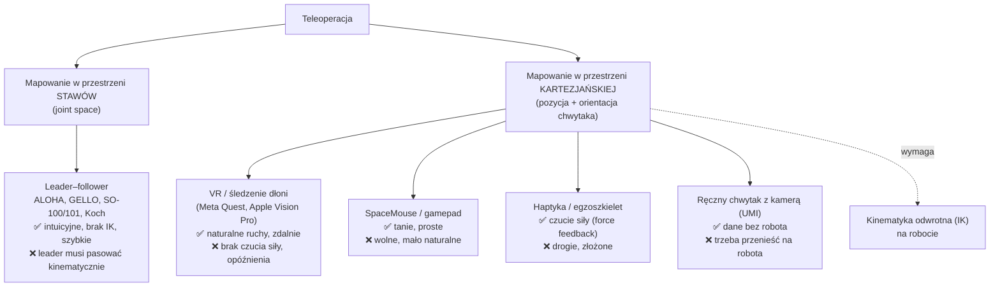
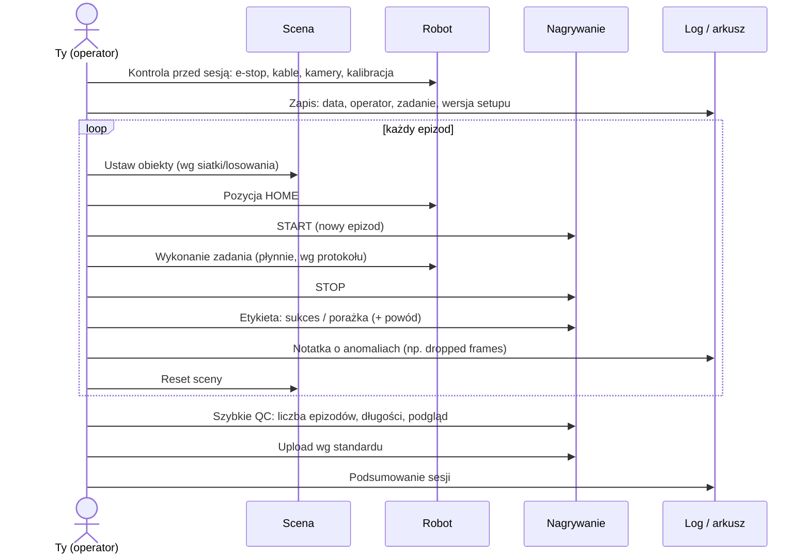

# 03 Teleoperacja i zbieranie datasetów

> [!skrot] W 30 sekund
> - **Teleoperacja** = człowiek steruje robotem na żywo przez jakieś urządzenie wejściowe. Robot powtarza ruchy, a wszystko (kamery, stan, komendy) się **nagrywa**.
> - **Urządzenia:** ramię **leader–follower** (najczęstsze w labach od ALOHA/GELLO/SO-100), **VR** (gogle + śledzenie dłoni), **SpaceMouse** (mysz 3D, 6 osi), gamepad, rękawice/egzoszkielet, urządzenia haptyczne.
> - **Pętla pracy:** *przygotuj scenę → pozycja home → start nagrywania → wykonaj zadanie → stop → oznacz sukces/porażkę → reset sceny (z losowaniem) → powtórz*.
> - **Najważniejsze:** bezpieczeństwo (e-stop pod ręką), **spójność** wykonania wg protokołu, **różnorodność** pozycji startowych, **uczciwe etykiety**, notatki o anomaliach.

> [!intuicja] Po ludzku
> Leader–follower to jak **marionetka na odwrót**: masz w ręce małe ramię (leader) z tymi samymi stawami co duży robot (follower). Ruszasz małym — duży robi dokładnie to samo, staw po stawie. Czujniki w leaderze mówią „staw 1 = 30°”, a follower dostaje komendę „jedź na 30°”. Nagranie tych komend to **akcje** w datasecie.

## Rodzaje teleoperacji

| Pojęcie | Wyjaśnienie |
|---|---|
| **Leader / master** | Urządzenie, którym rusza człowiek |
| **Follower / slave** | Robot, który powtarza ruch |
| **Joint mapping** | Kąt stawu leadera → kąt stawu followera (1:1). Działa, gdy oba mają tę samą kinematykę |
| **Cartesian mapping** | Pozycja dłoni/kontrolera → docelowa poza chwytaka → robot liczy **IK** (kąty stawów) |
| **Clutch / deadman switch** | Przycisk „trzymam = robot słucha”; puszczasz = robot stoi. Pozwala przełożyć rękę bez ruszania robota |
| **Scaling** | Skalowanie ruchu (np. 0,5×) dla precyzji |
| **Latency** | Opóźnienie od ruchu człowieka do ruchu robota. Duże opóźnienie = nienaturalne, poszarpane demonstracje |
| **Force feedback** | Operator czuje opór (np. gdy robot dotknie stołu). Leader–follower często go nie ma → **uważaj na siłę dociskania!** |
| **Bimanual** | Dwa ramiona naraz (ALOHA): składanie ubrań, otwieranie słoika |

## Pętla jednej sesji zbierania

## Krok po kroku — jak przeprowadzić sesję (przećwicz to na głos!)

**Przed sesją (5–10 min):**
1. Przeczytaj **protokół zadania**: co jest sukcesem, ile epizodów, jakie warianty (obiekty, pozycje, oświetlenie).
2. **Bezpieczeństwo:** sprawdź, czy e-stop działa i jest w zasięgu ręki, w strefie robota nie ma ludzi ani zbędnych rzeczy.
3. **Sprzęt:** robot włączony, bez błędów; chwytak otwiera się/zamyka; kamery widoczne w systemie (np. `ls /dev/video*`, podgląd obrazu), ostre, dobrze naświetlone, **nic się nie przesunęło** (porównaj ze zdjęciem referencyjnym).
4. **Oprogramowanie:** właściwa wersja/konfiguracja, działa podgląd topiców (`ros2 topic hz`), jest miejsce na dysku (`df -h`).
5. **Zapisz w logu:** data, operator, zadanie, robot, wersja kalibracji, uwagi.

**W trakcie (pętla):**
1. Ustaw obiekty — wg **siatki pozycji** (np. taśma na stole, 9 pól) lub losowania z protokołu. Różnorodność = lepsza generalizacja.
2. Robot w pozycji **home**.
3. **Start nagrywania** → odczekaj chwilę (stabilny start) → wykonaj zadanie **płynnie i jednym, uzgodnionym sposobem**.
4. **Stop** zaraz po zakończeniu zadania (robot w spoczynku / wraca do home — wg protokołu).
5. **Etykieta**: sukces/porażka. Jeśli coś poszło nie tak (kolizja, upuszczenie, zasłonięta kamera, e-stop), oznacz/odrzuć i **zapisz powód**.
6. Reset sceny.
7. Co ~30–45 minut **przerwa** — zmęczony operator robi gorsze demonstracje.

**Po sesji:**
1. Szybkie QC (liczba epizodów, długość, podgląd kilku losowych nagrań, brak zgubionych klatek) — patrz [[04 Jakość danych, organizacja i upload]].
2. Upload wg standardu nazewnictwa, sprawdzenie, że plik doszedł (rozmiar/suma kontrolna).
3. Robot do pozycji parkowania, wyłączenie wg procedury, porządek na stanowisku.
4. Wpis w logu: ile zrobiono, problemy, co trzeba naprawić.

## W czym się nagrywa dane
| Format | Gdzie spotkasz | Co to |
|---|---|---|
| **rosbag2** (`.mcap` lub `.db3`) | ROS 2 | Nagranie **wszystkich wiadomości z topiców** z czasami. `ros2 bag record`, odtwarzanie `ros2 bag play`, podgląd w **Foxglove** |
| **HDF5** (`.hdf5`) | ALOHA, ACT, robomimic | Jeden plik na epizod: tablice obrazów, stanów i akcji (hierarchia jak foldery) |
| **LeRobotDataset** | Hugging Face LeRobot | Parquet (tabele stanów/akcji) + **MP4** (wideo z kamer) + `meta/` (info, statystyki, zadania) |
| **RLDS** (TFRecord) | Open X-Embodiment, Google | Format TensorFlow dla epizodów |
| **Zarr** | Diffusion Policy | Format tablic w kawałkach (chunkach) |

> [!wazne] Synchronizacja czasowa
> Każda kamera i stan robota mają swój **znacznik czasu (timestamp)**. Kamera daje np. 30 FPS, robot stan 100–500 Hz, a akcje idą 10–50 Hz. Dane trzeba **wyrównać w czasie** (najbliższy timestamp / interpolacja). Jeśli zegary komputerów się rozjadą (brak synchronizacji NTP/PTP), obraz nie pasuje do akcji. Dlatego **dropped frames** i **opóźnienia** to tak ważne rzeczy w QC.

## Przygotowanie i reset sceny
- **Zdjęcie referencyjne** setupu (pozycje kamer, oświetlenie) — porównujesz przed sesją.
- **Znaczniki na stole** (taśma, szablon) — powtarzalne pozycje.
- **Randomizacja wg protokołu:** pozycja i orientacja obiektu, rodzaj obiektu, *distractory* (obiekty przeszkadzające), tło, oświetlenie.
- **Nie zmieniaj tego, co ma być stałe** (pozycja kamer! mocowanie! oświetlenie, jeśli protokół mówi stałe). Przypadkowo trącona kamera = dane do wyrzucenia, a kalibracja nieaktualna.
- Przedmioty zużywają się (zgniecione pudełka, brudne tkaniny) — wymień i **zanotuj**.

## Typowe problemy przy teleoperacji
> [!blad] Osobliwość (singularity) lub limit stawu
> Robot nagle zwalnia, szarpie lub się zatrzymuje, bo jest blisko osobliwości / limitu. Wróć spokojnie, zakończ epizod jako nieudany, zanotuj. Więcej: [[08 Manipulatory — kinematyka]].

> [!blad] Zbyt mocny docisk
> Bez force feedback łatwo docisnąć chwytak do stołu → robot zgłosi błąd siły / zatrzyma się (*protective stop*) albo coś uszkodzi. Ruszaj się delikatnie przy kontakcie.

> [!blad] Leader i follower rozjechane na starcie
> Jeśli follower startuje z innej pozycji niż leader, po włączeniu **gwałtownie skoczy** do pozycji leadera. Zawsze wyrównaj pozycje przed włączeniem (wiele systemów robi to powoli automatycznie).

> [!blad] Zasłanianie kamery
> Ręka, rękaw, kabel w kadrze kamery scenicznej. Model zobaczy rzeczy, których potem nie będzie.

## Pytania rekrutacyjne
> [!zadanie] Jak przeprowadzisz sesję zbierania danych? (EN: Walk me through a data collection session.)
> > [!odpowiedz]- Odpowiedź
> > Czytam protokół → sprawdzam bezpieczeństwo (e-stop, strefa) → sprawdzam sprzęt (robot bez błędów, chwytak, kamery i ich pozycja, miejsce na dysku) → wpis do logu → pętla: ustawienie sceny wg randomizacji, home, start nagrywania, płynne wykonanie wg protokołu, stop, etykieta sukces/porażka + notatka → reset. Po sesji QC, upload, wpis do logu, porządek.
> > **EN:** *"First I read the task protocol, check safety — e-stop and the workspace — and verify the hardware: robot without faults, gripper, cameras and their positions, disk space. I log the session. Then for each episode: reset and randomize the scene, move to home, start recording, perform the task smoothly and consistently, stop, label success or failure and note anomalies. At the end I run quality checks, upload following the naming convention and update the log."*

> [!zadanie] Jaka jest różnica między teleoperacją leader–follower a VR?
> > [!odpowiedz]- Odpowiedź
> > Leader–follower mapuje kąty stawów 1:1 z ramienia-repliki na robota — intuicyjne, szybkie, bez kinematyki odwrotnej, ale leader musi pasować kinematycznie. VR śledzi pozę dłoni w przestrzeni kartezjańskiej, robot liczy IK — naturalne i można zdalnie, ale bez czucia siły, z opóźnieniem i problemami przy osobliwościach.

> [!zadanie] W trakcie epizodu robot zatrzymał się z błędem (protective stop). Co robisz?
> > [!odpowiedz]- Odpowiedź
> > Nic nie ruszam gwałtownie, sprawdzam, czy jest bezpiecznie. Przerywam/oznaczam epizod jako nieudany. Czytam komunikat błędu (panel/teach pendant/log), usuwam przyczynę (kolizja, limit, siła), odblokowuję zgodnie z procedurą, wracam do home. Zapisuję w logu, co się stało. Jeśli się powtarza albo nie znam przyczyny — eskaluję do inżyniera.

> [!zadanie] Po co losowo zmieniać pozycje obiektów między epizodami?
> > [!odpowiedz]- Odpowiedź
> > Żeby model nauczył się zadania, a nie „na pamięć” jednej trajektorii. Różnorodność pozycji, obiektów i warunków poprawia generalizację; bez niej model zawiedzie przy minimalnej zmianie sceny.

> [!zadanie] Co zrobisz, gdy zauważysz, że kamera się przesunęła w połowie sesji?
> > [!odpowiedz]- Odpowiedź
> > Zatrzymuję zbieranie, zapisuję w logu od którego epizodu (ew. oznaczam epizody od ostatniej dobrej kontroli jako podejrzane), zgłaszam. Kamery nie poprawiam „na oko” — trzeba przywrócić pozycję wg procedury i zwykle **ponownie skalibrować** (extrinsics). Dopiero wtedy wznawiam.

> [!zadanie] Co to jest clutch / deadman switch?
> > [!odpowiedz]- Odpowiedź
> > Przycisk, który musisz trzymać, żeby robot wykonywał komendy teleoperacji. Puszczenie = robot stoi. Pozwala bezpiecznie przełożyć rękę/kontroler (re-indeksacja) i jest elementem bezpieczeństwa.

## Fiszki #fiszki/rozmowa-gd/teleop
Co to jest teleoperacja leader–follower?::Człowiek rusza ramieniem-repliką (leader), a robot (follower) powtarza kąty stawów 1:1.
Joint mapping vs Cartesian mapping w teleop?::Joint: kąty stawów 1:1, bez IK. Cartesian: poza dłoni → poza chwytaka → robot liczy IK.
Co to jest deadman / clutch switch?::Przycisk, który trzeba trzymać, by robot słuchał; puszczenie zatrzymuje robota.
Formaty nagrywania danych robotów?::rosbag2 (MCAP/db3), HDF5, LeRobotDataset (Parquet + MP4), RLDS, Zarr.
Komenda do nagrania topiców w ROS 2?::ros2 bag record -o nazwa /topic1 /topic2 (albo -a dla wszystkich).
Pętla jednego epizodu?::Scena (randomizacja) → home → start nagrywania → zadanie → stop → etykieta sukces/porażka + notatka → reset.
Dlaczego potrzebna synchronizacja czasowa w datasecie?::Kamery, stan i akcje mają różne częstotliwości i zegary; bez wyrównania obraz nie pasuje do akcji.
Co zrobić z epizodem przerwanym e-stopem?::Oznaczyć jako nieudany/odrzucony i zapisać przyczynę w logu.
Dlaczego operator robi przerwy?::Zmęczenie pogarsza jakość i spójność demonstracji.
Co to jest UMI?::Universal Manipulation Interface — ręczny chwytak z kamerą do zbierania demonstracji bez robota.

## Moje notatki
> [!ja] Tu piszesz ty — Albert tej sekcji nie rusza.
