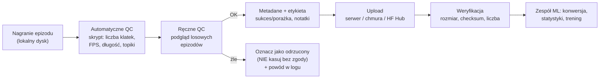

# 04 Jakość danych, organizacja i upload

> [!skrot] W 30 sekund
> - **QC (quality check) epizodu:** czy jest **kompletny** (wszystkie kamery i topiki), **zsynchronizowany**, bez **zgubionych klatek**, o **sensownej długości**, z **poprawną etykietą** i metadanymi, a obraz jest ostry i niezasłonięty.
> - **Organizacja:** stała **konwencja nazw**, **metadane** (kto, kiedy, zadanie, robot, wersja kalibracji), struktura katalogów, **nie nadpisujesz** surowych danych.
> - **Upload:** wg standardu labu (serwer, chmura S3/GCS, Hugging Face Hub, NAS), potem **weryfikacja** (rozmiar, suma kontrolna, liczba plików), dopiero potem kasujesz lokalnie — i tylko jeśli procedura pozwala.

> [!intuicja] Po ludzku
> Dane to jak zdjęcia z wakacji dla 50 osób: jak nazwiesz pliki `IMG_0001` i wrzucisz wszystko do jednego folderu, za miesiąc nikt nic nie znajdzie. Jak nazwiesz `2026-10-09_kubek-do-pudelka_franka01_ep0042`, dodasz plik z opisem i sprawdzisz, czy się wysłało — każdy znajdzie wszystko w 10 sekund. **Laboratorium żyje z danych, a ty jesteś ich pierwszym strażnikiem.**

## Pipeline danych — od nagrania do treningu



## Checklista QC jednego epizodu

| Co sprawdzam | Jak (przykład) | Typowy problem |
|---|---|---|
| **Kompletność** — wszystkie kamery i strumienie są | lista topiców w bagu: `ros2 bag info epizod/` | kamera odpadła w trakcie (USB), brak topiku |
| **Liczba klatek vs czas** | 30 FPS × 20 s ≈ 600 klatek na kamerę | **dropped frames** — za mało klatek, „dziury” w timestampach |
| **Częstotliwość** stanów/akcji | `ros2 topic hz` w trakcie / statystyki w bagu | spadki częstotliwości przy obciążonym CPU/USB |
| **Synchronizacja** | timestampy kamer i stanu w tym samym zakresie | przesunięcie zegarów między komputerami |
| **Długość epizodu** | w typowym zakresie (np. 10–60 s) | zapomniany stop → 5 minut stania |
| **Obraz** | podgląd: ostrość, ekspozycja, nic nie zasłania | prześwietlenie, rozmycie, zasłonięta kamera, przesunięta kamera |
| **Ruch** | wykres stanów: płynny, bez skoków | skoki = błąd odczytu / skok followera |
| **Chwytak** | otwarcie/zamknięcie w sensownym momencie | chwytak nie reagował |
| **Etykieta** | sukces/porażka zgodna z rzeczywistością, polecenie tekstowe poprawne | literówka w nazwie zadania (= inne zadanie dla modelu!) |
| **Metadane** | operator, data, robot, setup, wersja kalibracji | brak → nie wiadomo, czy dane pasują do kalibracji |

> [!wazne] Zasada: nie kasuj i nie „poprawiaj” po cichu
> Złych epizodów **nie usuwasz samodzielnie**, tylko oznaczasz (np. folder `rejected/`, flaga w metadanych) i zapisujesz powód. Surowych danych nie modyfikujesz — ewentualne poprawki to **nowa wersja** pliku/datasetu. Tak robią porządne laby (i tak powiesz na rozmowie).

## Konwencja nazw i struktura (przykład)
```
datasets/
└── pick_cup_to_box/                 # zadanie (snake_case, bez spacji i polskich znaków)
    └── 2026-10-09_franka01_op-pk/   # data ISO (RRRR-MM-DD) + robot + operator
        ├── session_meta.yaml        # setup, kalibracja v3, oświetlenie, uwagi
        ├── episode_0000/            # numeracja z zerami wiodącymi → poprawne sortowanie
        ├── episode_0001/
        └── rejected/episode_0007/   # odrzucony + powód w meta
```
- **Daty ISO 8601** (`2026-10-09`) — sortują się poprawnie.
- **Zera wiodące** (`0007`, nie `7`) — inaczej `10` przed `2`.
- **Bez spacji i polskich znaków** — skrypty i Linux mniej się mylą.
- **Jedna prawda:** wersja kalibracji i setupu w metadanych.

## Komendy, które się przydają (zobacz też [[15 Linux i wiersz poleceń]])
```bash
du -sh datasets/pick_cup_to_box/*        # ile zajmuje każda sesja
df -h                                    # ile miejsca zostało na dysku
ls datasets/.../ | wc -l                 # ile epizodów
ros2 bag info episode_0000               # topiki, liczba wiadomości, czas trwania
ffprobe -v error -count_frames -show_entries stream=nb_read_frames -of csv=p=0 cam_wrist.mp4   # liczba klatek w wideo
sha256sum plik.mcap > plik.mcap.sha256   # suma kontrolna przed wysłaniem
sha256sum -c plik.mcap.sha256            # weryfikacja po drugiej stronie
rsync -avP --checksum sesja/ user@serwer:/data/sesja/   # wysyłka z wznawianiem i postępem
aws s3 cp --recursive sesja/ s3://bucket/sesja/         # chmura (S3) — jeśli lab tak ma
huggingface-cli upload org/dataset ./sesja              # Hugging Face Hub (LeRobot)
```

## Prosty skrypt QC (Python) — umiesz to wyjaśnić linijka po linijce
```python
from pathlib import Path
import json

EXPECTED_CAMS = {"cam_wrist", "cam_scene"}
MIN_S, MAX_S, FPS = 5, 120, 30

def check_episode(ep: Path) -> list[str]:
    problems = []
    meta = json.loads((ep / "meta.json").read_text())       # metadane epizodu
    cams = {p.stem for p in ep.glob("*.mp4")}                # jakie kamery nagrały
    if missing := EXPECTED_CAMS - cams:
        problems.append(f"brak kamer: {missing}")
    dur = meta["duration_s"]
    if not MIN_S <= dur <= MAX_S:
        problems.append(f"podejrzana długość: {dur:.1f} s")
    for cam, n in meta["frames"].items():                    # klatki per kamera
        if n < 0.95 * dur * FPS:                             # >5% zgubionych klatek
            problems.append(f"{cam}: {n} klatek zamiast ~{dur*FPS:.0f}")
    if meta.get("success") is None:
        problems.append("brak etykiety sukces/porażka")
    return problems

for ep in sorted(Path("datasets/pick_cup_to_box").glob("*/episode_*")):
    if probs := check_episode(ep):
        print(ep.name, "→", "; ".join(probs))
```

## Typowe błędy
> [!blad] Upload bez weryfikacji
> „Wysłałem” ≠ „doszło”. Sieć zrywa, dysk się zapełnia. Sprawdź rozmiar / liczbę plików / sumę kontrolną.

> [!blad] Mieszanie sesji z różną kalibracją
> Jeśli kamera była skalibrowana na nowo, to **nowa wersja setupu** — musi to być w metadanych. Inaczej model dostanie niespójne dane.

> [!blad] Pełny dysk w trakcie nagrywania
> Wideo z 3 kamer to szybko gigabajty. `df -h` przed sesją.

## Pytania rekrutacyjne
> [!zadanie] Jakie kontrole jakości zrobiłbyś na zebranym epizodzie?
> > [!odpowiedz]- Odpowiedź
> > Kompletność strumieni (wszystkie kamery i topiki), liczba klatek względem długości (dropped frames), częstotliwość i synchronizacja timestampów, sensowna długość, podgląd obrazu (ostrość, ekspozycja, zasłonięcia, przesunięta kamera), płynność trajektorii, działanie chwytaka, poprawna etykieta i metadane. Część automatycznie skryptem, część ręcznie na losowej próbce.
> > **EN:** *"I'd check completeness — all camera streams and topics present — frame counts versus duration to catch dropped frames, timestamp sync, episode length, a quick visual check for blur, exposure or occlusion, smooth joint trajectories, and correct success labels and metadata. Ideally the basic checks are automated with a script and I spot-check a random sample manually."*

> [!zadanie] Znalazłeś 5 złych epizodów w sesji. Co robisz?
> > [!odpowiedz]- Odpowiedź
> > Oznaczam je jako odrzucone (wg standardu labu, np. osobny folder/flaga), zapisuję powód w logu, nie kasuję bez zgody. Jeśli przyczyna jest systemowa (np. kamera gubi klatki), zgłaszam i naprawiam przed dalszym zbieraniem. Ewentualnie dozbieram brakujące epizody.

> [!zadanie] Jak zorganizowałbyś pliki z sesji?
> > [!odpowiedz]- Odpowiedź
> > Hierarchia zadanie → sesja (data ISO + robot + operator) → epizody z zerami wiodącymi; plik metadanych sesji (setup, wersja kalibracji, uwagi) i epizodu (sukces, długość, notatki); bez spacji i polskich znaków; surowe dane niezmieniane, poprawki jako nowe wersje.

> [!zadanie] Jak upewnisz się, że upload się udał?
> > [!odpowiedz]- Odpowiedź
> > Porównuję liczbę plików i rozmiar, najlepiej sumy kontrolne (sha256/md5) po obu stronach; używam narzędzi, które wznawiają i weryfikują (`rsync --checksum`). Dopiero po weryfikacji, i jeśli procedura pozwala, zwalniam miejsce lokalnie.

## Fiszki #fiszki/rozmowa-gd/dane
Co to są dropped frames i jak je wykryć?::Zgubione klatki kamery; wykryć porównując liczbę klatek z czas×FPS albo szukając dziur w timestampach.
Co sprawdzasz w QC epizodu?::Kompletność strumieni, klatki/FPS, synchronizację, długość, obraz, płynność ruchu, chwytak, etykietę i metadane.
Co robisz ze złym epizodem?::Oznaczasz jako odrzucony + powód w logu; nie kasujesz bez zgody.
Dlaczego daty w formacie ISO (RRRR-MM-DD)?::Sortują się alfabetycznie = chronologicznie i są jednoznaczne.
Dlaczego zera wiodące w numerach epizodów?::Żeby sortowanie alfabetyczne było poprawne (0010 po 0009, nie po 0001).
Jak zweryfikować upload?::Liczba plików, rozmiar, sumy kontrolne (sha256sum -c), rsync --checksum.
Komenda: ile miejsca na dysku?::df -h (wolne miejsce na partycjach); du -sh katalog (rozmiar katalogu).
Komenda: informacje o rosbagu?::ros2 bag info <katalog_bagu>.
Dlaczego wersja kalibracji w metadanych?::Dane z różną kalibracją kamer nie są spójne; trzeba wiedzieć, która kalibracja dotyczy którego epizodu.

## Moje notatki
> [!ja] Tu piszesz ty — Albert tej sekcji nie rusza.
