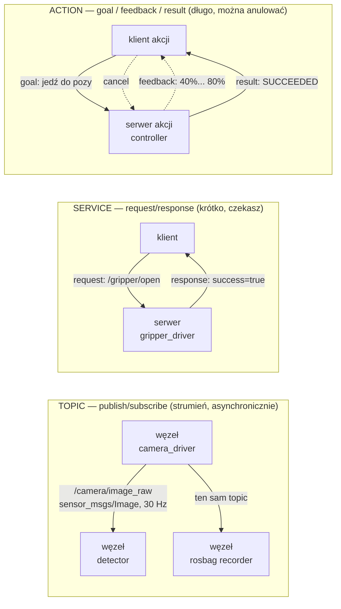

# 05 ROS 2 — podstawy

> [!skrot] W 30 sekund
> - **ROS 2 (Robot Operating System 2)** to **nie system operacyjny**, tylko **framework / middleware**: biblioteki + narzędzia, dzięki którym wiele programów (**węzłów**) na jednym lub wielu komputerach wymienia dane w standardowy sposób.
> - **3 sposoby komunikacji:** **topic** (strumień, publish/subscribe, „radio”), **service** (pytanie–odpowiedź, „telefon”), **action** (długie zadanie z postępem i możliwością anulowania, „zamówienie z śledzeniem przesyłki”). Plus **parametry** (konfiguracja węzła).
> - **Pod spodem: DDS** (Data Distribution Service) — sam odkrywa węzły w sieci, **bez centralnego mastera** (w ROS 1 był `roscore`). Węzły widzą się, jeśli mają ten sam **`ROS_DOMAIN_ID`** i sieć przepuszcza multicast.
> - **Wersje (dystrybucje):** **Humble** (LTS, Ubuntu 22.04, wsparcie do 2027), **Jazzy** (LTS, Ubuntu 24.04, do 2029), Kilted (2025, krótka), Rolling (ciągła).

> [!intuicja] Po ludzku
> Wyobraź sobie robota jako firmę. Każdy pracownik (**węzeł**) robi jedną rzecz: jeden obsługuje kamerę, drugi liczy, gdzie jest kubek, trzeci rusza ramieniem. **Topiki** to tablice ogłoszeń: kamera wiesza na tablicy `/camera/image` nowe zdjęcie 30 razy na sekundę, a kto chce, ten czyta. **Serwis** to telefon do kolegi: „skalibruj się” — i czekasz na „gotowe”. **Akcja** to zlecenie z raportami: „jedź ramieniem tam” — dostajesz co chwila „jestem w 40%… 80%…”, możesz przerwać, a na końcu „dojechałem”.

## Główne pojęcia



| | **Topic** | **Service** | **Action** |
|---|---|---|---|
| Wzorzec | publish / subscribe | request / response | goal → feedback → result |
| Ile stron | wielu do wielu (N:M) | 1 serwer, wielu klientów | 1 serwer, wielu klientów |
| Czas | ciągły strumień | krótka operacja | długa operacja |
| Czy czekasz? | nie (asynchronicznie) | tak, na odpowiedź | nie musisz; dostajesz postęp |
| Anulowanie | — | nie | **tak** |
| Plik definicji | `.msg` | `.srv` (request `---` response) | `.action` (goal `---` result `---` feedback) |
| Przykład | obraz kamery, `/joint_states`, `/cmd_vel` | „otwórz chwytak”, „zresetuj licznik”, „podaj parametr” | „jedź ramieniem do pozy” (`FollowJointTrajectory`), „nawiguj do punktu” |
| Komenda | `ros2 topic echo /x` | `ros2 service call /x typ "{...}"` | `ros2 action send_goal /x typ "{...}"` |

> [!wazne] Jak wybrać? (pytanie pewne na rozmowie)
> - Dane płyną **ciągle** (sensory, stan) → **topic**.
> - Szybka komenda z odpowiedzią „udało się / nie” → **service**.
> - Coś trwa **sekundy lub dłużej**, chcesz postęp lub móc przerwać (ruch ramienia, nawigacja) → **action**.

## Pozostałe klocki
| Pojęcie | Co to |
|---|---|
| **Node (węzeł)** | Jeden program/proces (albo kilka węzłów w jednym procesie — *composition*), robi jedną rzecz |
| **Message (msg)** | Typ danych na topiku, np. `sensor_msgs/msg/Image`, `geometry_msgs/msg/Twist`, `sensor_msgs/msg/JointState` |
| **Parameter** | Ustawienie węzła (np. `fps: 30`, `serial_port: /dev/ttyUSB0`), zmienialne w trakcie: `ros2 param set` |
| **Package (pakiet)** | Jednostka kodu: węzły + launch + konfiguracja + `package.xml` (zależności) |
| **Workspace** | Katalog z `src/` z pakietami; po budowie `build/`, `install/`, `log/` |
| **colcon** | Narzędzie do budowania workspace’u: `colcon build` |
| **ament_cmake / ament_python** | System budowania pakietu w C++ / Pythonie |
| **Launch file** | Skrypt (Python/XML/YAML) startujący wiele węzłów z parametrami naraz |
| **rclpy / rclcpp** | Biblioteka ROS 2 dla Pythona / C++ |
| **Executor** | Pętla, która wywołuje callbacki węzła (single-/multi-threaded) |
| **QoS** | Zasady dostarczania wiadomości (niezawodność, historia) — patrz niżej |
| **Namespace** | Prefiks nazw, np. `/robot1/camera/image` — wiele robotów bez konfliktów |
| **Remapping** | Zmiana nazwy topiku przy starcie, np. `image:=/camera/color/image_raw` |
| **Lifecycle node** | Węzeł z cyklem stanów (unconfigured → inactive → active), kontrolowane uruchamianie sterowników |
| **RMW** | ROS Middleware — warstwa wybierająca implementację DDS (Fast DDS — domyślny w Humble, Cyclone DDS, Zenoh od Jazzy/Kilted) |

## ROS 1 vs ROS 2 (często pytają!)
| | ROS 1 | ROS 2 |
|---|---|---|
| Centralny węzeł | **roscore / master** (pada = wszystko pada) | **brak**, DDS sam odkrywa węzły |
| Transport | własny TCPROS/UDPROS | **DDS** (standard przemysłowy) |
| QoS | brak | **jest** (reliable / best effort itd.) |
| Czas rzeczywisty, embedded | słabo | lepiej (micro-ROS na mikrokontrolery) |
| Bezpieczeństwo | brak | SROS2 (szyfrowanie, uwierzytelnianie DDS) |
| Python | 2 → 3 | 3 |
| Launch | XML | **Python** (oraz XML, YAML) |
| Koniec wsparcia | Noetic — **maj 2025** (EOL) | aktywny rozwój |

## QoS w 1 minucie
| Ustawienie | Opcje | Kiedy |
|---|---|---|
| **Reliability** | `RELIABLE` (dostarcz na pewno, retransmisje) / `BEST_EFFORT` (wyślij i zapomnij) | sensory wysokiej częstotliwości → best effort; komendy → reliable |
| **Durability** | `VOLATILE` (nowy subskrybent nie dostaje starych) / `TRANSIENT_LOCAL` (dostaje ostatnią wiadomość) | `/robot_description`, mapy, statyczne TF → transient local |
| **History + depth** | `KEEP_LAST n` / `KEEP_ALL` | ile wiadomości trzymać w kolejce |

> [!blad] Klasyczna pułapka QoS
> Publisher kamery daje `BEST_EFFORT`, a subskrybent chce `RELIABLE` → **niezgodne, nic nie dochodzi** (i brak oczywistego błędu). `ros2 topic info -v /topic` pokazuje QoS obu stron. Działa odwrotnie: publisher RELIABLE + subscriber BEST_EFFORT = OK.

## Minimalny węzeł w Pythonie (umiej go wyjaśnić)
```python
import rclpy
from rclpy.node import Node
from std_msgs.msg import String

class Talker(Node):
    def __init__(self):
        super().__init__("talker")                                  # nazwa węzła
        self.pub = self.create_publisher(String, "chatter", 10)     # topic, QoS depth 10
        self.timer = self.create_timer(0.5, self.tick)              # co 0,5 s → 2 Hz
        self.n = 0

    def tick(self):
        msg = String(data=f"hello {self.n}")
        self.pub.publish(msg)
        self.get_logger().info(msg.data)
        self.n += 1

class Listener(Node):
    def __init__(self):
        super().__init__("listener")
        self.create_subscription(String, "chatter", self.on_msg, 10)

    def on_msg(self, msg):                                          # callback na każdą wiadomość
        self.get_logger().info(f"got: {msg.data}")

def main():
    rclpy.init()
    node = Talker()
    rclpy.spin(node)            # pętla zdarzeń: wywołuje timery i callbacki
    node.destroy_node()
    rclpy.shutdown()
```
**Klucz:** węzeł nic nie robi „sam z siebie” — reaguje na **timery i callbacki**, a `spin()` je obsługuje. Długie obliczenia w callbacku blokują inne callbacki (wtedy `MultiThreadedExecutor` + callback groups).

## Ważne typy wiadomości w manipulacji
| Typ | Co niesie |
|---|---|
| `sensor_msgs/JointState` | nazwy stawów, pozycje, prędkości, wysiłek (effort) — topic `/joint_states` |
| `sensor_msgs/Image`, `CompressedImage`, `CameraInfo` | obraz; parametry kamery (macierz K, dystorsja) |
| `sensor_msgs/PointCloud2` | chmura punktów z kamery głębi / lidaru |
| `geometry_msgs/Pose`, `PoseStamped`, `Transform`, `Twist`, `Wrench` | poza; poza z czasem i ramką; transformacja; prędkość; siła+moment |
| `trajectory_msgs/JointTrajectory` | trajektoria w stawach (punkty z czasami) |
| `control_msgs/action/FollowJointTrajectory` | akcja wykonania trajektorii przez kontroler |
| `control_msgs/action/GripperCommand` | akcja dla chwytaka (pozycja, maks. siła) |
| `std_msgs/Header` | `stamp` (czas) + `frame_id` (w jakim układzie są dane) — w prawie każdej wiadomości sensora |

## Typowe błędy
> [!blad] „ROS to system operacyjny”
> Nie — działa **na** Linuksie (najczęściej Ubuntu). To middleware + narzędzia + ekosystem pakietów.

> [!blad] Zapomniane `source`
> Nowy terminal nie zna ROS-a ani twoich pakietów, dopóki nie zrobisz `source /opt/ros/humble/setup.bash` i `source install/setup.bash`.

> [!blad] Service do długich operacji
> Klient serwisu czeka, a nie da się anulować ani śledzić postępu. Do ruchu ramienia używa się **akcji**.

## Pytania rekrutacyjne
> [!zadanie] Czym się różni topic, service i action?
> > [!odpowiedz]- Odpowiedź
> > Topic: asynchroniczny strumień publish/subscribe, wielu do wielu, np. obrazy i stany. Service: synchroniczne zapytanie–odpowiedź dla krótkich operacji, np. otwórz chwytak. Action: dla długich zadań — cel, cykliczny feedback, wynik, i można anulować, np. ruch ramienia po trajektorii.
> > **EN:** *"Topics are asynchronous publish-subscribe streams, many-to-many, used for sensor data. Services are request-response calls for short operations. Actions are for long-running goals: the client sends a goal, gets periodic feedback and a final result, and can cancel it — for example executing an arm trajectory."*

> [!zadanie] Czym różni się ROS 2 od ROS 1?
> > [!odpowiedz]- Odpowiedź
> > Brak centralnego mastera (DDS i automatyczne odkrywanie), QoS, lepsze wsparcie czasu rzeczywistego i systemów wbudowanych, bezpieczeństwo (SROS2), launch w Pythonie, wsparcie wielu robotów. ROS 1 (Noetic) skończył wsparcie w 2025.

> [!zadanie] Dwa komputery w tej samej sieci nie widzą swoich topiców. Co sprawdzasz?
> > [!odpowiedz]- Odpowiedź
> > Ten sam `ROS_DOMAIN_ID` na obu; ta sama dystrybucja i zgodne RMW (`RMW_IMPLEMENTATION`); `ROS_LOCALHOST_ONLY` nie ustawione na 1 (Humble) / `ROS_AUTOMATIC_DISCOVERY_RANGE` (Jazzy); czy się pingują (ta sama podsieć); firewall (`firewalld`/`ufw`) i multicast (`ros2 multicast receive` / `send`); czy węzły w ogóle działają (`ros2 node list` lokalnie); w Dockerze — `--network host`.

> [!zadanie] Co to jest QoS i podaj przykład problemu?
> > [!odpowiedz]- Odpowiedź
> > Quality of Service — zasady dostarczania: niezawodność (reliable/best effort), trwałość (volatile/transient local), historia (keep last N). Problem: kamera publikuje best effort, a subskrybent żąda reliable → niezgodność i brak danych. Sprawdzam `ros2 topic info -v`.

> [!zadanie] Co to jest `ROS_DOMAIN_ID`?
> > [!odpowiedz]- Odpowiedź
> > Numer (domyślnie 0, zwykle 0–101), który oddziela grupy węzłów w tej samej sieci. Węzły widzą się tylko w obrębie tej samej domeny. W labie z kilkoma robotami każdy może mieć swoją domenę.

## Fiszki #fiszki/rozmowa-gd/ros2
Czym jest ROS 2?::Middleware/framework dla robotów (biblioteki, narzędzia, komunikacja), działa na Linuksie — nie jest systemem operacyjnym.
Topic — wzorzec i zastosowanie?::Publish/subscribe, asynchroniczny strumień wielu-do-wielu; dane sensorów, stany.
Service — wzorzec i zastosowanie?::Request/response, krótkie operacje z odpowiedzią (np. otwórz chwytak).
Action — z czego się składa?::Goal, feedback, result + możliwość anulowania; długie zadania (ruch ramienia, nawigacja).
Co jest pod spodem komunikacji ROS 2?::DDS (Data Distribution Service) przez warstwę RMW; automatyczne odkrywanie bez mastera.
Domyślny DDS w ROS 2 Humble?::eProsima Fast DDS (alternatywa: Cyclone DDS).
Dystrybucje LTS ROS 2 i ich Ubuntu?::Humble — Ubuntu 22.04 (do 2027); Jazzy — Ubuntu 24.04 (do 2029).
Co to jest ROS_DOMAIN_ID?::Numer separujący grupy węzłów w sieci; węzły widzą się tylko w tej samej domenie.
QoS reliability — opcje?::RELIABLE (gwarantowane dostarczenie) i BEST_EFFORT (bez retransmisji).
QoS durability TRANSIENT_LOCAL — po co?::Nowy subskrybent dostaje ostatnią wiadomość (np. /robot_description, static TF).
Niezgodność QoS — przykład?::Publisher BEST_EFFORT + subscriber RELIABLE = brak komunikacji.
Czym budujesz workspace ROS 2?::colcon build (potem source install/setup.bash).
Do czego launch file?::Uruchamia wiele węzłów naraz z parametrami, remappingami, namespace'ami.
Co robi rclpy.spin()?::Kręci pętlę zdarzeń węzła: wywołuje callbacki subskrypcji, timerów, serwisów.
Jaka wiadomość niesie stany stawów?::sensor_msgs/msg/JointState na topicu /joint_states.
Co jest w std_msgs/Header?::stamp (znacznik czasu) i frame_id (układ współrzędnych danych).
Główna różnica ROS 1 vs ROS 2?::ROS 1 ma centralny roscore; ROS 2 używa DDS bez mastera, ma QoS, lepszy real-time i bezpieczeństwo.

## Moje notatki
> [!ja] Tu piszesz ty — Albert tej sekcji nie rusza.
