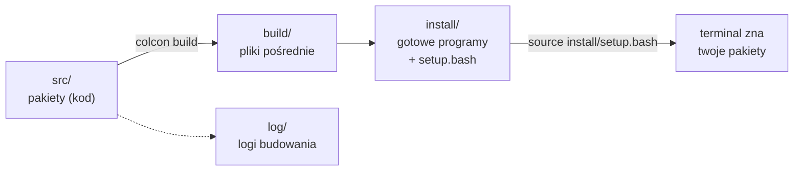
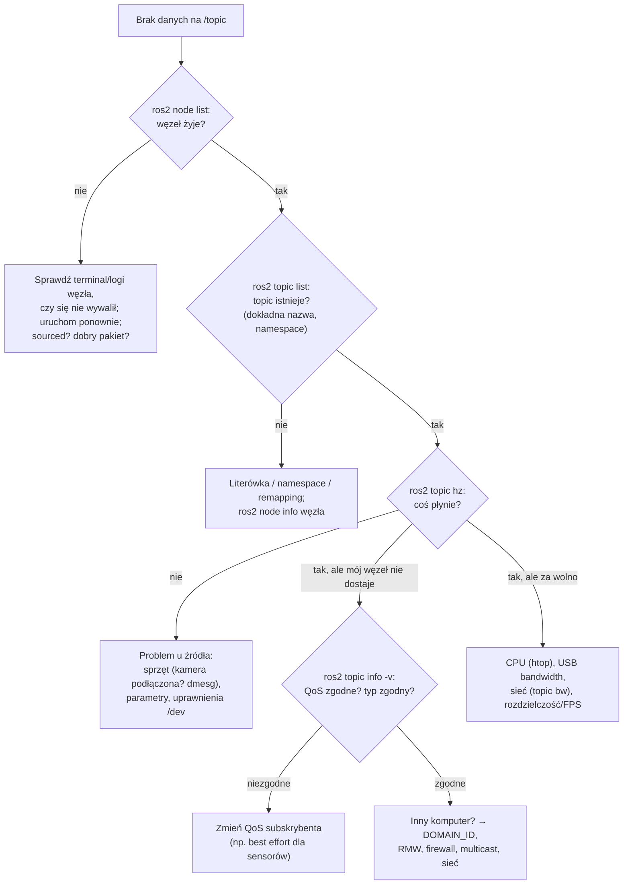

# 06 ROS 2 — komendy, launch, bagi i debugowanie

> [!skrot] W 30 sekund
> - **Zawsze najpierw:** `source /opt/ros/humble/setup.bash` (ROS) i `source ~/ws/install/setup.bash` (twoje pakiety).
> - **Co działa?** `ros2 node list`, `ros2 topic list`, `ros2 topic hz /x`, `ros2 topic echo /x`, `ros2 topic info -v /x`.
> - **Nagrywanie:** `ros2 bag record -o nazwa /topic1 /topic2`, odtwarzanie `ros2 bag play nazwa`, opis `ros2 bag info nazwa`.
> - **Wizualnie:** `rqt_graph` (kto z kim gada), `rviz2` (3D: robot, TF, chmury punktów, obrazy), **Foxglove** (przeglądanie bagów).
> - **Budowa:** `colcon build --symlink-install`, potem znowu `source install/setup.bash`.

> [!intuicja] Po ludzku
> `ros2 ...` to „pilot” do całego systemu. `list` — co istnieje, `info` — szczegóły, `echo` — podsłuchaj, `hz` — jak często, `pub`/`call`/`send_goal` — wyślij coś ręcznie. Jak coś nie działa, **zawsze** idziesz od ogółu do szczegółu: czy węzeł żyje → czy topic istnieje → czy coś na nim płynie → jak często → czy QoS i ramki się zgadzają.

## Ściąga komend (wydrukuj sobie w głowie)

### Węzły i topiki
```bash
ros2 node list                         # jakie węzły żyją
ros2 node info /camera                 # co publikuje / subskrybuje / jakie serwisy
ros2 topic list -t                     # topiki z typami
ros2 topic echo /joint_states          # podgląd wiadomości (Ctrl+C koniec)
ros2 topic echo /joint_states --once   # tylko jedna wiadomość
ros2 topic hz /camera/color/image_raw  # częstotliwość (powinno być ~30 Hz)
ros2 topic bw /camera/color/image_raw  # przepustowość (MB/s)
ros2 topic info -v /camera/color/image_raw   # publisherzy, subskrybenci i ich QoS
ros2 topic pub /cmd_vel geometry_msgs/msg/Twist "{linear: {x: 0.1}}" -r 10   # publikuj 10 Hz
ros2 topic pub --once /chatter std_msgs/msg/String "{data: hello}"
```

### Serwisy, akcje, parametry, interfejsy
```bash
ros2 service list -t
ros2 service call /gripper/open std_srvs/srv/Trigger "{}"
ros2 action list -t
ros2 action send_goal /arm_controller/follow_joint_trajectory control_msgs/action/FollowJointTrajectory "{...}" --feedback
ros2 param list /camera
ros2 param get /camera fps
ros2 param set /camera exposure 100
ros2 param dump /camera > camera.yaml      # zapisz konfigurację
ros2 interface show sensor_msgs/msg/JointState   # z jakich pól składa się typ
```

### Uruchamianie
```bash
ros2 run <pakiet> <wykonywalny>                       # jeden węzeł
ros2 run turtlesim turtlesim_node --ros-args -p background_r:=255 -r __ns:=/robot1
ros2 launch <pakiet> <plik.launch.py> arg:=wartość   # cały system
ros2 launch realsense2_camera rs_launch.py           # przykład: kamera RealSense
```

### Diagnostyka
```bash
ros2 doctor --report       # sprawdza konfigurację, sieć, wersje
ros2 wtf                   # alias doctor :)
ros2 multicast receive     # na kompie A,   a na kompie B:
ros2 multicast send        # → test, czy multicast (discovery DDS) przechodzi
printenv | grep -i ros     # ROS_DISTRO, ROS_DOMAIN_ID, RMW_IMPLEMENTATION...
ros2 daemon stop && ros2 daemon start   # „restart” cache'u odkrywania (gdy lista topiców jest dziwna)
rqt_graph                  # graf węzłów i topiców
rqt_console                # logi
rviz2                      # wizualizacja 3D
ros2 run tf2_tools view_frames     # PDF z drzewem TF
ros2 run tf2_ros tf2_echo base_link tool0   # transformacja między ramkami na żywo
```

### Budowanie workspace’u
```bash
mkdir -p ~/ws/src && cd ~/ws/src
git clone <repo>
cd ~/ws
rosdep install --from-paths src --ignore-src -r -y   # doinstaluj zależności z package.xml
colcon build --symlink-install                       # build (Python bez przebudowy po zmianie)
colcon build --packages-select moj_pakiet            # tylko jeden pakiet
colcon test && colcon test-result --verbose          # testy
source install/setup.bash
```



## Launch file w Pythonie (przykład do wytłumaczenia)
```python
from launch import LaunchDescription
from launch.actions import DeclareLaunchArgument
from launch.substitutions import LaunchConfiguration
from launch_ros.actions import Node

def generate_launch_description():
    fps = LaunchConfiguration("fps")
    return LaunchDescription([
        DeclareLaunchArgument("fps", default_value="30"),
        Node(package="usb_cam", executable="usb_cam_node_exe", name="wrist_cam",
             namespace="robot1",
             parameters=[{"framerate": fps, "video_device": "/dev/video0"}],
             remappings=[("image_raw", "wrist/image_raw")]),
        Node(package="robot_state_publisher", executable="robot_state_publisher",
             parameters=[{"robot_description": open("robot.urdf").read()}]),
    ])
```
Uruchomienie: `ros2 launch moj_pakiet zbieranie.launch.py fps:=15`.

## rosbag2 — nagrywanie danych
| Komenda | Co robi |
|---|---|
| `ros2 bag record -a` | nagrywa **wszystkie** topiki (uwaga: ogromne pliki) |
| `ros2 bag record -o ep_0001 /joint_states /cam/image_raw/compressed` | wybrane topiki do katalogu `ep_0001` |
| `ros2 bag record -s mcap ...` | format **MCAP** (domyślny od Jazzy; w Humble domyślnie SQLite `.db3`) |
| `ros2 bag record --max-bag-duration 60 ...` | dziel na pliki co 60 s |
| `ros2 bag info ep_0001` | czas trwania, topiki, **liczba wiadomości** (→ QC!) |
| `ros2 bag play ep_0001 --rate 0.5 --loop` | odtwarzanie w połowie prędkości, w pętli |
| `ros2 bag play ... --clock` + `use_sim_time:=true` | węzły używają czasu z bagu |

> [!wazne] Obrazy w bagach
> Surowe obrazy (`image_raw`) to ogromne pliki (640×480×3 B × 30 FPS ≈ 27 MB/s **na kamerę**). Dlatego nagrywa się `.../compressed` (JPEG/PNG) albo zapisuje wideo osobno. Pełny dysk albo wolny dysk = **zgubione wiadomości** w bagu.

## Debugowanie — algorytm „topic nie działa”



## Typowe błędy
> [!blad] `Package 'xyz' not found`
> Nie zrobiłeś `source install/setup.bash` w tym terminalu, albo pakiet się nie zbudował (sprawdź wynik `colcon build`), albo jesteś w złym workspace.

> [!blad] Zmiana w kodzie C++ „nie działa”
> Trzeba przebudować (`colcon build`). W Pythonie z `--symlink-install` nie trzeba, ale po dodaniu nowego pliku/entry pointu — trzeba.

> [!blad] Budowanie w katalogu `src`
> `colcon build` uruchamia się w **korzeniu** workspace'u (`~/ws`), nie w `src`.

## Pytania rekrutacyjne
> [!zadanie] Jak sprawdzisz, czy kamera publikuje obrazy i z jaką częstotliwością?
> > [!odpowiedz]- Odpowiedź
> > `ros2 topic list` (czy topic jest), `ros2 topic hz /camera/.../image_raw` (częstotliwość), `ros2 topic echo --once` na `camera_info` albo podgląd w `rqt_image_view`/`rviz2`. Jeśli nie ma — `ros2 node list`, logi węzła, a sprzętowo `lsusb`, `dmesg`, `ls /dev/video*`.

> [!zadanie] Jak nagrać dane do rosbaga i jak sprawdzić, co jest w środku?
> > [!odpowiedz]- Odpowiedź
> > `ros2 bag record -o nazwa /topic1 /topic2` (ew. `-s mcap`), zatrzymanie Ctrl+C. Sprawdzenie: `ros2 bag info nazwa` — czas trwania, lista topiców, liczba wiadomości; podgląd: `ros2 bag play` + rviz/Foxglove.

> [!zadanie] Jak zbudować i uruchomić pakiet z repozytorium?
> > [!odpowiedz]- Odpowiedź
> > Sklonować do `~/ws/src`, `rosdep install --from-paths src --ignore-src -y`, `colcon build --symlink-install` w `~/ws`, `source install/setup.bash`, potem `ros2 run`/`ros2 launch`.

> [!zadanie] Co pokazuje `rqt_graph` i do czego jest RViz?
> > [!odpowiedz]- Odpowiedź
> > `rqt_graph` — graf węzłów i łączących je topiców (kto publikuje, kto subskrybuje), do szukania brakujących połączeń. RViz2 — wizualizacja 3D: model robota, drzewo TF, chmury punktów, obrazy, trajektorie, markery.

## Fiszki #fiszki/rozmowa-gd/ros2
Komenda: lista węzłów?::ros2 node list
Komenda: częstotliwość topicu?::ros2 topic hz /nazwa
Komenda: QoS publisherów i subskrybentów topicu?::ros2 topic info -v /nazwa
Komenda: jednorazowy podgląd wiadomości?::ros2 topic echo /nazwa --once
Komenda: wywołanie serwisu?::ros2 service call /nazwa pakiet/srv/Typ "{pola}"
Komenda: struktura typu wiadomości?::ros2 interface show pakiet/msg/Typ
Komenda: zmiana parametru w trakcie?::ros2 param set /węzeł nazwa wartość
Komenda: nagranie wybranych topiców?::ros2 bag record -o nazwa /t1 /t2
Komenda: opis bagu?::ros2 bag info nazwa
Komenda: test multicastu między komputerami?::ros2 multicast receive (na jednym) i ros2 multicast send (na drugim).
Komenda: zależności pakietów z package.xml?::rosdep install --from-paths src --ignore-src -r -y
Co daje colcon build --symlink-install?::Linkuje pliki zamiast kopiować — zmiany w Pythonie/configach bez przebudowy.
Komenda: drzewo TF do PDF?::ros2 run tf2_tools view_frames
Komenda: transformacja między dwiema ramkami na żywo?::ros2 run tf2_ros tf2_echo ramka_źródłowa ramka_docelowa
Domyślny format bagów w Humble i w Jazzy?::Humble: SQLite (.db3); Jazzy: MCAP.
Dlaczego nagrywa się obrazy compressed?::Surowe obrazy zajmują dziesiątki MB/s na kamerę; dysk nie nadąża → zgubione wiadomości.

## Moje notatki
> [!ja] Tu piszesz ty — Albert tej sekcji nie rusza.
