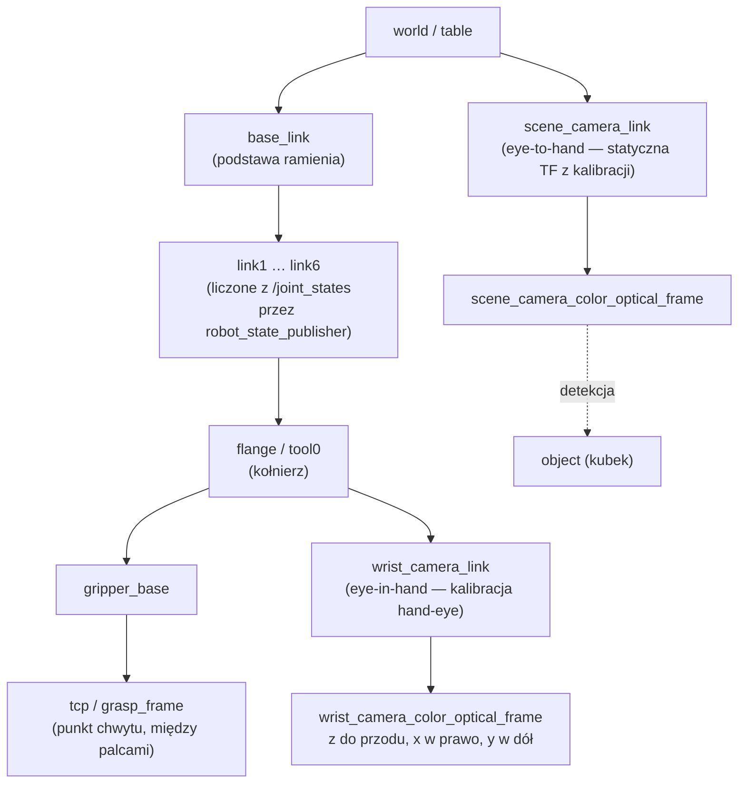
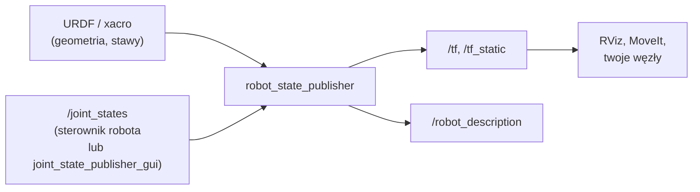

# 07 TF2, URDF i układy współrzędnych

> [!skrot] W 30 sekund
> - **Układ współrzędnych (frame / ramka)** = punkt zerowy + kierunki osi x, y, z. Każda część robota i każda kamera ma swój.
> - **Transformacja** między ramkami = **przesunięcie (translacja) + obrót (rotacja)**. Zapis: macierz jednorodna $4\times4$ albo wektor + **kwaternion**.
> - **TF2** w ROS 2 trzyma **drzewo** wszystkich ramek w czasie i pozwala zapytać: „gdzie jest kubek widziany kamerą **w układzie bazy robota**?”.
> - **URDF** = plik XML opisujący robota: **linki** (sztywne części) i **jointy** (stawy, które je łączą). Z niego `robot_state_publisher` liczy TF ramienia na podstawie `/joint_states`.
> - **Konwencja ROS (REP-103):** prawoskrętny układ, **x do przodu, y w lewo, z w górę**; kamera „optyczna”: **z do przodu, x w prawo, y w dół**. Jednostki SI: metry, radiany.

> [!intuicja] Po ludzku
> Każdy mówi „kubek jest 30 cm przede mną”, ale „przede mną” zależy od tego, **kto** mówi. Kamera widzi kubek 40 cm przed obiektywem, ale robot potrzebuje wiedzieć, gdzie to jest względem **jego podstawy**. TF to tłumacz, który zna, gdzie stoi każdy „mówca” względem innych, i przelicza współrzędne. Jeśli kamera się przesunie, a TF dalej myśli, że stoi w starym miejscu — robot będzie łapał powietrze. **Stąd kalibracja.**

## Drzewo TF typowego stanowiska manipulacji



- **Dynamiczne TF** — zmieniają się w czasie (stawy ramienia) → topic `/tf`.
- **Statyczne TF** — stałe (kamera przykręcona do stołu, chwytak do kołnierza) → topic `/tf_static` (QoS transient local, publikowane raz).
- Każda ramka ma **jednego rodzica** → to drzewo (bez pętli).
- Dla robotów mobilnych (REP-105): `map → odom → base_link`. (Znasz to z łodzi: [[SLAM — TF map-odom-base]].)

## Matematyka transformacji (tyle wystarczy)

> [!definicja] Macierz jednorodna
> Transformacja z ramki B do ramki A:
> $$ {}^{A}T_{B} = \begin{bmatrix} R & t \\ 0\;0\;0 & 1 \end{bmatrix},\quad R\in\mathbb{R}^{3\times3}\ (\text{obrót}),\ t\in\mathbb{R}^3\ (\text{przesunięcie}) $$
> Punkt zapisany w B przeliczasz do A: $\;p_A = {}^{A}T_{B}\,p_B\;$ (z $p$ dopisanym jako $[x,y,z,1]^T$).
> **Składanie** (łańcuch): $\;{}^{base}T_{obj} = {}^{base}T_{cam}\;{}^{cam}T_{obj}$ — indeksy „skracają się” jak ułamki.
> **Odwrotność:** ${}^{B}T_{A} = ({}^{A}T_{B})^{-1} = \begin{bmatrix} R^T & -R^T t \\ 0 & 1\end{bmatrix}$.

> [!wzor] Obroty — 3 sposoby zapisu
> | Zapis | Co to | Plus / minus |
> |---|---|---|
> | **Macierz rotacji** $R$ | 3×3, ortonormalna, $\det R=1$, $R^{-1}=R^T$ | łatwo składać; 9 liczb dla 3 stopni swobody |
> | **Kąty Eulera / RPY** (roll, pitch, yaw) | obrót wokół x, y, z | intuicyjne; **gimbal lock**, zależą od kolejności osi |
> | **Kwaternion** $q=(x,y,z,w)$ | 4 liczby, $\|q\|=1$ | brak gimbal lock, stabilne numerycznie, standard w ROS; mało intuicyjne |
> Kwaternion obrotu o kąt $\theta$ wokół osi $u$: $q = (u\sin\tfrac{\theta}{2},\ \cos\tfrac{\theta}{2})$. **Brak obrotu = (0, 0, 0, 1)**. Uwaga: $q$ i $-q$ to ten sam obrót.
> Obrót wokół osi z o kąt $\psi$: $R_z(\psi)=\begin{bmatrix}\cos\psi & -\sin\psi & 0\\ \sin\psi & \cos\psi & 0\\ 0&0&1\end{bmatrix}$

## Przykład — kubek z kamery do bazy robota
Kamera stoi 1 m przed robotem (oś x bazy), patrzy **w stronę robota** (obrócona o 180° wokół z). Kubek widziany w ramce kamery (dla uproszczenia nie-optycznej, konwencja ROS) w punkcie $p_{cam}=(0{,}4;\ 0{,}1;\ 0)$.
1. ${}^{base}T_{cam}$: $t=(1, 0, 0)$, $R=R_z(180°)=\begin{bmatrix}-1&0&0\\0&-1&0\\0&0&1\end{bmatrix}$.
2. $p_{base} = R\,p_{cam} + t = (-0{,}4;\ -0{,}1;\ 0) + (1;0;0) = (0{,}6;\ -0{,}1;\ 0)$.
3. Sens: kubek jest 0,4 m przed kamerą, czyli 0,6 m przed robotem, i 0,1 m w lewo **od kamery** = 0,1 m w prawo **od robota**. ✓

W kodzie: `tf_buffer.lookup_transform("base_link", "camera_link", rclpy.time.Time())` + `tf2_geometry_msgs.do_transform_point(...)`.

## URDF — opis robota
```xml
<robot name="mini_arm">
  <link name="base_link"/>
  <link name="link1">
    <visual>   <geometry><cylinder radius="0.04" length="0.2"/></geometry></visual>
    <collision><geometry><cylinder radius="0.05" length="0.2"/></geometry></collision>
    <inertial> <mass value="1.0"/> <inertia ixx="0.01" iyy="0.01" izz="0.01" ixy="0" ixz="0" iyz="0"/></inertial>
  </link>
  <joint name="joint1" type="revolute">
    <parent link="base_link"/> <child link="link1"/>
    <origin xyz="0 0 0.1" rpy="0 0 0"/>          <!-- gdzie jest staw względem rodzica -->
    <axis xyz="0 0 1"/>                          <!-- wokół której osi się obraca -->
    <limit lower="-3.14" upper="3.14" effort="50" velocity="2.0"/>
  </joint>
</robot>
```
| Element | Znaczenie |
|---|---|
| `link` | sztywna część: `visual` (jak wygląda), `collision` (uproszczony kształt do kolizji), `inertial` (masa, bezwładność — do symulacji/dynamiki) |
| `joint` typy | `revolute` (obrotowy z limitami), `continuous` (obrotowy bez limitów), `prismatic` (liniowy), `fixed` (sztywno), `floating`, `planar` |
| `origin` | poza stawu względem linka-rodzica (xyz w m, rpy w rad) |
| `axis` | oś ruchu stawu |
| `limit` | zakres [rad lub m], maks. siła/moment, maks. prędkość |
| **xacro** | „URDF z makrami” — zmienne, parametry, include; `xacro robot.urdf.xacro > robot.urdf` |
| **SRDF** | dodatkowy opis dla MoveIt: grupy stawów, pozycje nazwane (home), wyłączone pary kolizji |



## Typowe błędy
> [!blad] Stopnie zamiast radianów
> ROS: **radiany i metry**. 90° = π/2 ≈ 1,5708 rad. Wpisanie „90” jako kąta stawu = 90 rad ≈ 14 obrotów (robot zgłosi limit, albo gorzej).

> [!blad] Ramka optyczna kamery vs `camera_link`
> `camera_link` ma konwencję ROS (x do przodu), a `*_optical_frame` konwencję obrazu (z do przodu, x w prawo, y w dół). Dane obrazu/chmury są w ramce optycznej. Pomylenie = punkty obrócone o 90°.

> [!blad] Kolejność w łańcuchu transformacji
> ${}^{A}T_{B}\,{}^{B}T_{C}$ ≠ ${}^{B}T_{C}\,{}^{A}T_{B}$. Mnożenie macierzy nie jest przemienne.

> [!blad] „Extrapolation into the future” / „lookup would require extrapolation”
> TF nie ma transformacji na żądany czas (dane za stare/za nowe, rozjechane zegary). Sprawdź zegary, `use_sim_time`, czy publisher TF działa.

## Pytania rekrutacyjne
> [!zadanie] Co to jest TF w ROS i do czego służy?
> > [!odpowiedz]- Odpowiedź
> > Biblioteka TF2 śledzi drzewo układów współrzędnych w czasie (`/tf` i `/tf_static`) i przelicza pozycje między ramkami, np. pozycję obiektu z ramki kamery do ramki bazy robota w danej chwili.
> > **EN:** *"TF2 keeps track of all coordinate frames as a tree over time, so any node can ask for the transform between two frames at a given timestamp — for example to express an object detected by the camera in the robot base frame."*

> [!zadanie] Co to jest URDF? Wymień typy jointów.
> > [!odpowiedz]- Odpowiedź
> > Unified Robot Description Format — XML opisujący robota: linki (visual, collision, inertial) i jointy łączące je w drzewo. Typy: revolute, continuous, prismatic, fixed, floating, planar. `robot_state_publisher` z URDF i `/joint_states` publikuje TF.

> [!zadanie] Dlaczego ROS używa kwaternionów zamiast kątów Eulera?
> > [!odpowiedz]- Odpowiedź
> > Kwaterniony nie mają gimbal lock (utraty stopnia swobody), są jednoznaczne co do kolejności osi, stabilne numerycznie i łatwo je interpolować (slerp). Kąty Eulera są intuicyjne, ale zależą od kolejności obrotów i mają osobliwości.

> [!zadanie] Jak opisać pozę obiektu w przestrzeni? Ile liczb?
> > [!odpowiedz]- Odpowiedź
> > 6 stopni swobody: 3 pozycji (x, y, z) i 3 orientacji. Zapis: wektor + kwaternion (7 liczb, bo kwaternion ma 4 z ograniczeniem normy), macierz jednorodna 4×4 albo xyz + RPY.

> [!zadanie] Statyczna vs dynamiczna transformacja — przykłady?
> > [!odpowiedz]- Odpowiedź
> > Statyczna: kamera przykręcona do stołu, chwytak na kołnierzu (`/tf_static`, np. `static_transform_publisher`). Dynamiczna: stawy ramienia, pozycja robota mobilnego (`/tf`, publikowane cyklicznie).

## Fiszki #fiszki/rozmowa-gd/tf
Konwencja osi ROS (REP-103) dla ciała?::Prawoskrętny: x do przodu, y w lewo, z w górę; metry i radiany.
Konwencja ramki optycznej kamery?::z do przodu (w scenę), x w prawo, y w dół.
Postać macierzy jednorodnej?::Górny lewy blok R (obrót 3×3), prawa kolumna t (przesunięcie 3×1), dolny wiersz 0 0 0 1.
Jak złożyć transformacje base→cam i cam→obj?::T_base_obj = T_base_cam · T_cam_obj.
Odwrotność macierzy jednorodnej?::( Rᵀ  −Rᵀt ; 0 0 0 1 ).
Kwaternion braku obrotu (x,y,z,w)?::(0, 0, 0, 1).
Co to jest gimbal lock?::Utrata jednego stopnia swobody w kątach Eulera, gdy dwie osie obrotu się pokrywają.
Topiki TF?::/tf (dynamiczne) i /tf_static (statyczne, transient local).
Co robi robot_state_publisher?::Z URDF i /joint_states liczy i publikuje TF wszystkich linków.
Elementy linka w URDF?::visual, collision, inertial.
Typy jointów URDF?::revolute, continuous, prismatic, fixed, floating, planar.
Co to jest xacro?::Makra do URDF: zmienne, parametry, include; generuje URDF.
Co to jest SRDF?::Semantyczny opis robota dla MoveIt: grupy planowania, pozy nazwane, wyłączone kolizje.
Ile stopni swobody ma poza obiektu w 3D?::6: 3 pozycji + 3 orientacji.
REP-105 — łańcuch ramek robota mobilnego?::map → odom → base_link.

## Moje notatki
> [!ja] Tu piszesz ty — Albert tej sekcji nie rusza.
