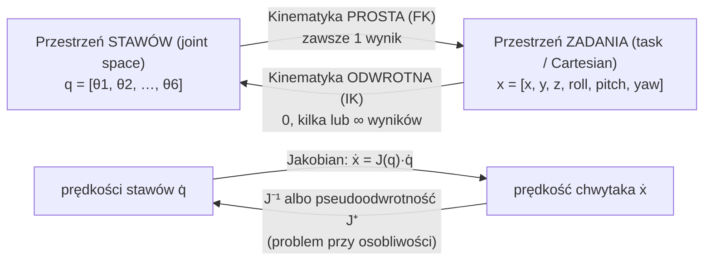

# 08 Manipulatory — kinematyka

> [!skrot] W 30 sekund
> - **Manipulator** = ramię robota: łańcuch **linków** połączonych **stawami** (obrotowymi lub liniowymi), na końcu **efektor** (chwytak).
> - **DOF (stopnie swobody):** ile niezależnych stawów. **6 DOF** wystarcza, żeby ustawić chwytak w dowolnej pozycji i orientacji (w zasięgu). **7 DOF** = **redundantny** (jak ludzka ręka — możesz ruszać łokciem, nie ruszając dłonią).
> - **Kinematyka prosta (FK):** znam kąty stawów → liczę, gdzie jest chwytak. **Zawsze jedno rozwiązanie, łatwe.**
> - **Kinematyka odwrotna (IK):** chcę chwytak tutaj → jakie kąty stawów? **Może być 0, kilka albo nieskończenie wiele rozwiązań. Trudne.**
> - **Jakobian $J$:** łączy prędkości stawów z prędkością chwytaka: $\dot{x}=J(q)\,\dot q$. **Osobliwość** = $J$ traci rząd → w jakimś kierunku nie da się ruszyć, a prędkości stawów „wybuchają”.

> [!intuicja] Po ludzku
> Twoja ręka: bark, łokieć, nadgarstek to stawy. **FK** — „mam zgięty łokieć o 90° i bark o 30°, gdzie jest dłoń?” — patrzysz i wiesz. **IK** — „chcę dotknąć nosa, jak zgiąć stawy?” — mózg musi to wyliczyć, i jest wiele sposobów (łokieć wyżej/niżej). **Osobliwość** — wyprostuj rękę całkowicie przed siebie: nie możesz już przesunąć dłoni **dalej** przed siebie, choćbyś bardzo szybko ruszał stawami. Robot w takim miejscu zwalnia, szarpie albo zgłasza błąd.

## Rodzaje stawów i ramion
| Staw | Ruch | Symbol |
|---|---|---|
| **Obrotowy (revolute, R)** | obrót o kąt $\theta$ | większość ramion: UR, Franka, xArm |
| **Liniowy / pryzmatyczny (prismatic, P)** | przesunięcie o $d$ | osie liniowe, gantry, SCARA (oś z) |

| Typ ramienia | Przykład | Cechy |
|---|---|---|
| **Przegubowe 6 DOF** | Universal Robots **UR3e/UR5e/UR10e**, UFactory **xArm6**, ABB, FANUC | standard przemysłowy, analityczna IK |
| **Przegubowe 7 DOF (redundantne)** | **Franka Research 3 / Panda**, **Kinova Gen3**, xArm7, KUKA LBR iiwa | omijanie przeszkód łokciem, popularne w badaniach |
| **SCARA** | Epson | szybki pick&place na płasko |
| **Kartezjański / gantry** | drukarki 3D, CNC | XYZ liniowo |
| **Tanie badawcze** | **SO-100 / SO-101** (LeRobot), Koch, **ViperX/WidowX** (ALOHA), **Trossen** | serwa Dynamixel/Feetech, leader–follower |
| **Cobot (collaborative)** | UR, Franka, Kinova | może pracować przy człowieku: ograniczenie siły i prędkości, wykrywanie kolizji |

> [!wazne] Parametry ramienia (z karty katalogowej)
> - **Udźwig (payload)** — np. UR5e: 5 kg; Franka: 3 kg. **Liczy się z chwytakiem!**
> - **Zasięg (reach)** — UR5e: 850 mm; Franka: 855 mm.
> - **Powtarzalność (repeatability)** — UR5e: ±0,03 mm (to nie to samo co **dokładność (accuracy)** — powtarzalność = trafia w to samo miejsce, dokładność = trafia tam, gdzie kazano).
> - **Liczba DOF**, **maks. prędkości stawów**, **zakresy stawów**.

## Przestrzeń stawów vs przestrzeń zadania

## FK i IK na przykładzie ramienia 2-stawowego (płaskiego)
Dwa linki o długościach $l_1, l_2$, kąty $\theta_1$ (od osi x) i $\theta_2$ (względem pierwszego linka).

> [!wzor] Kinematyka prosta
> $$x = l_1\cos\theta_1 + l_2\cos(\theta_1+\theta_2),\qquad y = l_1\sin\theta_1 + l_2\sin(\theta_1+\theta_2)$$

> [!wzor] Kinematyka odwrotna (z twierdzenia cosinusów)
> $$\cos\theta_2 = \frac{x^2+y^2-l_1^2-l_2^2}{2\,l_1 l_2}$$
> $$\theta_2 = \pm\arccos(\cdot)\quad(\text{dwa rozwiązania: „łokieć w górę” / „w dół”})$$
> $$\theta_1 = \operatorname{atan2}(y,x) - \operatorname{atan2}\!\big(l_2\sin\theta_2,\ l_1 + l_2\cos\theta_2\big)$$
> Jeśli $|\cos\theta_2|>1$ → punkt **poza zasięgiem**, brak rozwiązania.

**Przykład:** $l_1=l_2=1$, cel $(1, 1)$.
1. $\cos\theta_2 = \frac{1+1-1-1}{2}=0 \Rightarrow \theta_2=\pm 90°$.
2. Dla $\theta_2=+90°$: $\theta_1 = 45° - \operatorname{atan2}(1, 1) = 45°-45° = 0°$.
3. Sprawdzenie FK: $x=\cos 0 + \cos 90° = 1$, $y = \sin 0+\sin 90° = 1$ ✓. Drugie rozwiązanie: $\theta_1=90°, \theta_2=-90°$.

> [!definicja] Parametry Denavita–Hartenberga (DH)
> Standardowy sposób opisu łańcucha: każdy staw opisują 4 liczby: $\theta_i$ (obrót wokół z), $d_i$ (przesunięcie wzdłuż z), $a_i$ (długość wzdłuż x), $\alpha_i$ (skręt wokół x). FK całego ramienia = iloczyn macierzy: $T_{0n} = T_{01}\,T_{12}\cdots T_{(n-1)n}$. W ROS zamiast DH używa się URDF (`origin` + `axis`), ale idea ta sama.

## IK w praktyce
| Metoda | Jak | Przykład |
|---|---|---|
| **Analityczna** | gotowe wzory dla konkretnej geometrii | UR (do 8 rozwiązań), IKFast |
| **Numeryczna** | iteracyjnie poprawia $q$, używając Jakobianu: $\Delta q = J^{+}\,\Delta x$ (lub Levenberg–Marquardt / damped least squares) | **KDL**, **TRAC-IK**, pick_ik, BioIK (w MoveIt) |

Numeryczna może: nie zbiec się, dać inne rozwiązanie niż się spodziewasz (skok konfiguracji), zależy od punktu startowego.

## Osobliwości (singularities) — pewne pytanie
- **Definicja:** konfiguracja, w której Jakobian traci rząd ($\det J = 0$ dla kwadratowego $J$) → chwytak **traci możliwość ruchu w jakimś kierunku**, a do małego ruchu w pobliżu potrzeba **ogromnych prędkości stawów**.
- **Typowe dla 6-osiowych (np. UR):**
  1. **Nadgarstkowa (wrist)** — osie stawu 4 i 6 współliniowe (staw 5 ≈ 0°).
  2. **Łokciowa (elbow)** — ramię całkowicie wyprostowane (granica zasięgu).
  3. **Barkowa (shoulder)** — nadgarstek nad osią podstawy.
- **Objawy:** robot gwałtownie przyspiesza stawy, zwalnia, „przewraca” nadgarstek, zgłasza błąd; w teleop kartezjańskiej — szarpanie.
- **Jak unikać:** planować w przestrzeni stawów, trzymać się z dala (pozycja startowa z ugiętym łokciem i nadgarstkiem), damped least squares, robot 7 DOF.

## Ruchy i trajektorie
| Ruch | Co | Przykład w UR |
|---|---|---|
| **Joint move (PTP)** | wszystkie stawy jadą liniowo w przestrzeni stawów; chwytak po **krzywej** | `movej` |
| **Linear move** | chwytak po **prostej** w przestrzeni kartezjańskiej (IK co krok) | `movel` — może trafić w osobliwość |
| **Trajektoria** | ścieżka + **profil czasowy** (prędkości, przyspieszenia w limitach) | profil trapezowy, S-curve (ograniczony jerk) |

**Ścieżka (path)** = gdzie jechać (geometria). **Trajektoria (trajectory)** = ścieżka + **kiedy** (czas, prędkość).

## Typowe błędy
> [!blad] „IK zawsze ma jedno rozwiązanie”
> Nie: 0 (poza zasięgiem / kolizja z limitami), kilka (UR do 8), nieskończenie wiele (7 DOF).

> [!blad] Powtarzalność ≠ dokładność
> UR5e ma świetną powtarzalność (±0,03 mm), ale absolutna dokładność bez kalibracji jest gorsza (milimetry).

> [!blad] Payload bez chwytaka
> Chwytak 1 kg + obiekt 4,5 kg na UR5e (5 kg) = przeciążenie. Plus moment od środka masy daleko od kołnierza.

## Pytania rekrutacyjne
> [!zadanie] Czym się różni kinematyka prosta od odwrotnej?
> > [!odpowiedz]- Odpowiedź
> > FK: z kątów stawów liczysz pozę efektora — jedno rozwiązanie, mnożenie macierzy transformacji. IK: z zadanej pozy efektora szukasz kątów stawów — może nie być rozwiązań, może być kilka lub nieskończenie wiele; rozwiązuje się analitycznie lub numerycznie (Jakobian).
> > **EN:** *"Forward kinematics maps joint angles to the end-effector pose — it's unique and easy. Inverse kinematics goes the other way: given a desired pose, find joint angles. It may have no solution, several, or infinitely many for redundant arms, and it's solved analytically or numerically using the Jacobian."*

> [!zadanie] Co to jest osobliwość i jak się objawia?
> > [!odpowiedz]- Odpowiedź
> > Konfiguracja, w której Jakobian traci rząd — robot traci stopień swobody w przestrzeni kartezjańskiej, a prędkości stawów potrzebne do ruchu w pobliżu dążą do nieskończoności. Objawy: szarpanie, gwałtowne obroty nadgarstka, zatrzymanie z błędem. Przykład: nadgarstkowa w UR, gdy osie 4 i 6 są współliniowe; łokciowa przy wyprostowanym ramieniu.

> [!zadanie] Dlaczego niektóre ramiona mają 7 stopni swobody?
> > [!odpowiedz]- Odpowiedź
> > Redundancja: 6 DOF wystarcza na dowolną pozę, a siódmy daje dodatkową swobodę — można zmieniać konfigurację (np. ruch łokciem) przy tej samej pozie chwytaka, omijać przeszkody, osobliwości i limity stawów. Przykłady: Franka, Kinova Gen3, KUKA iiwa.

> [!zadanie] Co to jest Jakobian manipulatora?
> > [!odpowiedz]- Odpowiedź
> > Macierz pochodnych cząstkowych pozy efektora po kątach stawów; mapuje prędkości stawów na prędkość efektora ($\dot x = J\dot q$), a przez transpozycję siły na momenty ($\tau = J^T F$). Używany w IK numerycznej, sterowaniu prędkościowym i analizie osobliwości.

> [!zadanie] `movej` vs `movel`?
> > [!odpowiedz]- Odpowiedź
> > `movej` — interpolacja w przestrzeni stawów, chwytak po krzywej, bezpieczny wobec osobliwości, szybszy. `movel` — chwytak po prostej w przestrzeni kartezjańskiej, potrzebny np. przy podejściu do chwytu, ale może przejść przez osobliwość.

> [!zadanie] Co to jest workspace robota?
> > [!odpowiedz]- Odpowiedź
> > Zbiór punktów osiągalnych przez efektor. *Reachable* — osiągalne w jakiejkolwiek orientacji; *dexterous* — osiągalne w każdej orientacji. Ograniczają go długości linków, limity stawów i kolizje.

## Fiszki #fiszki/rozmowa-gd/kinematyka
Co to jest DOF manipulatora?::Liczba niezależnych stawów (stopni swobody).
Ile DOF potrzeba do dowolnej pozy w 3D?::6 (3 pozycji + 3 orientacji).
Co to jest manipulator redundantny?::Ma więcej DOF niż potrzeba do zadania (np. 7 DOF) — nieskończenie wiele rozwiązań IK.
Kinematyka prosta (FK)?::Kąty stawów → poza efektora; jedno rozwiązanie.
Kinematyka odwrotna (IK)?::Poza efektora → kąty stawów; 0, kilka lub ∞ rozwiązań.
Jakobian manipulatora — równanie?::ẋ = J(q)·q̇ (prędkości stawów → prędkość efektora); τ = Jᵀ F.
Co to jest osobliwość?::Konfiguracja, gdzie Jakobian traci rząd; utrata kierunku ruchu, prędkości stawów → ∞.
Osobliwość nadgarstkowa w UR?::Osie stawów 4 i 6 współliniowe (staw 5 ≈ 0).
Parametry DH?::θ, d, a, α — opis każdego stawu w łańcuchu kinematycznym.
Powtarzalność vs dokładność?::Powtarzalność: trafia w to samo miejsce; dokładność: trafia tam, gdzie zadano.
movej vs movel?::movej: interpolacja w stawach (krzywa); movel: prosta w przestrzeni kartezjańskiej.
Ścieżka vs trajektoria?::Ścieżka = geometria; trajektoria = ścieżka + czas (prędkości, przyspieszenia).
Solvery IK w MoveIt?::KDL (domyślny), TRAC-IK, pick_ik, BioIK, IKFast (analityczny).
Udźwig i zasięg UR5e?::5 kg, 850 mm.
Popularne ramiona 7 DOF w badaniach?::Franka (Panda/FR3), Kinova Gen3, KUKA LBR iiwa, xArm7.
FK ramienia 2R płaskiego?::x = l1 cosθ1 + l2 cos(θ1+θ2); y = l1 sinθ1 + l2 sin(θ1+θ2).

## Moje notatki
> [!ja] Tu piszesz ty — Albert tej sekcji nie rusza.
