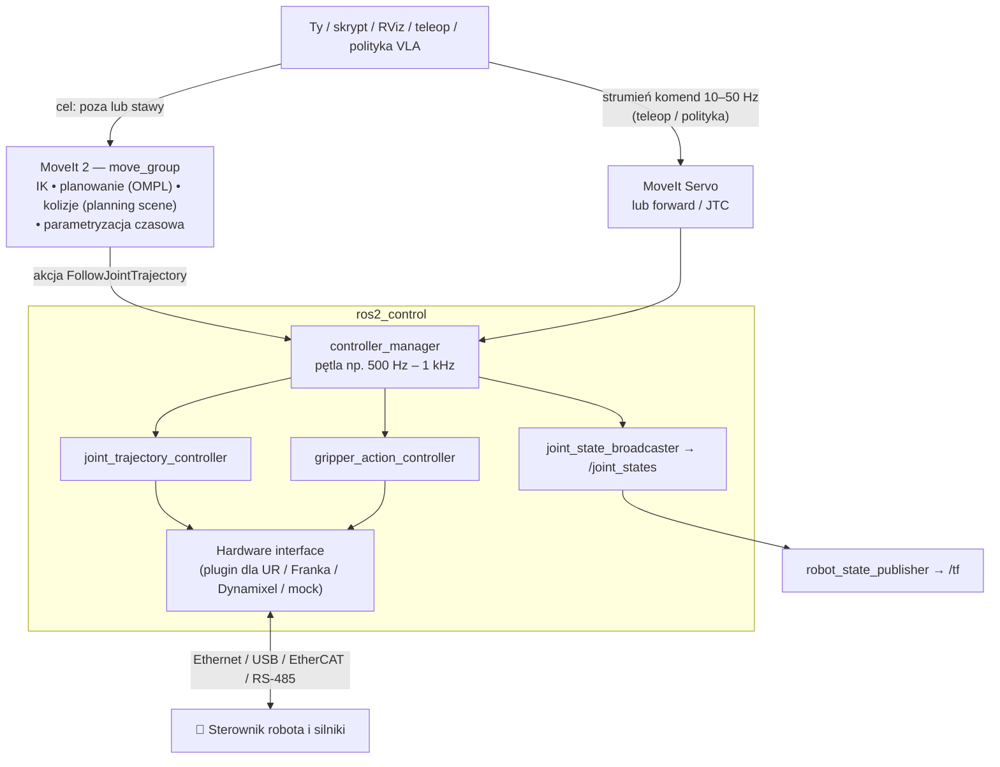
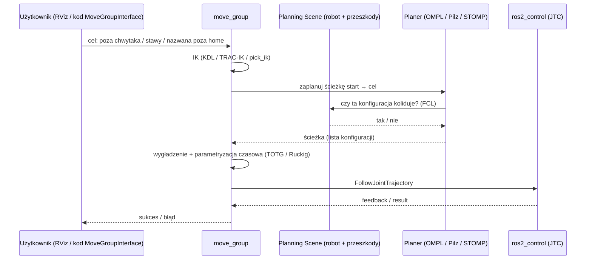

# 09 Sterowanie ramieniem, ros2_control i MoveIt

> [!skrot] W 30 sekund
> - **Tryby sterowania stawem:** **pozycyjny** (jedź na kąt), **prędkościowy** (kręć z prędkością), **momentowy / siłowy** (daj moment). Nad nimi: **impedancyjny** (zachowuj się jak sprężyna z tłumikiem — miękko przy kontakcie).
> - **ros2_control** = standardowa warstwa między ROS a sprzętem: **hardware interface** (rozmawia z robotem) + **controller manager** + **kontrolery** (np. `joint_trajectory_controller`, `joint_state_broadcaster`, kontroler chwytaka).
> - **MoveIt 2** = **planowanie ruchu**: IK, planowanie bezkolizyjnej ścieżki (np. **OMPL RRTConnect**), sprawdzanie kolizji ze sceną, wygładzenie w czasie, wysłanie trajektorii do kontrolera. **MoveIt Servo** — sterowanie w czasie rzeczywistym (np. teleoperacja z joysticka/VR).
> - **PID** — klasyczny regulator: $u = K_p e + K_i\int e + K_d \dot e$.

> [!intuicja] Po ludzku
> **MoveIt** to „nawigacja GPS” dla ramienia: mówisz „chwytak tam”, a on wyznacza trasę, która nie uderza w stół i kamerę. **ros2_control** to „kierowca”: dostaje trasę i pilnuje, żeby silniki ją wiernie wykonały (regulatory PID w pętli, setki razy na sekundę). **Hardware interface** to „sterownik pedałów” — tłumaczy polecenia na język konkretnego robota (UR, Franka, Dynamixel).

## Cała architektura



## Tryby sterowania
| Tryb | Interfejs w ros2_control | Kiedy | Uwaga |
|---|---|---|---|
| **Pozycyjny** | `position` | najczęściej (trajektorie, teleop leader–follower) | sztywny — przy kontakcie nie „ustępuje” |
| **Prędkościowy** | `velocity` | Servo, śledzenie celu | |
| **Momentowy (effort/torque)** | `effort` | sterowanie siłą, impedancja | wymaga dobrego modelu dynamiki; Franka 1 kHz |
| **Impedancyjny / compliance** | (sterownik w trybie momentu) | kontakt: wkładanie, wycieranie, chwytanie delikatnych rzeczy | robot zachowuje się jak sprężyna: $F = K(x_d - x) + D(\dot x_d-\dot x)$ |

> [!definicja] PID w jednej linijce
> Błąd $e = $ wartość zadana − zmierzona.
> $$u(t) = K_p\,e(t) + K_i\int_0^t e\,d\tau + K_d\,\frac{de}{dt}$$
> - **P** — reaguje na obecny błąd (za duże → oscylacje),
> - **I** — usuwa błąd ustalony (za duże → przeregulowanie, *windup*),
> - **D** — tłumi, reaguje na zmianę (wzmacnia szum).
> Znasz to z regulatora łodzi: [[Regulator od zera — 4. Dlaczego się buja]].

## ros2_control — co trzeba wiedzieć
| Element | Rola |
|---|---|
| **Hardware interface** (plugin `SystemInterface`, `ActuatorInterface`, `SensorInterface`) | `read()` stan ze sprzętu, `write()` komendy do sprzętu, w każdym cyklu |
| **controller_manager** | ładuje, uruchamia, przełącza kontrolery; pętla czasu rzeczywistego |
| **joint_state_broadcaster** | publikuje `/joint_states` z interfejsów stanu |
| **joint_trajectory_controller (JTC)** | wykonuje trajektorię (akcja `follow_joint_trajectory`), interpoluje między punktami |
| **forward_command_controller** | przekazuje komendę 1:1 (np. pozycje) — używane w prostym teleopie |
| **gripper_action_controller** | akcja `GripperCommand` |
| **mock_components/GenericSystem** | „udawany” sprzęt — testy bez robota |
```bash
ros2 control list_controllers            # jakie kontrolery i w jakim stanie (active/inactive)
ros2 control list_hardware_interfaces    # dostępne interfejsy (position/velocity/effort)
ros2 control switch_controllers --activate forward_position_controller --deactivate joint_trajectory_controller
```

## MoveIt 2 — jak planuje



| Pojęcie MoveIt | Co to |
|---|---|
| **move_group** | główny węzeł MoveIt |
| **Planning group** | zestaw stawów do planowania, np. `arm`, `gripper` (z SRDF) |
| **Planning scene** | model świata: robot + przeszkody (stół, kamera, ściana); źródło: ręcznie dodane bryły lub **octomap** z kamery głębi |
| **OMPL** | biblioteka planerów próbkujących: **RRT**, **RRTConnect** (domyślny), PRM |
| **Pilz Industrial Motion Planner** | przewidywalne ruchy PTP, LIN, CIRC (jak w robotach przemysłowych) |
| **CHOMP / STOMP** | planery optymalizacyjne (gładkie trajektorie) |
| **Time parameterization** | nadanie czasu punktom ścieżki w limitach prędkości/przyspieszeń |
| **MoveIt Setup Assistant** | GUI do stworzenia konfiguracji (SRDF, grupy, pozy) z URDF |
| **MoveIt Servo** | sterowanie w czasie rzeczywistym komendą prędkości kartezjańskiej/stawowej — **teleoperacja**, z hamowaniem przy osobliwościach i kolizjach |

> [!definicja] RRT w 3 zdaniach
> Rapidly-exploring Random Tree: losuj punkt w przestrzeni konfiguracji, znajdź najbliższy węzeł drzewa, zrób mały krok w jego stronę, jeśli bez kolizji — dodaj. **RRTConnect** rośnie z dwóch stron (start i cel) i łączy drzewa. Szybkie, ale ścieżki są „poszarpane” i nieoptymalne → potem wygładzanie.

## Popularne ramiona — jak się z nimi łączy
| Robot | Połączenie z PC | Driver ROS 2 | Ciekawostka |
|---|---|---|---|
| **Universal Robots (UR3e/5e/10e)** | Ethernet, **statyczne IP**; na teach pendancie program z URCap **External Control** (lub tryb headless) | `ur_robot_driver` (`ur_control.launch.py ur_type:=ur5e robot_ip:=192.168.1.102`) | Teach pendant, *protective stop*, *remote control mode* |
| **Franka (Panda / FR3)** | Ethernet do sterownika, **FCI** 1 kHz | `franka_ros2` / libfranka | Wymaga **jądra real-time (PREEMPT_RT)**; Desk w przeglądarce do odblokowania hamulców |
| **Kinova Gen3** | Ethernet | `ros2_kortex` | 7 DOF, web app |
| **UFactory xArm** | Ethernet | `xarm_ros2` | tańszy, popularny w labach |
| **SO-100/101, Koch, ViperX** | **USB → adapter szeregowy** do serw (Dynamixel / Feetech, magistrala TTL/RS-485) | LeRobot / `dynamixel_sdk` / Interbotix | serwa mają ID, baudrate; kalibracja zakresów |

## Typowe błędy
> [!blad] Kontroler „inactive”
> Driver wstał, ale robot nie reaguje na trajektorię → `ros2 control list_controllers`; kontroler może być nieaktywny albo aktywny jest inny (konflikt zasobów).

> [!blad] UR: „robot nie słucha komend z PC”
> Na pendancie nie uruchomiony program **External Control** / robot nie w trybie Remote, złe IP hosta w URCap, firewall blokuje porty (50001–50004), robot w protective stop.

> [!blad] Planowanie się nie udaje
> Cel poza zasięgiem / w kolizji (np. stół w planning scene za wysoko), brak rozwiązania IK, za mało czasu planowania, start w kolizji.

## Pytania rekrutacyjne
> [!zadanie] Czym jest MoveIt i jak planuje ruch?
> > [!odpowiedz]- Odpowiedź
> > Framework do planowania ruchu manipulatorów w ROS. Dostaje cel (pozę lub stawy), liczy IK, planerem (domyślnie OMPL RRTConnect) szuka bezkolizyjnej ścieżki w planning scene, wygładza ją i parametryzuje w czasie, a potem wysyła akcją FollowJointTrajectory do kontrolera w ros2_control.
> > **EN:** *"MoveIt is the motion planning framework for ROS. Given a goal pose, it solves IK, uses a sampling-based planner like RRTConnect from OMPL to find a collision-free path in the planning scene, time-parameterizes it, and sends it to the joint trajectory controller."*

> [!zadanie] Co to jest ros2_control?
> > [!odpowiedz]- Odpowiedź
> > Framework sterowania w ROS 2: hardware interface (plugin czytający stan i wysyłający komendy do sprzętu), controller manager (pętla czasu rzeczywistego, ładowanie i przełączanie kontrolerów) i kontrolery (np. joint_trajectory_controller, joint_state_broadcaster, gripper_action_controller). Dzięki temu ten sam kod wyżej działa z różnymi robotami i z symulacją.

> [!zadanie] Sterowanie pozycyjne vs impedancyjne?
> > [!odpowiedz]- Odpowiedź
> > Pozycyjne: robot sztywno trzyma zadaną pozycję — przy kontakcie generuje duże siły. Impedancyjne: robot zachowuje się jak sprężyna z tłumikiem wokół pozycji zadanej — ustępuje przy kontakcie, siła proporcjonalna do odchyłki; lepsze do zadań kontaktowych i bezpieczniejsze przy człowieku.

> [!zadanie] Jak działa regulator PID i co robi każdy człon?
> > [!odpowiedz]- Odpowiedź
> > Liczy sterowanie z błędu: P proporcjonalnie do błędu (szybkość, za duże → oscylacje), I całkuje błąd (usuwa uchyb ustalony, ryzyko windup), D reaguje na szybkość zmian błędu (tłumienie, wrażliwe na szum).

> [!zadanie] Jak podłączyłbyś UR5e do ROS 2?
> > [!odpowiedz]- Odpowiedź
> > Kabel Ethernet, statyczne IP robota i PC w tej samej podsieci (np. 192.168.1.102 i 192.168.1.101), ping. Na pendancie zainstalowany URCap External Control z IP PC. Na PC `ros2 launch ur_robot_driver ur_control.launch.py ur_type:=ur5e robot_ip:=192.168.1.102`, start programu External Control na pendancie, sprawdzenie `/joint_states` i kontrolerów, potem MoveIt.

## Fiszki #fiszki/rozmowa-gd/sterowanie
Trzy podstawowe tryby sterowania stawem?::Pozycyjny, prędkościowy, momentowy (effort).
Sterowanie impedancyjne — idea?::Robot zachowuje się jak sprężyna z tłumikiem: F = K(x_d − x) + D(ẋ_d − ẋ).
Wzór PID?::u = Kp·e + Ki·∫e dt + Kd·de/dt.
Co robi człon I w PID?::Usuwa uchyb ustalony; za duży powoduje przeregulowanie i windup.
Elementy ros2_control?::Hardware interface, controller_manager, kontrolery (JTC, joint_state_broadcaster, gripper).
Co publikuje joint_state_broadcaster?::/joint_states z interfejsów stanu sprzętu.
Akcja, którą MoveIt wysyła do kontrolera?::control_msgs/action/FollowJointTrajectory.
Domyślny planer MoveIt?::OMPL RRTConnect.
Co to jest planning scene?::Model świata dla MoveIt: robot + przeszkody (bryły, octomap) do sprawdzania kolizji.
Co to jest MoveIt Servo?::Sterowanie ramieniem w czasie rzeczywistym komendami prędkości (teleop), z ochroną przed osobliwościami i kolizjami.
Planer Pilz — do czego?::Przewidywalne ruchy przemysłowe PTP, LIN, CIRC.
RRT — idea?::Losowe próbkowanie przestrzeni konfiguracji i rozbudowa drzewa bezkolizyjnych kroków od startu (RRTConnect: z obu końców).
Komenda: lista kontrolerów ros2_control?::ros2 control list_controllers
UR — co musi działać na pendancie, żeby sterować z ROS?::Program z URCap External Control (lub tryb headless), robot w remote control.
Franka — szczególne wymaganie PC?::Jądro real-time (PREEMPT_RT), FCI 1 kHz.
Czym łączy się tanie ramiona z serwami Dynamixel/Feetech?::USB → adapter szeregowy (TTL / RS-485), serwa na magistrali z ID i baudrate.

## Moje notatki
> [!ja] Tu piszesz ty — Albert tej sekcji nie rusza.
