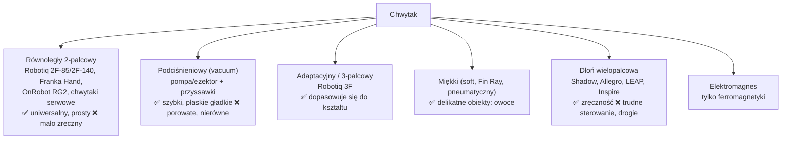

# 10 Chwytaki i czujniki siły

> [!skrot] W 30 sekund
> - **End-effector (efektor)** = to, co jest na końcu ramienia. Najczęściej **chwytak (gripper)**.
> - **Rodzaje:** **równoległy dwupalcowy** (parallel jaw — najpopularniejszy, np. **Robotiq 2F-85**, chwytak Franka), **podciśnieniowy (vacuum/suction)**, **adaptacyjny/trójpalcowy**, **miękki (soft)**, **elektromagnetyczny**, **dłoń wielopalcowa (dexterous hand)**.
> - **TCP (Tool Center Point)** — punkt „roboczy” narzędzia (np. między opuszkami palców). Musi być poprawnie ustawiony w konfiguracji robota/URDF, inaczej robot chwyta obok.
> - **Czujnik siły/momentu (F/T, 6-osiowy)** — mierzy 3 siły + 3 momenty na nadgarstku (np. ATI, Robotiq FT 300, wbudowany w UR e-Series). Do kontaktu, wykrywania chwytu i bezpieczeństwa.

> [!intuicja] Po ludzku
> Chwytak równoległy to szczypce z dwoma płaskimi palcami — proste, niezawodne, do 90% zadań. Przyssawka to odkurzacz — świetna do płaskich gładkich rzeczy (karton, szkło), bezużyteczna przy siatce czy gąbce. **TCP** to „czubek długopisu” — robot musi wiedzieć, gdzie jest czubek, a nie tylko gdzie trzyma długopis.

## Typy chwytaków

## Napędy chwytaków
| Napęd | Jak | Plus | Minus |
|---|---|---|---|
| **Elektryczny** (silnik + przekładnia) | sterowana pozycja, prędkość, **siła** | precyzyjny, programowalny | wolniejszy, droższy |
| **Pneumatyczny** | sprężone powietrze + zawór | szybki, silny, tani | tylko otwarty/zamknięty, kompresor, hałas |
| **Serwo hobbystyczne / Dynamixel** | silnik w module z enkoderem | tani, w zestawach badawczych | mniejsza siła, przegrzewanie przy ciągłym docisku |

## Ważne parametry i pojęcia
| Pojęcie | Znaczenie |
|---|---|
| **Stroke (skok)** | maks. rozwarcie palców (2F-85: 85 mm) |
| **Grip force** | siła chwytu (2F-85: 20–235 N) |
| **Payload chwytaka** | ile może bezpiecznie trzymać (zależy od tarcia, kształtu) |
| **Object detection** | chwytak elektryczny raportuje, że palce zatrzymały się na obiekcie (a nie zamknęły do końca) → **wiemy, czy chwycił** |
| **Fingertips / pady** | wymienne opuszki (guma, silikon, druk 3D) — zużywają się, wpływają na chwyt |
| **Tarcie** | chwyt trzyma dzięki tarciu: $F_{tarcia} \le \mu\, F_{chwytu}$; dla dwóch palców trzymających ciężar: $2\mu F \ge m g$ |
| **Kołnierz ISO 9409-1** | standardowe mocowanie narzędzia na kołnierzu robota (otwory, średnica) |
| **Tool changer** | szybkozłącze do zmiany narzędzi |
| **Komunikacja** | Robotiq: Modbus RTU po RS-485 (USB adapter) lub przez robota (Tool I/O, URCap); Franka Hand przez sterownik Franki |

> [!przyklad] Ile siły chwytu potrzeba?
> Kubek 0,3 kg, gumowe pady $\mu = 0{,}5$, dwa palce. Warunek: $2\mu F \ge m g \Rightarrow F \ge \frac{0{,}3 \cdot 9{,}81}{2\cdot 0{,}5} \approx 2{,}9$ N. Z zapasem bezpieczeństwa ×2–3 i przyspieszeniami ruchu → ~10 N. Za mocny chwyt = zgnieciony plastikowy kubek.

## Czujniki siły i dotyku
| Czujnik | Co daje |
|---|---|
| **F/T 6-osiowy na nadgarstku** (ATI Mini45, Robotiq FT 300, OnRobot HEX) | siły $F_x, F_y, F_z$ i momenty $T_x, T_y, T_z$ — wiadomość `geometry_msgs/WrenchStamped` |
| **Estymacja z momentów w stawach** | Franka, KUKA iiwa (czujniki momentu w każdym stawie), UR e-Series (wbudowany F/T) |
| **Czujniki dotykowe (tactile)** | GelSight / DIGIT (kamera pod żelem — widzi odcisk), czujniki rezystancyjne/pojemnościowe w opuszkach |
| **Prąd silnika chwytaka** | przybliżona siła chwytu |

> [!wazne] Zerowanie (bias / tare) czujnika F/T
> Czujnik dryfuje z temperaturą i widzi ciężar chwytaka. Przed pomiarem robi się **zerowanie** (tare) w znanej pozycji bez kontaktu. W logu zapisuj, kiedy.

## Utrzymanie chwytaka (to będziesz robić!)
- Sprawdź **luz** i dokręcenie śrub mocowania do kołnierza (wibracje luzują śruby).
- Stan **padów/opuszków** — starte = ślizganie, wymiana i wpis do logu.
- **Kabel** chwytaka przy nadgarstku — przy obrotach się skręca i przeciera (zostaw luz, prowadź wzdłuż ramienia, opaski).
- Test: pełne otwarcie/zamknięcie, czy raportuje pozycję, czy nie ma błędu komunikacji.
- Po wymianie palców/chwytaka: **zaktualizuj TCP** i ew. URDF (długość), kalibracja.
- Pneumatyka: ciśnienie, nieszczelności (syczenie), filtr.

## Typowe błędy
> [!blad] Zły TCP / payload w konfiguracji
> Robot źle liczy pozę narzędzia (chwyta obok) i źle kompensuje ciężar → fałszywe protective stopy albo dryf w trybie freedrive. Po każdej zmianie narzędzia: TCP + masa + środek masy.

> [!blad] Przegrzane serwo chwytaka
> W tanich chwytakach ciągłe ściskanie z max siłą przegrzewa serwo (Dynamixel zgłasza *overload* / *overheating* i się wyłącza). Ogranicz siłę/prąd.

## Pytania rekrutacyjne
> [!zadanie] Jakie znasz typy chwytaków i kiedy którego użyć?
> > [!odpowiedz]- Odpowiedź
> > Równoległy dwupalcowy — uniwersalny, większość zadań pick-and-place. Podciśnieniowy — płaskie, gładkie, nieporowate przedmioty (kartony, szkło). Adaptacyjny/miękki — nieregularne lub delikatne obiekty. Dłoń wielopalcowa — zręczna manipulacja w ręce. Elektromagnes — elementy stalowe.
> > **EN:** *"A parallel-jaw gripper covers most pick-and-place tasks; suction is great for flat, smooth, non-porous objects; soft or adaptive grippers handle fragile or irregular items; dexterous hands for in-hand manipulation."*

> [!zadanie] Co to jest TCP i dlaczego jest ważny?
> > [!odpowiedz]- Odpowiedź
> > Tool Center Point — punkt roboczy narzędzia względem kołnierza. Robot liczy ruchy kartezjańskie i IK dla TCP; zły TCP oznacza, że chwytak trafia obok celu i obraca się wokół złego punktu. Po zmianie narzędzia trzeba go zaktualizować (oraz masę/środek masy).

> [!zadanie] Skąd robot wie, że coś chwycił?
> > [!odpowiedz]- Odpowiedź
> > Chwytak elektryczny raportuje, że palce zatrzymały się przed pełnym zamknięciem (object detected) i pozycję palców; można też użyć prądu silnika, czujnika siły na nadgarstku (zmiana ciężaru), czujników dotykowych lub kamery na nadgarstku. Przyssawka — czujnik podciśnienia.

> [!zadanie] Do czego służy czujnik F/T i co trzeba zrobić przed użyciem?
> > [!odpowiedz]- Odpowiedź
> > Mierzy 3 siły i 3 momenty na nadgarstku: wykrywanie kontaktu i kolizji, sterowanie siłą/impedancją, ważenie obiektu, dane do uczenia. Przed użyciem zerowanie (bias/tare) bez kontaktu, bo dryfuje i widzi ciężar narzędzia.

## Fiszki #fiszki/rozmowa-gd/chwytaki
Co to jest TCP?::Tool Center Point — punkt roboczy narzędzia (np. między palcami) względem kołnierza.
Najpopularniejszy typ chwytaka?::Równoległy dwupalcowy (parallel jaw), np. Robotiq 2F-85.
Skok i siła Robotiq 2F-85?::Skok 85 mm, siła ok. 20–235 N.
Kiedy chwytak podciśnieniowy?::Płaskie, gładkie, nieporowate obiekty.
Warunek utrzymania obiektu dwoma palcami (tarcie)?::2·μ·F ≥ m·g (z zapasem bezpieczeństwa).
Co mierzy czujnik F/T 6-osiowy?::Fx, Fy, Fz oraz momenty Tx, Ty, Tz (WrenchStamped).
Po co tare/bias czujnika F/T?::Usunąć dryf i ciężar narzędzia przed pomiarem.
Standard mocowania narzędzia do kołnierza?::ISO 9409-1.
Jak Robotiq komunikuje się z PC?::Modbus RTU po RS-485 (adapter USB) albo przez robota (Tool I/O, URCap).
Co zrobić po wymianie chwytaka/palców?::Zaktualizować TCP, masę i środek masy, URDF; sprawdzić kalibrację i zapisać w logu.
GelSight / DIGIT?::Czujniki dotykowe: kamera pod elastycznym żelem obrazuje odcisk kontaktu.

## Moje notatki
> [!ja] Tu piszesz ty — Albert tej sekcji nie rusza.
