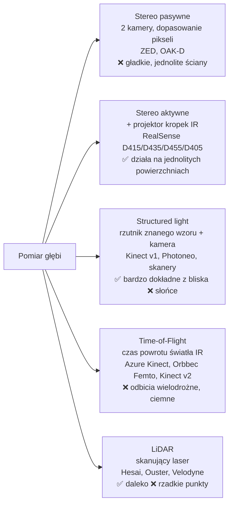

# 11 Kamery i sensory głębi

> [!skrot] W 30 sekund
> - **Model kamery otworkowej (pinhole):** punkt 3D $(X,Y,Z)$ trafia na piksel $u = f_x\frac{X}{Z}+c_x,\ v = f_y\frac{Y}{Z}+c_y$. Parametry $f_x, f_y, c_x, c_y$ to **intrinsics** (macierz $K$) + współczynniki **dystorsji**. Gdzie kamera stoi w świecie — **extrinsics** ($R, t$).
> - **Głębia (depth)** — 3 technologie: **stereo** (dwie kamery, jak oczy; RealSense D4xx, ZED), **structured light** (rzutnik wzoru), **Time-of-Flight** (mierzy czas lotu światła; Azure Kinect, Orbbec Femto).
> - **Stereo:** $Z = \frac{f\,B}{d}$ ($B$ — baza między kamerami, $d$ — dysparycja w pikselach). **Błąd głębi rośnie z kwadratem odległości.**
> - **Głębia się psuje** na powierzchniach **błyszczących, przezroczystych, czarnych**, w słońcu (IR) i **bliżej niż minimalny zasięg**.
> - **Praktyka:** USB 3, dobre kable, numer seryjny zamiast `/dev/videoX`, stała ekspozycja i balans bieli, kontrola FPS i zgubionych klatek.

> [!intuicja] Po ludzku
> Zamknij jedno oko i trzymaj palec przed nosem, potem przełącz oko — palec „skacze” bardzo. Daleki budynek prawie nie skacze. To jest **dysparycja**: im bliżej, tym większy skok, i tak kamera stereo liczy odległość. Dlatego dla dalekich rzeczy pomiar jest niedokładny (mały skok = łatwo się pomylić o piksel). Lustro czy szkło „oszukują” oczy tak samo jak kamerę.

## Model kamery i intrinsics

> [!definicja] Macierz intrinsics $K$
> $$K=\begin{bmatrix} f_x & 0 & c_x\\ 0 & f_y & c_y\\ 0&0&1\end{bmatrix},\qquad s\begin{bmatrix}u\\v\\1\end{bmatrix} = K\,[R\,|\,t]\begin{bmatrix}X\\Y\\Z\\1\end{bmatrix}$$
> - $f_x, f_y$ — ogniskowa w **pikselach**, $c_x, c_y$ — punkt główny (≈ środek obrazu).
> - **Dystorsja:** radialna $k_1,k_2,k_3$ (beczka/poduszka — proste linie się wyginają), tangencjalna $p_1, p_2$ (soczewka krzywo względem matrycy). Model *plumb_bob* w ROS.
> - W ROS to wszystko jest w `sensor_msgs/CameraInfo` (pola `K`, `D`, `R`, `P`) na topicu `.../camera_info`.

> [!wzor] Z piksela i głębi do punktu 3D (deprojekcja)
> $$X = \frac{(u-c_x)\,Z}{f_x},\qquad Y=\frac{(v-c_y)\,Z}{f_y},\qquad Z = \text{depth}(u,v)$$
> Tak powstaje **chmura punktów** z obrazu głębi. Wynik jest w **ramce optycznej** kamery (z do przodu).

**Przykład:** $f_x=f_y=600$, $c_x=320$, $c_y=240$. Piksel $(420, 240)$, głębia 0,6 m → $X=\frac{100\cdot0{,}6}{600}=0{,}1$ m, $Y=0$, $Z=0{,}6$ m. Obiekt 10 cm w prawo od osi kamery, 60 cm przed nią.

## Technologie głębi



| Kamera | Typ | Cechy (orientacyjnie) |
|---|---|---|
| **Intel RealSense D435 / D435i** | aktywne stereo, globalna migawka dla głębi | szerokie FOV, min. zasięg ~0,2–0,3 m, `i` = z IMU; bardzo popularna w labach |
| **RealSense D405** | stereo krótkiego zasięgu | **7 cm – 50 cm**, idealna jako **kamera na nadgarstku** |
| **RealSense D455** | aktywne stereo, większa baza (95 mm) | lepsza głębia dalej |
| **ZED 2 / ZED X / ZED Mini** (Stereolabs) | stereo pasywne + GPU (CUDA) | znasz z łodzi: [[Sensory i sprzęt]] |
| **Orbbec Femto / Gemini** | ToF / stereo | zamienniki Azure Kinect (wycofany 2023) |
| **Zwykła kamera USB (UVC)** | tylko RGB | Logitech itp., często jako kamera sceny |

## Parametry obrazu, które musisz rozumieć
| Parametr | Co to | Dlaczego ważne przy danych |
|---|---|---|
| **Rozdzielczość, FPS** | np. 640×480 @ 30 | spójne w całym datasecie |
| **Ekspozycja (exposure)** | czas naświetlania | **auto-ekspozycja** zmienia jasność między epizodami; długa = rozmycie ruchu |
| **Gain / ISO** | wzmocnienie | szum |
| **Balans bieli (white balance)** | temperatura barw | auto → kolory „pływają” |
| **Rolling vs global shutter** | migawka linia po linii vs cała klatka naraz | rolling: zniekształcenie szybko ruszających się obiektów (ramię!) |
| **Format** | MJPEG (skompresowany) vs YUYV (surowy) | YUYV zjada więcej łącza USB |
| **FOV** | kąt widzenia | szeroki = dystorsja |
| **Głębia wyrównana do koloru** (*aligned depth*) | piksel głębi odpowiada pikselowi koloru | inaczej przesunięcie między RGB i D |

> [!wazne] Przepustowość USB
> USB 3.x Gen 1 = **5 Gb/s** na kontroler (praktycznie mniej). Kilka kamer z głębią na **jednym kontrolerze / hubie** = zgubione klatki. Kolejne kroki: porty **USB 3** (niebieskie / SS), krótki dobry kabel (długi aktywny lub światłowodowy), osobne kontrolery, hub z zasilaniem, niższa rozdzielczość/FPS, MJPEG. Sprawdzenie: `lsusb -t` (prędkość `5000M` = USB 3, `480M` = USB 2 — **zły kabel/port!**).

## Komendy (Linux)
```bash
lsusb                              # czy kamera jest widoczna (np. "Intel Corp. RealSense")
lsusb -t                           # drzewo USB i prędkości (480M vs 5000M)
dmesg -w                           # podłącz kamerę i patrz na komunikaty jądra na żywo
v4l2-ctl --list-devices            # które /dev/videoN należą do której kamery
v4l2-ctl -d /dev/video0 --list-formats-ext    # obsługiwane formaty, rozdzielczości, FPS
v4l2-ctl -d /dev/video0 -c auto_exposure=1 -c exposure_time_absolute=150   # ręczna ekspozycja
rs-enumerate-devices               # RealSense: numery seryjne, firmware
realsense-viewer                   # GUI RealSense: podgląd, ustawienia, aktualizacja firmware
ros2 launch realsense2_camera rs_launch.py serial_no:="'123456789012'" camera_name:=wrist align_depth.enable:=true
ros2 run rqt_image_view rqt_image_view   # podgląd obrazu z topicu
```

> [!blad] `/dev/video0` zmienia się po restarcie
> Numer urządzenia zależy od kolejności wykrycia. Dwie kamery mogą się **zamienić** (kamera nadgarstka nagrywa się jako sceniczna — dataset zepsuty!). Rozwiązanie: identyfikacja po **numerze seryjnym** (parametr drivera) albo **reguła udev** tworząca stałą nazwę (`/dev/cam_wrist`) — patrz [[15 Linux i wiersz poleceń]].

## Typowe problemy z głębią
| Problem | Przyczyna | Co robić |
|---|---|---|
| Dziury (zera) w głębi | błyszczące, przezroczyste, czarne powierzchnie; za blisko; cienie | matowe obiekty, zmiana kąta, filtry (hole filling), uwzględnić w protokole |
| Szum dalej od kamery | błąd stereo ∝ $Z^2$ | bliżej, kamera z większą bazą |
| „Latające piksele” na krawędziach | mieszanie tła i obiektu | filtry krawędzi / spatial filter |
| Interferencja | dwie kamery IR na siebie świecą, słońce | zwykle stereo aktywne znosi; ToF gorzej; zasłony |
| RGB i głębia nie pasują | brak wyrównania | `align_depth` |

## Synchronizacja wielu kamer
- **Programowa:** znaczniki czasu + dopasowanie najbliższych (ROS: `message_filters` ApproximateTimeSynchronizer).
- **Sprzętowa:** kabel synchronizacji (RealSense *inter-cam sync*, tryby master/slave) — klatki naświetlane jednocześnie.
- **Zegary między komputerami:** NTP / chrony; dla dokładności PTP.

## Pytania rekrutacyjne
> [!zadanie] Jak działa kamera głębi stereo? Od czego zależy dokładność?
> > [!odpowiedz]- Odpowiedź
> > Dwie kamery w znanej odległości (baza) widzą scenę; dla każdego piksela szuka się odpowiednika w drugim obrazie, różnica pozycji to dysparycja; $Z = fB/d$. Dokładność spada z kwadratem odległości, rośnie z bazą i rozdzielczością. Aktywne stereo dodaje projektor wzoru IR, żeby działało na jednolitych powierzchniach.
> > **EN:** *"Two cameras with a known baseline observe the scene; for each pixel we find the match in the other image, and depth equals focal length times baseline over disparity. Depth error grows quadratically with distance. Active stereo like RealSense adds an IR dot projector so it also works on textureless surfaces."*

> [!zadanie] Co to są intrinsics i extrinsics?
> > [!odpowiedz]- Odpowiedź
> > Intrinsics — parametry wewnętrzne: ogniskowe $f_x, f_y$, punkt główny $c_x, c_y$ i dystorsja; mówią, jak punkt 3D w układzie kamery trafia na piksel. Extrinsics — poza kamery (R, t) względem innego układu (świata, bazy robota, drugiej kamery).

> [!zadanie] Na jakich obiektach kamery głębi zawodzą?
> > [!odpowiedz]- Odpowiedź
> > Przezroczystych (szkło, folia), lustrzanych/błyszczących (metal), bardzo ciemnych pochłaniających IR, cienkich (druty), jednolitych bez tekstury (pasywne stereo), w silnym słońcu, bliżej niż min. zasięg.

> [!zadanie] Kamera gubi klatki. Co sprawdzisz?
> > [!odpowiedz]- Odpowiedź
> > `ros2 topic hz` i logi drivera; `lsusb -t` — czy jest na USB 3 (5000M), czy nie dzieli kontrolera z inną kamerą; kabel i port (wymiana na krótki/certyfikowany); obciążenie CPU (`htop`) i dysku; rozdzielczość/FPS/format (MJPEG); auto-ekspozycja w słabym świetle obniża FPS; firmware; zasilanie (hub z zasilaniem).

> [!zadanie] Dlaczego warto wyłączyć auto-ekspozycję i auto-balans bieli przy zbieraniu danych?
> > [!odpowiedz]- Odpowiedź
> > Żeby wygląd sceny był spójny między klatkami i epizodami — automatyka zmienia jasność i kolory w zależności od tego, co jest w kadrze (np. ramię zasłania jasne tło), co wprowadza do danych zmienność niezwiązaną z zadaniem. Długa auto-ekspozycja w słabym świetle dodatkowo rozmywa ruch i obniża FPS.

## Fiszki #fiszki/rozmowa-gd/kamery
Model pinhole — rzut punktu na piksel?::u = fx·X/Z + cx, v = fy·Y/Z + cy.
Co zawiera macierz K?::fx, fy (ogniskowe w pikselach), cx, cy (punkt główny).
Intrinsics vs extrinsics?::Intrinsics: K + dystorsja (wewnętrzne). Extrinsics: R, t kamery względem innego układu.
Wzór na głębię w stereo?::Z = f·B / d (ogniskowa × baza / dysparycja).
Jak błąd głębi stereo zależy od odległości?::Rośnie z kwadratem odległości (∝ Z²).
Deprojekcja piksela do 3D?::X = (u−cx)Z/fx, Y = (v−cy)Z/fy, Z = głębia.
Trzy technologie kamer głębi?::Stereo (pasywne/aktywne), structured light, Time-of-Flight.
Kamera RealSense do pracy z bliska (nadgarstek)?::D405 (ok. 7–50 cm).
Gdzie w ROS są intrinsics kamery?::sensor_msgs/CameraInfo na topicu camera_info (K, D, R, P).
Na czym zawodzą kamery głębi?::Przezroczyste, lustrzane, ciemne, cienkie obiekty; słońce; poniżej min. zasięgu.
Rolling vs global shutter?::Rolling: linia po linii (zniekształca ruch); global: cała klatka naraz.
Jak sprawdzić, czy kamera działa jako USB 3?::lsusb -t — prędkość 5000M (USB 3) vs 480M (USB 2).
Komenda: lista kamer V4L2 i ich /dev/video?::v4l2-ctl --list-devices
Jak trwale rozróżnić dwie identyczne kamery?::Po numerze seryjnym (parametr drivera) lub regułą udev ze stałą nazwą.
Dlaczego wyłączać auto-ekspozycję przy zbieraniu danych?::Spójny wygląd między epizodami; brak zmian jasności i spadków FPS.
Synchronizacja obrazów w ROS?::message_filters (ApproximateTime/ExactTime), sprzętowo kablem sync.

## Moje notatki
> [!ja] Tu piszesz ty — Albert tej sekcji nie rusza.
