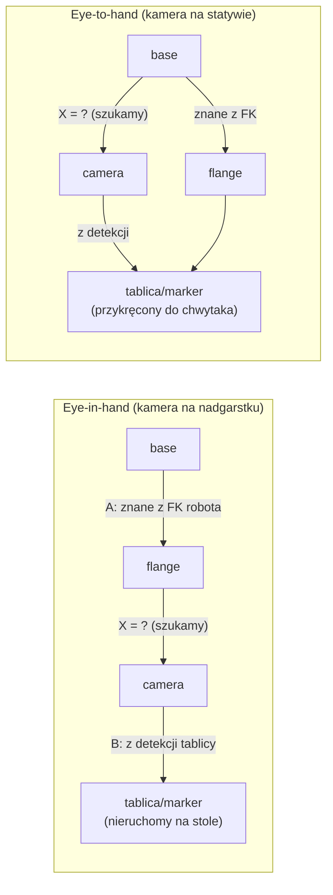

# 12 Kalibracja kamer i hand-eye

> [!skrot] W 30 sekund
> - **Kalibracja wewnętrzna (intrinsic):** fotografujesz **szachownicę / tablicę ChArUco** w 20–50 różnych pozycjach → OpenCV liczy $K$ i dystorsję. Jakość: **błąd reprojekcji** (RMS) — dobrze **< 0,5 px**.
> - **Kalibracja zewnętrzna (extrinsic) / hand-eye:** gdzie jest kamera względem robota. Równanie **$AX = XB$**. Dwa warianty: **eye-in-hand** (kamera na nadgarstku → szukasz *kołnierz→kamera*) i **eye-to-hand** (kamera na statywie → szukasz *baza→kamera*).
> - **Weryfikacja:** dotknij TCP punktu wskazanego kamerą / nałóż model robota na obraz i sprawdź, czy się pokrywa.
> - **Kiedy ponownie:** po **każdym** poruszeniu kamery, zmianie mocowania, wymianie obiektywu/kamery, okresowo wg procedury. **Każda kalibracja = nowa wersja w logu.**

> [!intuicja] Po ludzku
> Intrinsics to „wada wzroku” kamery — jak okulary: mierzysz raz, dopóki nie zmienisz obiektywu/rozdzielczości. Extrinsics to „gdzie stoisz” — wystarczy, że ktoś trąci statyw łokciem, i już wszystko jest źle. Hand-eye to jak nauczenie się, gdzie masz oczy względem ręki: patrzysz na ten sam przedmiot z kilku pozycji ręki i z tego wyliczasz, jak kamera jest zamocowana.

## Kalibracja wewnętrzna — krok po kroku
1. **Tablica:** szachownica (np. 9×6 **wewnętrznych narożników**, kwadrat 25 mm) albo **ChArUco** (szachownica z markerami ArUco — działa, nawet gdy część tablicy jest poza kadrem). Musi być **płaska i sztywna** (naklejona na szkło/dibond), wymiar kwadratu **zmierzony suwmiarką**.
2. **Ustawienia kamery jak przy pracy:** ta sama rozdzielczość (intrinsics zależą od rozdzielczości!), stała ostrość, dobre światło, bez rozmycia.
3. **Zbieranie ujęć (20–50):** tablica w **różnych miejscach kadru (też w rogach — tam dystorsja jest największa)**, różne odległości, **przechylona** w różnych kierunkach (±30–45°), nieruchoma w momencie zdjęcia.
4. **Obliczenie:** OpenCV `cv2.calibrateCamera` lub w ROS:
   ```bash
   ros2 run camera_calibration cameracalibrator --size 9x6 --square 0.025 \
       --ros-args -r image:=/camera/image_raw -p camera:=/camera
   ```
   GUI pokazuje paski X, Y, Size, Skew — zbieraj, aż zrobią się zielone → **CALIBRATE** → **SAVE/COMMIT**.
5. **Ocena:** błąd reprojekcji (RMS) — < 0,5 px bardzo dobrze, > 1 px coś jest nie tak (rozmyte zdjęcia, zły rozmiar kwadratu, wygięta tablica).
6. **Zapis:** plik YAML (`camera_info`) + wpis w logu: data, kamera (nr seryjny), rozdzielczość, błąd, kto.

> [!wazne] RealSense / ZED
> Mają **fabryczną kalibrację** intrinsics i między kamerami stereo (zapisana w urządzeniu). Zwykle jej nie robisz — ale możesz uruchomić **on-chip calibration / health check** (RealSense Viewer, „Dynamic Calibrator”) gdy głębia się pogorszy (np. po upadku).

## Hand-eye calibration



> [!definicja] Równanie $AX = XB$
> Robot przyjmuje kilka póz. Między dwiema pozami $i, j$:
> - $A$ = względny ruch **kołnierza** (z kinematyki robota, znany),
> - $B$ = względny ruch **tablicy widzianej przez kamerę** (z detekcji, znany),
> - $X$ = szukana stała transformacja kołnierz→kamera (eye-in-hand).
> Ponieważ kamera jest sztywno przykręcona, ruch kołnierza i ruch kamery są „tym samym ruchem w różnych układach”: $A X = X B$. Z wielu par rozwiązuje się $X$ (metody **Tsai–Lenz**, Park, Horaud, Daniilidis — w OpenCV `cv2.calibrateHandEye`).

**Procedura (eye-in-hand):**
1. Marker/tablica (ArUco, AprilTag, ChArUco) **przyklejony nieruchomo** na stole.
2. Robot w 15–30 pozach, **z dużymi obrotami wokół różnych osi** (same przesunięcia nie wystarczą — równanie wymaga rotacji!), tablica zawsze dobrze widoczna.
3. W każdej pozie zapis: poza kołnierza (z TF/FK) + poza tablicy w kamerze (detekcja).
4. Obliczenie $X$ (narzędzia: **easy_handeye2**, **MoveIt Calibration**, `cv2.calibrateHandEye`).
5. Wynik jako **statyczna TF** (`static_transform_publisher` / launch / URDF).
6. **Weryfikacja:** wskaż kamerą punkt (marker), każ robotowi przyjechać TCP do niego — błąd w mm; albo nałóż model robota na obraz.

## Inne „kalibracje” w labie
| Co | Po co |
|---|---|
| **Kalibracja ramion leader–follower** (np. LeRobot SO-101: ustawienie pozycji środkowej i zakresów każdego serwa) | żeby kąt leadera = kąt followera |
| **Homing / zero stawów** | robot musi znać zero enkodera |
| **TCP i payload** | po zmianie narzędzia |
| **Tare czujnika F/T** | dryf, ciężar narzędzia |
| **Kalibracja chwytaka** (Robotiq: *activation*, zakres otwarcia) | poprawny odczyt pozycji |
| **Synchronizacja zegarów** (chrony/NTP) | spójne timestampy |

## Typowe błędy
> [!blad] Złe wymiary tablicy
> Podanie „liczby kwadratów” zamiast **liczby wewnętrznych narożników** (szachownica 10×7 pól ma 9×6 narożników) albo zły rozmiar kwadratu → skala całej kalibracji zła.

> [!blad] Kalibracja w innej rozdzielczości niż praca
> Intrinsics dla 1280×720 nie pasują do 640×480 (trzeba przeskalować lub skalibrować ponownie).

> [!blad] Hand-eye z samymi przesunięciami
> Bez rotacji wokół różnych osi $X$ jest źle uwarunkowane — wynik losowy.

> [!blad] „Poprawię kamerę na oko”
> Kamera przesunięta o 2 mm i 1° → przy 0,5 m błąd ~1 cm. Dane po takiej zmianie wymagają **nowej kalibracji** i nowej wersji setupu.

## Pytania rekrutacyjne
> [!zadanie] Jak skalibrowałbyś kamerę (intrinsics)?
> > [!odpowiedz]- Odpowiedź
> > Szachownica lub ChArUco o zmierzonym rozmiarze, na płaskim podłożu; 20–50 ostrych zdjęć w różnych miejscach kadru (też w rogach), odległościach i nachyleniach, w docelowej rozdzielczości; `camera_calibration` z ROS lub OpenCV `calibrateCamera`; sprawdzam błąd reprojekcji (< 0,5 px), zapisuję YAML i wpis do logu.
> > **EN:** *"I'd use a checkerboard or ChArUco board with a measured square size, capture 20 to 50 sharp images covering the whole field of view including corners, at different distances and tilts, at the working resolution, run the ROS camera_calibration tool or OpenCV, check the reprojection error — ideally below half a pixel — and save and log the result."*

> [!zadanie] Co to jest hand-eye calibration? Eye-in-hand vs eye-to-hand?
> > [!odpowiedz]- Odpowiedź
> > Wyznaczenie transformacji między kamerą a robotem. Eye-in-hand: kamera na nadgarstku, szukamy kołnierz→kamera, marker nieruchomo na stole. Eye-to-hand: kamera stała, szukamy baza→kamera, marker na chwytaku. Robot przyjmuje wiele póz z różnymi obrotami, z par (ruch robota, ruch markera w kamerze) rozwiązuje się $AX = XB$.

> [!zadanie] Co to jest błąd reprojekcji?
> > [!odpowiedz]- Odpowiedź
> > Średnia odległość (w pikselach) między wykrytymi narożnikami tablicy a ich położeniem przewidzianym przez model kamery po kalibracji. Mały (< 0,5 px) = model dobrze opisuje kamerę.

> [!zadanie] Kiedy trzeba rekalibrować?
> > [!odpowiedz]- Odpowiedź
> > Extrinsics: po każdym przesunięciu/uderzeniu kamery, zmianie mocowania, przebudowie stanowiska, wymianie chwytaka (dla eye-in-hand) i okresowo wg procedury. Intrinsics: po zmianie kamery, obiektywu, ostrości lub rozdzielczości. Zawsze z wpisem w logu i nową wersją setupu.

## Fiszki #fiszki/rozmowa-gd/kalibracja
Czym kalibruje się intrinsics?::Szachownicą lub tablicą ChArUco, 20–50 ujęć, OpenCV calibrateCamera / ROS camera_calibration.
Dobry błąd reprojekcji?::Poniżej ok. 0,5 piksela.
Równanie hand-eye?::AX = XB (A — ruch robota, B — ruch markera w kamerze, X — szukana transformacja).
Eye-in-hand — co szukamy?::Transformację kołnierz → kamera (kamera na nadgarstku).
Eye-to-hand — co szukamy?::Transformację baza robota → kamera (kamera nieruchoma).
Dlaczego hand-eye potrzebuje rotacji?::Bez obrotów wokół różnych osi problem AX=XB jest źle uwarunkowany.
Szachownica 10×7 pól — ile wewnętrznych narożników?::9×6.
Przewaga ChArUco nad szachownicą?::Markery identyfikują narożniki — działa przy częściowym zasłonięciu/wyjściu poza kadr.
Narzędzia hand-eye w ROS 2?::easy_handeye2, MoveIt Calibration; OpenCV calibrateHandEye (Tsai, Park, Daniilidis…).
Jak zweryfikować hand-eye?::Dojechać TCP do punktu wskazanego przez kamerę i zmierzyć błąd; nałożyć model robota na obraz.
Czy intrinsics zależą od rozdzielczości?::Tak — fx, fy, cx, cy skalują się z rozdzielczością.

## Moje notatki
> [!ja] Tu piszesz ty — Albert tej sekcji nie rusza.
