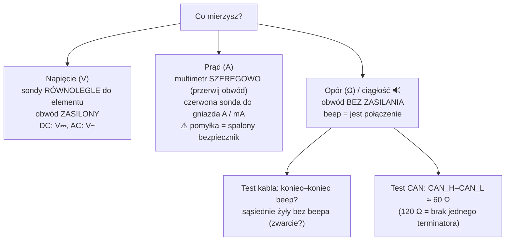

# 13 Elektronika, okablowanie i drobne naprawy

> [!skrot] W 30 sekund
> - **Prawo Ohma** $U = I R$, **moc** $P = U I$. Zasilacz musi dać **napięcie, jakiego chce urządzenie** i **co najmniej tyle prądu, ile pobiera** (z zapasem).
> - **Multimetr:** napięcie mierzysz **równolegle**, prąd **szeregowo** (przerywasz obwód!), opór i ciągłość (**beeper**) — **tylko bez zasilania**.
> - **Magistrale:** UART/szeregowy (TX↔RX na krzyż, ten sam baudrate), **RS-485** (różnicowa, A/B, terminator 120 Ω — serwa Dynamixel, Modbus), **CAN** (CAN_H/CAN_L, **120 Ω na obu końcach → zmierzysz 60 Ω**), I²C, SPI, USB, Ethernet/EtherCAT.
> - **Okablowanie:** odciążenie (strain relief), zapas na ruch stawu (service loop), opaski bez zgniatania, **opisane** kable, osobno zasilanie i sygnał.
> - **Zasada nr 1:** przed grzebaniem — **wyłącz zasilanie i e-stop**, robot w bezpiecznej pozie.

> [!intuicja] Po ludzku
> Prąd to woda w rurach: **napięcie** to ciśnienie, **prąd** to ile wody płynie, **opór** to wąska rura. Zasilacz 12 V / 5 A to „kran z ciśnieniem 12 i max 5 litrów na sekundę”. Urządzenie weźmie tyle, ile potrzebuje — ale jeśli potrzebuje więcej niż 5 A, napięcie siądzie i wszystko zacznie się dziwnie resetować. Większość „magicznych” problemów sprzętowych to **zasilanie, kabel albo wtyczka**.

## Podstawy, które muszą siedzieć
> [!wzor] Wzory
> - $U = I\cdot R$ (wolty = ampery × omy)
> - $P = U\cdot I = I^2 R$ (waty)
> - Szeregowo: $R = R_1 + R_2$; równolegle: $\frac{1}{R} = \frac{1}{R_1}+\frac{1}{R_2}$
> - Energia baterii: Wh = V × Ah (np. 24 V × 10 Ah = 240 Wh)

**Przykład:** serwo 12 V pobiera do 1,5 A w szczycie, ramię ma 6 serw → szczyt $6\times1{,}5 = 9$ A → zasilacz 12 V **co najmniej 10–12 A**. Moc: $12\cdot 9 = 108$ W.

| Typowe napięcia w labie | Gdzie |
|---|---|
| **5 V** | USB, Raspberry Pi, logika |
| **3,3 V** | mikrokontrolery (ESP32, STM32) — **5 V może je spalić!** |
| **12 V** | serwa Dynamixel serii X (część), wentylatory, oświetlenie LED |
| **24 V** | **standard przemysłowy**: I/O robotów, chwytaki, czujniki, Tool I/O UR |
| **48 V** | zasilanie silników niektórych ramion |
| **230 V AC** | sieć — sterownik robota, zasilacze. **Nie ruszasz bez uprawnień (SEP)!** |

## Multimetr — jak mierzyć

> [!wazne] Kolejność diagnozy „urządzenie nie działa”
> 1. Czy jest **zasilanie**? Dioda, multimetr na złączu (właściwe napięcie, właściwa polaryzacja?).
> 2. Czy **bezpiecznik** cały? (ciągłość)
> 3. Czy **kabel** cały? (ciągłość każdej żyły, wyginanie przy pomiarze — przerwa „na zgięciu”)
> 4. Czy **złącze** dobrze siedzi, nie ma wygiętych pinów, korozji, luźnego zacisku?
> 5. Czy **komunikacja** działa? (urządzenie widoczne w `lsusb`/`dmesg`/`ping`)
> 6. Dopiero potem software.

## Magistrale komunikacyjne
| Magistrala | Przewody | Cechy | W labie |
|---|---|---|---|
| **UART / TTL serial** | TX, RX, GND | punkt–punkt, **TX→RX na krzyż**, ten sam **baudrate** (np. 115200), poziomy 3,3/5 V | Arduino, moduły, `/dev/ttyUSB0`, `/dev/ttyACM0` |
| **RS-232** | TX, RX, GND | ±12 V, stare urządzenia | |
| **RS-485** | A, B (+GND) | **różnicowa**, wiele urządzeń na jednej linii, do ~1200 m, **terminator 120 Ω** na końcach, half-duplex | **Dynamixel**, Robotiq (Modbus RTU), Feetech |
| **CAN** | CAN_H, CAN_L | różnicowa, priorytet ID, **120 Ω na obu końcach**, 125 k–1 Mb/s (CAN FD szybciej) | silniki, BMS — znasz z łodzi: [[Magistrala CAN]] |
| **I²C** | SDA, SCL (+pull-upy) | adresy 7-bit, krótkie dystanse na płytce | czujniki IMU, EEPROM |
| **SPI** | MOSI, MISO, SCK, CS | szybka, krótka | wyświetlacze, ADC |
| **USB** | | 2.0 = 480 Mb/s, 3.x = 5+ Gb/s; **max ~5 m** pasywnie (2.0), ~3 m (3.0) | kamery, adaptery |
| **Ethernet** | RJ45 | ramiona robotów, kamery GigE, PoE | UR, Franka |
| **EtherCAT** | Ethernet fizycznie | **real-time** przemysłowy, łańcuch urządzeń | napędy, niektóre roboty |

## Silniki i enkodery (krótko)
| | Co | Gdzie |
|---|---|---|
| **DC szczotkowy** | prosty, sterowanie napięciem/PWM | zabawki, małe napędy |
| **BLDC** | bezszczotkowy, wymaga sterownika (ESC/FOC) | stawy robotów, drony |
| **Krokowy (stepper)** | kroki 1,8°, bez sprzężenia (może gubić kroki) | drukarki 3D, osie liniowe |
| **Serwo** | silnik + przekładnia + enkoder + regulator w jednym | Dynamixel, Feetech, serwa modelarskie (PWM 50 Hz, 1–2 ms) |
| **Enkoder inkrementalny** | liczy impulsy, po włączeniu nie zna pozycji → **homing** | |
| **Enkoder absolutny** | zna pozycję od razu po włączeniu | większość ramion robotów |

## Okablowanie i drobne naprawy — dobre praktyki
- **Odciążenie (strain relief):** kabel nie może ciągnąć za złącze — przypnij go obok.
- **Zapas na ruch (service loop):** przy stawach i nadgarstku kabel musi mieć luz na pełny zakres obrotu, inaczej przerwie się po tygodniu.
- **Prowadzenie:** wzdłuż ramienia, opaski/rzepy **bez zgniatania**, prowadnice/łańcuch kablowy (*cable chain*), z dala od ostrych krawędzi i punktów zgniatania (*pinch points*).
- **Opisy:** każdy kabel opisany na obu końcach (np. `CAM-WRIST-USB`, `GRIP-24V`). Ułatwia diagnozę i inwentarz.
- **Zasilanie osobno od sygnału** (zakłócenia), wspólna masa tam, gdzie wymagana.
- **Polaryzacja:** czerwony +, czarny −/GND (ale **zawsze sprawdź** — nie każdy producent trzyma się kolorów).
- **Złącza:** JST, Dupont (luźne!), Molex, XT60 (zasilanie), M8/M12 (przemysłowe, przykręcane), RJ45, USB-C. Kup/używaj złączy z zatrzaskiem przy ruchomych częściach.
- **Zaciskanie (crimping)** odpowiednią zaciskarką > lutowanie przy ruchomych kablach (lut sztywnieje i pęka przy zgięciu).
- **Lutowanie:** czysty grot, cyna z topnikiem, nagrzej **element**, nie cynę; koszulka termokurczliwa na złącze; po ostygnięciu test ciągłości.
- **ESD (elektrostatyka):** dotykając płytek — opaska antystatyczna / dotknij uziemienia, trzymaj płytki za krawędzie.
- **Śruby:** właściwy klucz/bit (imbus, torx), nie przekręcaj gwintów w plastiku/aluminium; **klej do gwintów** (np. Loctite 243 — średni) przy wibracjach, gdy procedura każe.
- **Po naprawie:** test funkcjonalny + **wpis do logu** (co, dlaczego, kto, jakie części).

## Typowe błędy
> [!blad] Pomiar prądu „jak napięcia”
> Multimetr w trybie A wpięty równolegle = **zwarcie** przez multimetr → spalony bezpiecznik w mierniku (albo gorzej).

> [!blad] Pomiar oporu na zasilonym układzie
> Błędny wynik i ryzyko uszkodzenia miernika. Najpierw odłącz zasilanie.

> [!blad] Odłączanie/podłączanie pod napięciem (hot-plug)
> Serwa, płytki z magistralą, złącza silników — wyłącz zasilanie przed rozłączeniem. Wyjątki: USB, Ethernet (projektowane do tego).

> [!blad] Brak wspólnej masy
> Dwa urządzenia gadają po UART, ale mają osobne zasilacze bez połączonego GND → śmieci w transmisji.

## Pytania rekrutacyjne
> [!zadanie] Serwo w ramieniu przestało odpowiadać. Jak do tego podejdziesz?
> > [!odpowiedz]- Odpowiedź
> > Bezpiecznie zatrzymuję robota/wyłączam zasilanie. Sprawdzam diodę/zasilanie serwa (napięcie na złączu), kabel łańcucha (ciągłość, luźne złącze — w łańcuchu Dynamixel uszkodzone złącze odcina **wszystkie dalsze** serwa), czy serwo jest widoczne (skan ID w narzędziu, np. Dynamixel Wizard), status błędów (przegrzanie, overload, napięcie) i temperaturę. Restart zasilania. Jeśli serwo uszkodzone — wymiana wg procedury (ustawienie ID i baudrate, kalibracja), wpis do logu; jeśli nie wiem — eskaluję.
> > **EN:** *"First make it safe. Then check power at the connector, the daisy-chain cable and connectors — a bad connector cuts off every servo after it — whether the servo responds to an ID scan, and its error flags like overload or overheating. Power-cycle. If it's faulty, replace it following the procedure — set ID and baud rate, recalibrate — and log it. If I can't find the cause, I escalate with what I've checked."*

> [!zadanie] Jak zmierzysz napięcie, prąd i sprawdzisz kabel multimetrem?
> > [!odpowiedz]- Odpowiedź
> > Napięcie — równolegle na zasilonym obwodzie, tryb V DC. Prąd — szeregowo, przerywając obwód, sonda w gnieździe A/mA. Kabel — bez zasilania, tryb ciągłości: każda żyła koniec–koniec piszczy, sąsiednie żyły nie (brak zwarcia), ruszając kablem, żeby wyłapać przerwę.

> [!zadanie] Jak zmierzyć, czy magistrala CAN jest poprawnie zakończona?
> > [!odpowiedz]- Odpowiedź
> > Przy wyłączonym zasilaniu mierzę opór między CAN_H a CAN_L: ~60 Ω = dwa terminatory 120 Ω równolegle (poprawnie); ~120 Ω = brakuje jednego; ~40 Ω = trzy (za dużo).

> [!zadanie] Jak dobrać zasilacz do urządzenia?
> > [!odpowiedz]- Odpowiedź
> > Napięcie dokładnie takie, jak wymaga urządzenie; prąd znamionowy zasilacza ≥ szczytowy pobór (suma wszystkich odbiorników) z zapasem 20–30%; właściwe złącze i polaryzacja; dla silników — zapas na prądy rozruchowe.

## Fiszki #fiszki/rozmowa-gd/elektronika
Prawo Ohma?::U = I·R.
Moc elektryczna?::P = U·I = I²·R.
Jak mierzyć napięcie multimetrem?::Równolegle, na zasilonym obwodzie.
Jak mierzyć prąd multimetrem?::Szeregowo (przerywając obwód), sonda w gnieździe A/mA.
Kiedy mierzyć opór / ciągłość?::Tylko przy odłączonym zasilaniu.
Opór między CAN_H a CAN_L przy poprawnej terminacji?::Ok. 60 Ω (dwa terminatory 120 Ω równolegle).
UART — jak łączyć TX i RX?::Na krzyż: TX jednego do RX drugiego, plus wspólna masa; ten sam baudrate.
RS-485 — cechy?::Różnicowa (A/B), wiele urządzeń na linii, terminator 120 Ω, długie dystanse; Dynamixel, Modbus RTU.
Standardowe napięcie przemysłowe I/O?::24 V DC.
Napięcie logiki mikrokontrolerów, które łatwo spalić 5 V?::3,3 V.
Enkoder inkrementalny vs absolutny?::Inkrementalny liczy impulsy (po starcie potrzebny homing); absolutny zna pozycję od razu.
Co to jest strain relief?::Odciążenie kabla — mocowanie obok złącza, by kabel nie ciągnął za styk.
Co to jest service loop?::Zapas kabla przy ruchomym stawie na pełny zakres ruchu.
Dlaczego zaciskać zamiast lutować na ruchomych kablach?::Lut usztywnia przewód, który pęka przy zginaniu tuż za lutem.
Pierwsza rzecz przed pracą przy sprzęcie robota?::Bezpieczny stan: e-stop/wyłączone zasilanie, robot w bezpiecznej pozie.

## Moje notatki
> [!ja] Tu piszesz ty — Albert tej sekcji nie rusza.
