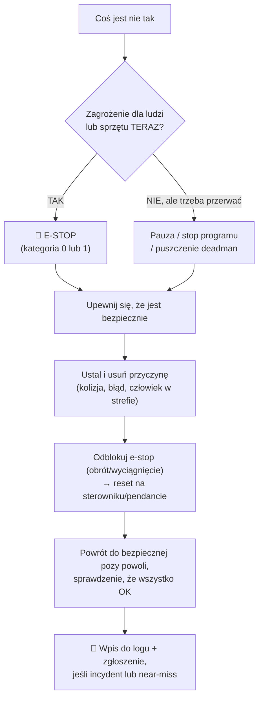

# 14 Bezpieczeństwo pracy z robotami

> [!skrot] W 30 sekund
> - **E-stop (zatrzymanie awaryjne)** — czerwony grzyb na żółtym tle. **Zawsze wiesz, gdzie jest, i masz go w zasięgu ręki**, gdy robot jest włączony. Po wciśnięciu: najpierw usuń przyczynę, potem odblokuj wg procedury.
> - **Kategorie zatrzymania (IEC 60204-1):** **0** — natychmiastowe odcięcie zasilania napędów; **1** — kontrolowane hamowanie, potem odcięcie; **2** — kontrolowane zatrzymanie z zasilaniem utrzymanym.
> - **Coboty (ISO 10218, ISO/TS 15066):** 4 tryby współpracy: **monitorowane zatrzymanie**, **prowadzenie ręczne**, **monitorowanie prędkości i odległości**, **ograniczanie mocy i siły**. Cobot ≠ zawsze bezpieczny — liczy się **ocena ryzyka całej aplikacji** (ostry przedmiot w chwytaku = ostry przedmiot).
> - **Zasady:** nie wchodzisz w strefę robota, gdy jest aktywny; uważasz na **punkty zgniatania**; przy pracy przy sprzęcie — odłączona energia (**LOTO**); zgłaszasz **każdy** incydent i „prawie-wypadek”.

> [!intuicja] Po ludzku
> Robot nie wie, że jesteś człowiekiem. Ramię 20 kg poruszające się 1 m/s potrafi zrobić krzywdę, a nawet cobot może przytrzasnąć palce między chwytakiem a stołem. Bezpieczeństwo to nie „przeszkadzajka” — to pierwsze, o co cię zapytają w labie, i najprostszy sposób, żeby pokazać, że jesteś **odpowiedzialny**.

## Hierarchia zatrzymań

| Pojęcie | Znaczenie |
|---|---|
| **Emergency stop (E-stop)** | ręczne zatrzymanie awaryjne, sprzętowe (nie zależy od software'u), zatrzaskowe |
| **Protective stop** | zatrzymanie wyzwolone przez system bezpieczeństwa robota (przekroczona siła/moment — kolizja, limit, strefa) — UR: „Protective Stop”, Franka: „reflex” |
| **Kategoria 0** | natychmiastowe odcięcie mocy od napędów (hamulce) |
| **Kategoria 1** | kontrolowane hamowanie po trajektorii, potem odcięcie mocy |
| **Kategoria 2** | kontrolowane zatrzymanie, moc **utrzymana** (robot stoi „pod prądem”) |
| **Enabling device / deadman (3-pozycyjny)** | na pendancie: puszczony = stop, wciśnięty do połowy = ruch, **wciśnięty mocno (panika) = stop** |
| **Tryb ręczny / zredukowana prędkość** | przy uczeniu robota: ≤ **250 mm/s** TCP (tryb T1) |
| **Freedrive / hand guiding** | ręczne prowadzenie ramienia (przycisk na ramieniu/pendancie) |
| **Strefy bezpieczeństwa** | wirtualne granice, płaszczyzny, ograniczenia prędkości w sterowniku bezpieczeństwa |
| **Kurtyna świetlna / skaner laserowy / mata** | wykrywają człowieka → zwolnij lub stop |
| **LOTO (Lockout–Tagout)** | odcięcie i zablokowanie źródeł energii (kłódka + zawieszka) przed serwisem |
| **Near-miss** | zdarzenie, które **prawie** spowodowało wypadek — **też zgłaszasz** |

## Cztery tryby współpracy człowiek–robot (ISO/TS 15066 / ISO 10218)
| Tryb | Jak działa | Przykład |
|---|---|---|
| **Safety-rated monitored stop** | robot zatrzymuje się, gdy człowiek wchodzi do wspólnej strefy | podawanie części |
| **Hand guiding** | człowiek prowadzi robota ręką przez urządzenie z enable | uczenie trajektorii |
| **Speed and separation monitoring** | im bliżej człowiek, tym wolniej; za blisko = stop (skanery) | wspólna hala |
| **Power and force limiting (PFL)** | ograniczona siła i moc kontaktu, by nie przekroczyć progów bólu/urazu | coboty UR, Franka |

## Zasady w labie (powiedz to swoimi słowami na rozmowie)
1. **Przed włączeniem:** strefa pusta, e-stop sprawdzony (test na początku dnia/sesji wg procedury), kable nie w zasięgu ruchu.
2. **W trakcie:** nie sięgasz do strefy roboczej, gdy robot jest w trybie automatycznym/teleop aktywnym; ustawianie sceny **tylko** gdy robot zatrzymany/wyłączone napędy lub w trybie, który procedura dopuszcza.
3. **Punkty zgniatania (pinch points):** między palcami chwytaka, między linkami, między ramieniem a stołem/ścianą.
4. **Nowy program / nowa trajektoria:** najpierw **wolno** (redukcja prędkości), z ręką na e-stopie.
5. **Hamulce:** ręczne zwolnienie hamulców (np. przy kolizji) — ramię może **opaść**; podtrzymuj, wg instrukcji.
6. **Energia zmagazynowana:** pneumatyka pod ciśnieniem, sprężyny, kondensatory, baterie LiPo (nie przebijać, ładować pod nadzorem w worku).
7. **Lasery** (lidary, projektory IR kamer) — zwykle klasa 1 (bezpieczne), ale nie zaglądaj w nieznane źródła.
8. **Ergonomia:** teleoperacja przez godziny męczy — przerwy, ustawienie krzesła i stołu.
9. **Nie obchodzisz zabezpieczeń** („tylko na chwilę wyłączę kurtynę”) — nigdy.
10. **Zgłaszasz:** incydenty, uszkodzenia, near-missy; nie „ukrywasz” kolizji robota — mogła uszkodzić kalibrację lub mechanikę.

## Typowe błędy
> [!blad] E-stop jako „pauza”
> E-stop to awaria, nie przycisk pauzy — częste e-stopy (kat. 0) zużywają hamulce i mechanikę. Do zwykłego przerwania: pauza programu / puszczenie deadmana.

> [!blad] „To cobot, więc jest bezpieczny”
> Cobot jest bezpieczny tylko w ocenionej aplikacji. Nóż, gorący przedmiot, ruch na wysokości głowy, przygniecenie do sztywnej powierzchni — dalej groźne.

> [!blad] Odblokowanie e-stopu bez znalezienia przyczyny
> Robot może kontynuować ruch, który spowodował problem.

## Pytania rekrutacyjne
> [!zadanie] Jakie zasady bezpieczeństwa stosujesz przy pracy z robotem?
> > [!odpowiedz]- Odpowiedź
> > Znam położenie e-stopu i mam go w zasięgu, sprawdzam go przed pracą; strefa robota pusta przed ruchem; nie wkładam rąk w strefę, gdy robot jest aktywny; nowe ruchy testuję na zredukowanej prędkości; uważam na punkty zgniatania; przed pracą przy sprzęcie odcinam energię (LOTO); zgłaszam incydenty i near-missy i zapisuję w logu.
> > **EN:** *"I always know where the e-stop is and keep it within reach; I check the workspace is clear before motion; I never reach into the workspace while the robot is active; new motions are tested at reduced speed; I watch out for pinch points; I de-energize equipment before maintenance; and I report incidents and near misses."*

> [!zadanie] Czym się różni e-stop od protective stop?
> > [!odpowiedz]- Odpowiedź
> > E-stop wyzwala człowiek ręcznie (przycisk awaryjny), to zatrzymanie kategorii 0 lub 1, zatrzaskowe, wymaga ręcznego odblokowania. Protective stop wyzwala automatycznie system bezpieczeństwa robota (np. przekroczenie siły przy kolizji, naruszenie strefy) — trzeba usunąć przyczynę i potwierdzić.

> [!zadanie] Robot uderzył w stół podczas teleoperacji. Co robisz?
> > [!odpowiedz]- Odpowiedź
> > Zatrzymanie (robot zwykle sam przejdzie w protective stop, inaczej e-stop), sprawdzam, czy nikt nie jest zagrożony, oznaczam epizod jako nieudany, odblokowuję wg procedury i odjeżdżam powoli. Sprawdzam chwytak, palce, mocowanie kamery na nadgarstku i kalibrację (uderzenie może przesunąć kamerę), zapisuję w logu, informuję prowadzącego.

> [!zadanie] Jakie są tryby współpracy człowiek–robot?
> > [!odpowiedz]- Odpowiedź
> > Monitorowane zatrzymanie, prowadzenie ręczne, monitorowanie prędkości i odległości, ograniczanie mocy i siły (ISO 10218 / ISO/TS 15066).

## Fiszki #fiszki/rozmowa-gd/bhp
Kategoria zatrzymania 0?::Natychmiastowe odcięcie zasilania napędów.
Kategoria zatrzymania 1?::Kontrolowane hamowanie, potem odcięcie zasilania.
Kategoria zatrzymania 2?::Kontrolowane zatrzymanie z utrzymanym zasilaniem.
E-stop vs protective stop?::E-stop — ręczny, awaryjny, zatrzaskowy; protective stop — automatyczny z systemu bezpieczeństwa (kolizja, strefa).
4 tryby współpracy wg ISO/TS 15066?::Safety-rated monitored stop, hand guiding, speed & separation monitoring, power & force limiting.
Normy bezpieczeństwa robotów przemysłowych i cobotów?::ISO 10218-1/-2 oraz ISO/TS 15066.
Co to jest LOTO?::Lockout–Tagout: odcięcie i zablokowanie źródeł energii przed serwisem.
Enabling device 3-pozycyjny?::Puszczony — stop; środkowa pozycja — ruch; wciśnięty mocno — stop.
Maks. prędkość TCP w trybie ręcznym T1?::250 mm/s.
Co to jest near-miss i co z nim robisz?::Zdarzenie prawie-wypadkowe; zgłaszasz i zapisujesz.
Czym są pinch points?::Miejsca, gdzie ruch robota może przygnieść/przyciąć (palce chwytaka, między linkami, ramię–stół).

## Moje notatki
> [!ja] Tu piszesz ty — Albert tej sekcji nie rusza.
