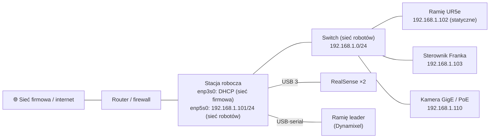

# 16 Sieci — IP, podsieci, łączenie urządzeń

> [!skrot] W 30 sekund
> - **Adres IP** (IPv4) = 4 liczby 0–255, np. `192.168.1.102`. **Maska** mówi, która część to sieć: `/24` = `255.255.255.0` → urządzenia `192.168.1.1`–`192.168.1.254` są w **tej samej podsieci** i gadają bez routera.
> - **Robot i PC muszą być w tej samej podsieci** (np. robot `192.168.1.102/24`, PC `192.168.1.101/24`). Roboty zwykle mają **statyczne IP**.
> - **DHCP** = router sam rozdaje adresy; **statyczne** = wpisujesz ręcznie. **Brama (gateway)** = router do innych sieci/internetu. **DNS** = nazwy → IP.
> - **Diagnoza:** `ip a` (moje adresy), `ping` (czy żyje), `ip route` (trasy), `nmcli` (konfiguracja), `ss -tulpn` (porty), `traceroute`, `arp -a`/`ip neigh` (kto jest w sieci), `nmap -sn 192.168.1.0/24` (skan).
> - **TCP** = niezawodny (połączenie, potwierdzenia), **UDP** = szybki, bez gwarancji (strumienie, DDS discovery). **Port** = „numer drzwi” programu (SSH 22, HTTP 80, HTTPS 443).

> [!intuicja] Po ludzku
> IP to adres domu: `192.168.1` to **ulica**, a `.102` to **numer domu**. Maska `/24` mówi „pierwsze 3 liczby to ulica”. Sąsiedzi z tej samej ulicy mogą do siebie po prostu podejść (bez routera). Jak robot mieszka na `192.168.1.x`, a twój laptop na `10.0.0.x` — to inne ulice; bez routera (bramy) się nie spotkają. **90% problemów „robot nie odpowiada” to zła ulica albo zły kabel.**

## Adresowanie

> [!definicja] Maska i CIDR
> | CIDR | Maska | Liczba adresów hostów | Przykład zakresu |
> |---|---|---|---|
> | `/24` | 255.255.255.0 | 254 | 192.168.1.1 – 192.168.1.254 |
> | `/16` | 255.255.0.0 | 65 534 | 192.168.0.1 – 192.168.255.254 |
> | `/30` | 255.255.255.252 | 2 | punkt–punkt |
> Liczba hostów $= 2^{32-n} - 2$ (odejmujesz adres sieci `.0` i rozgłoszeniowy `.255`).

| Zakres prywatny (nie w internecie) | Typowo |
|---|---|
| `10.0.0.0/8` | firmy |
| `172.16.0.0/12` | Docker (`172.17.0.0/16`) |
| `192.168.0.0/16` | domy, laby, **roboty** (UR domyślnie bywa `192.168.1.x` / `192.168.56.x`) |
| `127.0.0.1` | **localhost** — ten sam komputer |
| `169.254.x.x` | **link-local** — dostajesz, gdy DHCP nie odpowiedział (znak, że coś nie tak!) |

## Typowa sieć laboratorium



- Często **dwie karty sieciowe**: jedna do sieci firmowej (internet, serwer danych), druga **dedykowana robotom** (statycznie, bez bramy) — robot nie jest wystawiony na świat, a ruch sterowania nie miesza się z resztą.
- Robot z pętlą sterowania (UR 500 Hz, Franka 1 kHz) najlepiej **kablem bezpośrednio** lub przez dedykowany switch — **nie przez Wi-Fi**.

## Konfiguracja statycznego IP (Ubuntu)
**NetworkManager (nmcli) — najprościej:**
```bash
nmcli con show                                  # lista połączeń
sudo nmcli con mod "Wired connection 2" ipv4.method manual \
     ipv4.addresses 192.168.1.101/24 ipv4.gateway ""     # bez bramy dla sieci robotów
sudo nmcli con up "Wired connection 2"
ip a show enp5s0                                # sprawdź
ping -c 3 192.168.1.102                         # robot żyje?
```
**Netplan** (`/etc/netplan/01-robot.yaml`, Ubuntu Server):
```yaml
network:
  version: 2
  ethernets:
    enp5s0:
      dhcp4: false
      addresses: [192.168.1.101/24]
```
`sudo netplan apply`. **Doraźnie (do restartu):** `sudo ip addr add 192.168.1.101/24 dev enp5s0`.

## Ściąga diagnostyczna
```bash
ip a                        # interfejsy i adresy (czy kabel: "state UP", czy jest adres)
ip link                     # stan łącza (NO-CARRIER = brak fizycznego połączenia!)
ip route                    # trasy, brama domyślna
ping -c 4 192.168.1.102     # osiągalność (uwaga: niektóre urządzenia blokują ping)
ip neigh                    # tablica ARP: kto odpowiadał w sieci lokalnej
nmap -sn 192.168.1.0/24     # skan: jakie urządzenia są w podsieci (zgubiony adres robota!)
ss -tulpn                   # jakie porty nasłuchują na tym komputerze
nc -zv 192.168.1.102 30004  # czy port na robocie jest otwarty
traceroute 8.8.8.8          # przez jakie routery idzie ruch
resolvectl status ; dig google.com    # DNS
sudo ethtool enp5s0         # prędkość łącza (1000Mb/s? 100Mb/s = zły kabel)
sudo firewall-cmd --list-all  # Fedora/RHEL firewall  |  sudo ufw status  # Ubuntu
```

## Model warstwowy — wystarczy tyle
| Warstwa (TCP/IP) | Co | Przykład |
|---|---|---|
| Łącza | kabel, MAC, switch | Ethernet, Wi-Fi |
| Sieci | adresy IP, routing | IPv4, ICMP (ping) |
| Transportowa | porty, niezawodność | **TCP** (SSH, HTTP, sterowanie UR), **UDP** (DDS/ROS 2, wideo, DNS) |
| Aplikacji | protokoły programów | SSH, HTTP, Modbus TCP, RTSP |

> [!wazne] ROS 2 a sieć
> DDS używa **UDP multicast** do odkrywania węzłów. Problemy: Wi-Fi gubi multicast, firewall blokuje porty UDP (7400+), Docker w trybie bridge nie przepuszcza → `--network host`. Pomaga: ten sam `ROS_DOMAIN_ID`, `ros2 multicast send/receive`, ewentualnie Discovery Server albo Cyclone DDS z ustawionym interfejsem, a od Jazzy także `rmw_zenoh`.

## Typowe błędy
> [!blad] Dwa urządzenia z tym samym IP
> Konflikt — połączenie raz działa, raz nie. `arping`/`ip neigh` pokaże dwa różne MAC dla jednego IP.

> [!blad] Brama ustawiona na interfejsie robotów
> Komputer próbuje wysyłać internet przez sieć robotów → „internet przestał działać”. Na sieci robotów **bez bramy**.

> [!blad] Adres 169.254.x.x
> Interfejs ustawiony na DHCP, a w sieci robotów nie ma serwera DHCP. Ustaw statyczny.

> [!blad] Ping nie działa ≠ urządzenie martwe
> Niektóre urządzenia/firewalle blokują ICMP. Sprawdź `nc -zv ip port` albo `ip neigh` po próbie połączenia.

## Pytania rekrutacyjne
> [!zadanie] Podłączasz nowe ramię do PC kablem Ethernet. Jak skonfigurujesz sieć?
> > [!odpowiedz]- Odpowiedź
> > Sprawdzam IP robota (panel/pendant/dokumentacja, ewentualnie `nmap`). Ustawiam statyczny adres na karcie PC w tej samej podsieci, np. robot 192.168.1.102/24 → PC 192.168.1.101/24, bez bramy. `ip a` i `ip link` — czy łącze UP; `ping` robota; jeśli trzeba, sprawdzam porty (`nc -zv`) i firewall. Potem driver z `robot_ip`.
> > **EN:** *"I'd find the robot's IP from its panel or docs, set a static IP on the PC's interface in the same subnet — say robot 192.168.1.102/24 and PC .101/24, with no gateway on that interface — check the link is up, ping the robot, check the firewall and required ports, then launch the driver with the robot IP."*

> [!zadanie] Co oznacza zapis 192.168.1.0/24?
> > [!odpowiedz]- Odpowiedź
> > Sieć, w której pierwsze 24 bity (trzy oktety) to część sieciowa, maska 255.255.255.0; hosty 192.168.1.1–254, .0 to adres sieci, .255 rozgłoszeniowy.

> [!zadanie] TCP vs UDP?
> > [!odpowiedz]- Odpowiedź
> > TCP — połączeniowy, niezawodny, z kolejnością i retransmisjami (SSH, HTTP, transfer plików). UDP — bezpołączeniowy, bez gwarancji, mniejsze opóźnienie (strumienie wideo, DNS, DDS w ROS 2, gry).

> [!zadanie] Statyczne IP vs DHCP — co dla robota i dlaczego?
> > [!odpowiedz]- Odpowiedź
> > Statyczne — adres robota musi być stały, bo jest wpisany w konfigurację drivera i launch; DHCP mógłby go zmienić. DHCP jest wygodne dla laptopów i sieci biurowej (ew. DHCP z rezerwacją po MAC).

> [!zadanie] Robot nie odpowiada na ping. Kolejne kroki?
> > [!odpowiedz]- Odpowiedź
> > Fizycznie: kabel, diody na porcie, `ip link` (NO-CARRIER?). Mój adres: `ip a` — czy jestem w tej samej podsieci, czy nie mam 169.254. IP robota — panel robota, `nmap -sn`. Konflikt IP? Firewall/ICMP blokowany? Inny kabel/port switcha. Restart robota/interfejsu. Jeśli nic — eskalacja z listą tego, co sprawdziłem.

## Fiszki #fiszki/rozmowa-gd/sieci
Co oznacza /24?::Maska 255.255.255.0 — pierwsze 3 oktety to sieć; 254 hosty.
Liczba hostów w podsieci /n?::2^(32−n) − 2.
Prywatne zakresy IPv4?::10.0.0.0/8, 172.16.0.0/12, 192.168.0.0/16.
Co oznacza adres 169.254.x.x?::Link-local — DHCP nie odpowiedział; brak poprawnej konfiguracji.
Co to jest brama (gateway)?::Router, przez który idzie ruch do innych sieci/internetu.
Komenda: moje adresy IP?::ip a
Komenda: trasy i brama domyślna?::ip route
Komenda: skan urządzeń w podsieci?::nmap -sn 192.168.1.0/24
Komenda: czy port na zdalnym hoście jest otwarty?::nc -zv ip port
Komenda: nasłuchujące porty lokalnie?::ss -tulpn
Komenda: statyczne IP przez NetworkManager?::nmcli con mod "nazwa" ipv4.method manual ipv4.addresses IP/24, potem nmcli con up "nazwa".
Co oznacza NO-CARRIER w ip link?::Brak fizycznego połączenia (kabel, port, urządzenie wyłączone).
TCP vs UDP?::TCP: połączeniowy, niezawodny; UDP: bez gwarancji, mniejsze opóźnienie.
Porty SSH, HTTP, HTTPS?::22, 80, 443.
Jaki transport używa DDS do odkrywania?::UDP multicast.
Dlaczego robot na osobnej karcie sieciowej bez bramy?::Izolacja, stabilna pętla sterowania, brak konfliktów tras z siecią firmową.

## Moje notatki
> [!ja] Tu piszesz ty — Albert tej sekcji nie rusza.
