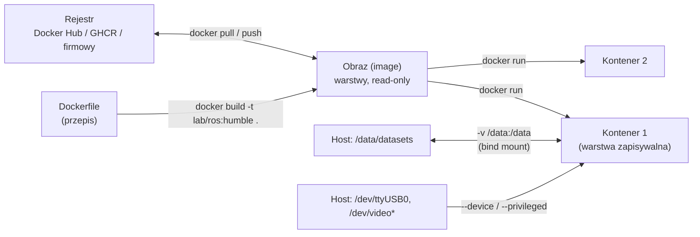

# 17 Docker dla robotyki

> [!skrot] W 30 sekund
> - **Obraz (image)** = przepis + gotowy „zamrożony” system plików (np. Ubuntu 22.04 + ROS 2 Humble + twoje zależności). **Kontener** = uruchomiona instancja obrazu. **Dockerfile** = przepis na obraz. **Wolumen / bind mount** = katalog z hosta widoczny w kontenerze (dane przeżywają usunięcie kontenera).
> - **Po co w robotyce:** to samo środowisko na każdym komputerze („u mnie działa” znika), różne wersje ROS obok siebie, łatwe wdrożenie na robota.
> - **Kluczowe flagi dla robotów:** `--network host` (DDS/ROS 2 i sterowniki sieciowe), `--device /dev/ttyUSB0` lub `--privileged` + `-v /dev:/dev` (USB, kamery), `--gpus all` (CUDA), `-e DISPLAY -v /tmp/.X11-unix:/tmp/.X11-unix` (RViz/GUI), `--ipc host` (pamięć współdzielona DDS).
> - **Docker Compose** — kilka kontenerów opisanych w jednym `compose.yaml`, start `docker compose up -d`.

> [!intuicja] Po ludzku
> Obraz to **pudełko z gotowym zestawem LEGO i instrukcją** — każdy dostaje identyczne. Kontener to **zbudowana z niego zabawka**, którą się bawisz; możesz ją rozwalić i zbudować od nowa z pudełka. Ważne: wszystko, co zrobisz w kontenerze (np. nagrane dane), **znika razem z nim**, chyba że zapisujesz do katalogu podpiętego z hosta (wolumen).

## Pojęcia



| Pojęcie | Znaczenie |
|---|---|
| **Image** | szablon tylko do odczytu, z warstw (każda instrukcja Dockerfile = warstwa, cache) |
| **Container** | proces uruchomiony z obrazu, izolowany (namespaces, cgroups) — **to nie maszyna wirtualna**, dzieli jądro z hostem |
| **Dockerfile** | `FROM`, `RUN`, `COPY`, `ENV`, `WORKDIR`, `CMD`/`ENTRYPOINT` |
| **Volume / bind mount** | trwałe dane poza kontenerem |
| **Registry** | magazyn obrazów |
| **Compose** | wiele kontenerów + sieci + wolumeny w jednym pliku YAML |
| **Tag** | wersja obrazu (`ros:humble`, `lab/collect:1.4.2`) — **unikaj `latest` w produkcji** |

> [!wazne] Kontener vs maszyna wirtualna
> VM emuluje cały komputer z **własnym jądrem** (ciężka, minuty startu). Kontener to izolowany **proces na jądrze hosta** (lekki, sekundy). Dlatego sterowniki jądra (np. USB, kamera, real-time kernel Franki) są **z hosta**.

## Przykładowy Dockerfile dla ROS 2
```dockerfile
FROM ros:humble-ros-base                    # oficjalny obraz ROS 2 Humble (Ubuntu 22.04)
ENV DEBIAN_FRONTEND=noninteractive
RUN apt-get update && apt-get install -y \
      ros-humble-realsense2-camera ros-humble-rmw-cyclonedds-cpp python3-pip \
    && rm -rf /var/lib/apt/lists/*          # mniejszy obraz
WORKDIR /ws
COPY src/ src/
RUN . /opt/ros/humble/setup.sh && colcon build --symlink-install
COPY entrypoint.sh /entrypoint.sh
ENTRYPOINT ["/entrypoint.sh"]               # source'uje setup.bash i uruchamia komendę
CMD ["ros2", "launch", "collect", "collect.launch.py"]
```

## Uruchamianie z dostępem do sprzętu
```bash
docker run -it --rm \
  --network host --ipc host \
  --device /dev/ttyUSB0 \
  -v /dev:/dev --device-cgroup-rule='c 81:* rmw' \
  --gpus all \
  -e DISPLAY=$DISPLAY -v /tmp/.X11-unix:/tmp/.X11-unix \
  -v /data:/data \
  -e ROS_DOMAIN_ID=7 \
  lab/collect:1.4.2 bash
```
| Flaga | Po co |
|---|---|
| `--network host --ipc host` | ROS 2 / DDS widzi sieć hosta i pamięć współdzieloną |
| `--device /dev/ttyUSB0` | konkretny port szeregowy (bezpieczniej niż `--privileged`) |
| `-v /dev:/dev --device-cgroup-rule='c 81:* rmw'` | kamery V4L2 (major 81), także po ponownym podłączeniu |
| `--gpus all` | GPU (wymaga NVIDIA Container Toolkit) |
| `-e DISPLAY -v /tmp/.X11-unix:...` | GUI (RViz); na hoście `xhost +local:` |
| `-v /data:/data` | dane trafiają na dysk hosta, nie giną z kontenerem |
| *(uwaga)* | w bashu po `\` nie może być komentarza — dlatego opisy są tu, a nie w komendzie |

## Najważniejsze komendy
```bash
docker ps ; docker ps -a              # działające / wszystkie kontenery
docker images                         # obrazy lokalnie
docker build -t nazwa:tag .           # zbuduj obraz z Dockerfile w bieżącym katalogu
docker run -it --rm obraz bash        # interaktywnie, usuń po wyjściu
docker exec -it kontener bash         # drugi terminal do działającego kontenera
docker logs -f kontener               # logi
docker stop kontener ; docker rm kontener
docker compose up -d ; docker compose logs -f ; docker compose down
docker system df ; docker system prune   # zajęte miejsce / sprzątanie (⚠️ ostrożnie)
sudo usermod -aG docker $USER         # docker bez sudo (grupa docker ≈ uprawnienia roota!)
```

## Typowe błędy
> [!blad] Dane zapisane „w kontenerze”
> Kontener z `--rm` po wyjściu znika z danymi. Zapisuj do zamontowanego katalogu hosta.

> [!blad] ROS 2 w kontenerze nie widzi topiców z hosta
> Brak `--network host` (domyślny bridge izoluje multicast), inny `ROS_DOMAIN_ID`, inne RMW, brak `--ipc host` (problem z pamięcią współdzieloną Fast DDS — topiki widać, ale dane nie dochodzą).

> [!blad] Urządzenie podłączone po starcie kontenera
> `--device` widzi tylko to, co istniało przy starcie. Rozwiązanie: `-v /dev:/dev` + `--device-cgroup-rule` albo restart kontenera.

> [!blad] RViz: `cannot open display`
> Brak przekazania X11 (`DISPLAY`, socket) albo `xhost +local:` na hoście; przy Waylandzie — XWayland.

## Pytania rekrutacyjne
> [!zadanie] Co to jest Docker i po co w robotyce?
> > [!odpowiedz]- Odpowiedź
> > Narzędzie do konteneryzacji: pakuje aplikację z całym środowiskiem (system, biblioteki, ROS) w obraz, który uruchamia się identycznie na każdym komputerze. W robotyce: powtarzalne środowisko (wersja ROS, zależności), izolacja projektów, łatwe wdrożenie na robota i odtworzenie konfiguracji po awarii.
> > **EN:** *"Docker packages an application with its whole environment into an image that runs the same everywhere. In robotics it gives reproducible ROS environments, isolates dependencies between projects, and makes deployment to robots easy."*

> [!zadanie] Obraz vs kontener?
> > [!odpowiedz]- Odpowiedź
> > Obraz to niezmienny szablon (warstwy systemu plików + metadane), budowany z Dockerfile. Kontener to uruchomiona instancja obrazu z własną zapisywalną warstwą — można ich uruchomić wiele z jednego obrazu.

> [!zadanie] Jak dać kontenerowi dostęp do kamery USB i do sieci ROS 2?
> > [!odpowiedz]- Odpowiedź
> > `--device /dev/video0` (lub `-v /dev:/dev` z regułą cgroup, ostatecznie `--privileged`), `--network host` i `--ipc host` dla DDS, ten sam `ROS_DOMAIN_ID`. Dla GUI przekazanie X11, dla GPU `--gpus all`.

> [!zadanie] Kontener vs maszyna wirtualna?
> > [!odpowiedz]- Odpowiedź
> > Kontener dzieli jądro z hostem i izoluje tylko procesy (lekki, szybki start); VM ma własne jądro i emulowany sprzęt (cięższa, pełna izolacja).

## Fiszki #fiszki/rozmowa-gd/docker
Obraz vs kontener?::Obraz — niezmienny szablon z warstw; kontener — uruchomiona instancja obrazu z zapisywalną warstwą.
Kontener vs VM?::Kontener dzieli jądro hosta (lekki); VM ma własne jądro (ciężka).
Flaga Dockera potrzebna dla ROS 2/DDS?::--network host (i zwykle --ipc host).
Jak dać kontenerowi port szeregowy?::--device /dev/ttyUSB0 (albo -v /dev:/dev + device-cgroup-rule, ostatecznie --privileged).
Jak uruchomić GUI (RViz) w kontenerze?::-e DISPLAY i -v /tmp/.X11-unix:/tmp/.X11-unix, na hoście xhost +local:.
Jak dać kontenerowi GPU?::--gpus all (NVIDIA Container Toolkit).
Komenda: wejście do działającego kontenera?::docker exec -it kontener bash
Komenda: logi kontenera?::docker logs -f kontener
Gdzie zapisywać dane z kontenera?::Do zamontowanego katalogu hosta (bind mount / volume), bo kontener jest ulotny.
Co robi docker compose?::Uruchamia wiele kontenerów opisanych w jednym pliku YAML (docker compose up -d).
Dlaczego unikać tagu latest?::Nie wiadomo, jaka wersja się uruchomi — brak powtarzalności.

## Moje notatki
> [!ja] Tu piszesz ty — Albert tej sekcji nie rusza.
