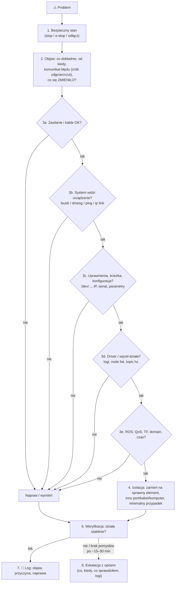

# 19 Troubleshooting — jak diagnozować

> [!skrot] W 30 sekund
> - **Metoda (powiedz ją na rozmowie!):** 1) **bezpiecznie** zatrzymaj, 2) **odtwórz** i opisz objaw, 3) **sprawdź od najprostszego** (zasilanie → kabel → urządzenie widoczne → sterownik → konfiguracja → software), 4) **izoluj** (podziel problem na pół, zamień na sprawny element), 5) napraw **jedną rzecz naraz**, 6) **zweryfikuj**, 7) **zapisz w logu**, 8) **eskaluj** z konkretami, jeśli w rozsądnym czasie (np. 15–30 min) nie wiesz.
> - **Warstwy:** fizyczna (prąd, kable) → system (USB/sieć widzi urządzenie) → uprawnienia → driver/węzeł → ROS (topiki, QoS, TF) → aplikacja.
> - **Zasada:** „co się **zmieniło** od czasu, gdy działało?” — najczęściej to jest odpowiedź.

> [!intuicja] Po ludzku
> Jak lampa nie świeci, nie zaczynasz od rozbierania instalacji elektrycznej w bloku. Sprawdzasz: włączona do kontaktu? żarówka cała? działa inna lampa w tym kontakcie? To samo z robotem. **Od najprostszego, po jednej rzeczy, i zapisuj, co sprawdziłeś** — wtedy eskalacja jest wartościowa, a nie „nie działa, pomóż”.

## Ogólny algorytm

## Scenariusze — przećwicz odpowiedzi na głos

> [!zadanie] 1. Kamera nie jest wykrywana
> > [!odpowiedz]- Odpowiedź
> > Kabel i port (USB 3, inny port, krótszy kabel) → `lsusb` (widzi?) → `dmesg -w` przy podłączaniu (błędy enumeracji = kabel/zasilanie) → `v4l2-ctl --list-devices` / `rs-enumerate-devices` → uprawnienia (`video`, reguły udev RealSense) → czy inny proces jej nie trzyma (`lsof /dev/video0`, stary węzeł) → driver z właściwym numerem seryjnym → firmware. W Dockerze — czy urządzenie jest przekazane.

> [!zadanie] 2. Kamera działa, ale gubi klatki / FPS spada
> > [!odpowiedz]- Odpowiedź
> > `ros2 topic hz`, `lsusb -t` (5000M? kilka kamer na jednym kontrolerze?), CPU (`htop`) i dysk (zapis bagów, `df -h`), rozdzielczość/FPS/format (MJPEG), auto-ekspozycja w słabym świetle (obniża FPS), kabel/hub z zasilaniem, nagrywanie compressed zamiast raw.

> [!zadanie] 3. Robot nie odpowiada na komendy z PC (driver uruchomiony)
> > [!odpowiedz]- Odpowiedź
> > Stan robota: e-stop/protective stop, hamulce zwolnione, tryb remote/program External Control uruchomiony (UR) → sieć: `ping`, `ip a` (ta sama podsieć) → logi drivera (połączenie, błędy) → `ros2 control list_controllers` (właściwy kontroler aktywny?) → czy komendy idą na właściwy topic/akcję (`ros2 topic info`, `rqt_graph`) → limity/kolizje (MoveIt odrzuca plan?).

> [!zadanie] 4. Węzły na dwóch komputerach się nie widzą
> > [!odpowiedz]- Odpowiedź
> > `ROS_DOMAIN_ID`, RMW i dystrybucja takie same; `ROS_LOCALHOST_ONLY`/discovery range; ping w obie strony; firewall; `ros2 multicast send/receive`; Wi-Fi (multicast); Docker `--network host`; `ros2 daemon stop`.

> [!zadanie] 5. Follower w teleoperacji szarpie / opóźnia się
> > [!odpowiedz]- Odpowiedź
> > Częstotliwość pętli (`ros2 topic hz` komend), obciążenie CPU, opóźnienie USB/sieci (Wi-Fi?), baudrate i latency timer adaptera FTDI (domyślnie 16 ms → ustawić 1 ms), osobliwość lub limity stawów, źle dobrane wzmocnienia PID serw, zasilanie serw (spadki napięcia przy obciążeniu), kalibracja leader–follower.

> [!zadanie] 6. Robot chwyta obok obiektu (systematyczny offset)
> > [!odpowiedz]- Odpowiedź
> > Podejrzenie: kalibracja/TF. Czy kamera się przesunęła (porównaj ze zdjęciem referencyjnym)? Czy po wymianie chwytaka zaktualizowano TCP? Weryfikacja hand-eye (dojazd do markera), `tf2_echo` między ramkami, czy używana jest właściwa wersja kalibracji. Naprawa: rekalibracja, nowa wersja w logu, oznaczenie danych zebranych w międzyczasie.

> [!zadanie] 7. `Permission denied` przy otwieraniu `/dev/ttyUSB0`
> > [!odpowiedz]- Odpowiedź
> > `ls -l /dev/ttyUSB0` → grupa `dialout`; `groups` → dopisanie `usermod -aG dialout` i ponowne logowanie; ewentualnie reguła udev z `MODE="0666"`; w Dockerze przekazanie urządzenia.

> [!zadanie] 8. Nagrywanie przerwało się / dataset ma braki
> > [!odpowiedz]- Odpowiedź
> > `df -h` (pełny dysk), logi rekordera, `ros2 bag info` (które topiki mają za mało wiadomości), wydajność dysku (HDD vs SSD), czy węzeł kamery nie padł w trakcie (logi, `dmesg` — odłączenie USB). Oznaczyć dotknięte epizody, naprawić przyczynę, dozbierać.

> [!zadanie] 9. Powtarzające się protective stopy
> > [!odpowiedz]- Odpowiedź
> > Komunikat (która oś, siła/moment/prędkość/strefa) → payload i TCP w konfiguracji zgodne z narzędziem? → kolizje z kablami/sceną → zbyt agresywne trajektorie (przyspieszenia) → granice stref bezpieczeństwa → mechanika (luz, uszkodzenie po uderzeniu). Eskalacja, jeśli przyczyna niejasna.

> [!zadanie] 10. Chwytak nie reaguje
> > [!odpowiedz]- Odpowiedź
> > Zasilanie (24 V, dioda), kabel przy nadgarstku (skręcony/przetarty), komunikacja (port, ID, baudrate, Modbus), aktywacja (Robotiq wymaga *activate* po włączeniu), błąd/przegrzanie, mechanika (zablokowany palec). Test z oprogramowania producenta, potem z ROS.

> [!zadanie] 11. `colcon build` się wywala
> > [!odpowiedz]- Odpowiedź
> > Czytam **pierwszy** błąd (nie ostatni); brakujące zależności → `rosdep install`; czy `source /opt/ros/<distro>/setup.bash`; czy mieszam dystrybucje; czyszczenie `rm -rf build install log` i ponowny build; budowanie jednego pakietu `--packages-select` z `--event-handlers console_direct+`.

> [!zadanie] 12. Timestampy z dwóch komputerów się nie zgadzają
> > [!odpowiedz]- Odpowiedź
> > Synchronizacja zegarów: `timedatectl`, `chronyc tracking` / `chronyc sources`; ustawić chrony/NTP do wspólnego serwera (lub PTP dla dużej precyzji); sprawdzić `use_sim_time`.

## Jak eskalować (wzór wiadomości)
> [!przyklad] Szablon zgłoszenia
> **EN (firma międzynarodowa — pisz po angielsku):**
> *"Hi [engineer], the wrist camera on station 2 (RealSense D405, SN …) stopped publishing at ~14:20 during data collection. Symptoms: /wrist/color/image_raw at 0 Hz, dmesg shows 'USB disconnect' repeatedly. Checked: other USB port and spare cable — same; camera works on my laptop; no changes to the setup since yesterday's calibration. Suspect the USB controller on the station PC. Collection is paused; episodes 0112–0118 are marked as suspect in the log. Could you take a look when you have a moment?"*
>
> Struktura: **co / gdzie / od kiedy → objawy (konkretne) → co już sprawdziłem → hipoteza → wpływ (co wstrzymane, które dane podejrzane) → prośba.**

## Typowe błędy
> [!blad] Zmienianie wielu rzeczy naraz
> Nie wiesz potem, co pomogło (albo co zepsuło). Jedna zmiana → test.

> [!blad] Brak zapisu
> Za tydzień ten sam problem, a nikt nie pamięta rozwiązania. Każda naprawa → log.

> [!blad] Za późna albo za wczesna eskalacja
> Za wcześnie bez sprawdzenia podstaw — marnujesz czas inżyniera. Za późno — lab stoi pół dnia. Zasada: podstawy samodzielnie, potem zgłoszenie z konkretami; **od razu**, gdy chodzi o bezpieczeństwo, uszkodzenie drogiego sprzętu lub zasilanie 230 V.

## Fiszki #fiszki/rozmowa-gd/troubleshooting
Kroki diagnozy problemu sprzętowego?::Bezpieczny stan → objaw i co się zmieniło → od najprostszego (zasilanie, kabel, widoczność, uprawnienia, driver, ROS) → izolacja → jedna zmiana → weryfikacja → log → eskalacja.
Najważniejsze pytanie przy awarii?::Co się zmieniło od czasu, gdy działało?
Co zawiera dobre zgłoszenie/eskalacja?::Co/gdzie/od kiedy, konkretne objawy, co sprawdziłeś, hipoteza, wpływ na pracę/dane, prośba.
Kiedy eskalować od razu?::Bezpieczeństwo ludzi, ryzyko uszkodzenia drogiego sprzętu, zasilanie sieciowe 230 V.
Teleop szarpie — co z adapterem FTDI?::Latency timer domyślnie 16 ms — ustawić 1 ms.
Robot chwyta obok — pierwsze podejrzenie?::Kalibracja (przesunięta kamera, hand-eye) lub nieaktualny TCP.
colcon build pada — który błąd czytać?::Pierwszy (kolejne są zwykle skutkami).
Jak sprawdzić synchronizację zegara?::timedatectl, chronyc tracking / chronyc sources.
Robotiq nie reaguje po włączeniu — o czym pamiętać?::Wymaga aktywacji (activate) po zasileniu.

## Moje notatki
> [!ja] Tu piszesz ty — Albert tej sekcji nie rusza.
