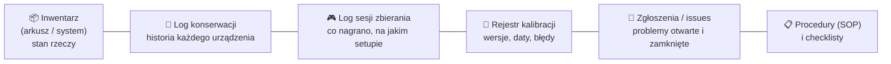

# 20 Dokumentacja, inwentaryzacja i log konserwacji

> [!skrot] W 30 sekund
> - **Inwentarz:** co mamy, **ile**, **gdzie leży**, **numer seryjny**, stan, kto używa, data zakupu/gwarancji.
> - **Log konserwacji (maintenance log):** każda czynność przy sprzęcie: **data, kto, urządzenie (SN), co zrobiono, dlaczego, części, wynik, następna kontrola**.
> - **Log sesji:** data, operator, zadanie, setup i **wersja kalibracji**, liczba epizodów, problemy.
> - **Procedury (SOP) i checklisty** — robisz wg nich; jak coś odbiega, zapisujesz i zgłaszasz; jak procedura jest nieaktualna — proponujesz poprawkę.
> - **Argument na rozmowie:** prowadzisz bardzo rozbudowaną dokumentację swoich projektów (ta baza w Obsidianie, notatki Solar/SNN z kodu, gałęzi i błędów).

> [!intuicja] Po ludzku
> Lab bez logów to warsztat, w którym nikt nie wie, który klucz jest gdzie, kiedy ostatnio wymieniano olej i kto zepsuł wiertarkę. Log to **pamięć laboratorium** — dzięki niemu da się powiedzieć „aha, od czwartku po wymianie kabla kamera gubi klatki”. Bez daty i numeru seryjnego wpis jest prawie bezwartościowy.

## Co i gdzie zapisywać

### Przykładowy wiersz inwentarza
| ID | Nazwa | Model | Nr seryjny | Lokalizacja | Stan | Przypisany do | Ostatnia kontrola | Uwagi |
|---|---|---|---|---|---|---|---|---|
| CAM-007 | Kamera nadgarstka | RealSense D405 | 218622270xxx | Stanowisko 2, ramię B | sprawna | teleop-2 | 2026-10-09 | firmware 5.16 |
| GRP-002 | Chwytak | Robotiq 2F-85 | xxxx | Stanowisko 1 | **pady zużyte** | teleop-1 | 2026-10-07 | zamówione pady |

### Przykładowy wpis w logu konserwacji
| Data | Kto | Urządzenie | Czynność | Powód | Części | Wynik | Następnie |
|---|---|---|---|---|---|---|---|
| 2026-10-09 14:40 | PK | CAM-007 (D405, SN …) | wymiana kabla USB-C na 1 m aktywny | gubienie klatek, `dmesg`: USB disconnect | kabel USB-C #12 | 30 FPS stabilnie przez 20 min | obserwować przez 2 dni |
| 2026-10-09 15:10 | PK | Stanowisko 2 | rekalibracja hand-eye (kamera sceny) | kamera trącona podczas resetu | — | błąd weryfikacji 2,1 mm | **nowa wersja: calib_v4** |

> [!wazne] Dobre notatki = konkret
> - ❌ „kamera coś nie działała, naprawiłem”
> - ✅ „14:20 CAM-007 przestała publikować (0 Hz), dmesg: USB disconnect ×5. Wymiana kabla na #12 → 30 Hz stabilnie. Epizody 0112–0118 oznaczone jako podejrzane.”

## Dobre praktyki (to możesz powiedzieć)
- **Zapisuj od razu**, nie na koniec dnia (pamięć zawodzi).
- **Daty ISO** i godziny; **numery seryjne / ID** zamiast „ta kamera”.
- **Jedno źródło prawdy** (wspólny arkusz / system ticketów / wiki), nie prywatny zeszyt.
- **Zdjęcia** setupu (pozycje kamer, okablowanie) — przed i po zmianie.
- **Etykiety** na sprzęcie i kablach zgodne z ID w inwentarzu.
- **Wypożyczenia/przeniesienia** — zapis, gdzie poszło.
- **Okresowe przeglądy** wg harmonogramu (np. tygodniowo: śruby, kable, pady, czystość obiektywów; miesięcznie: weryfikacja kalibracji).
- **Zgłaszanie braków** (części zamienne, zużyte elementy) zanim zabraknie.
- **Procedura nieaktualna?** Zapisz rozbieżność i zaproponuj poprawkę — nie improwizuj po cichu.

## Pytania rekrutacyjne
> [!zadanie] Jak prowadziłbyś log konserwacji i inwentarz?
> > [!odpowiedz]- Odpowiedź
> > Wspólny arkusz lub system: inwentarz z ID, modelem, numerem seryjnym, lokalizacją, stanem i datą kontroli; log z datą, osobą, urządzeniem, czynnością, przyczyną, częściami, wynikiem i kolejnym krokiem. Wpisy od razu, konkretne, z ID i zdjęciami; okresowe przeglądy i zgłaszanie braków.
> > **EN:** *"In a shared spreadsheet or tracking system: the inventory has ID, model, serial number, location, status and last check; each maintenance entry has date, person, device, what was done and why, parts used, result and follow-up. I log immediately and specifically, with IDs and photos."*

> [!zadanie] Daj przykład, kiedy dokładna dokumentacja ci pomogła.
> > [!odpowiedz]- Odpowiedź
> > (Twoja historia!) Np. w SNN_Agent: spisanie danych i kampanii eksperymentów pozwoliło wykryć przeciek danych i wycofać „championa” (clip-F1 0,658), który wyglądał świetnie, ale był zawyżony. W Solar Boat: notatki z gałęzi i konfiguracji po zawodach pokazały, że część kodu produkcyjnego istniała tylko lokalnie na Jetsonie — dzięki temu wiadomo było, co zabezpieczyć. Zobacz [[22 Moje projekty — jak o nich opowiadać]].

> [!zadanie] Procedura mówi X, ale widzisz, że lepiej byłoby Y. Co robisz?
> > [!odpowiedz]- Odpowiedź
> > Robię wg procedury (spójność danych jest ważniejsza niż moja wygoda), zapisuję obserwację i proponuję zmianę prowadzącemu z uzasadnieniem. Zmiana wchodzi dopiero po akceptacji i jest wpisana do procedury z datą — żeby wszyscy operatorzy robili tak samo.

## Fiszki #fiszki/rozmowa-gd/dokumentacja
Pola wpisu w logu konserwacji?::Data, kto, urządzenie (ID/SN), co zrobiono, dlaczego, części, wynik, następny krok.
Pola inwentarza?::ID, nazwa, model, numer seryjny, lokalizacja, stan, przypisanie, ostatnia kontrola, uwagi.
Co to jest SOP?::Standard Operating Procedure — spisana procedura wykonywania czynności.
Co robisz, gdy procedura wydaje się zła?::Wykonujesz wg procedury, zapisujesz uwagę i proponujesz zmianę; wdrożenie po akceptacji.
Dlaczego zapisywać od razu?::Pamięć zawodzi; szczegóły (godzina, komunikat, SN) giną.
Co po rekalibracji wpisać do logu?::Nową wersję kalibracji, datę, błąd weryfikacji i których danych dotyczy.

## Moje notatki
> [!ja] Tu piszesz ty — Albert tej sekcji nie rusza.
