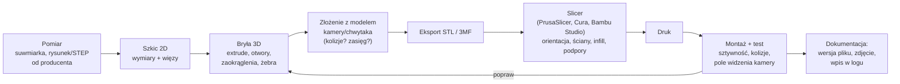

# 21 CAD i mocowania (druk 3D)

> [!skrot] W 30 sekund
> - **CAD:** Fusion 360 (darmowy dla studentów), SolidWorks, Onshape (w przeglądarce), FreeCAD (open source), Inventor. **Workflow:** szkic 2D z **wymiarami i więzami** → wyciągnięcie (extrude) / obrót → otwory, zaokrąglenia → złożenie → eksport **STL** (do druku) / **STEP** (wymiana z innymi CAD).
> - **Druk 3D FDM:** **PLA** (łatwy, sztywny, mięknie ~55–60 °C), **PETG** (wytrzymalszy, odporniejszy — dobry na mocowania), **ABS/ASA** (temperatura, UV), **TPU** (elastyczny — pady chwytaka), **PA-CF/PETG-CF** (sztywne z włóknem węglowym).
> - **Wytrzymałość:** wydruk jest **najsłabszy między warstwami (oś Z)** — orientuj część tak, by obciążenie nie rozrywało warstw.
> - **Mocowania:** gwint statywowy **1/4"-20 UNC** (kamery), otwory **M3/M4**, **wtopione insert'y gwintowane** (heat-set inserts), profile aluminiowe **2020/3030/4040** z nakrętkami T, kołnierz robota **ISO 9409-1**.
> - **Tolerancje w druku:** dodaj **0,2–0,4 mm luzu** na pasowania (otwór pod śrubę M3 → ~3,2–3,4 mm).

> [!intuicja] Po ludzku
> Mocowanie kamery ma być **sztywne i powtarzalne**: jak się trzęsie — obraz się rozmywa, jak da się je zamocować na dwa sposoby — po każdym demontażu kalibracja do kosza. Dlatego dobre mocowanie ma **kołki/wypusty ustalające** (zakładasz tylko w jednej pozycji) i jest grube tam, gdzie działa dźwignia.

## Od pomysłu do zamontowanej części

## Materiały do druku
| Materiał | Plusy | Minusy | Do czego w labie |
|---|---|---|---|
| **PLA** | łatwy, dokładny, sztywny | kruchy, mięknie ~55–60 °C (nagrzane auto, blisko silników!) | prototypy, uchwyty bez obciążenia |
| **PETG** | wytrzymały, mniej kruchy, odporny chemicznie | lekko się ciągnie (nitki) | **mocowania kamer, uchwyty, osłony** |
| **ABS / ASA** | odporność temp. (~95 °C), ASA na UV | skurcz, opary — zamknięta drukarka | części przy silnikach |
| **TPU** | elastyczny, przyczepny | trudniejszy w druku | **pady/opuszki chwytaka**, odbojniki |
| **PA (nylon), *-CF** | bardzo wytrzymały, sztywny (CF) | wilgoć, ścierne dysze (CF) | palce chwytaka, części nośne |

## Parametry druku, które mają znaczenie
| Parametr | Typowo | Wpływ |
|---|---|---|
| **Liczba ścian (perimeters)** | 3–5 dla części nośnych | **największy wpływ na wytrzymałość** (bardziej niż infill) |
| **Infill** | 20–40% (gyroid/cubic) | sztywność, masa, czas |
| **Wysokość warstwy** | 0,2 mm (0,1 dla detali) | jakość vs czas |
| **Orientacja** | obciążenie wzdłuż warstw, nie w poprzek | wytrzymałość |
| **Podpory** | gdy nawisy > ~45° | ślady, trudne usuwanie |

## Elementy złączne — ściąga
| Element | Wymiar / uwaga |
|---|---|
| **Gwint statywowy** | **1/4"-20 UNC** — standard aparatów i kamer (RealSense, ZED, kamery USB) |
| **Śruby metryczne** | M2,5 / **M3** / M4 / M5 / M6 (M3 = średnica 3 mm, skok 0,5 mm); łby imbus (DIN 912 / ISO 4762) |
| **Otwór przelotowy w druku** | M3 → 3,2–3,4 mm |
| **Heat-set insert** | mosiężna tulejka wtapiana lutownicą → trwały gwint w plastiku (lepszy niż gwint w plastiku) |
| **Nakrętka w gnieździe (nut trap)** | sześciokątna kieszeń na nakrętkę, M3 ≈ 5,5 mm „na klucz” + luz |
| **Profile aluminiowe** | 2020 / 3030 / 4040 (mm), rowek V-slot/T-slot, **nakrętki T** — szybka budowa ram i statywów kamer |
| **Kołki ustalające (dowel pins)** | powtarzalne pozycjonowanie (np. Ø4 h6) |
| **Klej do gwintów** | Loctite 222 (słaby) / **243 (średni, rozbieralny)** / 270 (mocny) |

## Dobre praktyki projektowe
- **Zmierz dwa razy** (suwmiarka), a jeśli producent daje **STEP/rysunek** — użyj go.
- **Sztywność:** żebra, grubsze ścianki przy dźwigni, krótkie wysięgniki (kamera na nadgarstku drga przy szybkim ruchu).
- **Powtarzalność:** kołki, wypusty, asymetria (da się złożyć tylko jednym sposobem).
- **Kable:** przewidź prowadzenie i odciążenie kabla w mocowaniu.
- **Pole widzenia:** sprawdź w CAD/RViz, czy chwytak/mocowanie nie zasłania kamery.
- **Masa** (payload robota!) i **środek masy**.
- **Wersjonowanie** plików CAD (`mount_d405_v3.step`), zdjęcie po montażu, wpis w logu i ewentualnie aktualizacja URDF (nowa geometria, nowa poza kamery → rekalibracja).

## Pytania rekrutacyjne
> [!zadanie] Jak zaprojektowałbyś mocowanie kamery na nadgarstku robota?
> > [!odpowiedz]- Odpowiedź
> > Pomiar/STEP kamery i kołnierza/chwytaka, CAD: sztywny wspornik z żebrami, otwory pod śruby producenta (np. M3 lub 1/4"-20), elementy ustalające dla powtarzalnej pozycji, prowadzenie kabla z odciążeniem, sprawdzenie pola widzenia i kolizji w złożeniu, minimalna masa. Druk z PETG, 4+ ściany, orientacja tak, by siły nie rozrywały warstw, inserty gwintowane. Po montażu test sztywności, aktualizacja URDF, kalibracja hand-eye, wpis w logu.
> > **EN:** *"I'd start from the camera's STEP file and the flange dimensions, design a stiff, ribbed bracket with locating features so it only mounts one way, plan cable routing with strain relief, check field of view and collisions in the assembly, print it in PETG with several perimeters and heat-set inserts, then update the URDF, recalibrate hand-eye and log the change."*

> [!zadanie] Dlaczego wydruk 3D pęka „wzdłuż warstw”?
> > [!odpowiedz]- Odpowiedź
> > Adhezja między warstwami jest słabsza niż wytrzymałość samego filamentu wzdłuż ścieżki — część jest anizotropowa. Dlatego orientuje się ją tak, by główne naprężenia szły wzdłuż warstw, zwiększa liczbę ścian i temperaturę druku.

> [!zadanie] PLA czy PETG na mocowanie przy robocie?
> > [!odpowiedz]- Odpowiedź
> > Raczej PETG: mniej kruchy, wytrzymalszy na uderzenia i temperaturę (PLA mięknie już ~55–60 °C, a przy silnikach i lampach bywa ciepło). PLA dobre na szybkie prototypy.

## Fiszki #fiszki/rozmowa-gd/cad
Standardowy gwint statywowy kamer?::1/4"-20 UNC.
STL vs STEP?::STL — siatka trójkątów do druku; STEP — dokładna bryła do wymiany między CAD-ami.
Najsłabszy kierunek wydruku FDM?::Oś Z — między warstwami.
Co najbardziej zwiększa wytrzymałość wydruku?::Liczba ścian (perimeters), potem orientacja i infill.
PLA — główna wada przy robotach?::Mięknie w ok. 55–60 °C, kruchy.
Materiał na elastyczne pady chwytaka?::TPU.
Co to jest heat-set insert?::Mosiężna tulejka gwintowana wtapiana w plastik lutownicą.
Luz na otwór pod M3 w druku?::ok. 3,2–3,4 mm.
Profile aluminiowe w labach?::2020/3030/4040 z rowkiem V/T-slot i nakrętkami T.
Klej do gwintów średni, rozbieralny?::Loctite 243.
Po co elementy ustalające (kołki) w mocowaniu?::Powtarzalna pozycja po demontażu — kalibracja pozostaje ważna.

## Moje notatki
> [!ja] Tu piszesz ty — Albert tej sekcji nie rusza.
