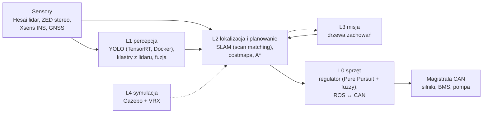
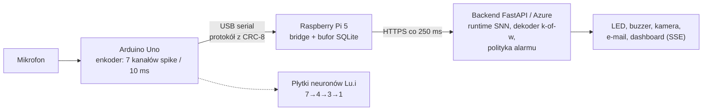

# 22 Moje projekty — jak o nich opowiadać

> [!skrot] W 30 sekund
> - Szymon (z polecenia): **„nauczcie się ładnie mówić o tym, co robiliście na uczelni — to jest bardzo ważne”**. Ta notatka to twój scenariusz.
> - **Dwa główne projekty:** **AGH Solar Boat — autonomiczna łódź na ROS 2** (zawody Njord 2026, Trondheim) i **SNN_Agent — detekcja stłuczenia szkła impulsową siecią neuronową na Arduino + Raspberry Pi 5 + chmura** (koło IDS AGH).
> - **Struktura każdej opowieści — STAR:** **S**ytuacja (kontekst) → **T**ask (twoje zadanie) → **A**kcja (co **ty** zrobiłeś, konkretnie, technicznie) → **R**ezultat (liczby, czego się nauczyłeś).
> - **Mostek do tej pracy:** w obu projektach był **sprzęt + Linux + ROS/edge + dane + dokumentacja** — dokładnie to, co robi się w labie.

> [!wazne] ⚠️ Zanim powiesz to na rozmowie
> Fragmenty oznaczone **[sprawdź]** napisałem na podstawie twoich notatek i historii gałęzi — **przeczytaj i popraw tak, żeby każde zdanie było prawdą i żebyś umiał je rozwinąć**. Rekruter zawsze dopytuje o szczegóły tego, co mówisz. Lepiej powiedzieć mniej, ale pewnie.

## Elevator pitch — „Tell me about yourself” (60–90 s)
> [!przyklad] Wersja EN (ćwicz na głos, z zegarkiem)
> *"I'm Patryk, I study Computer Science at AGH — I'm in my fifth semester — and I've also started Automation and Robotics at Kraków University of Technology, because I want a stronger hardware and control background.*
> *Most of my practical experience comes from two student projects. In the AGH Solar Boat team I work on the software of an autonomous boat built on ROS 2 Humble — a layered stack with lidar, a ZED stereo camera, an INS, a CAN bus to the motors and an NVIDIA Jetson on board. I worked mostly on the localization and planning layer — the lidar-based SLAM, docking in the costmap and matching detections by timestamps — and on tooling like Dockerized setups and diagnostics. We competed at Njord in Trondheim this year.*
> *The second project is a research project in the Industrial Data Science club: detecting glass breaking from audio with a spiking neural network — an Arduino encodes sound into spikes, a Raspberry Pi 5 bridges it to a cloud runtime. I built parts of the runtime, like the streaming decoder and telemetry.*
> *What I enjoy most is where software meets real hardware, and robot learning is the most exciting direction there — that's why this internship caught my attention."*

> [!przyklad] Wersja PL (gdyby rozmowa była po polsku)
> „Studiuję informatykę na AGH, piąty semestr, i dodatkowo zacząłem automatykę i robotykę na Politechnice Krakowskiej, bo chcę mieć mocniejsze podstawy sprzętowe i ze sterowania. Najwięcej praktyki mam z dwóch projektów: w kole AGH Solar Boat rozwijamy autonomiczną łódź na ROS 2 — lidar, kamera stereo ZED, INS, magistrala CAN do silników, Jetson na pokładzie. Zajmowałem się głównie warstwą lokalizacji i planowania — SLAM-em z lidaru, dokowaniem w costmapie, dopasowaniem detekcji po znacznikach czasu — oraz narzędziami: Docker, diagnostyka. W tym roku startowaliśmy na zawodach Njord w Trondheim. Drugi projekt to detekcja tłuczonego szkła z dźwięku impulsową siecią neuronową: Arduino koduje dźwięk na impulsy, Raspberry Pi 5 przesyła je do runtime'u w chmurze — zrobiłem m.in. dekoder strumieniowy i telemetrię. Najbardziej kręci mnie styk softu i prawdziwego sprzętu, a robot learning to teraz najciekawszy kierunek — stąd ta aplikacja.”

## Projekt 1 — AGH Solar Boat: autonomiczna łódź (ROS 2)

**Fakty do zapamiętania** (z [[Solar — Start]]):
- ROS 2 **Humble**, architektura warstwowa **L0–L4**, ~13 repozytoriów, własny stos (**nie Nav2**), komputer **Jetson** (JetPack 6).
- Sensory: lidar **Hesai**, kamera stereo **ZED** (wrapper 5.1), INS **Xsens**, GNSS, echosonda; most **ROS ↔ CAN** (SocketCAN `can0`, plik `barka.dbc`).
- Percepcja: **YOLO na TensorRT w Dockerze**, fuzja kamera–lidar.
- L2 SLAM: deskewing chmury, cechy (płaszczyzny/linie z PCA), **scan matching Gauss–Newton 3 DOF (x, y, yaw)** do lokalnej mapy voxelowej, korekta `map → odom`, **costmapa** dla planera **A\***.
- Zawody **Njord 2026 (Trondheim)**, sierpień 2026.

**STAR — przykład 1 (techniczny):**
> [!przyklad] Dokowanie i costmapa [sprawdź]
> - **S:** Na zawodach łódź musiała wpłynąć do doku/slipu; planer opierał się na costmapie z SLAM-u.
> - **T:** Poprawić zachowanie przy dokowaniu i wykorzystanie detekcji.
> - **A:** Dodałem dok do costmapy i okresową publikację śledzonych detekcji (`/tracked_detections`), dopasowanie detekcji po znacznikach czasu (gałąź `njord/tracked_timestamp_matching`). Testowałem na rosbagach i w symulacji. [sprawdź szczegóły — co dokładnie ty]
> - **R:** [uzupełnij: co zadziałało na zawodach, czego się nauczyłeś — np. że synchronizacja czasowa danych z różnych sensorów jest krytyczna — **to świetny mostek do synchronizacji w datasetach!**]

**STAR — przykład 2 (troubleshooting / porządek):**
> [!przyklad] Po zawodach — zabezpieczenie kodu i dokumentacja [sprawdź]
> - **S:** Po zawodach część działającego kodu była tylko lokalnie na Jetsonie (niezacommitowane zmiany, gałęzie bez kopii na GitLabie).
> - **T:** Zrozumieć stan systemu i zabezpieczyć wiedzę dla zespołu.
> - **A:** Przeszedłem wszystkie repozytoria i gałęzie, spisałem mapę topików i serwisów (158 topików, 11 serwisów), drzewo TF, znane błędy z odniesieniem do plików i linii, ryzyka (np. kilka węzłów nadających tę samą ramkę CAN).
> - **R:** Jedna baza wiedzy dla zespołu, lista krytycznych rzeczy do wypchnięcia, znalezione konkretne błędy (np. publikacja na niezainicjalizowanym publisherze). **Mostek:** „Dokładna dokumentacja i logi to coś, co robię naturalnie — w labie to inwentarz i maintenance log.”

**STAR — przykład 3 (analiza sterowania):**
> [!przyklad] Oscylacje łodzi [sprawdź]
> - **S:** Łódź „bujała się” na kursie.
> - **T:** Znaleźć przyczynę.
> - **A:** Przeanalizowałem regulator (Simulink: Pure Pursuit + logika rozmyta) i planer: schodkowa ścieżka A\* z siatki 8-sąsiedztwa przeliczana co ~0,5 s, krótki lookahead (≤ 1 m) malejący przy dużym błędzie kursu i bardzo duże wzmocnienie wyjścia (fuzzy działał jak przekaźnik).
> - **R:** Zaproponowane poprawki: wygładzanie ścieżki line-of-sight, stały dłuższy lookahead (3–6 m), mniejsze wzmocnienie i ogranicznik narastania ciągu. [uzupełnij: czy wdrożone/przetestowane]

**Inne twoje rzeczy [sprawdź]:** diagnostyka i watchdog łącza w `dongle-service` (modem 5G, hotplug, CLI), dockeryzacja detekcji i wybór świata w skrypcie startowym symulacji, naprawa budowania `mapper`, projekt **loop closure** dla SLAM-u.

## Projekt 2 — SNN_Agent: detekcja stłuczenia szkła (koło IDS AGH)

**Fakty** (z [[SNN_Agent — Start]]):
- Cel: ciągła detekcja **tłuczonego szkła z dźwięku** siecią **impulsową (SNN)** z neuronów sprzętowych **Lu.i** (topologia 7→4→3→1), porównanie z detektorem **FFT** na Arduino.
- Łańcuch: Arduino Uno → **Raspberry Pi 5** → Azure (runtime SNN, analiza zdjęcia) → alarm.
- **Twoja część:** w `snn_runtime` — **loader manifestu (P1)**, **dekoder strumieniowy k-of-w (P2)**, **telemetria NeuronFrame (P3)**; porównanie **SNN vs Fourier** (PR #74).
- Jakość: PR gate w CI, ~1000 testów.

**STAR — przykład (rzetelność danych — idealny pod tę rolę!):**
> [!przyklad] Przeciek danych i uczciwe metryki
> - **S:** Najlepszy model („champion”) miał świetny wynik (clip-F1 0,658).
> - **T:** Ustalić, czy wynik jest wiarygodny.
> - **A:** Zespół przeanalizował zbiór danych i metryki: okazało się, że był **przeciek między zbiorem treningowym i testowym**, a część próbek była źle oznaczona. Przeszliśmy na czysty, wersjonowany zbiór z kontraktem danych i walidatorem, oraz na metrykę **recall przy budżecie fałszywych alarmów na godzinę**. [sprawdź, jaki był twój udział]
> - **R:** Champion został **wycofany**, a na czystych danych widać realny stan (budżet 6 FA/h na razie nieosiągalny). **Lekcja: jakość i uczciwe etykiety danych są ważniejsze niż ładna liczba** — dokładnie to, o co chodzi w zbieraniu danych do VLA.

## Mostki: projekt → wymaganie z ogłoszenia
| Wymaganie | Co powiesz |
|---|---|
| Teleoperacja i dane | Rosbagi z łodzi, analiza danych z sensorów, synchronizacja po timestampach; w SNN — wersjonowany dataset, walidator, przeciek danych |
| Utrzymanie sprzętu | Jetson, lidar, kamera ZED, CAN, Arduino/RPi, okablowanie na łodzi [uzupełnij konkretną naprawę!] |
| Troubleshooting Linux | Jetson przez SSH, usługi systemd (watchdog ZED, modem), Docker, sterowniki |
| Sieci | Modem 5G, ROS_DOMAIN_ID, Cyclone DDS, SSH na łódź |
| Kamery / głębia | ZED stereo, fuzja kamera–lidar, YOLO |
| ROS 2 | Humble: topiki, TF, launch, rosbagi, interfejsy msg/srv |
| Docker | `ros2-humble-gpu`, YOLO TensorRT w kontenerze |
| Dokumentacja | Baza wiedzy obu projektów w Obsidianie — **możesz ją pokazać jako dowód** |

## Pytania, które padną po twojej opowieści (przygotuj odpowiedzi!)
> [!zadanie] Co było najtrudniejsze w projekcie łodzi?
> > [!odpowiedz]- Szkic
> > Integracja: wiele warstw i ludzi, rozjechane gałęzie, synchronizacja danych z sensorów, testowanie na wodzie (mało czasu, warunki). Rozwiązania: rosbagi i symulacja do testów offline, dokumentacja, porządek w gałęziach. [dopasuj do siebie]

> [!zadanie] Jak działa wasz SLAM w trzech zdaniach?
> > [!odpowiedz]- Szkic
> > Chmura z lidaru jest kompensowana o ruch łodzi (deskew), z niej wyciągamy cechy — płaszczyzny i linie — i dopasowujemy je metodą Gaussa–Newtona do lokalnej mapy voxelowej w 3 stopniach swobody (x, y, yaw), z predykcją z odometrii. Wynik koryguje transformację map→odom, a z keyframe'ów budujemy globalną costmapę dla planera A\*. Nie ma jeszcze loop closure — to coś, co projektowałem.

> [!zadanie] Co byś zrobił inaczej?
> > [!odpowiedz]- Szkic
> > Wcześniej postawić CI i testy na rosbagach, pilnować, żeby nic nie zostawało tylko na Jetsonie, ustalić konwencje (TF, nazwy topiców, gałęzie) na początku sezonu.

> [!zadanie] Jaka była twoja rola w zespole?
> > [!odpowiedz]- Szkic
> > [uzupełnij precyzyjnie: za co odpowiadałeś, z kim współpracowałeś, jak dzieliliście pracę]

> [!zadanie] Czy naprawiałeś kiedyś sprzęt?
> > [!odpowiedz]- Szkic
> > [uzupełnij **prawdziwym** przykładem: kabel, złącze CAN, zasilanie Jetsona, montaż sensora, lutowanie, Arduino… — to pytanie jest prawie pewne, bo ogłoszenie podkreśla „hands-on hardware”]

## Fiszki #fiszki/rozmowa-gd/projekty
Solar Boat — jaka wersja ROS i jaki komputer?::ROS 2 Humble, NVIDIA Jetson (JetPack 6).
Solar Boat — sensory?::Lidar Hesai, kamera stereo ZED, INS Xsens, GNSS, echosonda.
Solar Boat — warstwy stosu?::L0 sprzęt/CAN, L1 percepcja, L2 lokalizacja i planowanie, L3 misja (drzewa zachowań), L4 symulacja.
Solar Boat — zawody 2026?::Njord, Trondheim, sierpień 2026.
SLAM łodzi w jednym zdaniu?::Deskew lidaru → cechy (płaszczyzny/linie) → Gauss–Newton 3 DOF do lokalnej mapy voxelowej → korekta map→odom → costmapa dla A*.
SNN_Agent — cel?::Detekcja tłuczonego szkła z dźwięku impulsową siecią neuronową (Lu.i 7→4→3→1), porównanie z FFT.
SNN_Agent — łańcuch sprzętowy?::Mikrofon → Arduino Uno (spike encoder) → Raspberry Pi 5 → backend w Azure → alarm/dashboard.
SNN_Agent — twoja część?::snn_runtime: loader manifestu, dekoder strumieniowy k-of-w, telemetria NeuronFrame; porównanie SNN vs Fourier.
Lekcja z wycofanego championa SNN?::Przeciek danych zawyżył wynik — jakość danych i uczciwe metryki ważniejsze niż ładna liczba.
Struktura STAR?::Sytuacja, Task (zadanie), Akcja (co TY zrobiłeś), Rezultat (liczby, wnioski).

## Moje notatki
> [!ja] Tu piszesz ty — Albert tej sekcji nie rusza.
