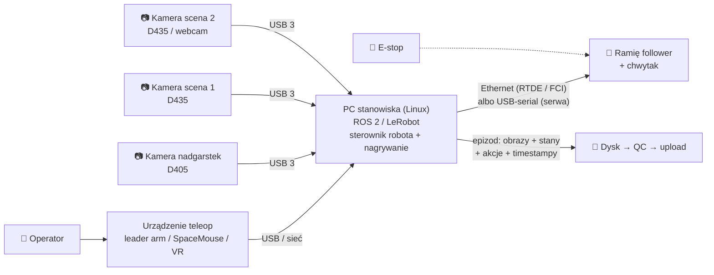

# 26 Sprzęt w labach robot learning

> [!skrot] W 30 sekund
> - W labach, które zbierają dane do VLA, powtarza się **ten sam zestaw**: **ramię** (Franka, UR, xArm, ViperX/WidowX, tanie SO-100/SO-101) + **chwytak** + **2–4 kamery** (stała z boku, z góry i **na nadgarstku**) + **urządzenie do teleoperacji** (ramię leader, SpaceMouse, gogle VR).
> - **Nie musisz znać konkretnego robota z labu GD.** Musisz umieć powiedzieć, **czym te roboty się różnią** (liczba osi, udźwig, czujniki momentu, jak się z nimi łączy) i **jak wygląda typowe stanowisko**.
> - **Znane datasety:** **Open X-Embodiment** (ponad milion epizodów z 22 typów robotów), **DROID** (Franka, ~76 tys. demonstracji w setkach scen), **BridgeData V2** (WidowX 250). Na rozmowie dobrze brzmi: *„DROID pokazał, że różnorodność scen jest tak samo ważna jak liczba demonstracji.”*
> - **Kamery:** **RealSense D435/D435i** (scena), **D405** (z bliska — na nadgarstek), **ZED** (pasywne stereo, potrzebuje GPU).

> [!intuicja] Po ludzku
> Stanowisko do zbierania danych to „studio nagraniowe” dla robota. **Ramię** jest aktorem, **kamery** są operatorami kamer, a **ty z urządzeniem do teleoperacji** jesteś reżyserem, który prowadzi aktora za rękę. Dataset to nagranie: co kamery widziały i co robot zrobił, klatka po klatce.

## Typowe stanowisko (to rysuj na kartce, gdy zapytają)

## Ramiona — porównanie
| Robot | Osie (DoF) | Udźwig | Co wyróżnia | Jak się łączy |
|---|---|---|---|---|
| **Franka Research 3 (dawniej Panda)** | 7 | 3 kg | **czujniki momentu w każdym stawie** → miękkie sterowanie, wyczuwa kontakt; najpopularniejszy w badaniach (DROID) | Ethernet, **FCI / libfranka**, pętla 1 kHz, `franka_ros2` |
| **Universal Robots UR5e** (też UR3e, UR10e) | 6 | 5 kg | przemysłowy, bardzo niezawodny, **wbudowany F/T** w e-Series, tablet (teach pendant) | Ethernet, **RTDE** (do 500 Hz), `ur_robot_driver` + URCap External Control |
| **UFactory xArm 6/7, Lite 6** | 6 / 7 | ~1–5 kg zależnie od modelu | tańszy, prosty SDK w Pythonie | Ethernet, xArm SDK, `xarm_ros2` |
| **Kinova Gen3** | 7 (lub 6) | kilka kg | lekki, czujniki momentu, kamera w nadgarstku w opcji | Ethernet, Kortex API |
| **Trossen ViperX 300 / WidowX 250** | 6 | < 1 kg | serwa **Dynamixel**, tani; **ALOHA** = 2× ViperX (follower) + 2× WidowX (leader); WidowX w BridgeData | USB (**U2D2**) → szyna serw (TTL / RS-485) |
| **AgileX PiPER** | 6 | ~1,5 kg | tanie lekkie ramię, popularne w zestawach do teleopu | CAN (adapter USB–CAN) |
| **SO-100 / SO-101 (LeRobot)** | 5 + chwytak | kilkaset gramów | **drukowane w 3D**, serwa **Feetech STS3215**, para leader + follower za kilkaset dolarów | USB-serial → szyna serw |
| **Koch v1.1** | 5 + chwytak | mały | poprzednik SO-100, serwa Dynamixel | USB (U2D2) |

> [!wazne] Co z tego wynika dla twojej pracy
> - **Ramiona „przemysłowe/badawcze” (Franka, UR, xArm, Kinova)** mają własny sterownik w szafce, łączą się po **Ethernecie**, mają tryby bezpieczeństwa, protective stopy i licencje/firmware. Typowe problemy: **sieć (IP, kabel), tryb pracy (remote/local), odblokowanie hamulców, protective stop po kolizji.**
> - **Ramiona „na serwach” (ViperX, SO-100, Koch)** łączą się po **USB-serial** z szyną serw. Typowe problemy: **`/dev/ttyUSB*` się przenumerował** (→ reguła udev), **brak uprawnień** (grupa `dialout`), **przegrzane serwo**, **zły ID serwa**, **kalibracja zer**, luźny kabel w łańcuchu.

## Urządzenia do teleoperacji
| Urządzenie | Jak działa | Plus | Minus |
|---|---|---|---|
| **Ramię leader** (ALOHA, GELLO, SO-100 leader) | ruszasz ręką małym ramieniem o tej samej kinematyce; follower kopiuje kąty stawów | intuicyjne, **naturalne i płynne demonstracje**, tanie | tylko dla pasującej kinematyki; operator się męczy |
| **GELLO** | tani „bliźniak” ramienia (Franka/UR/xArm) z serw Dynamixel i druku 3D | jak leader, ale dla dużych ramion | trzeba zbudować i skalibrować |
| **SpaceMouse** (3Dconnexion) | joystick 6-osiowy, sterujesz prędkością TCP | tani, uniwersalny | mniej naturalny, wolniejsze demonstracje |
| **VR (np. Meta Quest)** | śledzenie dłoni/kontrolerów → poza TCP (przez IK) | intuicyjne, widok z kamer w goglach | opóźnienia, IK i kalibracja przestrzeni |
| **Ręczny chwytak z kamerą (UMI)** | człowiek zbiera dane bez robota, chwytakiem z kamerą GoPro | dane „w terenie”, bez robota | trzeba odtworzyć pozę (SLAM), przenoszenie na robota |
| **Kinesthetic teaching / freedrive** | prowadzisz samo ramię ręką | najprostsze | ręka operatora widoczna na kamerach |

## Kamery na stanowisku
| Kamera | Zasada | Zakres / zastosowanie | Uwagi |
|---|---|---|---|
| **Intel RealSense D435 / D435i** | aktywne stereo (IR projektor) | ~0,3–3 m, **kamera sceny** | i = z IMU; USB 3 obowiązkowo |
| **RealSense D405** | stereo bez projektora, krótka baza | **~7–50 cm**, **kamera na nadgarstku** | mała, do chwytania z bliska |
| **RealSense D455** | aktywne stereo, większa baza | dalej, dokładniej na dystansie | większa |
| **Stereolabs ZED 2i / ZED Mini** | pasywne stereo + sieć neuronowa | na zewnątrz, dalsze odległości | **wymaga GPU NVIDIA** (znasz z łodzi!) |
| **Orbbec (Femto, Gemini)** | ToF / stereo | alternatywa dla RealSense | |
| **Zwykła kamera USB / GoPro** | tylko RGB | wiele datasetów i tak używa samego RGB | tania |

> [!przyda] Połącz z łodzią
> *"On the boat we used a ZED stereo camera on a Jetson — it needs an NVIDIA GPU for depth, and we had a watchdog service because it occasionally dropped. So I know cameras are one of the most common failure points."* [sprawdź, czy to prawda u ciebie]

## Znane datasety (na wypadek pytania „co wiesz o naszej dziedzinie?”)
| Dataset | Robot | Co ważne |
|---|---|---|
| **Open X-Embodiment (OXE)** | 22 typy robotów, dziesiątki labów | ponad milion epizodów; na nim trenowano RT-X, Octo, OpenVLA |
| **DROID** | Franka + chwytak Robotiq, kamery stereo | ~76 tys. demonstracji, setki scen w wielu budynkach — **nacisk na różnorodność** |
| **BridgeData V2** | WidowX 250 | ~60 tys. trajektorii w kuchniach-zabawkach, zadania opisane językiem |
| **ALOHA / Mobile ALOHA** | 2× ViperX (bimanual) | precyzyjne zadania dwuręczne, ACT |
| **LeRobot Hub** | SO-100, ALOHA, Koch… | tysiące datasetów społeczności w formacie **LeRobotDataset** |

## Typowe błędy
> [!blad] „Znam tylko UR, więc nie poradzę sobie z innym robotem”
> Zasady są te same: sterownik, sieć/USB, kalibracja, tryby bezpieczeństwa, TCP, kamery. Na rozmowie mów: *"I haven't used that exact arm, but the workflow — driver, network, calibration, safety configuration — transfers between robots, and I learn new hardware quickly from the manual."*

> [!blad] Mylenie leadera z followerem
> **Leader** = ramię, którym rusza człowiek. **Follower** = robot, który wykonuje zadanie i jest nagrywany.

## Pytania rekrutacyjne
> [!zadanie] Jak wygląda typowe stanowisko do zbierania danych manipulacyjnych?
> > [!odpowiedz]- Odpowiedź
> > Ramię (follower) z chwytakiem, 2–4 kamery (kamera na nadgarstku i 1–3 kamery sceny), urządzenie do teleoperacji (ramię leader, SpaceMouse lub VR), komputer z Linuxem, który uruchamia sterownik robota i nagrywa zsynchronizowane obrazy, stany stawów, akcje i znaczniki czasu, oraz e-stop w zasięgu ręki. Po epizodzie: reset sceny, kontrola jakości, upload.
> > **EN:** *"A follower arm with a gripper, a wrist camera plus one to three scene cameras, a teleop device such as a leader arm or a SpaceMouse, and a Linux PC that runs the robot driver and records synchronized images, joint states and actions — plus an e-stop within reach."*

> [!zadanie] Czym różni się Franka od UR5e?
> > [!odpowiedz]- Odpowiedź
> > Franka ma 7 osi (redundantna — może zmieniać „łokieć” przy tej samej pozie chwytaka), czujniki momentu w każdym stawie i sterowanie 1 kHz przez libfranka — popularna w badaniach i do sterowania impedancyjnego. UR5e ma 6 osi, udźwig 5 kg, jest przemysłowy i bardzo niezawodny, ma wbudowany czujnik siły na nadgarstku i interfejs RTDE. Oba łączą się po Ethernecie.

> [!zadanie] Jakie znasz metody teleoperacji i które dają najlepsze dane?
> > [!odpowiedz]- Odpowiedź
> > Ramię leader (ALOHA, GELLO), SpaceMouse, VR, kinesthetic teaching, ręczny chwytak z kamerą (UMI). Do precyzyjnej manipulacji najczęściej najlepsze, najbardziej naturalne i płynne demonstracje daje ramię leader o tej samej kinematyce — operator czuje ruch i nie ma pośredniej IK. SpaceMouse jest uniwersalny, ale demonstracje są wolniejsze i mniej naturalne.

> [!zadanie] Jaką kamerę dałbyś na nadgarstek, a jaką na scenę i dlaczego?
> > [!odpowiedz]- Odpowiedź
> > Na nadgarstek małą kamerę krótkiego zasięgu, np. RealSense D405 (dobra głębia z 7–50 cm), bo widzi obiekt z bliska tuż przed chwytem. Na scenę D435 lub podobną (zasięg ~0,3–3 m), zamocowaną sztywno, żeby kalibracja się nie rozjeżdżała. Wszystkie po USB 3 i z zapisanymi numerami seryjnymi, żeby nie pomylić kamer.

> [!zadanie] Ramię na serwach przestało odpowiadać po przepięciu USB. Co sprawdzasz?
> > [!odpowiedz]- Odpowiedź
> > Czy urządzenie jest widoczne (`lsusb`, `dmesg`), czy nie zmieniła się nazwa portu (`/dev/ttyUSB0` → `ttyUSB1`; rozwiązanie: reguła udev ze stałą nazwą), uprawnienia (grupa `dialout`), zasilanie serw (osobny zasilacz!), czy któreś serwo nie zgłasza błędu przegrzania/przeciążenia, czy łańcuch kabli między serwami jest cały. Potem test jednego serwa narzędziem producenta.

> [!zadanie] Co wiesz o Open X-Embodiment i DROID?
> > [!odpowiedz]- Odpowiedź
> > Open X-Embodiment to zbiór ponad miliona epizodów z ponad 20 typów robotów z wielu labów, ujednolicony do wspólnego formatu; trenowano na nim m.in. RT-X, Octo i OpenVLA — pokazał, że trening na danych z wielu robotów pomaga. DROID to duży dataset z Franki zebrany w setkach różnych scen i budynków — nacisk na różnorodność otoczenia, co poprawia uogólnianie.

## Fiszki #fiszki/rozmowa-gd/sprzet
Ile osi ma Franka Research 3 i co ją wyróżnia?::7 osi, czujniki momentu w każdym stawie, sterowanie 1 kHz przez libfranka (FCI).
UR5e — osie, udźwig, interfejs?::6 osi, 5 kg, RTDE po Ethernecie (do 500 Hz), wbudowany F/T w e-Series.
Z czego składa się ALOHA?::2 ramiona follower ViperX + 2 ramiona leader WidowX (serwa Dynamixel), kilka kamer; bimanualna teleoperacja.
Co to jest GELLO?::Tani leader z serw Dynamixel i druku 3D o kinematyce dużego ramienia (Franka/UR/xArm).
SO-100 / SO-101?::Drukowane w 3D ramiona LeRobot na serwach Feetech STS3215, para leader + follower.
Jak łączy się ramię na serwach Dynamixel z PC?::Adapter USB (U2D2) → szyna serw TTL/RS-485 → /dev/ttyUSB*.
Kamera na nadgarstek — przykład i zasięg?::RealSense D405, ok. 7–50 cm.
Kamera sceny — przykład i zasięg?::RealSense D435, ok. 0,3–3 m (aktywne stereo z projektorem IR).
Czego wymaga ZED do głębi?::GPU NVIDIA (CUDA).
Open X-Embodiment?::Ponad milion epizodów z 22 typów robotów; trening RT-X, Octo, OpenVLA.
DROID?::Dataset z Franki, ~76 tys. demonstracji w setkach scen — nacisk na różnorodność.
BridgeData V2 — jaki robot?::WidowX 250.
Leader vs follower?::Leader — ramię prowadzone przez człowieka; follower — robot wykonujący i nagrywany.
UMI?::Ręczny chwytak z kamerą GoPro do zbierania demonstracji bez robota.

## Moje notatki
> [!ja] Tu piszesz ty — Albert tej sekcji nie rusza.
