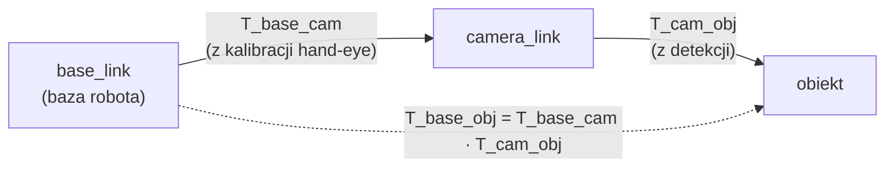

# 27 Zadania obliczeniowe — liczenie na głos

> [!skrot] W 30 sekund
> - Na rozmowie technicznej często pada **małe zadanie „na kartce”**: obróć punkt, złóż dwie transformacje, policz głębię ze stereo, podsieć, przepustowość kamer. Nikt nie oczekuje kalkulatora w głowie. Oczekuje **metody wypowiedzianej na głos**.
> - **Schemat odpowiedzi:** 1) powiedz wzór, 2) podstaw liczby, 3) podaj wynik **z jednostką**, 4) **sprawdź sensowność** („2 metry — to rozsądne dla kamery na stole”).
> - Tu są **23 zadania** z rozwiązaniami krok po kroku. Każde trafia też do [[24 Trenażer — symulacja rozmowy|trenażera]].

> [!intuicja] Po ludzku
> Rekruter nie sprawdza, czy umiesz mnożyć. Sprawdza, **czy rozumiesz, co liczysz**: że punkt z kamery trzeba „przenieść” do układu robota, że głębia ze stereo psuje się z odległością, że 3 kamery bez kompresji zapchają dysk. Mów, co robisz, zanim to zrobisz: *"First I'll write the transform, then plug in the numbers…"*

## Ściąga wzorów (wszystko, czego potrzebujesz poniżej)
| Temat | Wzór |
|---|---|
| Obrót wokół Z o kąt θ | $R_z(\theta) = \begin{bmatrix}\cos\theta & -\sin\theta & 0\\ \sin\theta & \cos\theta & 0\\ 0&0&1\end{bmatrix}$ |
| Transformacja punktu | $p_A = R_{AB}\, p_B + t_{AB}$ (macierz 4×4: $T_{AB} = \begin{bmatrix}R & t\\0&1\end{bmatrix}$) |
| Składanie | $T_{AC} = T_{AB}\, T_{BC}$ (indeksy „skracają się” w środku) |
| Odwrotność | $T^{-1} = \begin{bmatrix}R^T & -R^T t\\ 0 & 1\end{bmatrix}$ |
| Kwaternion obrotu o θ wokół osi $u$ | $q = (x,y,z,w) = (u \sin\tfrac{\theta}{2},\ \cos\tfrac{\theta}{2})$ — **w ROS kolejność x, y, z, w** |
| FK ramienia 2-członowego (płaskie) | $x = l_1\cos\theta_1 + l_2\cos(\theta_1+\theta_2)$, $y = l_1\sin\theta_1 + l_2\sin(\theta_1+\theta_2)$ |
| Zasięg ramienia 2-członowego | $|l_1 - l_2| \le r \le l_1 + l_2$ |
| Kamera otworkowa (projekcja) | $u = f_x \frac{X}{Z} + c_x$, $v = f_y \frac{Y}{Z} + c_y$ |
| Odwrotnie (piksel + głębia → 3D) | $X = \frac{(u - c_x) Z}{f_x}$, $Y = \frac{(v - c_y) Z}{f_y}$ |
| Stereo | $Z = \frac{f B}{d}$, błąd: $\Delta Z \approx \frac{Z^2}{f B}\,\Delta d$ |
| Przepustowość obrazu | szer × wys × bajty/piksel × fps |
| Moment siły | $\tau = m g \cdot r$ (ramię siły poziomo) |
| Prędkość liniowa z obrotu | $v = \omega \cdot r$ |
| Hosty w podsieci /n | $2^{32-n} - 2$ |

## Łańcuch transformacji — jak to „czytać”

Zasada: **indeks prawy jednej macierzy = indeks lewy następnej** (base‑cam · cam‑obj = base‑obj). Jeśli indeksy się nie „stykają”, to znaczy, że gdzieś brakuje odwrotności.

## Blok A — obroty i transformacje
> [!zadanie] A1. Obróć punkt $p = (0{,}2;\ 0{,}1;\ 0)$ o 90° wokół osi Z.
> > [!odpowiedz]- Rozwiązanie
> > $\cos 90° = 0$, $\sin 90° = 1$, więc $R_z = \begin{bmatrix}0&-1&0\\1&0&0\\0&0&1\end{bmatrix}$.
> > $x' = 0\cdot0{,}2 - 1\cdot0{,}1 = -0{,}1$; $y' = 1\cdot 0{,}2 + 0 = 0{,}2$; $z' = 0$. **Wynik: $(-0{,}1;\ 0{,}2;\ 0)$.**
> > Sprawdzenie: obrót o 90° w lewo zamienia „x na y” — punkt leżący głównie na osi X ląduje głównie na osi Y. ✔

> [!zadanie] A2. Kamera wisi nad stołem w punkcie $t = (0{,}5;\ 0;\ 1{,}0)$ m względem bazy robota i patrzy w dół (obrót o 180° wokół X, czyli $R = \mathrm{diag}(1, -1, -1)$). Kamera widzi kubek w $p_{cam} = (0{,}1;\ 0{,}05;\ 0{,}8)$. Gdzie jest kubek w układzie bazy?
> > [!odpowiedz]- Rozwiązanie
> > $p_{base} = R\,p_{cam} + t = (0{,}1;\ -0{,}05;\ -0{,}8) + (0{,}5;\ 0;\ 1{,}0) = $ **$(0{,}6;\ -0{,}05;\ 0{,}2)$ m**.
> > Sprawdzenie: kamera jest 1 m nad bazą, kubek 0,8 m od kamery w dół → 0,2 m nad poziomem bazy. ✔ Sensowne, jeśli stół jest trochę wyżej niż baza.
> > **EN:** *"I rotate the point into the base orientation and then add the camera's position: p_base = R · p_cam + t."*

> [!zadanie] A3. Policz odwrotność transformacji z A2 (czyli pozę bazy w układzie kamery) i sprawdź na kubku.
> > [!odpowiedz]- Rozwiązanie
> > $R^T = \mathrm{diag}(1,-1,-1)$ (ta macierz jest swoją odwrotnością). $-R^T t = -(0{,}5;\ 0;\ -1{,}0) = (-0{,}5;\ 0;\ 1{,}0)$.
> > Sprawdzenie na kubku: $R^T (0{,}6;\ -0{,}05;\ 0{,}2) + (-0{,}5;\ 0;\ 1{,}0) = (0{,}6;\ 0{,}05;\ -0{,}2) + (-0{,}5;\ 0;\ 1{,}0) = (0{,}1;\ 0{,}05;\ 0{,}8)$ ✔ — wróciliśmy do $p_{cam}$.
> > Najczęstszy błąd: odwrócić tylko $R$, a $t$ zostawić bez zmian albo dać po prostu $-t$.

> [!zadanie] A4. Zapisz kwaternion obrotu o 90° wokół Z (w kolejności ROS). A jaki jest kwaternion „braku obrotu”?
> > [!odpowiedz]- Rozwiązanie
> > $\theta/2 = 45°$, $\sin 45° = \cos 45° \approx 0{,}7071$. Oś $u = (0,0,1)$. **$q = (0;\ 0;\ 0{,}7071;\ 0{,}7071)$** w kolejności (x, y, z, w).
> > Brak obrotu: **$(0;\ 0;\ 0;\ 1)$**. Kwaternion musi mieć długość 1 — $0{,}7071^2 + 0{,}7071^2 = 1$ ✔.
> > Pułapka: niektóre biblioteki (np. Eigen w konstruktorze, transforms3d) używają kolejności **w, x, y, z**. Zawsze sprawdzaj.

> [!zadanie] A5. Kwaternion ma $w = 0{,}5$. O jaki kąt obraca?
> > [!odpowiedz]- Rozwiązanie
> > $w = \cos(\theta/2) = 0{,}5 \Rightarrow \theta/2 = 60° \Rightarrow$ **$\theta = 120°$** (wokół osi danej przez x, y, z).

> [!zadanie] A6. Robot chwyta zawsze 2 cm za daleko w osi X bazy, w każdym miejscu stołu. Co to mówi o błędzie?
> > [!odpowiedz]- Rozwiązanie
> > Stały przesuw niezależny od położenia to błąd **translacji** w łańcuchu: zła translacja w kalibracji hand-eye (kamera–baza), zły **TCP** (długość narzędzia) albo zły offset w URDF. Gdyby błąd rósł z odległością od kamery lub zmieniał kierunek w różnych miejscach — podejrzewałbym **rotację** lub intrinsics kamery.

## Blok B — kinematyka
> [!zadanie] B1. Ramię płaskie: $l_1 = 0{,}5$ m, $l_2 = 0{,}3$ m, $\theta_1 = 30°$, $\theta_2 = 60°$. Gdzie jest koniec ramienia?
> > [!odpowiedz]- Rozwiązanie
> > $\theta_1 + \theta_2 = 90°$.
> > $x = 0{,}5\cos 30° + 0{,}3\cos 90° = 0{,}5\cdot0{,}866 + 0 = 0{,}433$ m.
> > $y = 0{,}5\sin 30° + 0{,}3\sin 90° = 0{,}25 + 0{,}3 = 0{,}55$ m.
> > **Wynik: (0,433; 0,55) m.** Sprawdzenie: odległość od bazy $\approx 0{,}70$ m — mniej niż $l_1 + l_2 = 0{,}8$ ✔.

> [!zadanie] B2. To samo ramię (0,5 + 0,3 m). Czy dosięgnie punktów (0,6; 0,6) i (0,1; 0,1)? Ile rozwiązań IK ma typowy osiągalny punkt?
> > [!odpowiedz]- Rozwiązanie
> > Zasięg: $0{,}2 \le r \le 0{,}8$ m.
> > (0,6; 0,6): $r = \sqrt{0{,}72} \approx 0{,}85$ m > 0,8 → **nie** (za daleko).
> > (0,1; 0,1): $r \approx 0{,}14$ m < 0,2 → **nie** (za blisko — „dziura” przy bazie).
> > Typowy punkt w środku zasięgu ma **2 rozwiązania** (łokieć w górę / w dół). Na brzegu zasięgu — 1 (ramię wyprostowane, **osobliwość**).

> [!zadanie] B3. Ile wynosi moment w stawie barku, gdy ramię trzyma poziomo 1 kg w odległości 0,5 m (pomijając masę ramienia)?
> > [!odpowiedz]- Rozwiązanie
> > $\tau = m g r = 1 \cdot 9{,}81 \cdot 0{,}5 \approx$ **4,9 N·m**. W praktyce dochodzi masa samego ramienia i chwytaka — dlatego udźwig robota podaje się dla konkretnego zasięgu i dlatego **ustawienie payloadu w konfiguracji** jest ważne.

> [!zadanie] B4. Staw obraca się z prędkością 1 rad/s, a chwytak jest 0,8 m od osi. Jak szybko porusza się chwytak? Czy to dużo?
> > [!odpowiedz]- Rozwiązanie
> > $v = \omega r = 1 \cdot 0{,}8 =$ **0,8 m/s**. W trybie ręcznym/testowym (T1) norma ogranicza prędkość narzędzia do **250 mm/s** → przy 0,8 m to najwyżej ~0,31 rad/s (~18°/s). Wniosek: mały obrót w stawie u podstawy = szybki ruch na końcu ramienia — przy testach zaczynaj od niskich prędkości.

> [!zadanie] B5. Serwo ma enkoder 12-bitowy (4096 kroków na obrót). Jaka to rozdzielczość kątowa i ile to milimetrów na końcu członu 0,3 m?
> > [!odpowiedz]- Rozwiązanie
> > $360° / 4096 \approx 0{,}088°$ $= 0{,}00153$ rad. Na 0,3 m: $0{,}00153 \cdot 0{,}3 \approx$ **0,46 mm**. Przy kilku stawach błędy się sumują — tanie ramiona na serwach są mniej precyzyjne niż przemysłowe.

## Blok C — kamery
> [!zadanie] C1. Kamera: $f_x = f_y = 600$ px, $c_x = 320$, $c_y = 240$. Na jakim pikselu widać punkt $(0{,}1;\ 0{,}05;\ 1{,}0)$ m (układ kamery)?
> > [!odpowiedz]- Rozwiązanie
> > $u = 600\cdot\frac{0{,}1}{1{,}0} + 320 = 380$, $v = 600\cdot\frac{0{,}05}{1{,}0} + 240 = 270$. **Piksel (380, 270).**
> > Sprawdzenie: punkt trochę w prawo i w dół od środka → piksel na prawo i poniżej środka (320, 240) ✔.

> [!zadanie] C2. Ta sama kamera. Na pikselu (420, 240) mapa głębi pokazuje 0,8 m. Jakie są współrzędne 3D punktu?
> > [!odpowiedz]- Rozwiązanie
> > $X = \frac{(420 - 320)\cdot 0{,}8}{600} \approx 0{,}133$ m, $Y = \frac{(240-240)\cdot 0{,}8}{600} = 0$, $Z = 0{,}8$. **Wynik: (0,133; 0; 0,8) m** w układzie optycznym kamery (Z do przodu, X w prawo, Y w dół).
> > Tak właśnie powstaje chmura punktów z obrazu głębi.

> [!zadanie] C3. Stereo: $f = 640$ px, baza $B = 5$ cm, dysparycja 16 px. Jaka głębia? Jaki błąd, jeśli dysparycja jest zmierzona z błędem 1 px? A na 0,5 m?
> > [!odpowiedz]- Rozwiązanie
> > $Z = \frac{640 \cdot 0{,}05}{16} =$ **2,0 m**.
> > Błąd: $\Delta Z \approx \frac{Z^2}{fB}\Delta d = \frac{4}{32}\cdot 1 =$ **0,125 m** (12,5 cm!).
> > Na 0,5 m: $\frac{0{,}25}{32} \approx 0{,}008$ m = **8 mm**.
> > **Wniosek:** błąd rośnie z **kwadratem** odległości — dlatego kamerę do chwytania daje się blisko (nadgarstek), a większa baza stereo poprawia dokładność na dystansie.

> [!zadanie] C4. Ile danych na sekundę daje jedna kamera RGB 640×480 przy 30 fps bez kompresji? A trzy kamery przez godzinę? Czy jedna zmieści się na USB 2.0?
> > [!odpowiedz]- Rozwiązanie
> > $640 \cdot 480 \cdot 3\ \text{B} \cdot 30 = 27{,}6$ MB/s ≈ **221 Mbit/s** na kamerę.
> > Trzy kamery: ~83 MB/s → przez godzinę ≈ **300 GB**. Głębia 16-bit dokłada $640\cdot480\cdot2\cdot30 \approx 18{,}4$ MB/s na kamerę.
> > USB 2.0 ma teoretycznie 480 Mbit/s, w praktyce ~35 MB/s — **jedna kamera RGB prawie je zapycha**, a RGB + głębia już się nie mieści. Dlatego: **USB 3**, rozkładanie kamer na różne kontrolery USB i **kompresja wideo** w datasecie (LeRobot zapisuje obrazy jako wideo — kilkadziesiąt razy mniej miejsca).

> [!zadanie] C5. Zbierasz 50 epizodów po 30 s, 30 fps, 3 kamery. Ile to kroków czasowych i ile obrazów?
> > [!odpowiedz]- Rozwiązanie
> > $50 \cdot 30 \cdot 30 =$ **45 000 kroków** (każdy: stan robota + akcja + 3 obrazy) → **135 000 obrazów**. Jeden zepsuty epizod to 900 kroków złych danych — dlatego QC po każdym epizodzie.

## Blok D — czas i synchronizacja
> [!zadanie] D1. Kamera daje klatki co 30 Hz, a stany robota przychodzą z 500 Hz. Dopasowujesz do każdej klatki najbliższy stan. Jaki jest maksymalny błąd czasowy? A jeśli zegary dwóch komputerów różnią się o 50 ms?
> > [!odpowiedz]- Rozwiązanie
> > Stan robota co 2 ms → najbliższy jest najwyżej **1 ms** od klatki (gdy zegary są wspólne). Sama klatka to „próbka” co 33,3 ms.
> > Jeśli zegary różnią się o 50 ms, to **każda** para jest przesunięta o 50 ms — przy ruchu chwytaka 0,5 m/s to **2,5 cm** różnicy między obrazem a zapisaną pozą. Model uczy się złego związku obraz → akcja. Rozwiązanie: **synchronizacja zegarów (chrony/NTP, PTP)** i znaczniki czasu z jednego źródła.

> [!zadanie] D2. Opóźnienie teleoperacji wynosi 100 ms, ruch ręki 0,25 m/s. O ile follower „zostaje w tyle”?
> > [!odpowiedz]- Rozwiązanie
> > $0{,}25 \cdot 0{,}1 =$ **2,5 cm**. Operator to czuje — demonstracje stają się wolniejsze i „poprawiane”. Przy dużym opóźnieniu sprawdzasz: sieć (Wi-Fi zamiast kabla?), obciążenie CPU, kolejki/QoS, częstotliwość pętli.

## Blok E — sieci i elektryka
> [!zadanie] E1. Ile hostów zmieści się w sieci /24, a ile w /26? Czy 192.168.1.130 należy do 192.168.1.128/26?
> > [!odpowiedz]- Rozwiązanie
> > /24: $2^8 - 2 =$ **254** hosty. /26: $2^6 - 2 =$ **62** hosty (maska 255.255.255.192).
> > 192.168.1.128/26 obejmuje adresy .128–.191 (.128 = adres sieci, .191 = broadcast) → **.130 należy** ✔.

> [!zadanie] E2. Laptop ma 192.168.1.10/24, a robot 192.168.56.101/24. `ping` nie działa. Dlaczego i co robisz?
> > [!odpowiedz]- Rozwiązanie
> > To **różne podsieci** (192.168.1.x vs 192.168.56.x) — bez routera się nie dogadają. Ustawiam na karcie podłączonej do robota statyczny adres z jego podsieci, np. `192.168.56.1/24` (sprawdzając, że nikt go nie używa), np. przez `nmcli`. Potem `ping 192.168.56.101`.

> [!zadanie] E3. Mierzysz omomierzem między CAN_H a CAN_L (zasilanie wyłączone). Wychodzi 120 Ω. Co to znaczy? A ile powinno być?
> > [!odpowiedz]- Rozwiązanie
> > Powinno być **60 Ω** — dwa terminatory 120 Ω na końcach magistrali połączone równolegle: $\frac{120 \cdot 120}{120 + 120} = 60$. 120 Ω → **brakuje jednego terminatora** (albo przerwa w przewodzie). ~40 Ω → trzy terminatory (jeden za dużo).

> [!zadanie] E4. Chwytak bierze 5 A z zasilacza 24 V, a przewody (tam i z powrotem) mają razem 0,2 Ω. Jaka moc i jaki spadek napięcia?
> > [!odpowiedz]- Rozwiązanie
> > Moc: $P = U I = 24 \cdot 5 =$ **120 W** → zasilacz musi mieć zapas (np. 150–200 W).
> > Spadek: $U = I R = 5 \cdot 0{,}2 =$ **1 V** → na chwytaku ~23 V. Przy cienkich lub długich przewodach spadek rośnie i urządzenie może się resetować przy szczycie prądu — to typowa przyczyna „losowych” resetów.

> [!zadanie] E5. Dataset ma 25 GB, łącze do chmury 100 Mbit/s. Ile potrwa upload?
> > [!odpowiedz]- Rozwiązanie
> > 100 Mbit/s = 12,5 MB/s. $25\,000 / 12{,}5 = 2000$ s ≈ **33 minuty** (w praktyce więcej przez narzut). Wniosek: upload w tle albo po sesji, z **sumami kontrolnymi** (sha256) i wznawianiem (`rsync`, narzędzia z obsługą wznowień).

## Typowe błędy
> [!blad] Mieszanie stopni i radianów
> `math.cos(90)` w Pythonie to cosinus z **90 radianów**. ROS i prawie wszystkie biblioteki liczą w radianach: $90° = \pi/2 \approx 1{,}571$, $1\ \text{rad} \approx 57{,}3°$.

> [!blad] Mylenie bitów z bajtami
> Sieć i USB podają **bity** na sekundę (Mbit/s), dyski i pliki — **bajty** (MB). Dziel przez 8: 1 Gbit/s ≈ 125 MB/s.

> [!blad] Wynik bez sprawdzenia sensowności
> Zawsze powiedz jedno zdanie kontroli: „to mniej niż zasięg ramienia”, „piksel po właściwej stronie środka”. To pokazuje inżynierskie myślenie bardziej niż sam wynik.

## Fiszki #fiszki/rozmowa-gd/obliczenia
Odwrotność transformacji jednorodnej?::R → Rᵀ, t → −Rᵀ·t.
Kolejność składania T_base_obj?::T_base_obj = T_base_cam · T_cam_obj (indeksy stykają się w środku).
Kwaternion obrotu o 90° wokół Z (x,y,z,w)?::(0, 0, 0,7071, 0,7071).
Kwaternion braku obrotu (x,y,z,w)?::(0, 0, 0, 1).
Jak z w kwaternionu policzyć kąt?::θ = 2·arccos(w).
Zasięg ramienia dwuczłonowego?::|l1 − l2| ≤ r ≤ l1 + l2.
Projekcja kamery otworkowej?::u = fx·X/Z + cx, v = fy·Y/Z + cy.
Piksel + głębia → punkt 3D?::X = (u − cx)·Z/fx, Y = (v − cy)·Z/fy.
Jak rośnie błąd głębi stereo z odległością?::Z kwadratem: ΔZ ≈ Z²/(f·B)·Δd.
Przepustowość kamery RGB 640×480 @30 fps bez kompresji?::Ok. 27,6 MB/s ≈ 221 Mbit/s.
Ile hostów w /26?::62 (64 adresy minus sieć i broadcast).
Ile omów między CAN_H a CAN_L w poprawnej magistrali?::60 Ω (dwa terminatory 120 Ω równolegle).
Prędkość liniowa końca ramienia z obrotu stawu?::v = ω·r.
Limit prędkości w trybie ręcznym T1?::250 mm/s.
1 Gbit/s w MB/s?::Ok. 125 MB/s (dzielisz przez 8).

## Moje notatki
> [!ja] Tu piszesz ty — Albert tej sekcji nie rusza.
