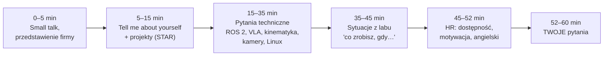

# 28 Próbna rozmowa — scenariusz i dopytki

> [!skrot] W 30 sekund
> - Rozmowa na staż trwa zwykle **45–60 minut** w kilku fazach: przedstawienie → **ty i twoje projekty** → pytania techniczne → **sytuacje z labu** → HR i logistyka → **twoje pytania**.
> - Najwięcej punktów traci się nie na pytaniach podstawowych, tylko na **dopytkach**: *„Dlaczego?”*, *„A co dokładnie TY zrobiłeś?”*, *„Co byś zrobił, gdyby…?”*. Ta notatka to **łańcuchy dopytek** do przećwiczenia.
> - **Zrób co najmniej 2 pełne próby:** jedną po polsku, jedną po angielsku, z zegarkiem i nagraniem.
> - Oceniasz się w **tabeli na dole** (5 kryteriów po 1–5 punktów).

> [!intuicja] Po ludzku
> Rekruter ciągnie za każdą nitkę, którą mu podasz. Powiesz „SLAM” — zapyta, jak działa. Powiesz „naprawiłem kabel” — zapyta, skąd wiedziałeś, że to kabel. Dlatego **mów tylko o tym, co umiesz rozwinąć o dwa poziomy w dół**, i przećwicz te dwa poziomy tutaj.

## Przebieg rozmowy

Kolejność może być inna, a części techniczna i HR mogą być osobnymi rozmowami. Fazy pozostają te same.

## Jak przeprowadzić próbę
| Tryb | Jak |
|---|---|
| **Sam** | Włącz nagrywanie dźwięku w telefonie. Czytaj **tylko pytanie** (odpowiedzi zakryte), odpowiadaj na głos, max 2 min. Odsłuchaj raz i oceń w tabeli. |
| **Z kolegą** | Daj mu tę notatkę. Ma zadawać pytania z sekcji „Scenariusz” i **dopytywać** według łańcuchów niżej. Po wszystkim niech wypełni tabelę oceny. |
| **Z Albertem** | Napisz: *„ej albert, zrób mi próbną rozmowę GD po angielsku, jedno pytanie naraz, dopytuj jak rekruter, na końcu oceń mnie tabelą z notatki 28”*. |

## Scenariusz — pytania po kolei (czytaj tylko pytania!)
1. *"Hi, could you briefly introduce yourself?"* → [[22 Moje projekty — jak o nich opowiadać]]
2. *"Tell me more about the boat project. What exactly was your part?"* → łańcuch 1 niżej
3. *"Why are you interested in this internship?"* → [[23 Pytania HR, behawioralne i po angielsku]]
4. *"What is a VLA model, and why does data quality matter so much?"* → [[02 Robot learning — imitation learning i VLA]]
5. *"How would you record a teleoperation episode? What's inside the dataset?"* → [[03 Teleoperacja i zbieranie datasetów]]
6. *"Explain topics, services and actions in ROS 2."* → [[05 ROS 2 — podstawy]]
7. *"Nodes on two machines can't see each other. What do you check?"* → [[16 Sieci — IP, podsieci, łączenie urządzeń]]
8. *"What's the difference between forward and inverse kinematics?"* → [[08 Manipulatory — kinematyka]]
9. *"How does a depth camera work?"* → [[11 Kamery i sensory głębi]]
10. *"The robot grasps 2 cm next to the object. What could be wrong?"* → [[12 Kalibracja kamer i hand-eye]]
11. *"A camera disappears in the middle of a session. Walk me through it."* → [[19 Troubleshooting — jak diagnozować]]
12. *"What would you do if you caused a collision?"* → [[14 Bezpieczeństwo pracy z robotami]]
13. *"Have you ever repaired hardware?"* → [[22 Moje projekty — jak o nich opowiadać]] (twoja prawdziwa historia!)
14. *"What's your availability with two universities?"* → twój grafik
15. *"Do you have any questions for us?"* → [[23 Pytania HR, behawioralne i po angielsku]]

## Łańcuchy dopytek — przećwicz dwa poziomy w dół
> [!zadanie] Łańcuch 1 (projekty): „Napisaliście własny SLAM — dlaczego nie użyliście gotowego pakietu (np. Nav2, slam_toolbox, LIO-SAM)?”
> > [!odpowiedz]- Szkic
> > Uczciwie i konkretnie: na wodzie jest mało stałych cech, łódź ma inny model ruchu niż robot kołowy, a 3 stopnie swobody (x, y, yaw) wystarczały i dawały prostszy, szybszy system pod nasz Jetson. Własny stos dawał też pełną kontrolę nad costmapą dla planera. **[dopasuj — jeśli to nie była twoja decyzja, powiedz: „This was decided before I joined, but as I understand the reasoning was…”]**
> > Dopytka poziom 2: *„Jakie ma słabe strony?”* → brak loop closure, więc dryf na długich trasach; to właśnie projektowałem.

> [!zadanie] Łańcuch 2 (projekty): „Mówisz o dopasowaniu detekcji po znacznikach czasu. Na czym polegał problem i jak go rozwiązałeś?”
> > [!odpowiedz]- Szkic
> > Detekcje z kamery i dane z lidaru/lokalizacji przychodzą z różnymi opóźnieniami i częstotliwościami; jeśli łączysz „najnowszą” detekcję z „najnowszą” pozą, obiekt ląduje w złym miejscu mapy. Trzeba łączyć po **stemplu czasu pomiaru** (header.stamp), a nie czasie odbioru, np. szukając najbliższej pozy w buforze lub interpolując TF w czasie. **Mostek:** *"It's exactly the same problem as synchronizing camera frames with joint states in a teleop dataset."* [sprawdź szczegóły swojej implementacji]

> [!zadanie] Łańcuch 3 (projekty): „Wycofaliście najlepszy model przez przeciek danych. Jak go wykryliście? Co to jest przeciek danych?”
> > [!odpowiedz]- Szkic
> > Przeciek (data leakage) = informacja ze zbioru testowego dostaje się do treningu, np. fragmenty tego samego nagrania są i w treningu, i w teście. Model „zna” odpowiedzi i wynik jest zawyżony. Objaw: wynik podejrzanie dobry, który nie trzyma się na nowych danych. Rozwiązanie: podział danych **po nagraniach/sesjach**, a nie po fragmentach, wersjonowany zbiór, walidator. **Mostek:** w robotyce dzieli się epizody po scenach lub dniach, nie losowo po klatkach. [sprawdź swój udział]

> [!zadanie] Łańcuch 4 (technika): „Co to jest QoS w ROS 2? Kiedy reliable, a kiedy best effort? Co się stanie, gdy publisher i subscriber mają niezgodne QoS?”
> > [!odpowiedz]- Szkic
> > QoS to ustawienia jakości dostarczania: niezawodność, historia/głębokość kolejki, trwałość (durability), deadline. **Reliable** — gdy każda wiadomość się liczy (komendy, mapa, parametry). **Best effort** — strumienie sensorów (kamera, lidar), gdzie lepiej dostać świeżą klatkę niż czekać na starą. Niezgodność (np. subscriber reliable, publisher best effort) → **brak połączenia i brak danych bez oczywistego błędu**; widać to w `ros2 topic info -v`.

> [!zadanie] Łańcuch 5 (technika): „Dlaczego w VLA dane z teleoperacji muszą być dobrej jakości? Podaj przykład złej demonstracji.”
> > [!odpowiedz]- Szkic
> > Model kopiuje to, co widzi w danych — również wahania, błędy i niekonsekwencję. Przykłady złych demonstracji: operator się zawahał i cofnął, chwyt nieudany i poprawiany, ręka operatora w kadrze, kamera przesunięta względem kalibracji, brakujące klatki, niespójna strategia (raz z lewej, raz z prawej bez powodu), zły opis zadania. Dopytka: *„Wyrzuciłbyś demonstrację z poprawką chwytu?”* → zależy od protokołu: czasem poprawki są cenne (model uczy się wychodzić z błędów), ale muszą być **świadome i oznaczone**; pytam zespół o zasady i trzymam się ich konsekwentnie.

> [!zadanie] Łańcuch 6 (lab): „Masz 3 godziny sesji i po godzinie robot zaczyna łapać protective stopy co kilka epizodów. Co robisz?”
> > [!odpowiedz]- Szkic
> > 1) Bezpieczeństwo i stop nagrywania, zapisuję, które epizody były w trakcie (oznaczam do QC). 2) Odczytuję kod/komunikat stopu z panelu/logów — kolizja? przekroczenie siły? limit stawu? 3) Sprawdzam, co się zmieniło: czy payload i TCP są aktualne (np. po wymianie palców), czy scena się nie przesunęła, czy operator nie jest zbyt szybki, czy kabel nie ciągnie. 4) Jeśli nie znajdę w ~15 min — eskaluję do opiekuna z konkretami. 5) Wpis do logu konserwacji. Dopytka: *„A jak zmniejszysz straty czasu?”* → zmiana zadania na inne stanowisko lub krótsza przerwa, zamiast zbierać złe dane.

> [!zadanie] Łańcuch 7 (lab): „Skąd wiesz, że epizod jest dobry, zanim go wyślesz?”
> > [!odpowiedz]- Szkic
> > Automatycznie: liczba klatek na kamerę zgadza się z czasem × fps, brak dziur w znacznikach czasu, wszystkie strumienie obecne, wartości stawów w zakresie, plik się otwiera, metadane (zadanie, operator, scena, wersja kalibracji) uzupełnione. Ręcznie: szybki podgląd wideo — czy zadanie wykonane, brak ręki w kadrze, ostrość i ekspozycja. Na koniec status w arkuszu (OK / do odrzucenia z powodem) i suma kontrolna przy uploadzie.

> [!zadanie] Łańcuch 8 (HR): „Ta praca jest bardzo powtarzalna — setki takich samych demonstracji. Jak sobie z tym poradzisz?”
> > [!odpowiedz]- Szkic
> > *"I understand that consistency is the whole point — the model learns from it. I'd keep a checklist so quality doesn't drop when I'm tired, take short breaks, track my own stats per session, and look for small improvements to the workflow — for example scripts that automate QC or a faster scene reset. In the Solar Boat project a lot of the work was also repetitive testing and logging, and I learned that this is where reliability comes from."* [dopasuj]

> [!zadanie] Łańcuch 9 (HR): „Studiujesz na dwóch uczelniach. Jak pogodzisz to z 6 godzinami dziennie w labie?”
> > [!odpowiedz]- Szkic
> > Podaj **konkretny grafik**: które dni i godziny jesteś dostępny od kiedy, ile godzin tygodniowo realnie, jak to wygląda w sesji. **Nie obiecuj więcej, niż dasz radę.** *"I've checked my timetables: I'm available Monday, Wednesday and Friday from 8 to 14, and Thursday afternoons… During the exam session I'd need some flexibility, which I'd agree on with you in advance."* [uzupełnij prawdziwym grafikiem!]

> [!zadanie] Łańcuch 10 (kultura): „Opiekun mówi ci, żeby zrobić coś, co twoim zdaniem jest niebezpieczne (np. wejść do strefy robota w trakcie pracy). Co robisz?”
> > [!odpowiedz]- Szkic
> > Nie robię tego i spokojnie mówię dlaczego, proponując bezpieczną alternatywę (zatrzymanie robota, tryb ręczny z obniżoną prędkością, enabling device). Jeśli dalej jest presja — zgłaszam wyżej. *"Safety isn't negotiable for me, but I'd raise it respectfully and propose a safe way to achieve the same goal."*

## Gdy nie wiesz — protokół (zapamiętaj zdania)
1. **Przyznaj:** *"I'm not sure about that specific detail."*
2. **Powiedz, co wiesz najbliżej:** *"What I do know is that…"*
3. **Pokaż, jak byś to ustalił:** *"I'd check the documentation / the ROS 2 logs / ask my supervisor."*
4. **Nie zmyślaj** — w labie z drogim sprzętem zgadywanie jest gorsze niż „nie wiem”.

> [!przyda] Zdania „ratunkowe” po angielsku
> - *"Could you repeat the question, please?"* / *"Just to make sure I understand — do you mean…?"*
> - *"Let me think for a second."* (cisza 3–5 sekund jest OK)
> - *"I'll answer in two parts: first…, then…"*
> - *"Sorry, I don't know the English word — in Polish it's X, it's the thing that…"*
> - *"To sum up, …"* (zawsze domykaj dłuższą odpowiedź)

## Tabela oceny po próbie (1–5)
| Kryterium | 1 | 3 | 5 | Wynik |
|---|---|---|---|---|
| **Struktura** | chaos, dygresje | da się zrozumieć | STAR / „najpierw, potem, wynik”, domknięcie | |
| **Konkret** | ogólniki, „my” | trochę szczegółów | liczby, nazwy narzędzi, **„ja”** | |
| **Technika** | błędy merytoryczne | poprawnie, płytko | poprawnie + „dlaczego” + przykład | |
| **Angielski** | zacinanie się, PL słowa | komunikatywnie | płynnie, słownictwo techniczne | |
| **Postawa** | zmyślanie, nerwy | ok | spokój, uczciwe „nie wiem”, pytania do nich | |

Cel: **≥ 20/25** w dwóch próbach z rzędu. Słabe kryterium → wróć do notatki z tego tematu i zrób [[24 Trenażer — symulacja rozmowy|trenażer]] tylko z niej.

## Typowe błędy
> [!blad] Za długie odpowiedzi
> Powyżej 2 minut rekruter się wyłącza. Zasada: **odpowiedź w 1 zdaniu, potem 2–3 zdania szczegółu, potem stop.** Jeśli będą chcieli więcej — dopytają.

> [!blad] Wymienianie technologii bez historii
> „Znam ROS 2, Docker, Linux, C++, Python…” nic nie mówi. Lepiej: *"I used Docker to run YOLO with TensorRT on the boat's Jetson, because…"* — jedna technologia, jeden kontekst, jedno „dlaczego”.

## Fiszki #fiszki/rozmowa-gd/proba
Jakie są fazy typowej rozmowy na staż?::Przedstawienie → ty i projekty → technika → sytuacje z labu → HR/dostępność → twoje pytania.
Złota zasada długości odpowiedzi?::1 zdanie odpowiedzi, 2–3 zdania szczegółu, stop; max ~2 minuty.
Protokół „nie wiem” — 4 kroki?::Przyznaj → powiedz, co wiesz najbliżej → jak byś to ustalił → nie zmyślaj.
Czym grozi niezgodny QoS w ROS 2?::Brakiem połączenia i danych bez oczywistego błędu (sprawdź ros2 topic info -v).
Co to jest przeciek danych (data leakage)?::Informacja ze zbioru testowego trafia do treningu → zawyżony wynik.
Jak dzielić dane robota na train/test?::Po epizodach/scenach/dniach, nie losowo po klatkach.
Czym łączyć dane z różnych sensorów?::Stemplem czasu pomiaru (header.stamp), nie czasem odbioru.
Mówisz o projekcie — ile poziomów w dół musisz umieć rozwinąć?::Co najmniej dwa.
Ile punktów w tabeli oceny to cel?::Co najmniej 20/25 w dwóch próbach z rzędu.

## Moje notatki
> [!ja] Tu piszesz ty — Albert tej sekcji nie rusza.
