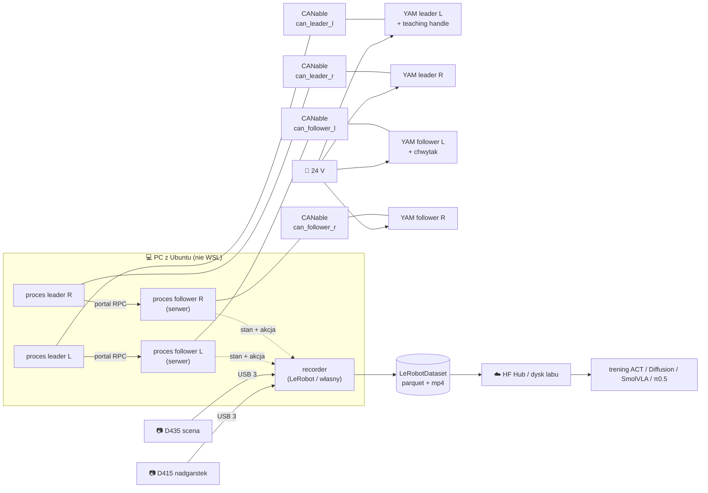

# 29 Lab — YAM, RealSense i LeRobot (plan 2 h)

> [!skrot] W 30 sekund
> - **Stanowisko:** 2× **YAM follower** + 2× **YAM leader** (i2rt) = układ **dwuręczny** (bimanual), jak ALOHA. Kamery: **RealSense D415** na nadgarstku + **D435** (prawdopodobnie, „1435”; sprawdź naklejkę albo `rs-enumerate-devices -s`) jako kamera sceny.
> - **YAM** = 6 stawów + chwytak, silniki **DAMIAO**: 3× **DM4340** (bark), 3× **DM4310** (łokieć/nadgarstek), chwytak np. `linear_4310`. Magistrala **CAN 1 Mbit/s**, zasilanie **24 V**, z PC przez adapter **CANable** (USB → interfejs sieciowy `canX`).
> - **Leader YAM** to *to samo ramię z silnikami*, tylko zamiast chwytaka ma **teaching handle** (spust = chwytak, górny przycisk = włącz/wyłącz synchronizację). Ma **bilateral force feedback**: czujesz opór, gdy follower w coś trafi.
> - **4 ramiona = 4 adaptery CAN.** Nazwy `can0..3` losują się przy podłączaniu → reguła **udev** po numerze seryjnym: `can_leader_l`, `can_leader_r`, `can_follower_l`, `can_follower_r`.
> - **Oprogramowanie:** oficjalny SDK `i2rt` (Python, `get_yam_robot`) + przykład `bimanual_lead_follower.py`. LeRobot obsługuje YAM-a tylko przez **pluginy społeczności** i **otwarte PR-y** (stan na 10.2026), więc **pierwszego dnia zapytaj, jakiego stosu używa lab**.
> - **Bezpieczeństwo:** silniki mają **watchdog 400 ms**: bez komend przechodzą w tłumienie (*damping*). **Wyłączenie 24 V = ramię spada** (nie ma już kompensacji grawitacji), więc najpierw odłóż ramię do pozy parkingowej.

> [!intuicja] Po ludzku
> To jest SO-101 z L3, tylko „dorosły”. Zamiast tanich serw na UART masz silniki z przekładnią i własnym sterownikiem, które gadają po CAN-ie jak w samochodzie. Zamiast lekkiej lalki-leadera masz drugie prawdziwe ramię: trzyma się samo w powietrzu (kompensacja grawitacji) i oddaje ci w dłoń siłę, którą czuje follower. Kamery dają RGB i dodatkowo głębię, a LeRobot to „magnetofon”, który zapisuje to wszystko w jednym formacie, z którego potem uczy się model.

## Plan na 2 godziny

| Czas | Blok | Cel: po bloku umiesz… |
|---|---|---|
| 0:00–0:15 | [[#1. Mapa systemu]] | narysować stanowisko z pamięci: kable, procesy, przepływ danych |
| 0:15–0:45 | [[#2. YAM od środka]] | wyjaśnić CAN, silniki DM, tryb MIT, grawitację, leader/follower, watchdog |
| 0:45–1:05 | [[#3. Kamery RealSense]] | dobrać tryb kamery, znaleźć numery seryjne, wiedzieć, czemu D415 na nadgarstku nie da głębi z bliska |
| 1:05–1:35 | [[#4. LeRobot na tym sprzęcie]] | przejść nagrywanie → dataset → trening → rollout i wiedzieć, gdzie YAM się wpina |
| 1:35–1:50 | [[#5. Runbook dnia w labie]] + [[#6. Troubleshooting]] | uruchomić i zamknąć stanowisko bez pytania, zdiagnozować 80% problemów |
| 1:50–2:00 | [[#7. Pytania do opiekuna — dzień 1]] + fiszki | wejść do labu z listą pytań, które robią dobre wrażenie |

---

## 1. Mapa systemu



**Przepływ jednego kroku teleoperacji (~kilkaset Hz w pętli sterowania, 30 Hz w datasecie):**
1. Proces leadera czyta pozycje 6 stawów + spust z teaching handle.
2. Wysyła je (RPC przez bibliotekę `portal`) do procesu followera → follower dostaje `command_joint_pos(q_leader)`.
3. Leader pobiera z powrotem pozycję followera i ciągnie się do niej słabą sprężyną (`bilateral_kp`). Gdy follower utknie na przeszkodzie, czujesz to w ręce.
4. Recorder z częstotliwością datasetu (np. 30 fps) zapisuje: **akcję** = pozycje leaderów, **stan** = pozycje followerów, **obrazy** z kamer.

> [!wazne] Akcja vs stan, wersja dwuręczna
> Bimanual YAM: **akcja** ma 14 liczb (2 × (6 stawów + chwytak)), **stan** też 14. Kolejność (lewe, potem prawe? stawy w radianach czy w stopniach?) zależy od integracji. Sprawdzisz to w `meta/info.json` → `features`. Pomylona kolejność lewe/prawe w datasecie to klasyczny cichy błąd.

## 2. YAM od środka

### Sprzęt
| Element | YAM (standard) | Po co ci to |
|---|---|---|
| Stawy | 6 DOF + chwytak | jak typowe ramię 6-osiowe: dowolna pozycja i orientacja w zasięgu |
| Silniki | J1–J3: **DM4340**, J4–J6: **DM4310** (DAMIAO) | silniki z przekładnią planetarną, własnym sterownikiem i enkoderem; ID 1–6 na magistrali |
| Chwytak | `linear_4310` / `crank_4310` / `linear_3507` / `flexible_4310` | typ chwytaka **musi się zgadzać** z flagą `--gripper`, inaczej zła kalibracja i masa |
| Magistrala | CAN, **1 Mbit/s**, jeden łańcuch na ramię | `ip link set <iface> up type can bitrate 1000000` |
| Zasilanie | 24 V | wyłączenie = brak momentu = ramię opada |
| Masa / zasięg | ~4,3 kg / ~0,8 m łańcucha | YAM Pro/Ultra/Big YAM różnią się, flaga `--arm yam/yam_pro/yam_ultra/...` |
| Leader | ten sam łańcuch + `yam_teaching_handle` (spust + 2 przyciski) | bilateral, górny przycisk włącza synchronizację |

> [!wazne] Sprawdź w labie, który to wariant
> „yam2” może znaczyć „2 sztuki YAM” albo **YAM Ultra 2** (`--arm yam_ultra_2`, DM4340 na J4). Zła flaga `--arm` po cichu przeskalowuje kompensację grawitacji: ramię „pływa” albo opada. Zapytaj albo przeczytaj naklejkę/fakturę.

### CAN w 5 zdaniach
- CAN to **magistrala różnicowa** (2 przewody CAN_H/CAN_L + masa), odporna na zakłócenia, z ramkami do 8 bajtów, z ID i arbitrażem. Na **końcach** magistrali muszą być **terminatory 120 Ω**.
- W Linuksie CAN to **interfejs sieciowy** (SocketCAN): `ip link`, `candump`, `cansend` z pakietu `can-utils`.
- `candump can_follower_l` → widzisz ruch na magistrali. Cisza = brak zasilania, zły kabel albo interfejs DOWN.
- `ip -details -statistics link show can_follower_l` → liczniki błędów, stan **ERROR-ACTIVE / ERROR-PASSIVE / BUS-OFF**. BUS-OFF = adapter się poddał. Wtedy `scripts/reset_all_can.sh` albo down/up.
- WSL domyślnie **nie ma modułów CAN w jądrze**, więc ćwicz na komputerze labowym z Ubuntu, a w domu w symulacji MuJoCo.

### Sterowanie: tryb MIT
Silniki DM przyjmują komendę w tzw. **trybie MIT** (od Mini Cheetah):

$$\tau = k_p\,(q_{cel} - q) + k_d\,(\dot q_{cel} - \dot q) + \tau_{ff}$$

- `kp`, `kd` = sztywność i tłumienie „wirtualnej sprężyny”. Duże `kp` = sztywno trzyma pozycję, małe = miękko.
- `τ_ff` (*feed-forward*) = moment dodany z góry. i2rt liczy go z **modelu MuJoCo** ramienia (masy, środki ciężkości): to jest **kompensacja grawitacji**.
- **Tryb zero-gravity:** `kp = 0`, sama kompensacja grawitacji → ramię przesuwasz ręką jak w nieważkości, a puszczone zostaje w miejscu. Leader tak właśnie działa. Test „czy wszystko OK” po podłączeniu:
  `python i2rt/robots/motor_chain_robot.py --channel can0 --arm yam --gripper linear_4310`
- **Bilateral:** leader dostaje mały `kp` (`--bilateral-kp` 0,1–0,2) w stronę pozycji followera → czujesz kontakt. Za duże = ręka „walczy” z ramieniem, za małe = brak czucia.

### Zabezpieczenia wbudowane
| Mechanizm | Co robi | Konsekwencja dla ciebie |
|---|---|---|
| **Watchdog 400 ms** | brak komendy przez 0,4 s → silnik w trybie tłumienia | gdy proces padnie, ramię **powoli opada**, nie „wariuje”. **Nie wyłączaj** (`set_timeout.py`) bez zgody |
| Limity stawów + bufor 0,15 rad | SDK obcina komendy | przekroczenie fizyczne → błąd silnika → zwykle restart zasilania |
| Limit siły chwytaka ~50 N | przy zablokowaniu chwytak nie dociska mocniej | kruche przedmioty nadal mogą pęknąć |
| `slow_move` przy włączeniu synchronizacji | follower dojeżdża do leadera przez ~3 s | **przed wciśnięciem przycisku ustaw leader blisko pozy followera** |

> [!uwaga] Rzeczy, których intern nie robi bez pytania
> `set_zero.py` (nadpisuje zero enkodera: zła poza = przesunięty cały robot i niezgodność ze starymi datasetami), `dm_motor_registers.py write/save` (rejestry silnika), wyłączanie timeoutu, zmiana `kp` followera. Wszystko to jest w repo, ale to są „ustawienia fabryczne” stanowiska.

### Komendy i2rt, które musisz znać
```bash
# instalacja (Ubuntu, Python 3.11, uv)
git clone https://github.com/i2rt-robotics/i2rt && cd i2rt
uv venv --python 3.11 && source .venv/bin/activate && uv pip install -e .

ls -l /sys/class/net/ | grep can                      # jakie adaptery widzi system
sudo ip link set can_follower_l up type can bitrate 1000000
ip a | grep can                                        # wszystkie 4 w stanie UP?

# pojedyncze ramię: leader + follower
python examples/minimum_gello/minimum_gello.py --gripper linear_4310 --mode follower --can-channel can_follower_l --bilateral-kp 0.2
python examples/minimum_gello/minimum_gello.py --gripper yam_teaching_handle --mode leader --can-channel can_leader_l --bilateral-kp 0.2

# cały układ 2+2 (odpala 4 procesy minimum_gello)
python examples/bimanual_lead_follower/bimanual_lead_follower.py

# podgląd leadera / symulacja bez sprzętu
python scripts/run_yam_leader.py --channel can_leader_l
python examples/minimum_gello/minimum_gello.py --mode visualizer_local
```

**Stałe nazwy CAN (udev)**, raz na stanowisko, adaptery podłączasz **po jednym**:
```bash
udevadm info -a -p /sys/class/net/can0 | grep -i serial
# /etc/udev/rules.d/90-can.rules:
# SUBSYSTEM=="net", ACTION=="add", ATTRS{serial}=="004E0027...", NAME="can_follower_l"
sudo udevadm control --reload-rules && sudo udevadm trigger
```
To ten sam problem co `/dev/ttyACM0` w L3, tylko dla interfejsów sieciowych.

## 3. Kamery RealSense

### D415 vs D435 (vs D405)
| | **D415** (u was: nadgarstek) | **D435 / D435i** (scena) | D405 (dla porównania) |
|---|---|---|---|
| Migawka sensorów głębi | **rolling shutter** | **global shutter** | global |
| Pole widzenia głębi | wąskie, ~65°×40° | szerokie, ~87°×58° | ~87°×58° |
| Minimalna odległość głębi | ~0,3 m (więcej przy 1280×720) | ~0,2–0,3 m | **~7 cm** |
| Mocna strona | dokładna głębia na średnim dystansie, statyczne sceny | ruch, szeroki kadr, robotyka mobilna | z bliska, na nadgarstek |
| RGB | 1920×1080, rolling | 1920×1080, rolling | z sensora stereo |
| Extra | — | **i** = IMU | brak projektora IR |

> [!wazne] Co z tego wynika dla waszego stanowiska
> - **D415 na nadgarstku:** obiekt w chwytaku jest bliżej niż min-Z → **głębia z bliska to dziury/zera**. RGB jest OK, a większość polityk (ACT, SmolVLA, π0.5) i tak bierze tylko RGB. Jeśli ktoś każe „nagrywać głębię z nadgarstka”, warto delikatnie zapytać, czy wiedzą o min-Z.
> - Ramię się rusza, a RGB ma rolling shutter → **rozmycie i „krzywienie” przy szybkich ruchach**. Pomaga ustalona, krótka ekspozycja i dobre oświetlenie.
> - Kamera sceny musi stać **sztywno i zawsze w tym samym miejscu**. Przesunięta o 2 cm = inna dystrybucja danych dla modelu. Zaznacz pozycję taśmą i zrób zdjęcie referencyjne.

### Komendy
```bash
rs-enumerate-devices -s        # model, numer seryjny, firmware, typ USB (musi być 3.x!)
realsense-viewer               # GUI: podgląd, tryby, ekspozycja, update firmware
lerobot-find-cameras realsense # to samo z poziomu LeRobota + zapis klatek testowych
```

### Zasady, które oszczędzą ci godzin
- **Zawsze adresuj kamerę numerem seryjnym**, nigdy indeksem `/dev/videoN`. Jedna RealSense tworzy kilka `/dev/video*` (głębia, IR, RGB, metadane), a kolejność się zmienia.
- **USB 3, osobne porty/kontrolery.** Na USB 2 dostępne są tylko niskie tryby, a dwie kamery na jednym hubie potrafią gubić klatki („Frame didn't arrive within 5000 ms”).
- **Kabel na nadgarstku = najczęstsza awaria.** Zgina się przy każdym ruchu. Potrzebne odciążenie (opaski, prowadzenie wzdłuż ramienia, zapas na obrót J6). Przerywanie obrazu tylko w niektórych pozach = kabel.
- **Auto-exposure / auto white balance:** wygodne, ale zmienia wygląd między epizodami. W labach często się je **blokuje** na stałe wartości. Zapytaj, jaka jest polityka.
- **Głębia ↔ RGB:** to różne sensory, przed użyciem trzeba je **wyrównać** (`rs.align`). Intrinsics są zapisane fabrycznie w kamerze. Hand-eye (gdzie kamera jest względem chwytaka) to osobna kalibracja, patrz [[12 Kalibracja kamer i hand-eye]].
- Projektory IR kilku RealSense'ów **się nie zagłuszają** (wzór tylko pomaga dopasowaniu stereo), więc dwie kamery patrzące na tę samą scenę są OK.

## 4. LeRobot na tym sprzęcie

### Gdzie YAM wpina się w LeRobot (stan: październik 2026)
| Droga | Co to jest | Uwagi |
|---|---|---|
| **Natywnie w `lerobot`** | PR-y [#4829](https://github.com/huggingface/lerobot/pull/4829) / [#4855](https://github.com/huggingface/lerobot/pull/4855): `yam_follower`, `bi_yam_follower` | **otwarte, niezmergowane**. Tylko standard YAM v1 + `linear_4310`, SocketCAN, konfiguracja przez `lerobot-setup-can` i `lerobot-calibrate` |
| Plugin [`lerobot_yam`](https://github.com/pravsels/lerobot_yam) | `yam_follower` + `yam_leader` | leader to **GELLO na Dynamixelach** (`/dev/ttyUSB0`), **nie** oficjalny YAM Leader na CAN |
| Plugin `lerobot_teleoperator_yamactiveleader` | aktywny leader YAM (serwa Feetech) | też inny sprzęt niż wasz |
| **SDK i2rt + własny recorder** → konwersja do LeRobotDataset | i2rt zapisuje trajektorie do **MCAP** (`record_replay_trajectory`) | prawdopodobne w labie z oficjalnymi leaderami |

**Wniosek:** wasze leadery (YAM Leader na CAN) nie mają gotowego, oficjalnego teleoperatora w LeRobot, więc lab ma albo własny kod, albo jedną z tych gałęzi. **Nie zgaduj, tylko zapytaj** (patrz pytania niżej). Znając plugin system, możesz nawet zaproponować: „leader YAM to po prostu `Teleoperator`, którego `get_action()` zwraca `get_joint_pos()` z i2rt”.

### Jak działa plugin (żebyś rozumiał każdą integrację)
- LeRobot importuje każdy zainstalowany pakiet o nazwie `lerobot_robot_*` / `lerobot_teleoperator_*`.
- **Robot** implementuje: `connect()`, `get_observation()` → `{"joint_1.pos": …, "wrist": obraz}`, `send_action(action)`, `disconnect()`, właściwości `observation_features` / `action_features`.
- **Teleoperator**: `connect()`, `get_action()`, `disconnect()`.
- Config to dataclass rejestrowana pod nazwą `type` → stąd flagi `--robot.type=… --robot.port=can0`.

### Przepływ pracy (komendy z cheat-sheetu, wstaw swoje typy)
```bash
hf auth login                                   # token z huggingface.co/settings/tokens
lerobot-find-cameras realsense                  # numery seryjne

lerobot-teleoperate \
  --robot.type=<typ_followera> --robot.port=can_follower_l \
  --robot.cameras="{ wrist: {type: intelrealsense, serial_number_or_name: \"<SN_D415>\", width: 640, height: 480, fps: 30},
                     top:   {type: intelrealsense, serial_number_or_name: \"<SN_D435>\", width: 640, height: 480, fps: 30} }" \
  --teleop.type=<typ_leadera> --teleop.port=can_leader_l \
  --display_data=true                            # podgląd w Rerun

lerobot-record ...te same flagi robot/teleop/cameras... \
  --dataset.repo_id=<org>/<nazwa> \
  --dataset.single_task="pick up the red cube and place it in the bowl" \
  --dataset.num_episodes=50 --dataset.episode_time_s=60 --dataset.reset_time_s=15
#   →  zapisz epizod i dalej   ←  wyrzuć i powtórz   ESC  zakończ, zakoduj, wyślij

lerobot-train --dataset.repo_id=<org>/<nazwa> --policy.type=act \
  --policy.device=cuda --output_dir=outputs/train/act_yam --steps=20000

lerobot-rollout --strategy.type=base --policy.path=<org>/<policy> \
  --robot.type=<typ_followera> ... --task="..." --duration=60
```
- Typ kamery w nowych wersjach może nazywać się `realsense` zamiast `intelrealsense`. `lerobot-record --help` rozstrzyga.
- Głębia: `use_depth: true` → osobne wideo (12-bitowe kody, `--dataset.depth_encoder.*`). Na nadgarstku z D415 patrz uwaga o min-Z.
- **Kamery w rolloucie muszą mieć te same nazwy, rozdzielczość i ustawienie co w datasecie.** Model nauczył się „top” z tego konkretnego kąta.
- Format datasetu (parquet + mp4, `meta/info.json`, `stats.json`, epizody, taski) → [[L2 LeRobotDataset — format od środka]]. Polityki → [[L5 Trening i ewaluacja polityk w LeRobot]].

### Co odróżnia dobrego interna od przeciętnego: jakość danych
1. **Jeden epizod = jedno czyste wykonanie zadania.** Nieudany → `←` i powtórz, nie „dokańczaj na siłę”.
2. **Pozycja startowa powtarzalna** (pozy parkingowe ramion), **pozycje obiektów zróżnicowane** w ustalonym obszarze.
3. **Płynne, zdecydowane ruchy w podobnym tempie.** Wahanie i drgania model też się nauczy.
4. **Nic się nie zmienia między epizodami poza tym, co ma się zmieniać:** kamera, światło, tło, ekspozycja.
5. **Po sesji:** obejrzyj 2–3 epizody (Rerun / visualizer na HF), sprawdź liczbę klatek, czy obie kamery mają obraz, czy akcja nie jest płaska (martwy leader), i **wpisz sesję do logu** (data, kto, task, liczba epizodów, uwagi, problemy).

## 5. Runbook dnia w labie

**Start (≈5 min):**
1. Rzut oka: nic nie leży w zasięgu ramion (≥1 m wolnego), kable kamer nie zaczepiają, kamera sceny na znaczniku.
2. Ramiona w pozie parkingowej. Zasilanie 24 V **on**.
3. Adaptery CAN: `ip a | grep can` → 4 interfejsy UP (jeśli DOWN: `ip link set … up type can bitrate 1000000`).
4. `rs-enumerate-devices -s` → obie kamery, USB 3.x.
5. Aktywuj venv, uruchom teleop. **Przed przyciskiem synchronizacji ustaw leader blisko pozy followera.**
6. Krótki test: każdy staw obu rąk + chwytaki, podgląd obrazów (Rerun / `realsense-viewer`).

**Koniec (≈5 min):**
1. Zakończ nagrywanie (`ESC`), poczekaj na zakodowanie wideo i upload. Sprawdź, czy dataset jest na Hubie / dysku.
2. Ramiona do pozy parkingowej, **przytrzymaj/podeprzyj**, dopiero potem Ctrl+C procesów i wyłączenie 24 V.
3. Log: sesja, liczba epizodów, usterki. Zgłoś luźne kable i dziwne dźwięki silników od razu.

## 6. Troubleshooting

| Objaw | Najczęstsza przyczyna | Co sprawdzić / zrobić |
|---|---|---|
| Brak `can_*` w `ip a` | adapter odłączony, brak reguły udev, nieznany serial | `dmesg -w` przy wpinaniu, `udevadm info … | grep serial` |
| Interfejs jest, silniki milczą | brak 24 V, kabel CAN, brak terminatora | `candump <iface>`: cisza = fizyka, nie software |
| Ramię nagle miękko opada w trakcie | proces padł / pętla się zawiesiła → watchdog 400 ms | log procesu, `ip -s link` (BUS-OFF?), `reset_all_can.sh` |
| Szarpnięcie przy włączeniu sync | leader daleko od followera | zawsze zbliż pozy przed przyciskiem |
| Ramię „pływa” w zero-gravity / opada | zła flaga `--arm` / `--gripper` → zły model grawitacji | porównaj z naklejką, zapytaj |
| Błąd silnika po uderzeniu w limit | przekroczony zakres stawu | odczytaj błąd, zwykle power-cycle; zgłoś |
| Odwrócone lewe/prawe ramię | zamienione adaptery bez udev | sprawdź reguły, nazwy interfejsów |
| „Frame didn't arrive within 5000” | USB 2 / kabel / za dużo kamer na kontrolerze | `rs-enumerate-devices`, inny port, niższa rozdzielczość |
| Obraz z nadgarstka przerywa w niektórych pozach | uszkodzony kabel na ruchomym ramieniu | wymień kabel, popraw prowadzenie |
| `Permission denied` na kamerze/porcie | brak reguł udev librealsense / grup | grupy `plugdev`, `video`, `dialout` + ponowne logowanie |
| Dataset ma mniej klatek niż powinien | CPU/dysk nie nadąża z kodowaniem | `--dataset.streaming_encoding`, niższa rozdzielczość, szybszy dysk |

## 7. Pytania do opiekuna — dzień 1
1. **Jakiego stosu używamy do teleopu i nagrywania:** czysty i2rt, LeRobot (który plugin/gałąź), własny recorder czy ROS 2?
2. Który dokładnie wariant: YAM / Pro / Ultra / **Ultra 2**? Jaki chwytak?
3. Gdzie jest „wyłącznik bezpieczeństwa” stanowiska? (YAM nie ma e-stopu w zestawie, więc zwykle jest to zasilacz 24 V.) Kto może zerować silniki?
4. Konwencja nazw: kamery (`wrist`/`top`?), repo_id datasetów, organizacja na HF, gdzie log sesji.
5. Protokół zadania: długość epizodu, poza startowa, rozmieszczenie obiektów, kryterium sukcesu, co robić z nieudanymi.
6. Ekspozycja kamer: auto czy zablokowana? Nagrywamy głębię?
7. Co trenujemy na tych danych (ACT? π0.5 fine-tune?) i czy mogę zobaczyć rollout. Wiedza, do czego są dane, zmienia sposób ich zbierania.

## Ćwiczenie w domu (bez sprzętu)
- Sklonuj `i2rt`, zainstaluj, uruchom `minimum_gello.py --mode visualizer_local` (MuJoCo; na WSL przez WSLg) i porusz ramieniem w symulacji.
- Zainstaluj `lerobot`, otwórz dowolny dataset ALOHA (bimanual!) na HF w visualizerze i porównaj `features` z tym, czego spodziewasz się po YAM.
- Przeczytaj `examples/minimum_gello/minimum_gello.py` (≈ 300 linii): zobaczysz `slow_move`, przycisk, bilateral `kp` i RPC przez `portal`.

## Zadania

> [!zadanie] Masz 4 adaptery CANable. Po restarcie lewy follower reaguje na prawy leader. Co się stało i jak zapobiec?
> > [!odpowiedz]- Odpowiedź
> > Domyślne nazwy `can0..3` zależą od kolejności enumeracji USB, więc po restarcie się przetasowały. Rozwiązanie: reguły udev wiążące numer seryjny adaptera (`ATTRS{serial}`) z nazwą (`can_follower_l` itd.), konfigurowane z podłączonym jednym adapterem naraz. Weryfikacja przez `ip a`.

> [!zadanie] W trakcie nagrywania prawy follower powoli „siada” i przestaje reagować. Logi procesu stoją. Co się dzieje?
> > [!odpowiedz]- Odpowiedź
> > Pętla sterowania przestała wysyłać komendy (zawieszony/padnięty proces albo BUS-OFF na CAN). Po 400 ms watchdog przełączył silniki w tłumienie, więc ramię opada powoli zamiast spaść. Odrzucam epizod (`←`), sprawdzam `ip -details -statistics link show can_follower_r`, resetuję CAN, restartuję proces. Zapisuję incydent w logu.

> [!zadanie] Dlaczego głębia z D415 na nadgarstku jest prawie bezużyteczna przy chwytaniu?
> > [!odpowiedz]- Odpowiedź
> > D415 ma minimalną odległość pomiaru ok. 0,3 m (więcej przy wysokiej rozdzielczości), a obiekt w chwytaku jest bliżej, więc głębia to zera/dziury. Do tego jest to rolling shutter, który rozmywa się przy ruchu. Na nadgarstek do głębi lepszy byłby D405 (od ~7 cm). RGB z D415 jest w porządku.

> [!zadanie] Czym różni się leader YAM od leadera SO-101?
> > [!odpowiedz]- Odpowiedź
> > Leader SO-101 to pasywne serwa z niską przekładnią, które tylko mierzą pozycję. Leader YAM to pełne ramię z silnikami DM na CAN: ma kompensację grawitacji (trzyma się samo) i bilateral force feedback (słaba sprężyna `kp` w stronę pozycji followera, więc czujesz kontakt). Zamiast chwytaka ma teaching handle: spust steruje chwytakiem, przycisk włącza synchronizację.

## Fiszki #fiszki/lab
Silniki YAM?::DAMIAO: 3× DM4340 (bark), 3× DM4310 (łokieć/nadgarstek), chwytak np. DM4310.
Magistrala i prędkość YAM?::CAN, 1 Mbit/s, przez CANable (SocketCAN).
Komenda podniesienia interfejsu CAN?::sudo ip link set can0 up type can bitrate 1000000
Napięcie zasilania YAM?::24 V.
Wzór trybu MIT?::τ = kp(q_cel − q) + kd(q̇_cel − q̇) + τ_ff
Co to zero-gravity mode?::kp = 0 + kompensacja grawitacji z modelu MuJoCo; ramię przesuwa się ręką i zostaje w miejscu.
Co robi watchdog DM?::Brak komendy przez 400 ms → silniki w tłumieniu (damping).
Co to bilateral-kp?::Słaba sprężyna ciągnąca leader do pozy followera → czucie kontaktu; zalecane 0,1–0,2.
Górny przycisk teaching handle?::Włącza/wyłącza synchronizację follower ↔ leader.
Nazwy CAN w bimanual i2rt?::can_leader_l, can_leader_r, can_follower_l, can_follower_r (udev po numerze seryjnym).
Skrypt dla układu 2+2?::examples/bimanual_lead_follower/bimanual_lead_follower.py (4× minimum_gello).
Czego nie robić bez zgody?::set_zero.py, zapis rejestrów silnika, wyłączanie timeoutu.
Co się dzieje po wyłączeniu 24 V?::Brak momentu → ramię opada; najpierw poza parkingowa i podparcie.
D415 vs D435 — migawka głębi?::D415 rolling, D435 global.
Min. odległość głębi D415?::~0,3 m (więcej przy 1280×720).
Kamera RealSense na nadgarstek z bliska?::D405 (~7–50 cm).
Jak adresować RealSense w LeRobot?::serial_number_or_name = numer seryjny (lerobot-find-cameras realsense).
Najczęstsza awaria kamery nadgarstkowej?::Kabel zginany przy ruchu ramienia.
Akcja vs stan w bimanual YAM?::Akcja = pozycje leaderów (14), stan = pozycje followerów (14).
Klawisze lerobot-record?::→ zapisz, ← powtórz, ESC zakończ i wyślij.
Wsparcie YAM w LeRobot (10.2026)?::Pluginy społeczności (lerobot_yam z GELLO) + otwarte PR-y bi_yam_follower; oficjalny leader na CAN bez gotowego teleoperatora.

## Moje notatki
> [!ja] Tu piszesz ty — Albert tej sekcji nie rusza.
