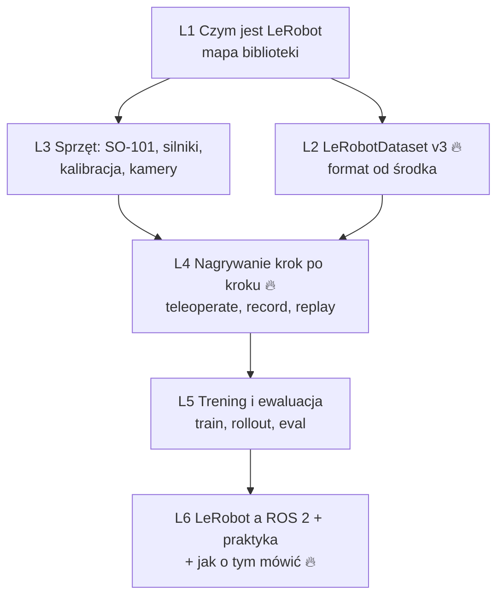

# 🤗 LeRobot — dokładnie (dział pogłębiony)

> [!skrot] Po co ten dział
> - **LeRobot** (Hugging Face) to dziś najpopularniejsza **otwarta** biblioteka do robot learningu: format datasetu, nagrywanie z teleoperacji, trening (ACT, Diffusion, π0, π0.5, SmolVLA, GR00T…), uruchamianie polityk na robocie, tanie ramiona (SO-101).
> - Lab zbierający dane do VLA prawie na pewno **zna** LeRobot, a format **LeRobotDataset** stał się standardem wymiany danych. Pokazanie, że rozumiesz go „od środka”, to mocny punkt na rozmowie.
> - Stan opisany na **październik 2026** (LeRobot ≥ 0.4, dataset **v3.0**, komendy `lerobot-*`). Biblioteka zmienia się szybko — przed rozmową zerknij na README.

## Mapa

| # | Notatka | Najważniejsze pytanie |
|---|---|---|
| L1 | [[L1 Czym jest LeRobot — mapa biblioteki]] | Z jakich klocków składa się LeRobot? |
| L2 | [[L2 LeRobotDataset — format od środka]] | Co dokładnie leży na dysku i jak to się czyta? |
| L3 | [[L3 Sprzęt — SO-101, silniki Feetech, kalibracja, kamery]] | Jak działa tanie ramię leader–follower i jego kalibracja? |
| L4 | [[L4 Nagrywanie datasetu krok po kroku]] | Jak nagrać 50 epizodów i wrzucić na Hub? |
| L5 | [[L5 Trening i ewaluacja polityk w LeRobot]] | Jak wytrenować ACT/SmolVLA i uruchomić na robocie? |
| L6 | [[L6 LeRobot a ROS 2 — integracja i jak o tym mówić]] | Jak to się ma do ROS-a i labu z UR/Franką? |

Powiązane: [[V0 VLA — mapa działu]] · [[R0 ROS 2 — mapa działu]] · [[03 Teleoperacja i zbieranie datasetów]] · [[00 Rozmowa GD — Start]].

## Praktyka bez robota (1–2 h) — patrz L6
Instalacja → wczytanie prawdziwego datasetu z Huba → podgląd epizodu → mini-trening ACT/Diffusion na symulacji Push-T. Po tym możesz uczciwie powiedzieć *„I've worked with LeRobot datasets hands-on”*.
