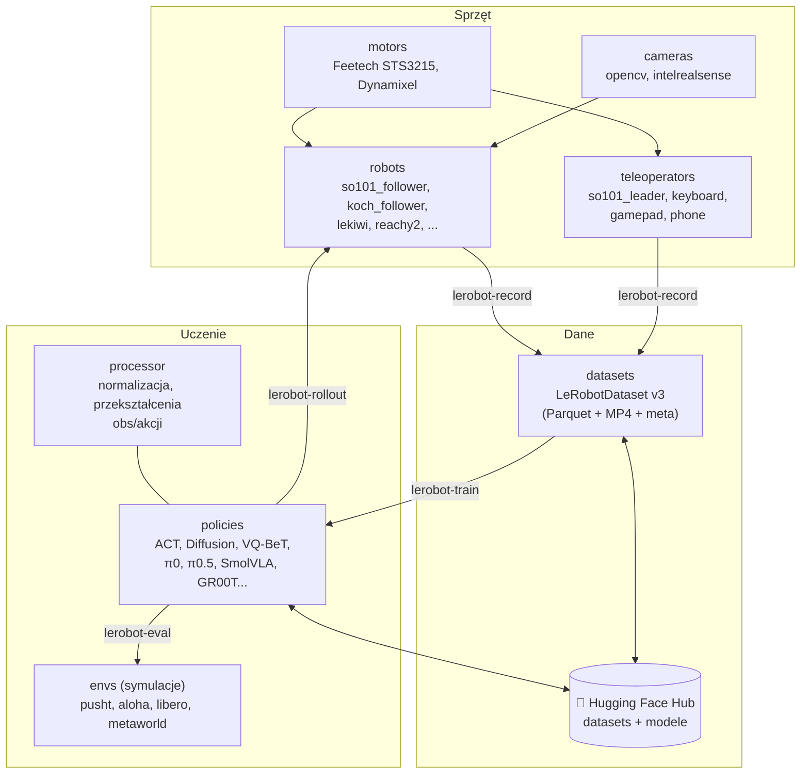

# L1 Czym jest LeRobot — mapa biblioteki

> [!skrot] W 30 sekund
> - **LeRobot** = otwarta biblioteka **Hugging Face** w **PyTorchu** (start: 2024), której celem jest „zrobić dla robotyki to, co `transformers` zrobiło dla NLP”: wspólny format danych, gotowe modele, gotowe skrypty, tani sprzęt, wymiana przez **Hugging Face Hub**.
> - Instalacja: `pip install lerobot` (+ dodatki, np. `lerobot[feetech]` dla silników SO-101). Sprawdzenie: `lerobot-info`.
> - **Klocki:** `robots` (ramiona: SO-100/101, Koch, LeKiwi, Reachy 2, Unitree G1…), `teleoperators` (ramię leader, klawiatura, gamepad, telefon), `cameras` (OpenCV, RealSense), `motors` (Feetech, Dynamixel), `datasets` (**LeRobotDataset**), `policies` (ACT, Diffusion, VQ-BeT, π0, π0-FAST, π0.5, SmolVLA, GR00T, X-VLA…), `envs` (symulacje: Push-T, ALOHA sim, LIBERO, Meta-World), `processor` (potoki przetwarzania obserwacji/akcji).
> - **Komendy CLI:** `lerobot-find-port`, `lerobot-setup-motors`, `lerobot-calibrate`, `lerobot-find-cameras`, `lerobot-teleoperate`, `lerobot-record`, `lerobot-replay`, `lerobot-train`, `lerobot-eval` (symulacja), `lerobot-rollout` (prawdziwy robot), `lerobot-dataset-viz`.
> - Roboty spoza listy (UR5e, Franka, xArm, Piper…) — przez **pluginy** społeczności (`pip install lerobot_robot_<nazwa>`).

> [!intuicja] Po ludzku
> LeRobot to **zestaw IKEA dla robot learningu**: masz instrukcję (dokumentacja), standardowe śrubki (format danych), gotowe meble (wytrenowane modele na Hubie) i tani zestaw startowy (ramię SO-101 za ~kilkaset dolarów/euro z druku 3D). Zamiast pisać własny recorder, własny format i własny trening — używasz wspólnego, a twoje dane od razu da się użyć w każdym modelu z biblioteki i udostępnić innym.

## Architektura biblioteki



## Moduły — co jest czym

| Moduł | Co robi | Przykład w kodzie / CLI |
|---|---|---|
| `lerobot.robots` | Klasa robota: `connect()`, `get_observation()`, `send_action()`, `disconnect()`, kalibracja | `SO101Follower(SO101FollowerConfig(port=..., id=...))` |
| `lerobot.teleoperators` | Urządzenie teleop: `get_action()` | `SO101Leader(...)` |
| `lerobot.cameras` | Kamery z wspólnym API (`async_read()`), OpenCV/V4L2, Intel RealSense | `OpenCVCameraConfig(index_or_path=0, width=640, height=480, fps=30)` |
| `lerobot.motors` | Niskopoziomowa komunikacja z magistralą silników | `FeetechMotorsBus` |
| `lerobot.datasets` | `LeRobotDataset` (czytanie/tworzenie), `StreamingLeRobotDataset` | `LeRobotDataset("lerobot/pusht")` |
| `lerobot.policies` | Implementacje polityk + konfiguracje | `--policy.type=act` |
| `lerobot.processor` | Potoki przetwarzania (normalizacja, zmiana przestrzeni akcji, np. stawy ↔ kartezjańska) | `make_default_processors()` |
| `lerobot.envs` | Środowiska symulacyjne (gymnasium) | `--env.type=pusht` |
| `lerobot.scripts` | Logika komend `lerobot-*` | `lerobot_record.py`, `lerobot_train.py` |

### Wspólny interfejs robota (to jest „kontrakt”)
```python
robot.connect()                      # otwiera port, sprawdza kalibrację
obs = robot.get_observation()        # {"shoulder_pan.pos": 12.3, ..., "front": np.ndarray(H,W,3)}
robot.send_action({"shoulder_pan.pos": 10.0, ..., "gripper.pos": 40.0})
robot.disconnect()
```
Każdy robot deklaruje `observation_features` i `action_features` (nazwy i kształty) — z nich automatycznie powstaje schemat datasetu (`hw_to_dataset_features`). Dlatego nowy robot = nowa klasa z tymi metodami, reszta (nagrywanie, trening) działa bez zmian.

## Konfiguracja — styl `--a.b=c`
LeRobot używa biblioteki **draccus** (konfiguracje jako dataclassy). Każda opcja to ścieżka w drzewie konfiguracji:
```bash
--robot.type=so101_follower --robot.port=/dev/ttyACM0 --robot.id=follower_1
--robot.cameras="{ front: {type: opencv, index_or_path: 0, width: 640, height: 480, fps: 30} }"
--dataset.repo_id=moje_konto/pick_cup --dataset.num_episodes=50 --dataset.single_task="Pick up the cup"
--policy.type=act --policy.device=cuda
```
`--robot.id` to **nazwa egzemplarza** — pod nią zapisuje się plik kalibracji. Używaj **tej samej** w teleoperate, record i rollout.

## Wspierany sprzęt (natywnie + przez pluginy)

| Typ | Natywnie | Przez pluginy społeczności |
|---|---|---|
| Ramiona tanie | **SO-100, SO-101**, Koch v1.1, OMX, OpenARM | — |
| Mobilne | **LeKiwi** (baza 3 kółek omni + SO-ramię, Raspberry Pi), EarthRover | — |
| Humanoidy / zaawansowane | HopeJR, Reachy 2, Unitree G1 | — |
| Przemysłowe / badawcze | — | **UR5e, Franka**, UFACTORY xArm, AgileX Piper, Trossen WidowX, ARX5, YAM |
| Teleop | leader arms, klawiatura, gamepad, telefon | GELLO, SpaceMouse, Meta Quest |

(Lista z README, stan na październik 2026 — zmienia się często.)

## Polityki — co jest w środku

| Grupa | Polityki | Kiedy |
|---|---|---|
| **Imitation learning** | **ACT**, **Diffusion Policy**, VQ-BeT | Jedno zadanie, od zera, mało danych — szybki start |
| **VLA** | **π0, π0-FAST, π0.5**, **SmolVLA**, **GR00T N1.x**, X-VLA i inne | Fine-tuning pretrenowanego modelu, polecenia tekstowe |
| **RL** | HIL-SERL (RL z człowiekiem w pętli), TD-MPC | Douczanie na robocie z nagrodą |
| **Modele nagrody / świata** | (eksperymentalne) | Badania |

Szczegóły modeli: [[V4 Architektury VLA i polityk krok po kroku]].

## Hugging Face Hub — dlaczego to ważne
- Datasety: `https://huggingface.co/datasets/<user>/<nazwa>` — tag **LeRobot**, tysiące datasetów społeczności.
- Wizualizacja online: Space **`lerobot/visualize_dataset`** — wklejasz `repo_id`, oglądasz epizody (wideo + wykresy stanów/akcji).
- Modele: `--policy.path=lerobot/smolvla_base` pobiera wagi z Huba; `--policy.repo_id=...` wysyła twoje.
- Logowanie: `hf auth login` (token z uprawnieniem zapisu).
- Lokalny cache: `~/.cache/huggingface/lerobot/<repo_id>`.

## Historia w pigułce
| Kiedy | Co |
|---|---|
| maj 2024 | Start projektu (Rémi Cadène, wcześniej Tesla Optimus), ACT/Diffusion/TD-MPC, datasety ALOHA/Push-T |
| 2024 | Ramiona Koch, potem **SO-100** (z The Robot Studio), format v2 |
| 2025 | **SO-101**, LeKiwi, π0 i π0-FAST zintegrowane, **SmolVLA**, async inference, **dataset v3.0** (wiele epizodów na plik, streaming), komendy `lerobot-*`, LeRobot 0.4 |
| 2026 | Pluginy sprzętu (UR, Franka…), `lerobot-rollout` ze strategiami (base, sentry, dagger…), RTC, trening w HF Jobs |

## Pytania rekrutacyjne
> [!zadanie] Co to jest LeRobot?
> > [!odpowiedz]- Odpowiedź
> > Otwarta biblioteka Hugging Face w PyTorchu do robot learningu: wspólny format datasetu (LeRobotDataset — Parquet + MP4 + metadane), narzędzia do nagrywania z teleoperacji, implementacje polityk (ACT, Diffusion, π0, SmolVLA…), skrypty treningu i uruchamiania na robocie, wsparcie dla tanich ramion (SO-101) i integracja z Hugging Face Hub.
> > **EN:** *"LeRobot is Hugging Face's open-source PyTorch library for real-world robot learning — a standard dataset format, teleop recording tools, policy implementations like ACT and SmolVLA, and training and deployment scripts, all integrated with the Hub."*

> [!zadanie] Jak dodać nowego robota do LeRobot?
> > [!odpowiedz]- Odpowiedź
> > Napisać klasę robota (i ewentualnie teleoperatora) implementującą wspólny interfejs: konfiguracja, `connect`, `get_observation`, `send_action`, `disconnect`, `observation_features`/`action_features`, opcjonalnie kalibracja — najlepiej jako osobny pakiet-plugin. Wtedy nagrywanie, trening i rollout działają bez zmian.

> [!zadanie] Do czego służy `--robot.id`?
> > [!odpowiedz]- Odpowiedź
> > Identyfikuje konkretny egzemplarz robota — pod tą nazwą zapisywany jest plik kalibracji. Ten sam `id` trzeba podawać przy teleoperacji, nagrywaniu i uruchamianiu polityki, żeby używać tej samej kalibracji.

## Fiszki #fiszki/rozmowa-gd/lerobot
Co to jest LeRobot?::Otwarta biblioteka Hugging Face (PyTorch) do robot learningu: format danych, nagrywanie, polityki, trening, uruchamianie, Hub.
Główne moduły LeRobot?::robots, teleoperators, cameras, motors, datasets, policies, processor, envs.
Komenda do treningu?::lerobot-train
Komenda do nagrywania?::lerobot-record
Uruchamianie polityki na prawdziwym robocie?::lerobot-rollout (lerobot-eval — w symulacji).
Metody interfejsu robota?::connect, get_observation, send_action, disconnect (+ observation_features, action_features).
Biblioteka konfiguracji w LeRobot?::draccus — opcje w stylu --robot.port=...
Gdzie lokalnie leżą datasety LeRobot?::~/.cache/huggingface/lerobot/<repo_id>
Jak obejrzeć dataset online?::Space lerobot/visualize_dataset na Hugging Face.
Polityki IL w LeRobot?::ACT, Diffusion, VQ-BeT.
VLA w LeRobot?::π0, π0-FAST, π0.5, SmolVLA, GR00T i inne.
Jak dodać UR5e/Franka do LeRobot?::Pluginy społeczności (pip install lerobot_robot_<nazwa>).

## Moje notatki
> [!ja] Tu piszesz ty — Albert tej sekcji nie rusza.
