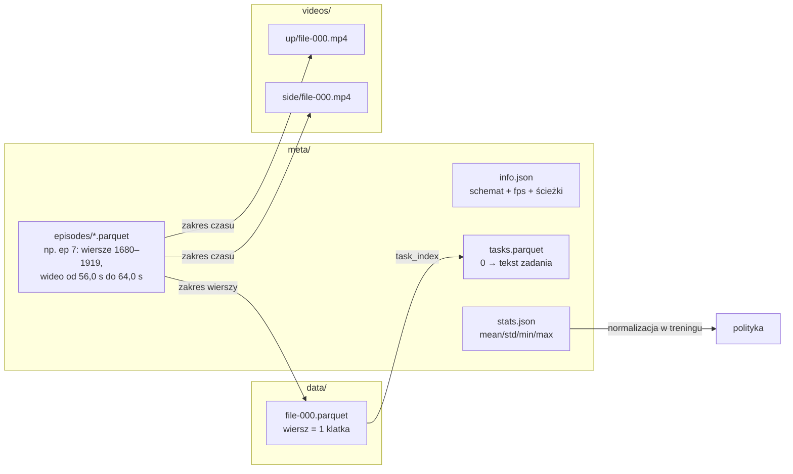

# L2 LeRobotDataset — format od środka

> [!skrot] W 30 sekund
> - **Trzy filary:** (1) **Parquet** — tabela liczb klatka po klatce (stany, akcje, czasy, indeksy); (2) **MP4** — wideo osobno dla każdej kamery (kodek **AV1**, `yuv420p`); (3) **metadane** — `meta/info.json` (schemat, fps, ścieżki), `meta/stats.json` (statystyki do normalizacji), `meta/tasks.parquet` (opisy zadań), `meta/episodes/` (gdzie zaczyna się i kończy każdy epizod).
> - **v3.0** (od LeRobot 0.4): **wiele epizodów w jednym pliku** (`file-000.parquet`, `file-000.mp4`), granice epizodów w metadanych. v2.1: jeden plik na epizod. Zysk: mniej plików, szybsze ładowanie, **streaming** z Huba.
> - Nazwy cech: **`observation.state`**, **`action`**, **`observation.images.<kamera>`**, plus `timestamp`, `frame_index`, `episode_index`, `index`, `task_index`.
> - W Pythonie: `LeRobotDataset("repo/id")[i]` → słownik tensorów PyTorch. **`delta_timestamps`** pobiera okna czasowe (np. 50 przyszłych akcji = chunk).

> [!intuicja] Po ludzku
> Wyobraź sobie **segregator**: (1) **arkusz Excela**, w którym każdy wiersz to 1/30 sekundy — gdzie były stawy, co kazał operator, który to epizod; (2) **pendrive z filmami** z każdej kamery — filmy wielu epizodów sklejone jeden za drugim; (3) **spis treści** na pierwszej stronie: „epizod 7 to wiersze 1680–1919 w arkuszu nr 0 i sekundy 56,0–64,0 w filmie nr 0”, „zadanie nr 0 to *pick up the cube*”, „średnia i rozrzut każdej kolumny”. Biblioteka czyta spis treści i podaje ci dowolną klatkę jak z jednej wielkiej tablicy.

## Układ na dysku (prawdziwy przykład: `lerobot/svla_so101_pickplace`)

```text
svla_so101_pickplace/
├── meta/
│   ├── info.json                         ← schemat, fps, liczniki, szablony ścieżek
│   ├── stats.json                        ← mean/std/min/max (+ kwantyle) każdej cechy
│   ├── tasks.parquet                     ← task_index ↔ tekst zadania
│   └── episodes/chunk-000/file-000.parquet  ← per epizod: długość, zadania, offsety w plikach danych/wideo
├── data/
│   └── chunk-000/file-000.parquet        ← WSZYSTKIE 50 epizodów (11 939 wierszy)
└── videos/
    ├── observation.images.up/chunk-000/file-000.mp4     ← kamera „up”, wszystkie epizody
    └── observation.images.side/chunk-000/file-000.mp4   ← kamera „side”
```
`chunk-XXX` grupuje pliki (do `chunks_size` = 1000 plików na katalog); `file-XXX` to kolejne pliki, gdy poprzedni osiągnie limit rozmiaru (`data_files_size_in_mb: 100`, `video_files_size_in_mb: 500`).



## `meta/info.json` — pole po polu (z prawdziwego datasetu)

```json
{
  "codebase_version": "v3.0",
  "robot_type": "so100_follower",
  "total_episodes": 50,
  "total_frames": 11939,
  "total_tasks": 1,
  "chunks_size": 1000,
  "fps": 30,
  "splits": { "train": "0:50" },
  "data_path":  "data/chunk-{chunk_index:03d}/file-{file_index:03d}.parquet",
  "video_path": "videos/{video_key}/chunk-{chunk_index:03d}/file-{file_index:03d}.mp4",
  "features": {
    "action":            { "dtype": "float32", "shape": [6],
                           "names": ["shoulder_pan.pos","shoulder_lift.pos","elbow_flex.pos",
                                     "wrist_flex.pos","wrist_roll.pos","gripper.pos"] },
    "observation.state": { "dtype": "float32", "shape": [6], "names": ["...te same 6..."] },
    "observation.images.up": { "dtype": "video", "shape": [480, 640, 3],
                               "names": ["height","width","channels"],
                               "info": { "video.codec": "av1", "video.pix_fmt": "yuv420p", "video.fps": 30 } },
    "observation.images.side": { "...": "..." },
    "timestamp":     { "dtype": "float32", "shape": [1] },
    "frame_index":   { "dtype": "int64",   "shape": [1] },
    "episode_index": { "dtype": "int64",   "shape": [1] },
    "index":         { "dtype": "int64",   "shape": [1] },
    "task_index":    { "dtype": "int64",   "shape": [1] }
  }
}
```

| Pole | Znaczenie | Na co patrzysz przy QC |
|---|---|---|
| `codebase_version` | Wersja formatu (`v3.0`) | Czy narzędzia ją obsługują |
| `robot_type` | Typ robota | Czy pasuje do polityki/stanowiska |
| `fps` | Częstotliwość klatek **całego** datasetu | Czy = FPS kamer i nagrywania |
| `total_episodes`, `total_frames` | Liczniki | Średnia długość epizodu: 11 939 / 50 ≈ 239 klatek ≈ **8 s** |
| `features` | Schemat: typ, kształt, **nazwy** wymiarów | Kolejność i nazwy stawów, liczba kamer, rozdzielczość |
| `data_path`, `video_path` | Szablony ścieżek | — |
| `splits` | Podział (zwykle cały „train”) | — |

### Kolumny w `data/*.parquet` — jeden wiersz = jedna klatka
| Kolumna | Przykład | Znaczenie |
|---|---|---|
| `index` | 1680 | Globalny numer klatki w całym datasecie |
| `episode_index` | 7 | Numer epizodu |
| `frame_index` | 0 | Numer klatki **w epizodzie** (od 0) |
| `timestamp` | 0.0333 | Czas w epizodzie [s] = frame_index / fps |
| `task_index` | 0 | Odnośnik do `tasks.parquet` |
| `observation.state` | `[12.1, -45.0, ...]` (6 liczb) | Stan robota (follower) |
| `action` | `[12.5, -44.2, ...]` (6 liczb) | Komenda (leader) |
| `next.reward`, `next.done`, `next.success` | (opcjonalne, RL/symulacja) | np. w `lerobot/pusht` |

**Obrazów nie ma w Parquecie** — są w MP4. Biblioteka dekoduje klatkę wideo o czasie `timestamp` (+ offset epizodu w pliku) — z tolerancją `tolerance_s` (domyślnie ~1e-4 s). Gdy timestampy są niespójne z wideo → błąd przy ładowaniu („timestamps violate tolerance”) — klasyczny sygnał zgubionych klatek.

### Jednostki SO-100/101 — pułapka
Pozycje stawów `*.pos` dla ramion SO **nie są w radianach**: po kalibracji LeRobot mapuje zakres każdego stawu na skalę znormalizowaną (np. −100…100, chwytak 0…100), opcjonalnie stopnie (`use_degrees`). ROS używa **radianów**. Przy łączeniu danych z różnych źródeł — **zawsze sprawdzaj jednostki w `names`/dokumentacji robota**.

## `meta/stats.json`
Dla każdej cechy: `mean`, `std`, `min`, `max`, `count` (w nowszych wersjach także kwantyle). Dla obrazów — statystyki per kanał. Polityka normalizuje wejścia/wyjścia tymi liczbami (`dataset.meta.stats`). Jeden błędny odczyt (np. skok enkodera do 4095) psuje min/max → normalizacja całego wymiaru się „ściska”. To argument za QC przed treningiem.

## Czytanie w Pythonie

```python
from lerobot.datasets import LeRobotDataset

ds = LeRobotDataset("lerobot/svla_so101_pickplace")          # pobiera do ~/.cache/huggingface/lerobot
print(ds.meta.fps, ds.num_episodes, ds.num_frames)           # 30, 50, 11939
print(ds.features.keys())
print(ds.meta.tasks)                                         # tabela zadań

x = ds[100]                                                  # jedna klatka → słownik tensorów
x["observation.state"].shape                                 # torch.Size([6])
x["observation.images.up"].shape                             # torch.Size([3, 480, 640]) — C,H,W, float 0..1
x["task"]                                                    # tekst zadania z tasks.parquet (str)

# tylko wybrane epizody
ds_small = LeRobotDataset("lerobot/svla_so101_pickplace", episodes=[0, 1, 2])
```

### `delta_timestamps` — okna czasowe (jak polityki dostają chunki)
```python
fps = 30
delta = {
    "observation.images.up": [-1/fps, 0.0],                  # bieżąca i poprzednia klatka
    "observation.state":     [-1/fps, 0.0],
    "action": [i / fps for i in range(50)],                  # 50 przyszłych akcji = chunk dla ACT/π0
}
ds = LeRobotDataset("lerobot/svla_so101_pickplace", delta_timestamps=delta)
s = ds[100]
s["action"].shape                                            # torch.Size([50, 6])
s["action_is_pad"]                                           # True tam, gdzie wyszliśmy poza koniec epizodu
```
Polityki same ustawiają `delta_timestamps` z konfiguracji (np. `chunk_size` w ACT). Na końcu epizodu brakujące kroki są **dopełniane** i oznaczane maską `*_is_pad`, żeby nie liczyć z nich straty.

### Streaming bez pobierania
```python
from lerobot.datasets import StreamingLeRobotDataset
ds = StreamingLeRobotDataset("lerobot/svla_so101_pickplace")   # czyta z Huba w locie
```
Trening: `lerobot-train --dataset.repo_id=... --dataset.streaming=true`.

### Tworzenie własnego datasetu (np. z konwersji bagów)
```python
ds = LeRobotDataset.create(repo_id="lab/pick_cup", fps=30, robot_type="ur5e",
                           features={...}, use_videos=True)
for frame in episode_frames:
    ds.add_frame({**frame, "task": "Pick up the cup and put it in the box"})
ds.save_episode()          # po każdym epizodzie
ds.finalize()              # OBOWIĄZKOWO na końcu — zamyka pliki Parquet (inaczej uszkodzone!)
ds.push_to_hub()
```
Pełny szkic konwersji: [[R7 ROS 2 w labie zbierania danych]].

## v2.1 vs v3.0

| | v2.1 | v3.0 |
|---|---|---|
| Plik danych | `data/chunk-000/episode_000007.parquet` (1 epizod = 1 plik) | `data/chunk-000/file-000.parquet` (wiele epizodów) |
| Wideo | `videos/chunk-000/<kamera>/episode_000007.mp4` | `videos/<kamera>/chunk-000/file-000.mp4` |
| Metadane epizodów | `meta/episodes.jsonl` | `meta/episodes/*.parquet` z offsetami |
| Zadania | `meta/tasks.jsonl` | `meta/tasks.parquet` |
| Statystyki | `meta/episodes_stats.jsonl` + agregat | `meta/stats.json` |
| Streaming | ❌ | ✅ `StreamingLeRobotDataset` |
| Konwersja | — | `python -m lerobot.scripts.convert_dataset_v21_to_v30 --repo-id=...` |

**Dlaczego zmiana?** Przy milionach epizodów miliony małych plików zabijają system plików i Hub. Duże pliki + indeks w metadanych skalują się dużo lepiej.

## Rozmiar — liczenie na głos
- 1 epizod 8 s × 30 FPS × 2 kamery 640×480 surowo: $240 \cdot 2 \cdot 921{,}6\text{ kB} \approx 442$ MB.
- W AV1 to zwykle **kilka MB** (kompresja ~50–200×).
- Parquet z 6 floatami: $240 \cdot (6+6) \cdot 4 \text{ B} \approx 11{,}5$ kB — pomijalne. **Prawie cały rozmiar to wideo.**

## Typowe błędy
> [!blad] Brak `finalize()`
> Pliki Parquet bez stopki są uszkodzone — datasetu nie da się wczytać.

> [!blad] Różne FPS kamer a `fps` datasetu
> Kamera daje 25 FPS, a dataset 30 → zduplikowane/brakujące klatki i błędy tolerancji timestampów.

> [!blad] Mieszanie konfiguracji w jednym datasecie
> Inna liczba kamer, inna kolejność stawów, inna kalibracja → schemat się nie zgadza albo (gorzej) zgadza się, ale dane znaczą co innego. Jedna konfiguracja = jeden dataset (lub jawnie opisane wersje).

## Pytania rekrutacyjne
> [!zadanie] Jak wygląda format LeRobotDataset?
> > [!odpowiedz]- Odpowiedź
> > Trzy części: Parquet z danymi niskowymiarowymi klatka po klatce (stan, akcja, timestamp, indeksy epizodu/klatki/zadania), MP4 osobno dla każdej kamery (AV1) i metadane — `info.json` ze schematem i fps, `stats.json` ze statystykami do normalizacji, `tasks` z opisami zadań i `episodes` z granicami epizodów. W v3.0 wiele epizodów jest w jednym pliku, a granice wyznacza metadanych; wspiera streaming z Huba.
> > **EN:** *"Parquet files for states, actions and timestamps, MP4 videos per camera, and metadata — info.json with the schema and fps, stats for normalization, tasks and episode offsets. In v3, many episodes share a file and episode boundaries live in the metadata."*

> [!zadanie] Dlaczego obrazy są w MP4, a nie jako PNG?
> > [!odpowiedz]- Odpowiedź
> > Kompresja wideo wykorzystuje podobieństwo kolejnych klatek — rozmiar spada kilkadziesiąt–kilkaset razy względem surowych klatek, co jest kluczowe przy tysiącach godzin danych i przesyłaniu przez Hub. Kosztem jest dekodowanie przy treningu i kompresja stratna (dlatego istotne są ustawienia kodeka).

> [!zadanie] Co to jest `delta_timestamps`?
> > [!odpowiedz]- Odpowiedź
> > Słownik przesunięć czasowych (w sekundach) dla każdej cechy — dataset zwraca nie jedną wartość, a okno, np. 2 ostatnie klatki obrazu i 50 przyszłych akcji (chunk). Poza granicami epizodu wartości są dopełniane i oznaczane maską `_is_pad`.

> [!zadanie] Co sprawdzisz w nowym datasecie przed treningiem?
> > [!odpowiedz]- Odpowiedź
> > `info.json`: fps, liczba epizodów i klatek, cechy (nazwy stawów, kamery, rozdzielczość); średnią i rozrzut długości epizodów; `stats.json` (dziwne min/max = skoki czujników); czy ładowanie nie zgłasza błędów tolerancji timestampów; zadania w `tasks`; obejrzenie kilku epizodów w wizualizatorze — czy obraz pasuje do ruchu, czy kamery nie są zasłonięte.

## Fiszki #fiszki/rozmowa-gd/lerobot
Trzy filary LeRobotDataset?::Parquet (stany, akcje, czasy), MP4 per kamera, metadane (info, stats, tasks, episodes).
Co nowego w v3.0?::Wiele epizodów w jednym pliku, granice w meta/episodes, streaming z Huba.
Co zawiera meta/info.json?::Wersję, robot_type, fps, liczniki, szablony ścieżek, features (dtype, shape, names).
Po co meta/stats.json?::Statystyki (mean/std/min/max) do normalizacji w treningu.
Gdzie są opisy zadań w v3?::meta/tasks.parquet (task_index ↔ tekst).
Nazwy kluczowych cech?::observation.state, action, observation.images.<kamera>.
Kolumny indeksowe?::index (globalny), episode_index, frame_index, timestamp, task_index.
Kodek wideo w LeRobot?::AV1, yuv420p.
Co robi delta_timestamps?::Zwraca okna czasowe cech, np. 50 przyszłych akcji (chunk).
Co oznacza action_is_pad?::Maska kroków dopełnionych poza końcem epizodu.
Co trzeba wywołać po nagraniu, przed push_to_hub?::dataset.finalize() — inaczej Parquet uszkodzony.
Jednostki stawów SO-101 w LeRobot?::Skala znormalizowana po kalibracji (np. −100…100, chwytak 0…100) lub stopnie — nie radiany.
Konwersja v2.1 → v3.0?::python -m lerobot.scripts.convert_dataset_v21_to_v30 --repo-id=...
Co zajmuje prawie całe miejsce w datasecie?::Wideo.

## Moje notatki
> [!ja] Tu piszesz ty — Albert tej sekcji nie rusza.
