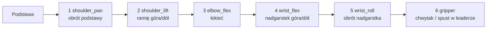
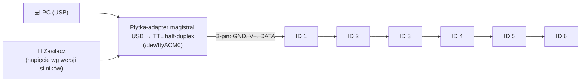
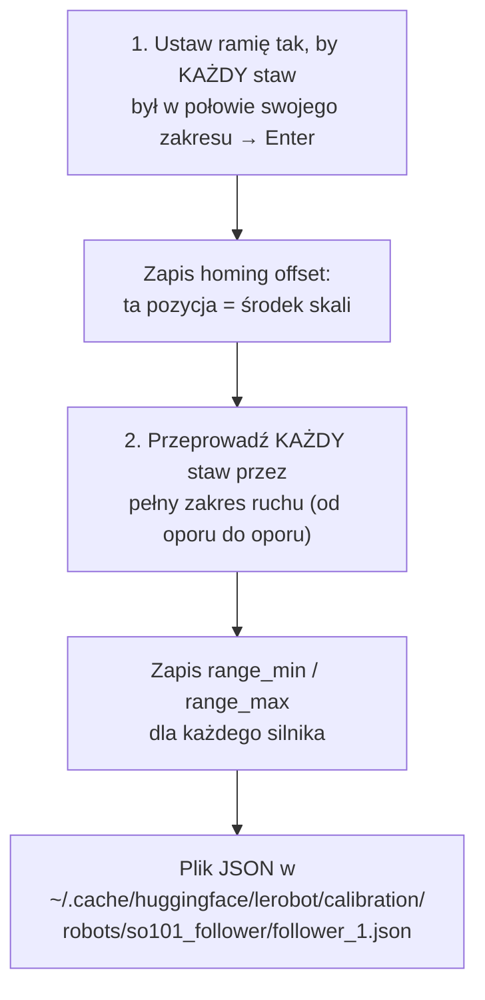

# L3 Sprzęt — SO-101, silniki Feetech, kalibracja, kamery

> [!skrot] W 30 sekund
> - **SO-101** (The Robot Studio + Hugging Face, 2025): drukowane w 3D ramię **5 DOF + chwytak** = 6 serwomotorów. Para **leader** (ręcznie prowadzony przez operatora, z uchwytem/spustem) + **follower** (kopiuje ruchy, nagrywany). Koszt rzędu ~100–150 USD za ramię + druk.
> - Silniki: **Feetech STS3215** — serwa **magistralowe** (wiele na jednym kablu, *daisy chain*), każdy ma **ID** (1–6), wspólna prędkość transmisji (**baudrate**), wbudowany **12-bitowy enkoder magnetyczny** (4096 pozycji/obrót). Follower: przekładnie **1/345**; leader: mieszane (1/191, 1/345, 1/147), żeby był lekki w prowadzeniu, ale utrzymał własny ciężar.
> - Z komputerem łączy je **płytka-adapter magistrali** (np. Waveshare) przez USB → w Linuksie port `/dev/ttyACM0`.
> - Kolejność uruchomienia: `lerobot-find-port` → `lerobot-setup-motors` (nadaj ID, raz) → `lerobot-calibrate` (środek zakresu, potem pełny zakres każdego stawu) → `lerobot-find-cameras` → teleop/nagrywanie.
> - **Kalibracja** sprawia, że leader i follower w tej samej pozycji fizycznej mają **te same liczby** — i że model wytrenowany na jednym SO-101 działa na innym.

> [!intuicja] Po ludzku
> Leader to **lalka-marionetka w twojej ręce**, follower to **prawdziwy aktor**, który robi dokładnie to samo. Ruszasz lalką → czujniki w jej stawach mówią „łokieć na 30%” → aktor ustawia łokieć na 30%. Żeby to działało, obie muszą mieć **tę samą miarkę**: co znaczy 0%, a co 100% dla każdego stawu. To jest kalibracja. Jeśli miarki się różnią, aktor będzie „krzywym lustrem” — i nagrasz krzywe dane.

## Budowa SO-101



| ID | Staw (nazwa w LeRobot) | Follower | Leader (przekładnia) |
|---|---|---|---|
| 1 | `shoulder_pan` | STS3215 1/345 | 1/191 |
| 2 | `shoulder_lift` | 1/345 | 1/345 |
| 3 | `elbow_flex` | 1/345 | 1/191 |
| 4 | `wrist_flex` | 1/345 | 1/147 |
| 5 | `wrist_roll` | 1/345 | 1/147 |
| 6 | `gripper` | 1/345 | 1/147 |

**Dlaczego różne przekładnie w leaderze?** Duże przełożenie (1/345) = silnik trudno obrócić ręką (opór), ale dobrze trzyma ciężar. Mniejsze (1/147) = łatwo prowadzić. Leader ma być **lekki w ręce**, ale ramię nie może opadać pod własnym ciężarem — stąd 1/345 tylko w barku.

### Inne roboty z ekosystemu
| Robot | Silniki | Uwagi |
|---|---|---|
| **SO-100** | Feetech STS3215 | Poprzednik SO-101 (gorsze prowadzenie kabli, inny chwytak leadera) |
| **Koch v1.1** | **Dynamixel** (XL430, XL330) | Droższe, precyzyjniejsze serwa Robotis |
| **LeKiwi** | Feetech + koła omni | Mobilna baza z SO-ramieniem, **Raspberry Pi** na pokładzie, sterowanie przez sieć |
| **ALOHA** (Trossen) | Dynamixel (ViperX/WidowX) | Dwuręczna platforma z pracy o ACT |
| **HopeJR**, Reachy 2, Unitree G1 | różne | Humanoidy/zaawansowane |

## Serwa magistralowe — jak to działa



| Pojęcie | Znaczenie | Typowy problem |
|---|---|---|
| **Magistrala (bus)** | Jeden przewód danych dla wszystkich silników, **pół-dupleks** (na zmianę mówi PC albo silnik) | Luźne złącze w środku łańcucha → „znikają” wszystkie dalsze silniki |
| **ID** | Adres silnika na magistrali (fabrycznie **1**) | Dwa silniki z tym samym ID → kolizje, błędy odczytu. Dlatego `setup-motors` po jednym silniku |
| **Baudrate** | Prędkość transmisji (LeRobot ustawia wspólną dla wszystkich, rzędu 1 Mbit/s) | Silnik z innym baudrate „nie istnieje” dla PC |
| **EEPROM** | Pamięć nieulotna silnika — ID, baudrate, limity zostają po wyłączeniu | Silnik z innego robota ma inne ID/baud → `setup-motors` ponownie |
| **Enkoder 12-bit** | 0–4095 na obrót (~0,088°/krok) | — |
| **Napięcie** | STS3215 występują w wersjach na różne napięcia (np. ~7,4 V i 12 V); zasilacz **musi** pasować do wersji | Złe napięcie → słaby moment albo uszkodzenie |
| **Przeciążenie / temperatura** | Silnik ma zabezpieczenia; przy blokadzie się grzeje i wyłącza moment | Ramię „wiotczeje” — sprawdź, czy coś nie blokuje, odczekaj |

> [!wazne] Waveshare — zworki
> Na płytce Waveshare zworki muszą być na kanale **B (USB)**. Inaczej komputer nie rozmawia z silnikami — klasyczny błąd przy pierwszym uruchomieniu.

## Krok 1: Znajdź port
```bash
lerobot-find-port
# wypisze porty, poprosi o odłączenie USB ramienia, porówna listy → "The port of this MotorsBus is /dev/ttyACM1"
```
Linux — uprawnienia do portu:
```bash
sudo chmod 666 /dev/ttyACM0                # szybko, ale do restartu / ponownego podłączenia
sudo usermod -aG dialout $USER             # na stałe (wyloguj się i zaloguj ponownie)
ls -l /dev/serial/by-id/                   # STAŁA nazwa po numerze seryjnym — lepsza niż ttyACM0/1!
```
> [!przyda] `/dev/ttyACM0` vs `/dev/serial/by-id/...`
> Numer `ACM0/ACM1` zależy od **kolejności podłączenia** — po restarcie leader i follower mogą się zamienić! W labie używasz `/dev/serial/by-id/usb-...` albo **reguły udev** z własną nazwą (`/dev/so101_follower`). Patrz [[15 Linux i wiersz poleceń]].

## Krok 2: Nadaj ID silnikom (raz na życie silnika)
```bash
lerobot-setup-motors --robot.type=so101_follower --robot.port=/dev/ttyACM0
lerobot-setup-motors --teleop.type=so101_leader  --teleop.port=/dev/ttyACM1
```
Skrypt prosi: „Connect the controller board to the 'gripper' motor only and press enter” → ustawia ID 6 → potem `wrist_roll` (5) … aż do `shoulder_pan` (1). **Zawsze tylko jeden silnik podłączony** w danej chwili. Po zakończeniu łączysz łańcuch.

## Krok 3: Kalibracja

```bash
lerobot-calibrate --robot.type=so101_follower --robot.port=/dev/ttyACM0 --robot.id=follower_1
lerobot-calibrate --teleop.type=so101_leader --teleop.port=/dev/ttyACM1 --teleop.id=leader_1
```



| Pole w pliku kalibracji (per silnik) | Znaczenie |
|---|---|
| `id` | ID na magistrali |
| `drive_mode` | Kierunek (czy odwrócić znak) |
| `homing_offset` | Przesunięcie, by środek zakresu był „zerem” |
| `range_min`, `range_max` | Surowe odczyty enkodera na końcach zakresu → skala znormalizowana |

**Po co?** Każdy egzemplarz jest złożony trochę inaczej (pozycja orczyka/horn na wałku). Bez kalibracji „łokieć 2048” w leaderze i followerze to różne kąty. Z kalibracją: ta sama poza fizyczna = te same liczby → teleop jest wierny, a **datasety z różnych SO-101 są zgodne** (model przenośny).

> [!blad] Najczęstsze błędy kalibracji
> - Nie przeprowadzono stawu przez **pełny** zakres → zakres obcięty, robot nie dojedzie do krańca.
> - Inne `id` przy nagrywaniu niż przy kalibracji → LeRobot nie znajdzie pliku i każe kalibrować ponownie (albo użyje złego).
> - Przekalibrowanie followera w połowie zbierania datasetu bez notatki → dane przed/po różnią się po cichu.

## Kamery

```bash
lerobot-find-cameras opencv          # lista kamer UVC (indeksy/ścieżki /dev/videoN) + zapisuje próbne klatki
lerobot-find-cameras realsense       # kamery Intel RealSense (po numerze seryjnym)
v4l2-ctl --list-devices              # linuksowo: jakie /dev/videoN należą do której kamery
v4l2-ctl -d /dev/video0 --list-formats-ext   # jakie rozdzielczości i FPS obsługuje
```
Konfiguracja w komendzie:
```bash
--robot.cameras="{ wrist: {type: opencv, index_or_path: /dev/video2, width: 640, height: 480, fps: 30},
                   top:   {type: intelrealsense, serial_number_or_name: 233522074606, width: 640, height: 480, fps: 30} }"
```
| Wskazówka | Dlaczego |
|---|---|
| Ścieżka/`by-id` zamiast indeksu `0` | Indeksy zmieniają się po restarcie |
| Rozdzielczość i FPS **wspierane** przez kamerę (MJPG dla 30 FPS po USB 2) | Inaczej kamera po cichu da mniej FPS |
| Kamery na **osobnych kontrolerach USB 3** | Przepustowość; `lsusb -t` |
| Ręczna ekspozycja / balans bieli | Stały wygląd obrazów między epizodami |
| Nazwy kamer **stałe** (`wrist`, `top`) | Stają się kluczami `observation.images.wrist` — zmiana nazwy = inny dataset |

## Konserwacja SO-101 (to też praca w labie)
- **Przed sesją:** luzy na stawach (śruby M2/M3), kable w prowadnicach (nie przycięte przy zgięciu), chwytak zamyka się do końca, brak dźwięków „zgrzytania”.
- **Objaw → przyczyna:** „Motor X not found” → kabel/złącze w łańcuchu, zasilanie, ID; skoki odczytu → luźny kabel danych; ramię opada → silnik przegrzany lub uszkodzona przekładnia; drgania → zbyt agresywne nastawy PID / luz mechaniczny.
- **Wymiana silnika:** nowy silnik → `setup-motors` (ID!) → ponowna **kalibracja** → wpis w logu (od którego epizodu nowa kalibracja). Patrz [[20 Dokumentacja, inwentaryzacja i log konserwacji]].

## Pytania rekrutacyjne
> [!zadanie] Jak działa teleoperacja leader–follower w SO-101?
> > [!odpowiedz]- Odpowiedź
> > Operator ręcznie prowadzi ramię leader; jego silniki działają jako czujniki pozycji (enkodery). Program w pętli (np. 30 Hz) odczytuje pozycje stawów leadera i wysyła je jako pozycje zadane do followera, który ma włączony moment i je odtwarza. Pozycje leadera są zapisywane jako **akcja**, pozycje followera jako **stan**. Dzięki kalibracji obie mają tę samą skalę.
> > **EN:** *"The operator moves the leader arm by hand; its servos act as position sensors. Each control step we read the leader joint positions and send them as goal positions to the follower. Leader positions are logged as actions, follower positions as the observed state."*

> [!zadanie] Ramię nagle zgłasza „motor 4 not found”. Co sprawdzasz?
> > [!odpowiedz]- Odpowiedź
> > Zasilanie płytki; kabel 3-pin między silnikiem 3 a 4 (i dalej — przy łańcuchu zniknęłyby też 5 i 6); złącza na silniku 4; czy silnik nie jest przegrzany/uszkodzony; port USB i uprawnienia. Jeśli silnik wymieniono — nadać ID (`setup-motors`) i przekalibrować.

> [!zadanie] Po co kalibracja i co się dzieje, gdy ją pominiesz?
> > [!odpowiedz]- Odpowiedź
> > Mapuje surowe odczyty enkoderów na wspólną skalę (środek zakresu i granice per staw), żeby leader i follower — oraz różne egzemplarze robota — miały te same liczby dla tej samej pozy. Bez niej teleop jest „krzywy”, a dataset i modele nie przenoszą się między robotami.

> [!zadanie] Leader i follower zamieniły się portami po restarcie. Jak temu zapobiec?
> > [!odpowiedz]- Odpowiedź
> > Używać stałych ścieżek `/dev/serial/by-id/...` (po numerze seryjnym adaptera) albo reguł udev nadających własne nazwy, zamiast `/dev/ttyACM0/1`, które zależą od kolejności podłączenia.

## Fiszki #fiszki/rozmowa-gd/lerobot
Ile silników ma SO-101 i jakie stawy?::6: shoulder_pan, shoulder_lift, elbow_flex, wrist_flex, wrist_roll, gripper.
Silniki SO-101?::Feetech STS3215 — serwa magistralowe z 12-bitowym enkoderem.
Przekładnie followera SO-101?::Wszystkie 1/345.
Dlaczego leader ma różne przekładnie?::Żeby był lekki w prowadzeniu ręką, a jednocześnie utrzymał własny ciężar (1/345 w barku).
Kolejność komend przy nowym SO-101?::lerobot-find-port → lerobot-setup-motors → lerobot-calibrate → lerobot-find-cameras → teleoperate/record.
Co robi lerobot-setup-motors?::Nadaje unikalne ID i wspólny baudrate każdemu silnikowi (zapis w EEPROM), po jednym silniku.
Przebieg kalibracji SO-101?::Wszystkie stawy w połowie zakresu → Enter → każdy staw przez pełny zakres.
Co zapisuje plik kalibracji?::Per silnik: id, drive_mode, homing_offset, range_min, range_max.
Gdzie jest plik kalibracji?::~/.cache/huggingface/lerobot/calibration/robots|teleoperators/<typ>/<id>.json
Stała nazwa portu w Linuksie?::/dev/serial/by-id/... albo reguła udev.
Uprawnienia do portu szeregowego na stałe?::sudo usermod -aG dialout $USER (+ ponowne logowanie).
Waveshare — typowy błąd?::Zworki nie na kanale B (USB).
Komenda do wykrycia kamer w LeRobot?::lerobot-find-cameras opencv / realsense
Co jest akcją, a co stanem w leader–follower?::Akcja — pozycje leadera; stan — pozycje followera.

## Moje notatki
> [!ja] Tu piszesz ty — Albert tej sekcji nie rusza.
