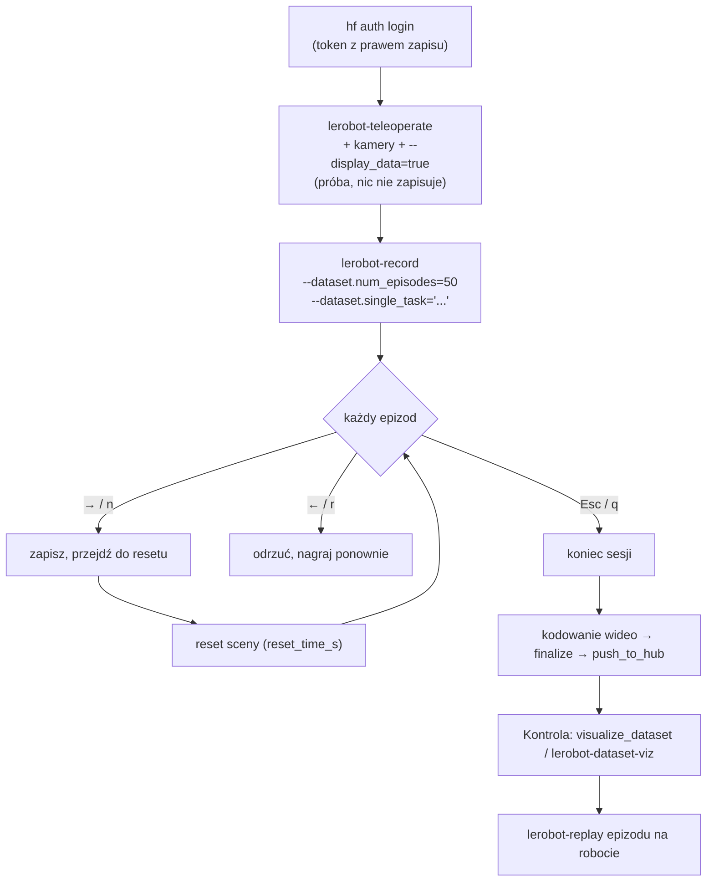
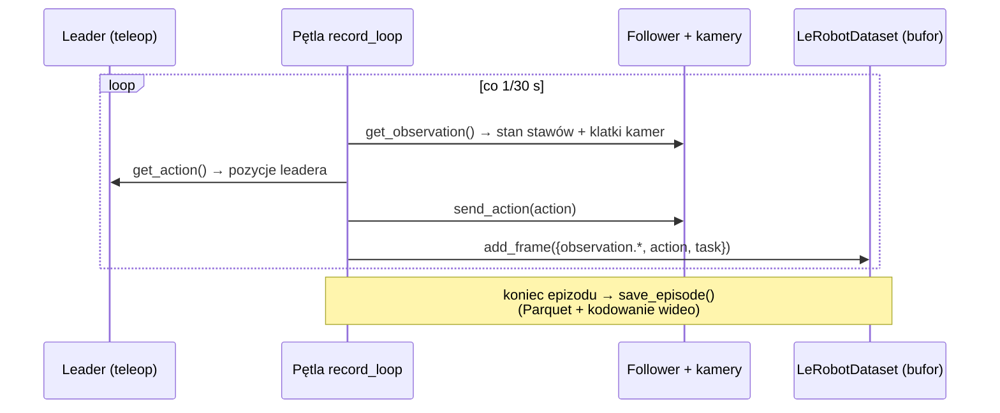

# L4 Nagrywanie datasetu krok po kroku

> [!skrot] W 30 sekund
> - **Najpierw** `lerobot-teleoperate` (bez zapisu) — sprawdzasz, że leader steruje followerem, kamery działają (`--display_data=true` → podgląd w **Rerun**).
> - **Potem** `lerobot-record` — pętla: **epizod** (`episode_time_s`, domyślnie 60 s) → **reset sceny** (`reset_time_s`) → następny… aż `num_episodes`. Na końcu kodowanie wideo, `finalize`, upload na Hub.
> - **Klawisze w trakcie:** **→ / `n`** — zakończ epizod/reset wcześniej i idź dalej; **← / `r`** — odrzuć i nagraj epizod **ponownie**; **Esc / `q`** — zakończ sesję (zakoduj i wyślij).
> - **Wznowienie:** ta sama komenda + `--resume=true`, a `num_episodes` = **ile jeszcze dograć** (nie łącznie!).
> - Po nagraniu: **obejrzyj** (`lerobot-dataset-viz` lub Space `lerobot/visualize_dataset`) i **odtwórz** epizod na robocie (`lerobot-replay`).

> [!intuicja] Po ludzku
> To jak nagrywanie filmików instruktażowych w studiu: najpierw **próba bez nagrywania** (teleoperate) — czy kamery łapią, czy mikrofon działa. Potem **seria ujęć** (record): „akcja!” → robisz zadanie → „cięcie!” → ustawiasz rekwizyty z powrotem (reset) → „akcja!”. Jak ujęcie nie wyszło, mówisz „jeszcze raz” (←) i nagrywasz od nowa — **nie zostawiasz zepsutego ujęcia w filmie**.

## Cały proces



## Krok 0: logowanie do Huba
```bash
hf auth login --token ${HUGGINGFACE_TOKEN} --add-to-git-credential
HF_USER=$(NO_COLOR=1 hf auth whoami | awk -F': *' 'NR==1 {print $2}')
echo $HF_USER
```

## Krok 1: teleoperacja próbna
```bash
lerobot-teleoperate \
  --robot.type=so101_follower --robot.port=/dev/ttyACM0 --robot.id=follower_1 \
  --robot.cameras="{ wrist: {type: opencv, index_or_path: /dev/video2, width: 640, height: 480, fps: 30},
                     top:   {type: opencv, index_or_path: /dev/video4, width: 640, height: 480, fps: 30} }" \
  --teleop.type=so101_leader --teleop.port=/dev/ttyACM1 --teleop.id=leader_1 \
  --display_data=true
```
Co sprawdzasz: follower nadąża bez szarpania; wszystkie stawy w pełnym zakresie; chwytak domyka; obrazy z obu kamer płynne, ostre, dobrze naświetlone; wykresy stawów w Rerun bez skoków.

W Pythonie to dosłownie:
```python
while True:
    action = teleop.get_action()      # pozycje leadera
    robot.send_action(action)         # → follower
```

## Krok 2: nagrywanie
```bash
lerobot-record \
  --robot.type=so101_follower --robot.port=/dev/ttyACM0 --robot.id=follower_1 \
  --robot.cameras="{ wrist: {...}, top: {...} }" \
  --teleop.type=so101_leader --teleop.port=/dev/ttyACM1 --teleop.id=leader_1 \
  --display_data=true \
  --dataset.repo_id=${HF_USER}/pick_cube_bin \
  --dataset.single_task="Pick up the red cube and place it in the bin" \
  --dataset.num_episodes=50 \
  --dataset.episode_time_s=30 \
  --dataset.reset_time_s=15 \
  --dataset.push_to_hub=true
```

| Flaga | Domyślnie | Znaczenie |
|---|---|---|
| `--dataset.repo_id` | — | `użytkownik/nazwa` na Hubie i nazwa katalogu w cache |
| `--dataset.single_task` | — | **Opis zadania** (tekst → `tasks.parquet`) — dla VLA to polecenie! |
| `--dataset.num_episodes` | 50 | Ile epizodów w sesji |
| `--dataset.episode_time_s` | 60 | Maks. długość epizodu (kończysz wcześniej klawiszem →) |
| `--dataset.reset_time_s` | 60 | Czas na przywrócenie sceny |
| `--dataset.fps` | wg kamer/robota | Częstotliwość nagrywania |
| `--dataset.push_to_hub` | true | Wysłanie na Hub po sesji |
| `--dataset.root` | cache | Lokalny katalog (wymagany przy `--resume`) |
| `--dataset.private` | false | Prywatne repozytorium |
| `--resume=true` | — | Dogranie epizodów do istniejącego datasetu |
| `--display_data=true` | — | Podgląd w Rerun |

### Klawisze w trakcie nagrywania
| Klawisz | Działanie |
|---|---|
| **→** lub **`n`** | Zakończ bieżący epizod (lub reset) wcześniej i przejdź dalej |
| **←** lub **`r`** | **Odrzuć** bieżący epizod i nagraj go ponownie |
| **Esc** lub **`q`** | Zakończ sesję: zakoduj wideo, zapisz, wyślij |

Działają na X11, Wayland i przez SSH, jeśli `lerobot-record` działa w **interaktywnym terminalu** z fokusem (litery `n/r/q` jako zapas).

### Co się dzieje w środku jednego kroku (30 Hz)

Obserwacja i akcja z **tej samej iteracji pętli** → synchronizacja „z konstrukcji” (inaczej niż w ROS, gdzie synchronizujesz po stampach — [[R7 ROS 2 w labie zbierania danych]]). Jeśli pętla nie wyrabia 30 Hz (wolny USB, CPU), pojawią się ostrzeżenia o FPS — **to sygnał do zatrzymania i diagnozy**.

## Krok 3: wznowienie i dogrywanie
```bash
# DOGRAJ 20 epizodów (a nie: „łącznie 70”!)
lerobot-record ...te same flagi... \
  --dataset.root=/data/lerobot/pick_cube_bin \
  --dataset.num_episodes=20 \
  --resume=true
```
Zaczęcie od zera: **ręcznie usuń** katalog datasetu (inaczej błąd „already exists”).

## Krok 4: kontrola jakości
```bash
# online: https://huggingface.co/spaces/lerobot/visualize_dataset → wklej ${HF_USER}/pick_cube_bin
lerobot-dataset-viz --repo-id ${HF_USER}/pick_cube_bin --episode-index 0      # lokalnie (Rerun)
lerobot-replay --robot.type=so101_follower --robot.port=/dev/ttyACM0 --robot.id=follower_1 \
  --dataset.repo_id=${HF_USER}/pick_cube_bin --dataset.episode=0
```
`lerobot-replay` wysyła zapisane **akcje** na robota — sprawdza powtarzalność i to, czy akcje „mają sens” (robot powinien z grubsza powtórzyć zadanie, jeśli scena jest ta sama).

Lista kontrolna QC:
- [ ] Liczba epizodów = zamierzona; długości podobne (outliery → obejrzyj).
- [ ] W wideo: obiekt widoczny, brak zasłonięć, ostrość, brak migotania/zmiany ekspozycji.
- [ ] Wykresy stanu i akcji: brak skoków (luźny kabel), chwytak zamyka/otwiera w sensownych momentach.
- [ ] Opis zadania poprawny (literówki w `single_task` trafiają do modelu!).
- [ ] Wpis w logu: operator, stanowisko, konfiguracja, uwagi.

## Dobre praktyki z dokumentacji LeRobot (warto cytować)
- Zacznij od **~50 epizodów**, np. **10 na każdą z 5 pozycji** obiektu.
- **Kamery nieruchome**, **spójny sposób chwytania**.
- Obiekt **widoczny** w kamerach. Reguła kciuka: *„powinieneś umieć wykonać zadanie, patrząc tylko na obrazy z kamer”*.
- **Nie dodawaj za dużo zmienności za szybko** — najpierw niezawodne opanowanie prostej wersji, potem nowe pozycje, techniki, kamery.

## Nagrywanie z API (gdy CLI nie wystarcza)
```python
dataset = LeRobotDataset.create(repo_id="lab/pick_cube_bin", fps=30,
                                features={**action_features, **obs_features},
                                robot_type=robot.name, use_videos=True)
# ... pętla epizodów: record_loop(...) → dataset.save_episode()
# przy re-record: dataset.clear_episode_buffer()
dataset.finalize()
dataset.push_to_hub()
```
Pozwala np. dodać własne sygnały (siła, dotyk), własne metadane, sterowanie start/stop z pedału.

## Inne tryby zbierania danych
| Tryb | Co | Kiedy |
|---|---|---|
| **Klawiatura / gamepad / telefon** jako teleop | `--teleop.type=keyboard` itp. | Brak ramienia leader; bazy mobilne |
| **HIL / DAgger** (`lerobot-rollout --strategy.type=dagger`) | Polityka jedzie, człowiek przejmuje przy błędzie, korekty są nagrywane | Douczanie po pierwszym treningu |
| **Sentry** (`--strategy.type=sentry`) | Ciągłe nagrywanie rolloutów polityki z uploadem | Ewaluacja na dużą skalę |

## Pytania rekrutacyjne
> [!zadanie] Opisz, jak nagrasz dataset 50 epizodów w LeRobot.
> > [!odpowiedz]- Odpowiedź
> > Logowanie do Huba; `lerobot-find-port`, kalibracja leadera i followera; `lerobot-find-cameras`; próba `lerobot-teleoperate` z podglądem; potem `lerobot-record` z robotem, teleopem, kamerami, `repo_id`, opisem zadania, liczbą epizodów i czasami epizodu/resetu. W trakcie → kończy epizod, ← nagrywa ponownie nieudany, Esc kończy. Na końcu dataset jest kodowany, finalizowany i wysyłany; sprawdzam go w wizualizatorze i odtwarzam epizod `lerobot-replay`.
> > **EN:** *"Calibrate both arms, check cameras and do a dry run with lerobot-teleoperate, then run lerobot-record with the task description and episode count — using the arrow keys to finish or re-record episodes — and finally review it in the dataset visualizer and replay an episode."*

> [!zadanie] Epizod się nie udał. Co robisz w LeRobot?
> > [!odpowiedz]- Odpowiedź
> > Wciskam ← (`r`) — epizod jest odrzucany z bufora i nagrywany ponownie, więc nieudane próby nie trafiają do datasetu (chyba że protokół każe je zachować jako oznaczone porażki — wtedy osobny dataset/etykieta).

> [!zadanie] Nagrywanie przerwało się po 30 z 50 epizodów. Jak dograć resztę?
> > [!odpowiedz]- Odpowiedź
> > Ta sama komenda z `--resume=true`, `--dataset.root` wskazującym lokalny katalog i `--dataset.num_episodes=20` — liczba **dodatkowych** epizodów, nie docelowa suma.

> [!zadanie] W logu pojawia się ostrzeżenie, że pętla nie osiąga 30 FPS. Co robisz?
> > [!odpowiedz]- Odpowiedź
> > Przerywam — dane z nierównym FPS psują synchronizację i timestampy. Sprawdzam: obciążenie CPU (`htop`), czy kamery są na USB 3 i osobnych kontrolerach (`lsusb -t`), czy kamera wspiera ustawioną rozdzielczość/FPS (MJPG), wyłączam `--display_data` jeśli podgląd obciąża, liczbę wątków zapisu obrazów, dysk.

## Fiszki #fiszki/rozmowa-gd/lerobot
Klawisz: zakończ epizod wcześniej?::→ (lub n).
Klawisz: nagraj epizod ponownie?::← (lub r).
Klawisz: zakończ sesję?::Esc (lub q) — kodowanie, zapis, upload.
Domyślne episode_time_s i reset_time_s?::60 s i 60 s.
Co oznacza num_episodes przy --resume=true?::Liczbę DODATKOWYCH epizodów do nagrania.
Czym podglądać dane w trakcie teleop?::--display_data=true (Rerun).
Do czego lerobot-replay?::Odtwarza zapisane akcje epizodu na robocie — test powtarzalności i sensowności akcji.
Gdzie obejrzeć dataset online?::Space lerobot/visualize_dataset.
Zalecenie LeRobot na start datasetu?::~50 epizodów, 10 na każdą z 5 pozycji, kamery nieruchome, spójny chwyt.
Reguła kciuka o kamerach?::Powinieneś umieć wykonać zadanie, patrząc tylko na obrazy z kamer.
Dlaczego opis single_task jest ważny?::Trafia do tasks.parquet i jest poleceniem tekstowym dla VLA.
Jak LeRobot synchronizuje obserwację z akcją?::Odczyt obserwacji i akcji w tej samej iteracji pętli (stały FPS).
Logowanie do Huba?::hf auth login (token z prawem zapisu).

## Moje notatki
> [!ja] Tu piszesz ty — Albert tej sekcji nie rusza.
