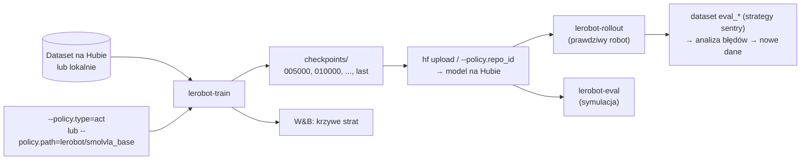
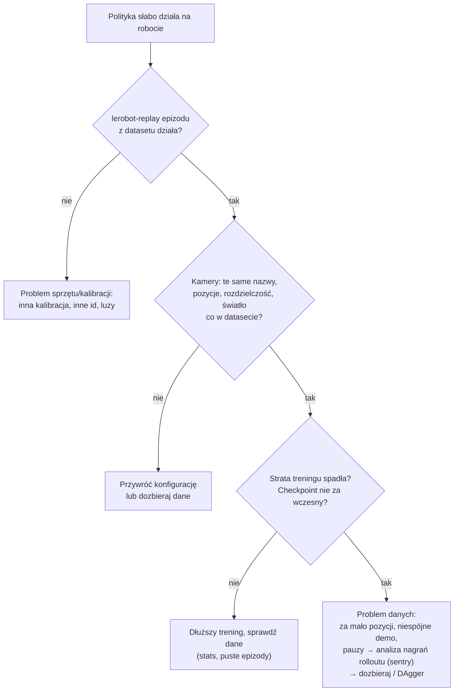

# L5 Trening i ewaluacja polityk w LeRobot

> [!skrot] W 30 sekund
> - **Trening:** `lerobot-train --dataset.repo_id=... --policy.type=act --output_dir=outputs/train/... --policy.device=cuda`. Polityka **sama dopasowuje się** do liczby stawów i kamer z `info.json`. Checkpointy: `outputs/train/<job>/checkpoints/<krok>/pretrained_model/` (+ `last`).
> - **Fine-tuning VLA:** zamiast `--policy.type` podajesz pretrenowane wagi: `--policy.path=lerobot/smolvla_base` (albo π0 / π0.5).
> - **Wznowienie:** `--config_path=.../checkpoints/last/pretrained_model/train_config.json --resume=true`. Logi: `--wandb.enable=true`. Chmura: `--job.target=a10g-small` (Hugging Face Jobs).
> - **Na robocie:** `lerobot-rollout --policy.path=... --robot.type=... --task="..."` ze strategią: `base` (tylko jazda), `sentry` (nagrywanie + upload), `highlight`, `dagger` (człowiek w pętli), `episodic`. Dla wolnych VLA: `--inference.type=rtc`.
> - **W symulacji:** `lerobot-eval --policy.path=... --env.type=pusht|aloha|libero --eval.n_episodes=50` → success rate + wideo.

> [!intuicja] Po ludzku
> `lerobot-train` to **kurs**: dajesz podręcznik (dataset) i wybierasz rodzaj ucznia (ACT, Diffusion, SmolVLA…). Co jakiś czas uczeń zapisuje **zeszyt** (checkpoint). `lerobot-rollout` to **egzamin praktyczny** na prawdziwym robocie, `lerobot-eval` — **egzamin próbny** w symulatorze. Fine-tuning VLA to zatrudnienie absolwenta z doświadczeniem (pretrenowany model) zamiast uczenia ucznia od zera.

## Przepływ



## Trening od zera — ACT na własnym datasecie
```bash
lerobot-train \
  --dataset.repo_id=${HF_USER}/pick_cube_bin \
  --policy.type=act \
  --output_dir=outputs/train/act_pick_cube \
  --job_name=act_pick_cube \
  --policy.device=cuda \
  --wandb.enable=true \
  --policy.repo_id=${HF_USER}/act_pick_cube
```
| Flaga | Znaczenie |
|---|---|
| `--policy.type` | `act`, `diffusion`, `vqbet`, `pi0`, `pi05`, `smolvla`, `groot`, … — ładuje domyślną konfigurację |
| `--policy.device` | `cuda` (NVIDIA), `mps` (Apple), `cpu` |
| `--steps` | Liczba kroków treningu (ACT domyślnie rzędu 100 tys.) |
| `--batch_size` | Rozmiar batcha |
| `--save_freq` | Co ile kroków checkpoint |
| `--policy.push_to_hub` | Domyślnie wysyła model po treningu (`false` — nie wysyłaj) |
| `--dataset.streaming=true` | Trening bez pobierania datasetu |
| `--job.target=a10g-small` | Uruchom na GPU w chmurze HF (Jobs); `hf jobs logs <id>` |

**Struktura wyjścia:**
```text
outputs/train/act_pick_cube/checkpoints/
├── 020000/pretrained_model/    ← config.json, model.safetensors, train_config.json (+ statystyki/processory)
├── 040000/...
└── last -> 100000              ← symlink do ostatniego
```
Wznowienie:
```bash
lerobot-train --config_path=outputs/train/act_pick_cube/checkpoints/last/pretrained_model/train_config.json --resume=true
```
**Czas:** ACT na pojedynczym GPU klasy RTX/A10 — kilka godzin. Bez GPU: Colab / HF Jobs.

### Konfiguracja ACT — parametry, o które mogą zapytać
| Parametr | Domyślnie (rząd) | Znaczenie |
|---|---|---|
| `chunk_size` | 100 | Ile przyszłych akcji przewiduje |
| `n_action_steps` | 100 | Ile z nich wykonuje przed kolejnym wywołaniem |
| `temporal_ensemble_coeff` | wyłączone | Włączenie temporal ensembling (wtedy `n_action_steps=1`) |
| `vision_backbone` | `resnet18` | Enkoder obrazu |
| `use_vae` | true | CVAE (zmienna stylu) |
| `kl_weight` | 10 | Waga członu KL w stracie |

Wartości konkretne sprawdzaj w `configuration_act.py` — zmieniają się między wersjami.

## Fine-tuning VLA — SmolVLA i π0

```bash
# SmolVLA (~450M) — mieści się na pojedynczym konsumenckim GPU
lerobot-train \
  --policy.path=lerobot/smolvla_base \
  --dataset.repo_id=${HF_USER}/pick_cube_bin \
  --batch_size=64 --steps=20000 \
  --output_dir=outputs/train/smolvla_pick_cube \
  --policy.device=cuda --wandb.enable=true
```
```bash
# π0 / π0.5 (~3B) — potrzeba dużo więcej pamięci GPU
lerobot-train --policy.path=lerobot/pi0_base --dataset.repo_id=${HF_USER}/pick_cube_bin ...
```
(Nazwy repozytoriów bazowych — sprawdź na Hubie, organizacja `lerobot`.)

| | ACT od zera | SmolVLA fine-tune | π0 / π0.5 fine-tune |
|---|---|---|---|
| Polecenie tekstowe | ❌ (jedno zadanie) | ✅ | ✅ |
| GPU | małe | średnie (consumer) | duże (≥ 24–80 GB zależnie od trybu) |
| Danych | ~50 epizodów/zadanie | dziesiątki–setki | dziesiątki–setki |
| Generalizacja | wąska | lepsza | najlepsza |
| Szybkość inferencji | szybka | średnia (async/RTC pomaga) | wolniejsza (RTC) |

## Uruchomienie na robocie — `lerobot-rollout`

```bash
lerobot-rollout \
  --strategy.type=base \
  --policy.path=${HF_USER}/act_pick_cube \
  --robot.type=so101_follower --robot.port=/dev/ttyACM0 --robot.id=follower_1 \
  --robot.cameras="{ wrist: {...}, top: {...} }" \
  --task="Pick up the red cube and place it in the bin" \
  --duration=60
```

| `--strategy.type` | Co robi | Kiedy |
|---|---|---|
| `base` | Autonomiczna jazda, bez nagrywania | Szybki test |
| `sentry` | Ciągłe nagrywanie rolloutów + upload co N epizodów (`--dataset.repo_id=.../eval_...`) | Ewaluacja na dużą skalę, analiza błędów |
| `highlight` | Bufor pierścieniowy, zapis ciekawych momentów klawiszem | Łapanie rzadkich błędów |
| `dagger` | Człowiek przejmuje sterowanie przy błędzie; korekty nagrywane | Douczanie (DAgger / HIL) |
| `episodic` | Epizody z fazami resetu | Klasyczna ewaluacja N prób |

- `--inference.type=rtc` — Real-Time Chunking dla wolnych VLA (π0, π0.5, SmolVLA) → płynny ruch.
- `--policy.pretrained_revision=010000` — konkretny checkpoint z Huba (tagowane krokiem).
- **Kamery muszą mieć te same nazwy i ustawienia co w datasecie** (klucze `observation.images.*`), `robot.id` — ta sama kalibracja.

> [!wazne] Bezpieczeństwo pierwszego rolloutu
> Ręka przy wyłączniku zasilania/E-stopie, nikt w zasięgu, scena jak w danych, krótkie `--duration`. Nowa polityka może wykonać nieoczekiwany ruch. Patrz [[14 Bezpieczeństwo pracy z robotami]].

## Ewaluacja w symulacji — `lerobot-eval`
```bash
lerobot-eval --policy.path=lerobot/diffusion_pusht --env.type=pusht --eval.n_episodes=50 --eval.batch_size=10
lerobot-eval --policy.path=lerobot/pi0_libero_finetuned --env.type=libero --env.task=libero_object --eval.n_episodes=10
```
Wynik: `pc_success` (procent sukcesów), średnia nagroda, nagrania wideo w `outputs/eval/...`.

## Diagnoza: „wytrenowałem, a robot nie działa”



## Pytania rekrutacyjne
> [!zadanie] Jak wytrenujesz politykę na nagranym datasecie w LeRobot i uruchomisz ją na robocie?
> > [!odpowiedz]- Odpowiedź
> > `lerobot-train` z `--dataset.repo_id` i `--policy.type=act` (albo `--policy.path` pretrenowanego VLA do fine-tuningu), na GPU, z logowaniem w W&B; checkpointy w `outputs/train/.../checkpoints`. Potem `lerobot-rollout` z `--policy.path`, tym samym robotem (`robot.id` → kalibracja), tymi samymi kamerami i opisem zadania; zaczynam od strategii `base` z krótkim czasem, potem ewaluacja wielu epizodów z nagrywaniem (`sentry`/`episodic`).
> > **EN:** *"lerobot-train with the dataset and policy type — or a pretrained VLA path for fine-tuning — then lerobot-rollout with the same robot id, cameras and task, starting with a short supervised run."*

> [!zadanie] Czym różni się `--policy.type` od `--policy.path`?
> > [!odpowiedz]- Odpowiedź
> > `type` tworzy nową politykę danego rodzaju z domyślną konfiguracją i losowymi wagami (trening od zera; wizja może być pretrenowana, np. ResNet). `path` wczytuje gotowy model (konfigurację + wagi) z Huba lub dysku — do fine-tuningu albo uruchamiania.

> [!zadanie] Co to jest strategia `dagger` w `lerobot-rollout`?
> > [!odpowiedz]- Odpowiedź
> > Zbieranie danych z człowiekiem w pętli: polityka steruje, a gdy się myli, operator przejmuje kontrolę i koryguje; korekty są nagrywane i trafiają do treningu. To praktyczna realizacja DAgger — dane dokładnie z tych stanów, w które polityka trafia.

> [!zadanie] Wytrenowana polityka działa gorzej niż replay. Co sprawdzasz?
> > [!odpowiedz]- Odpowiedź
> > Zgodność konfiguracji z danymi (kamery: nazwy, pozycje, rozdzielczość, ekspozycja; kalibracja i `robot.id`), wybór checkpointu i długość treningu, statystyki normalizacji, a potem dane: pokrycie pozycji, spójność demonstracji, pauzy. Nagrywam rollouty (sentry), żeby zobaczyć, gdzie polityka zawodzi, i dozbieram dane w tych sytuacjach.

## Fiszki #fiszki/rozmowa-gd/lerobot
Minimalny trening ACT?::lerobot-train --dataset.repo_id=... --policy.type=act --policy.device=cuda
Gdzie checkpointy?::outputs/train/<job>/checkpoints/<krok>/pretrained_model (+ last).
Wznowienie treningu?::--config_path=.../checkpoints/last/pretrained_model/train_config.json --resume=true
Fine-tuning SmolVLA?::lerobot-train --policy.path=lerobot/smolvla_base --dataset.repo_id=...
policy.type vs policy.path?::type — nowa polityka z domyślną konfiguracją; path — gotowy model (wagi) z Huba/dysku.
Trening w chmurze HF?::--job.target=a10g-small (Hugging Face Jobs).
Strategie lerobot-rollout?::base, sentry, highlight, dagger, episodic.
Do czego --inference.type=rtc?::Real-Time Chunking — płynna jazda wolnych VLA.
Ewaluacja w symulacji?::lerobot-eval --policy.path=... --env.type=pusht --eval.n_episodes=50 (wynik pc_success).
Warunek poprawnego rolloutu?::Te same nazwy/ustawienia kamer, ten sam robot.id (kalibracja), ten sam opis zadania co w danych.
Pierwszy krok diagnozy słabej polityki?::Sprawdzić, czy lerobot-replay epizodu z datasetu działa (sprzęt/kalibracja).

## Moje notatki
> [!ja] Tu piszesz ty — Albert tej sekcji nie rusza.
